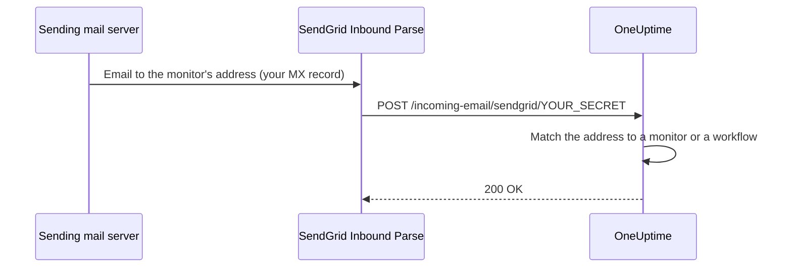

# SendGrid Inbound Email

OneUptime's **Incoming Email Monitor** allows you to create and resolve alerts based on emails sent to unique monitor-specific email addresses. This is useful for integrating with legacy systems, alerting tools, or any service that can send emails.

The same setup lets workflows receive email: a workflow with the **Incoming Email** trigger gets an address of its own on the same domain, and each email to it starts the workflow. See [Triggers](/docs/workflows/triggers#incoming-email).

This guide explains how to set up SendGrid Inbound Parse to forward incoming emails to your self-hosted OneUptime instance. OneUptime Cloud needs none of it: its addresses work out of the box.

:::cards
- [Before you begin](#prerequisites): A SendGrid account, a domain and a public HTTPS address.
- [Set it up](#setup-instructions): Seven steps, from the MX record to a test email.
- [Environment variables](#environment-variables-reference): The three settings, and their defaults.
- [Troubleshooting](#troubleshooting): Emails that never arrive, and webhooks that fail.
:::

## How It Works



1. You create an **Incoming Email Monitor** in OneUptime
2. OneUptime generates a unique email address for that monitor (e.g., `monitor-abc123@inbound.yourdomain.com`)
3. When an email is sent to that address, SendGrid receives it and forwards it to OneUptime via webhook
4. OneUptime evaluates the email against your configured criteria to create or resolve alerts

## Prerequisites

- A SendGrid account with Inbound Parse access
- A domain you control with access to DNS settings
- A public HTTPS endpoint that forwards SendGrid webhooks to your OneUptime instance

## Network Access

Inbound Parse requires SendGrid to initiate a connection to OneUptime. Allowing only outbound internet access from OneUptime is insufficient.

| Direction | Destination | Protocol / port | Purpose |
| --- | --- | --- | --- |
| SendGrid → OneUptime | `https://your-oneuptime-domain.com/incoming-email/sendgrid/YOUR_SECRET` | HTTPS / TCP 443 | Deliver parsed email as a multipart POST. |
| Sending mail servers → SendGrid | `mx.sendgrid.net`, selected by your inbound domain's public MX record | SMTP / TCP 25 | Receive email at SendGrid; this connection does not go to your OneUptime server. |
| OneUptime → SendGrid, only when separately configured to send email using the SendGrid provider | `api.sendgrid.com` | HTTPS / TCP 443 | Send notification emails through the Mail Send API. |

Publish DNS for the webhook hostname and serve a certificate trusted by public clients. A private OneUptime deployment can expose just the webhook path through a public reverse proxy or gateway that can reach OneUptime internally. Preserve the path, secret, content type and multipart request body, and allow the POST through without an interactive login or browser challenge. The OneUptime server does not need an inbound SMTP listener. See [SendGrid's Inbound Parse setup](https://www.twilio.com/docs/sendgrid/for-developers/parsing-email/setting-up-the-inbound-parse-webhook).

Set `INBOUND_EMAIL_WEBHOOK_SECRET` to a strong random value and replace `YOUR_SECRET` in the URL with that value. The route requires the final path segment. OneUptime checks its value when the secret is configured; leaving the variable empty disables that check. Keep the full URL and monitor email addresses private, including in proxy logs. OneUptime does not currently validate SendGrid's signed Inbound Parse headers or OAuth tokens. If you require those mechanisms, configure a gateway that validates them before forwarding to OneUptime, following [SendGrid's webhook security documentation](https://www.twilio.com/docs/sendgrid/for-developers/parsing-email/securing-your-parse-webhooks).

SendGrid does not provide a reliable static source IP list for Inbound Parse. Its outbound email sending IPs and the addresses resolved for `mx.sendgrid.net` are not a webhook allowlist. Follow [SendGrid's firewall guidance](https://support.sendgrid.com/hc/en-us/articles/44375457225371-How-to-Configure-Firewall-Settings-for-SendGrid-Webhook-and-Inbound-Parse-IPs) instead of pinning a current DNS result.

Inbound Parse is separate from outbound email delivery. Receiving monitor emails does not require OneUptime to call the SendGrid API. If you also select SendGrid for sending notifications, permit DNS resolution and outbound HTTPS to `api.sendgrid.com`; [Mail Send](https://www.twilio.com/docs/sendgrid/api-reference/mail-send/mail-send) needs no inbound callback for submission. If you use SMTP instead, allow the SMTP server and port configured in OneUptime.

## Setup Instructions

:::steps
### Choose your inbound email domain

Pick a subdomain dedicated to receiving email for OneUptime, such as `inbound.yourdomain.com`, `email.yourdomain.com` or `monitor.yourdomain.com`. It is used only for email to OneUptime monitors and workflows, so no mailbox of yours lives on it.

### Point its MX record at SendGrid

Add an MX record that routes email for the subdomain to SendGrid:

| Type | Host/Name | Priority | Value |
| --- | --- | --- | --- |
| MX | inbound | 10 | mx.sendgrid.net |

If your domain is `example.com` and you are using `inbound.example.com`, the record reads:

```text
inbound.example.com.  IN  MX  10  mx.sendgrid.net.
```

DNS changes can take up to 48 hours to propagate, but typically complete within a few hours.

### Authenticate the domain in SendGrid

The receiving domain must belong to one of your [authenticated domains in SendGrid](https://www.twilio.com/docs/sendgrid/ui/account-and-settings/inbound-parse). In the [SendGrid Dashboard](https://app.sendgrid.com), go to **Settings** > **Sender Authentication**, click **Authenticate Your Domain**, and add the DNS records it asks for (CNAME records for DKIM).

### Add the Inbound Parse webhook

In the SendGrid Dashboard, go to **Settings** > **Inbound Parse** and click **Add Host & URL**. Fill it in as below, then click **Add**:

| Field | Value |
| --- | --- |
| **Receiving Domain** | Your inbound subdomain (e.g., `inbound.yourdomain.com`) |
| **Destination URL** | `https://your-oneuptime-domain.com/incoming-email/sendgrid/YOUR_SECRET` |
| **Check incoming emails for spam** | Optional - enable if desired |
| **Send raw, full MIME message** | Leave unchecked (not required) |
| **POST the raw, full MIME message** | Leave unchecked (not required) |

### Configure OneUptime

Set the inbound email variables, with the same secret as in the Destination URL:

:::tabs
@tab Docker Compose
```bash title="config.env"
INBOUND_EMAIL_PROVIDER=SendGrid
INBOUND_EMAIL_DOMAIN=inbound.yourdomain.com
INBOUND_EMAIL_WEBHOOK_SECRET=replace-with-a-strong-random-secret
```
@tab Kubernetes
```yaml title="values.yaml"
inboundEmail:
  provider: "SendGrid"
  domain: "inbound.yourdomain.com"
  webhookSecret: "replace-with-a-strong-random-secret"
```
:::

Then apply them: run `npm run start` on Docker Compose, which recreates the containers with the new values, or upgrade the Helm release on Kubernetes.

### Create an Incoming Email monitor

[Create an Incoming Email monitor](/docs/monitor/incoming-email-monitor#creating-an-incoming-email-monitor). Its **Overview** page shows its address, such as `monitor-abc123def456@inbound.yourdomain.com`, and its criteria decide which emails create an alert and which resolve it.

Workflows use the same domain. Add the **Incoming Email** trigger to a workflow and click it: its address (`workflow-…@inbound.yourdomain.com`) is at the top of its settings. Until the inbound email variables above are set, the trigger says the server isn't set up to receive email.

### Send a test email

Send an email to the monitor's address, with a subject that matches its criteria. The monitor's summary shows the email, and an alert is created when the criteria match.
:::

## Environment Variables Reference

| Variable | Helm value | Description | Required | Default |
| --- | --- | --- | --- | --- |
| `INBOUND_EMAIL_PROVIDER` | `inboundEmail.provider` | The inbound email provider. SendGrid is the only one. | No | `SendGrid` |
| `INBOUND_EMAIL_DOMAIN` | `inboundEmail.domain` | The subdomain configured for inbound emails. Incoming email is off until it is set. | Yes | Empty |
| `INBOUND_EMAIL_WEBHOOK_SECRET` | `inboundEmail.webhookSecret` | Secret compared with the final webhook URL segment: `/incoming-email/sendgrid/YOUR_SECRET`. Configure it for public endpoints; an empty value disables validation. | Recommended | Empty |

What an Incoming Email monitor can match on - the subject, the sender, the body, the recipient, and whether an email arrived in time - is in [Available Filter Types](/docs/monitor/incoming-email-monitor#available-filter-types).

## Troubleshooting

:::details Emails are not being received
1. **Check DNS propagation:** `dig MX inbound.yourdomain.com` should return `mx.sendgrid.net`.
2. **Verify SendGrid Inbound Parse settings:** in the SendGrid Dashboard, under **Settings** > **Inbound Parse**, check your domain and webhook URL.
3. **Check OneUptime logs:** look for incoming email webhook requests, and any error, in the logs of the OneUptime `app` service. SendGrid keeps no detailed logs for Inbound Parse, so these are the record of what arrived.
:::

:::details Webhooks are failing
1. **Check the public webhook route:** the full URL, including its secret, must reach OneUptime from the internet. The URL without its final secret segment does not match the route.
2. **Check firewall rules:** allow HTTPS POST requests to the webhook path without login redirects or browser challenges, and do not use SendGrid's email sending IPs as a webhook source allowlist.
3. **Verify the SSL certificate:** use a valid, publicly trusted certificate for the webhook hostname and include its certificate chain.
:::

:::details The monitor does not create alerts
1. **Verify the criteria:** check that your alert creation criteria match the email content, and test with exact strings first before using pattern matching.
2. **Check the monitor:** make sure it is not disabled, and that its type is Incoming Email.
3. **Review the monitor's summary:** check whether the email was received and processed, and read the evaluation logs for how the criteria matched.
:::

:::details The trigger says the server isn't set up to receive email
`INBOUND_EMAIL_DOMAIN` is empty on the server. Set it, apply the change, and open the workflow's trigger again.
:::

## Security Best Practices

1. **Use HTTPS:** Always use HTTPS for your webhook endpoint
2. **Webhook Secret:** Configure `INBOUND_EMAIL_WEBHOOK_SECRET` and include it in your webhook URL (e.g., `/incoming-email/sendgrid/your-secret`) for additional validation
3. **Domain Verification:** Verify your domain in SendGrid for better email security
4. **Restrict Access:** Only create monitors for trusted email sources
5. **Monitor Logs:** Regularly review incoming email logs for suspicious activity

## Next steps

:::cards
- [Incoming Email Monitor](/docs/monitor/incoming-email-monitor): Criteria, address formats and examples.
- [Workflow triggers](/docs/workflows/triggers): Start a workflow from an email.
- [Private Network Access](/docs/self-hosted/private-network-access): What your server may reach on your own network.
- [Architecture](/docs/self-hosted/architecture): Where the webhook lands in a self-hosted install.
:::
