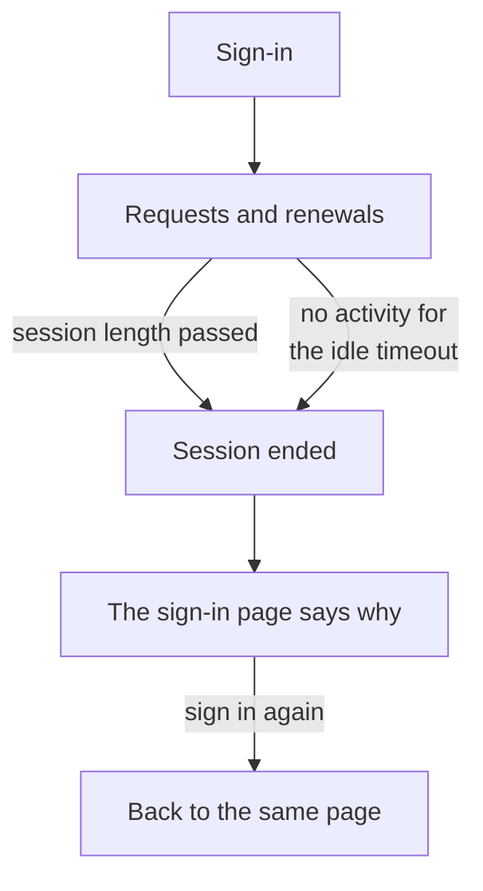

# Session Length

Choose how long people stay signed in to OneUptime before they sign in again: a set time after they sign in, a while without use, or both. It applies to every sign-in to the Dashboard, the Admin Dashboard and the mobile app, with a password, a passkey, Sign in with Microsoft or single sign-on. SSO sign-ins can have lengths of their own.

> [!NOTE]
> Session length is part of the [OneUptime Enterprise Edition](/docs/self-hosted/enterprise). The Community Edition has no **Session Length** page, and every sign-in lasts as [Without a limit](#without-a-limit) describes.

:::cards
- [Set a session length](#set-a-session-length): Two settings in the Admin Dashboard.
- [How a session ends](#how-a-session-ends): What the server counts, and when.
- [SSO sign-ins](#sso-sign-ins): Lengths of their own for single sign-on.
- [What is not a sign-in](#what-is-not-a-sign-in): API keys, MCP connections and status page readers.
:::

## Without a Limit

Until you set a length, a sign-in has none. Its access token lasts 15 minutes and is renewed in the background with a refresh token, which lasts 30 days and starts again every time it is used. Someone who opens OneUptime at least once every 30 days stays signed in; someone who does not signs in again.

## Set a Session Length

:::steps
### Open Session Length
In the Admin Dashboard, open **Settings**, then **Session Length** in the side menu.

### Choose the lengths
- **Sign people out after**: how long a sign-in lasts from the moment someone signs in, however active they are.
- **Sign people out after inactivity**: how long someone may go without clicking, typing or scrolling in OneUptime.

Each choice is saved as soon as you make it.

### Confirm who is signed out
A shorter length applies to everyone signed in now. When it signs people out at once, OneUptime first says how many, and whether you are one of them. Select **Save and sign them out** to go ahead.
:::

| Setting | Choices | Default |
| --- | --- | --- |
| **Sign people out after** | 1 hour to 90 days | **No limit** |
| **Sign people out after inactivity** | 15 minutes to 14 days | 30 days, the longest there is |

Through the API, `sessionLengthInMinutes` takes any whole number of minutes from 15 to 525600 (a year) and `sessionIdleTimeoutInMinutes` from 15 to 43200 (30 days), on the server's global configuration. Empty is the default.

## How a Session Ends

- The server counts both lengths from the session itself: when it signed in, and when its person was last active. It checks them on every request, every renewal and every live update, and never leaves signing out to the browser.
- The idle timeout counts from the last click, key press or scroll in any tab of the Dashboard or the Admin Dashboard. A tab left open does not keep a session alive.
- The mobile app counts as active each time it is used.
- When a session ends, the browser goes to the sign-in page, which says why. After signing in again, the person is taken back to the page they were on.

| Change | What happens to the people signed in now |
| --- | --- |
| A shorter session length or idle timeout | Everyone past it is signed out at once, the others when they reach it |
| A longer one, or none | Nobody is signed out, and sessions last longer from their next renewal |

## SSO Sign-ins

Sign-ins through single sign-on follow the same two settings. To give them lengths of their own, open **More settings** on the **Session Length** page and turn on **Separate lengths for SSO sign-ins**. The two settings under it then apply to sign-ins through a project's SAML or OpenID Connect provider, or the server's own [Global SSO](/docs/identity/global-sso), and the two at the top of the page to every other sign-in.

A project that requires SSO also lets a session in only while its SSO sign-in lasts, which is never longer than the length SSO sign-ins follow.

Through the API, the switch is `useSeparateSsoSessionLengths`, and the lengths of SSO sign-ins are `ssoSessionLengthInMinutes` and `ssoSessionIdleTimeoutInMinutes`, with the same ranges.

## What Is Not a Sign-in

- **API keys** keep the expiry you give them.
- **MCP connections**, AI assistants connected with OAuth, keep their own lifetime. In a project that requires SSO, a connection never outlives the SSO sign-in it was approved with.
- **Private status pages** have a length of their own for their readers: see [Private users](/docs/status-pages/index#private-users).

## Without a License

After the trial or the grace period, with no valid license or one that leaves session lengths out, the lengths cannot be set or changed. Those already set keep signing people out, and you can still remove them. On the Community Edition image, no length applies: the values stay in the database and apply again when you switch back.

## Next Steps

:::cards
- [SSO](/docs/identity/sso): Sign people in with your identity provider.
- [Global SSO](/docs/identity/global-sso): One identity provider for the whole server.
- [Enterprise Edition](/docs/self-hosted/enterprise): What the Enterprise Edition adds, and its license.
:::
