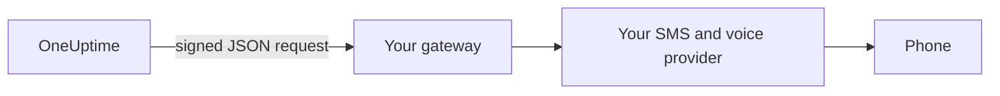

# SMS and Call Gateway

OneUptime can send its SMS and calls through a gateway you run, instead of Twilio. Use it when your rules require every message to go through your own SMS and voice provider, or through a system that checks it before it leaves your network. OneUptime posts each SMS and call to your gateway as a signed JSON request, and your gateway delivers it.

:::cards
- [Set it up](#set-it-up): A URL, and a signing secret made for you.
- [What your gateway receives](#what-your-gateway-receives): One signed JSON request per SMS or call.
- [Act on a page](#act-on-a-page): Acknowledge, escalate or resolve from a call or a reply.
- [Delivery and retries](#delivery-and-retries): What happens when your gateway is down.
:::

## How It Works



The gateway takes the place of the server's own Twilio account, for everything that would go through it: on-call pages, notifications, verification codes and status page subscriber SMS. Projects that add a Twilio config of their own, under **Project Settings > Call & SMS**, still send through that config. Each project's SMS and call switches, and its balance where billing is on, are checked as they are for Twilio.

## Set It Up

:::steps
1. In the Admin Dashboard, go to **Settings > Call and SMS**, and click **Edit Provider** on the **SMS and Call Provider** card.
2. Choose **Your own gateway**, and enter the **Gateway URL**. It can be on your private network.
3. Save. OneUptime makes a signing secret for you. Copy it from the card into your gateway.
4. Click **Send Test**. Your gateway should answer with a 2xx status and send nothing.
:::

To replace the secret, clear **Signing Secret** under **More fields** and save: OneUptime makes a new one. To go back to Twilio, choose **Twilio** and save.

## What Your Gateway Receives

Each SMS and call is one `POST` request with a JSON body and these headers:

| Header | Value |
| --- | --- |
| `Content-Type` | `application/json` |
| `X-OneUptime-Event` | `sms`, `call` or `test` |
| `X-OneUptime-Signature` | `sha256=` followed by the hex HMAC-SHA256 of the body, keyed with the signing secret |
| `User-Agent` | `OneUptime-CallAndSmsGateway/1.0` |

```json title="An on-call page by SMS"
{
  "version": 1,
  "event": "sms",
  "id": "7c5b0d0e-3e5f-4d1a-9a4f-2b8e6c1d9f00",
  "sentAt": "2026-10-27T09:30:00.000Z",
  "to": "+15551234567",
  "message": "OneUptime: A new alert has been created. Alert #42: Database is down…",
  "isSensitive": false,
  "project": {
    "id": "0f6b8c3a-1d2e-4f5a-8b9c-0d1e2f3a4b5c",
    "name": "Production"
  },
  "actions": {
    "acknowledge": "https://oneuptime.example.com/api/custom-notification-channel/page/5f2c…/acknowledge?token=…",
    "escalate": "https://oneuptime.example.com/api/custom-notification-channel/page/5f2c…/escalate?token=…",
    "resolve": "https://oneuptime.example.com/api/custom-notification-channel/page/5f2c…/resolve?token=…"
  }
}
```

| Field | What it is |
| --- | --- |
| `version` | Always `1` for this shape. Fields are only ever added to it. |
| `event` | `sms`, `call` or `test`, as in `X-OneUptime-Event`. |
| `id` | Unique to this message, and the same in every attempt to deliver it: use it to ignore a message you already sent. |
| `sentAt` | When OneUptime sent it, in ISO 8601. |
| `to` | The phone number, in E.164 form. `null` in a test. |
| `message` | The SMS, or what the call says. An SMS is at most 1,600 characters, and a call's text at most 16,384. A longer text is cut and ends with a note that the rest is in OneUptime. |
| `isSensitive` | `true` for a verification code. Keep the message out of your own logs. |
| `project` | The project's `id` and `name`, or `null` when no project sent it. |
| `actions` | For an on-call page, the links that act on it. `null` otherwise. |

A call is described rather than scripted: `message` is what it says, without Twilio's "press 1 to acknowledge". Offer the actions your own way, such as key presses, and call the matching link.

### Check the Signature

Compute the HMAC of the raw request body, before parsing it, and compare it with the header. The check is the same as for a [custom channel](/docs/self-hosted/custom-notification-channels#check-the-signature), so one verifier serves both:

```javascript title="Node.js"
const crypto = require("crypto");

function isFromOneUptime(rawBody, signatureHeader, secret) {
  const expected =
    "sha256=" + crypto.createHmac("sha256", secret).update(rawBody).digest("hex");
  const received = String(signatureHeader || "");

  return (
    received.length === expected.length &&
    crypto.timingSafeEqual(Buffer.from(received), Buffer.from(expected))
  );
}
```

## Act on a Page

When the person answers a call or a reply, your gateway sends a `POST` request to the matching link in `actions`. The links work as a custom channel's do: they need no API key, each carries a token for that one page that is valid for 7 days, and the action is recorded as done by the person who was paged. See [Act on a Page](/docs/self-hosted/custom-notification-channels#act-on-a-page) for each action and the answer.

```bash title="Acknowledge a page"
curl -X POST "https://oneuptime.example.com/api/custom-notification-channel/page/5f2c…/acknowledge?token=…"
```

## Delivery and Retries

A request counts as delivered when your gateway answers with a 2xx status within 10 seconds. A request it did not answer, or answered with 408, 429 or a 5xx status, is sent again after 1 second and after 4 seconds more: three attempts in all. Any other 4xx status is not sent again.

The SMS or call log, and for an on-call page the person's on-call log, says `Sent to the SMS and call gateway (HTTP 200).` or why it was not delivered, never the URL. OneUptime does not learn whether the message reached the phone, so an SMS shows as sent once your gateway accepts it, and the number it went out from is left blank.

## Test Requests

**Send test** sends a request with `event` set to `test`, and `to`, `project` and `actions` set to `null`. Answer it with a 2xx status and send nothing.

## Next steps

:::cards
- [Custom Notification Channels](/docs/self-hosted/custom-notification-channels): Page people through your own app.
- [Push Notifications](/docs/self-hosted/push-notifications): Turn push off for the whole server.
- [Twilio Integration](/docs/self-hosted/twilio-integration): Send through Twilio instead.
- [Private Network Access](/docs/self-hosted/private-network-access): What your server may reach on your own network.
:::
