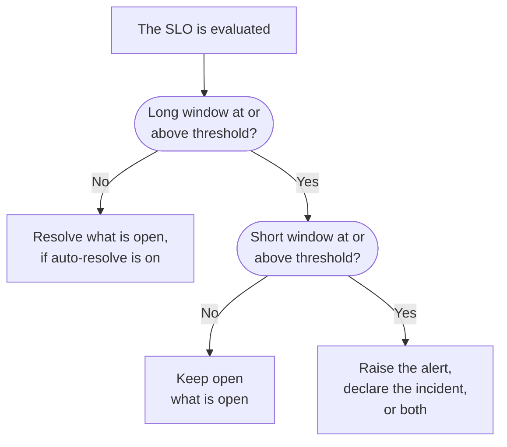

# Burn Rate Alerts and Incidents

Error budgets tell you where you stand; burn rate rules tell you when to get out of bed. When an SLO spends its error budget fast enough to matter, a burn rate rule raises an alert, declares an incident, or both, with your own title and description, severity, owners, labels, on-call escalation and workspace notifications.

:::cards
- [How a rule decides](#how-a-rule-decides-to-fire): Two windows, both over the threshold.
- [Default rules](#default-rules): Fast burn and slow burn, scaled to the SLO's window.
- [Create a rule](#create-or-edit-a-rule): Five steps on the SLO's Burn Rate Rules page.
- [Template variables](#what-each-alert-and-incident-says): Write your own titles and descriptions.
:::

## What burn rate means

Burn rate is how fast you are spending error budget compared with an even pace:

```text
burn rate = (share of time that was bad) ÷ (share of time the target allows to be bad)
```

At a burn rate of 1 you spend the budget exactly over the window, and reach the target with nothing to spare. Higher numbers run out sooner. For a 99.9% SLO over 30 days:

| Burn rate, if it lasts | Budget gone in |
| --- | --- |
| 1 | 30 days |
| 2 | 15 days |
| 6 | 5 days |
| 14.4 | about 2 days (50 hours) |

Burn rate does not depend on how much budget is left. It answers "how bad is it right now?", which is what a decision to page someone needs.

## How a rule decides to fire

OneUptime checks every enabled burn rate rule each time it evaluates the SLO, every 5 minutes. Each rule measures the burn rate over two windows and fires only when both are at or above its threshold:

- The **long window** (for example 1 hour) shows the burn is sustained and significant, not a single failed check.
- The **short window** (for example 5 minutes) shows it is still happening. Without it, a spike an hour ago would keep paging long after recovery.

This is the multi-window, multi-burn-rate pattern from the Google SRE Workbook, and the default OneUptime sets up for you.



A rule cannot fire until the SLO has a full long window of monitoring history: otherwise a monitor's very first failed check, divided by a few minutes of history, would read as an enormous burn rate. So a new SLO cannot fire its **Fast burn** rule for its first hour, or its **Slow burn** rule for its first six. If an SLO later stops having that much history, for example after its monitors are swapped for new ones, the rule resolves what it has open rather than leaving it hanging. A rule does not fire while any of the SLO's monitors is in scheduled maintenance either: see [Scheduled maintenance](#scheduled-maintenance).

## Default rules

Every new SLO gets two burn rate rules. For a 30-day window:

| Rule | Threshold | Long window | Short window | Fires when |
| --- | --- | --- | --- | --- |
| **Fast burn** | 14.4× | 1 hour | 5 minutes | About 2% of the budget burns in an hour: it would be gone in about 2 days. |
| **Slow burn** | 6× | 6 hours | 30 minutes | About 5% of the budget burns in six hours: it would be gone in about 5 days. |

The 14.4× and 6× thresholds are worked out for a 30-day budget, so OneUptime scales them to your SLO's window. Each rule always means "2% of the budget in 1 hour" or "5% of the budget in 6 hours":

| SLO window | Fast burn threshold | Slow burn threshold |
| --- | --- | --- |
| 7 days | 3.36× | 1.4× |
| 28 days | 13.44× | 5.6× |
| 30 days | 14.4× | 6× |
| 90 days | 43.2× | 18× |

Calendar-month SLOs get the 30-day values. The two rules raise an alert at the project's most severe alert severity, with the built-in title and description, resolve it automatically, and add no owners or labels. They do not declare incidents, so upgrading OneUptime never starts declaring incidents on your behalf. Edit them, delete them or add your own.

## Create or edit a rule

You need permission to create SLO burn rate rules.

:::steps
### Open Burn Rate Rules

Open the SLO, go to **Burn Rate Rules** and click **Create SLO Burn Rate Rule**, or edit one of the default rules.

### Name the rule

On **Rule**, enter a **Name**, such as "Fast burn". **Enabled** is on.

### Set the burn window

On **Burn Window**, set the **Burn Rate Threshold** (for example `14.4`), the **Long Window (Minutes)** and **Short Window (Minutes)**, and optionally the **Re-fire Suppression (Minutes)**.

### Choose what it declares

On **What It Declares**, turn on **Create Alert**, **Declare Incident**, or both. **Add SLO Owners as Owners** also makes the SLO's owners owners of everything the rule creates.

### Describe the alert and the incident

The **Alert** and **Incident** steps appear only for what the rule declares. Each has a title and a severity, and folded sections: **Description**, **Ownership & Labels**, **On-Call** and **More fields**, which holds auto-resolve, privacy and remediation notes. New rules start with the built-in title and description, ready to edit. Click **Create SLO Burn Rate Rule** on the last step.
:::

OneUptime checks a rule's numbers when you save it:

| Setting | Must be |
| --- | --- |
| **Burn Rate Threshold** | Greater than 0. |
| **Short Window (Minutes)** | Greater than 0. |
| **Long Window (Minutes)** | Longer than the short window. |
| **Re-fire Suppression (Minutes)** | 0 or more. Empty means the length of the long window. |

A rule must create an alert, declare an incident or both: a rule with both turned off is refused, because it would be checked at every evaluation and never declare anything.

The rules table shows, for each rule, its threshold, its windows and suppression, what it declares (and whether the alert or incident is resolved only by hand, or private), its severities, on-call policies, owners and labels.

> [!TIP]
> A good start: keep the two default rules, send the fast-burn rule to your paging on-call policy at a high severity, and let the slow-burn rule raise a lower-severity alert for working hours. If your team runs everything through incidents, turn on **Declare Incident** for the fast-burn rule, and turn off **Create Alert** on it if you would rather not get both.

## What a rule declares

|  | **Create Alert** | **Declare Incident** |
| --- | --- | --- |
| Starts | On | Off |
| What it is | The light signal: it lands in the alert list. | The heavy one: it takes an incident number and opens the whole response workflow. |
| Title and description | Its own, or the built-in text | Its own, or the built-in text |
| Severity | **Alert Severity**: the project's most severe one if empty | **Incident Severity**: the project's most severe one if empty |
| Escalation | **Alert On-Call Duty Policies** | **Incident On-Call Duty Policies** |
| Owners and labels | **Alert Owners** and **Alert Labels** | **Incident Owners** and **Incident Labels** |
| Private | Off | Off |
| Auto-resolve | On | On |
| Status pages | Never published | Never published |

Because each is set up on its own, you can send a short alert to the owning team's rotation and a detailed incident to your major-incident rotation. They also live separately: each is deduplicated, resolved and suppressed on its own, so resolving the incident does not reset the alert's suppression, or the other way around.

### The SLO is an affected resource

Every alert and incident a burn rate rule creates lists its SLO under **Affected Resources** and links to it. The **Affected Resources** filter of the alert and incident lists narrows them to one SLO, and the SLO's **Alerts** and **Incidents** pages list them, with side menu badges counting the open ones. OneUptime sets this link itself, and editing the alert or incident never removes it.

### Burn rate incidents stay internal

An error budget burning fast is an engineering signal, not a declared outage. A burn rate incident is never shown on status pages and never notifies status page subscribers. It is linked to no monitors either, because resolving it would otherwise rewrite the very monitor status history the SLO is measured from.

If you resolve such an incident by hand, nothing declares it again until the burn recovers and the rule genuinely fires again, so you never fight the rule while you work an incident.

## What each alert and incident says

New rules start with the built-in title and description in both the alert and the incident. Clear a title or a description to go back to the built-in text. The built-in title is:

```text
SLO burn rate: {{sloName}} — {{ruleName}}
```

The built-in description names the rule, gives the burn rate over both windows against the threshold, and the error budget left.

To write your own, use template variables in the title, the description and the remediation notes. Each of those fields lists them under **Template variables**: click one to insert it where the cursor is, or type `{{` in the field and pick one. The description and remediation notes also have **Insert variable** in their toolbar. The variables are filled in when the rule fires:

| Variable | What it holds | Example |
| --- | --- | --- |
| `{{sloName}}` | Name of the SLO. | `Checkout availability` |
| `{{sloId}}` | ID of the SLO. | `b7f4c2d8-1f3e-4a5b-9c6d-7e8f9a0b1c2d` |
| `{{sloLink}}` | Link to the SLO in the OneUptime Dashboard. | `https://oneuptime.com/dashboard/project-id/slos/slo-id` |
| `{{sloStatus}}` | Status of the SLO after this evaluation. | `At Risk` |
| `{{ruleName}}` | Name of the burn rate rule that fired. | `Fast burn` |
| `{{burnRateThreshold}}` | The rule's burn rate threshold (a multiple of the sustainable pace). | `14.4` |
| `{{longWindowBurnRate}}` | Burn rate measured over the rule's long window. | `21.5` |
| `{{shortWindowBurnRate}}` | Burn rate measured over the rule's short window. | `36` |
| `{{longWindowInMinutes}}` | Length of the rule's long window, in minutes. | `60` |
| `{{shortWindowInMinutes}}` | Length of the rule's short window, in minutes. | `5` |
| `{{targetPercentage}}` | The SLO's target, as a percentage. | `99.9` |
| `{{currentSliPercentage}}` | The SLI measured over the SLO's compliance window, as a percentage. | `99.87` |
| `{{errorBudgetRemainingPercentage}}` | Share of the error budget still left, as a percentage. Negative once the budget is overspent. | `42.5` |
| `{{errorBudgetRemaining}}` | Error budget still left, as a duration. Starts with a minus sign once the budget is overspent. | `18m 22s` |
| `{{errorBudgetRemainingMinutes}}` | Error budget still left, in minutes. | `18.37` |
| `{{windowDescription}}` | The SLO's compliance window, in words. | `rolling 30-day window` |

For example, the title `{{ruleName}}: {{sloName}} is burning {{longWindowBurnRate}}x` becomes `Fast burn: Checkout availability is burning 21.5x`.

:::details How the variables are filled in
- Numbers are rounded to two decimals.
- Spaces inside the braces are fine: `{{ sloName }}` works.
- A misspelled variable is left exactly as written, so a typo shows in the alert instead of silently disappearing.
- Titles can be 500 characters long, and descriptions and remediation notes 50,000. A title that grows past 500 characters once its variables are filled in is put on one line and cut short with an ellipsis, so the alert or incident is still created.
- If the link to the SLO cannot be built when the rule fires, `{{sloLink}}` is left empty and the alert or incident is still created.
:::

## Owners, labels and privacy

- **Alert Owners** and **Incident Owners** are people and teams, picked from one list with **Add owner**. They are added to the alert or incident as soon as it is created, and notified. People must be members of the project.
- **Add SLO Owners as Owners** also adds the SLO's owners, its owner users and the members of its owner teams, to everything the rule creates. SLO owners already hear about the SLO's own status changes, so this can notify them twice. It is off by default.
- Each owner is added once: a user who already owns the alert or incident, for example through the project's owner rules, or who is in an owner team being added, is not added again.
- **Alert Labels** and **Incident Labels** are added to the alert or incident, so filters, owner rules and workspace notification rules can match it.
- A private alert or incident is visible only to its owners, project admins and project owners.

Labels, owner teams and on-call policies must belong to the SLO's project.

## Resolution and re-fire suppression

- **Resolution follows the long window.** With auto-resolve on (the default), OneUptime resolves a rule's alert and incident once the long-window burn rate drops below the threshold. Resolving on the short window would flap: a recurring outage would resolve after five quiet minutes and page again all night.
- **Auto-resolve off.** Turn off **Auto Resolve Alert** or **Auto Resolve Incident** and that record stays open until someone resolves it, even after the burn recovers. The rule does not open another one on top of it, and once it is resolved by hand and the long window is below the threshold, the rule can fire again after its suppression.
- **Re-fire suppression.** After a record resolves, the rule does not declare that kind of record again for the suppression period, by default the length of the long window. This gives a recovering system room to recover without paging on what is left of the noise.

Some changes always resolve what a rule has open, whatever its auto-resolve settings say, so nothing is left escalating for a rule that can no longer justify it:

- turning off **Create Alert** or **Declare Incident** closes what that output opened;
- turning the rule off or deleting it;
- turning the SLO's evaluation off, archiving the SLO or deleting it;
- the SLO turning **Paused** or **Misconfigured**, because it then measures nothing;
- the rule losing its threshold or windows, or the SLO no longer having a full long window of history.

## Scheduled maintenance

While any monitor of the SLO is in an ongoing scheduled maintenance event, its burn rate rules raise no alert and declare no incident: planned work should not page anyone. What the rules already have open still resolves as usual. The time still counts toward the error budget, according to the SLO's downtime statuses.

## The SLO feed

The SLO's **Feed** posts every alert a rule raises and every incident it declares, with a link and the burn rates behind it, and when each one resolves, automatically or by hand. A record the rule picks up again because it was still open is not posted twice. Creating, changing and deleting a rule is posted too, and recorded in the SLO's **Audit Logs**. See [SLO Feed and Audit Logs](/docs/slo/feed-and-audit-logs).

## Troubleshooting

:::details A rule did not fire right after I created the SLO
A rule fires only once the SLO has a full long window of monitoring history: an hour for the default fast-burn rule, six hours for the slow-burn rule.
:::

:::details An alert resolved while the outage was still going on
Auto-resolve follows the long window: once the long-window burn rate drops below the threshold, the alert resolves. Give the rule a longer long window, or turn off **Auto Resolve Alert** and resolve the alert by hand.
:::

:::details Nothing fired during a scheduled maintenance event
Burn rate rules stay quiet while any of the SLO's monitors is in an ongoing scheduled maintenance event. The downtime still counts toward the budget.
:::

:::details Is there a minimum sample count?
Not for SLOs measured from monitor uptime. Uptime is measured in seconds, so every second in the window is a sample and there is no low-traffic case to guard against. A minimum sample count matters only for SLIs based on events, which are not available yet.
:::

## Next steps

:::cards
- [Error Budgets](/docs/slo/error-budget): What the budget is, and how long it lasts.
- [Escalation Rules](/docs/on-call/escalation-rules): Who gets paged, and in what order.
- [SLO Feed and Audit Logs](/docs/slo/feed-and-audit-logs): Every alert and incident a rule raised.
:::
