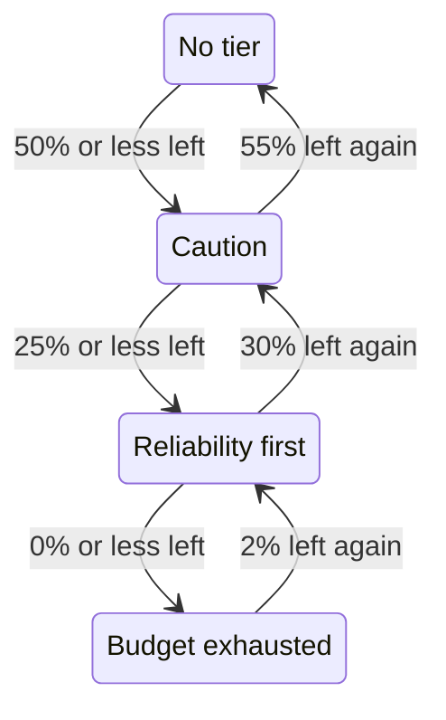

# Error Budget Policy

An error budget policy writes down what your team agreed to do as an SLO's error budget runs down, such as reviewing risky changes once half of it is spent, or freezing releases once all of it is. OneUptime puts the SLO in the tier of the policy its budget has reached, shows the team's agreement for that tier on the SLO's pages, and can raise an alert or declare an incident when the SLO enters a tier. It is the error budget policy practice of the [Google SRE Workbook](https://sre.google/workbook/error-budget-policy/).

:::cards
- [How tiers work](#how-tiers-work): Which tier applies, and when the SLO leaves it.
- [Set up a policy](#set-up-a-policy): Start from the recommended policy, or write your own tiers.
- [Alerts and incidents](#alerts-and-incidents): Page your team when the SLO enters a tier.
- [Read the tier from the API](#read-the-tier-from-the-api): Check the tier from CI and scripts.
:::

## How tiers work

A policy is a set of tiers. Each tier has three fields:

| Field | What it holds |
| --- | --- |
| **Name** | What the team calls the tier, for example "Reliability first". |
| **Budget Left Threshold (%)** | The share of the error budget left at or below which the tier applies. From 0 to 100, decimals allowed. Each tier of an SLO has a threshold of its own. |
| **What We Do** | What the team agreed to do while the SLO is in the tier, in Markdown. Required, up to 10,000 characters. |

A tier applies while the budget left is at or below its threshold, so a tier at 0% is the tier of an exhausted budget. When several tiers apply, the SLO is in the one with the lowest threshold: the most severe. When none applies, the SLO is in no tier. With tiers at 50%, 25% and 0%, an SLO with 30% of its budget left is in the 50% tier, and one with 10% left is in the 25% tier.

### Entering and leaving a tier

The tier follows the budget left the way the SLO's status does:

- Entering a tier is immediate: the evaluation that finds the budget at or below a tier's threshold puts the SLO in it. A budget that falls past several thresholds at once goes straight to the most severe tier.
- Leaving a tier for a less severe one waits until the budget is clearly back. A tier at 0% is left once 2% of the budget is left again. Any other tier is left once the budget is 5 points above its threshold.

So a tier at 0% moves with the **Budget Exhausted** status, and a tier at the SLO's at-risk threshold moves with **At Risk**: see [Status changes and the at-risk threshold](/docs/slo/error-budget#status-changes-and-the-at-risk-threshold). A rolling window that hovers at a threshold does not move the tier back and forth.



## Set up a policy

You need permission to create SLO error budget policy tiers.

:::steps
### Open Error Budget Policy

Open the SLO and go to **Error Budget Policy** in the **Rules** section of its side menu. The page lists the SLO's tiers, each with its name, the budget left it applies at, and what the team does.

### Start from the recommended policy

While the SLO has no tiers, the page offers **Use the recommended policy**. Click it, check the three tiers it lists, and confirm. Then edit each tier's wording into your team's own agreement.

### Or add a tier yourself

Click **Create SLO Error Budget Policy Tier**. Enter a **Name** and a **Budget Left Threshold (%)**, and write the team's agreement in **What We Do**.

### Choose what the tier raises

A tier records and shows the agreement. To page someone as well when the SLO enters it, open the folded alert and incident settings and switch on an alert, an incident or both. Both are off by default. See [Alerts and incidents](#alerts-and-incidents).
:::

Adding, editing or deleting a tier applies right away: OneUptime evaluates the SLO again within about a minute. A tier the budget is already at or below then puts the SLO in it, and the tier raises what it is set to raise. Turning a tier off or deleting it resolves what it raised, and the SLO moves to the tier its budget is in. Switching off a tier's alert or incident resolves that alert or incident.

### The recommended policy

**Use the recommended policy** adds three tiers, at half the budget, a quarter and none:

| Tier | Applies at | What the team does |
| --- | --- | --- |
| **Caution** | 50% left or less | Half of the error budget is spent. Review risky changes before they ship, and find out what has been spending the budget. |
| **Reliability first** | 25% left or less | Reliability comes first. Only reliability improvements and critical fixes ship until the budget recovers. |
| **Budget exhausted** | 0% left or less | The error budget is spent. Freeze non-critical releases: only fixes for this SLO's reliability and security fixes ship until the budget is back. |

None of them raises an alert or declares an incident until you switch that on. It adds only the tiers the SLO does not have: a tier with the same name, or with the same threshold, counts as there, whether it is on or off. So asking for it twice, from a second tab or through the API, adds nothing twice. Each tier it adds is recorded in the SLO's audit logs as added by you.

## Where the tier shows

- The SLO's **Overview** shows the tier it is in and what the team agreed to do there, so everyone who opens the SLO sees the agreement that holds now.
- The **Error budget burn-down** chart draws a labelled line at each tier's threshold, beside the at-risk threshold's.
- The SLO's **Feed** posts every tier change: the tier the SLO left and the tier it entered, the budget left, and what the team agreed to do in the new tier.
- The SLO's **Audit Logs** record each tier change as a change OneUptime made itself, so they show it only with **Store System Events** on: see [Turn audit logs on](/docs/slo/feed-and-audit-logs#turn-audit-logs-on). Adding, editing and removing a tier is recorded as the person who did it.
- The SLO's read API returns the tier: see [Read the tier from the API](#read-the-tier-from-the-api).

## Alerts and incidents

Each tier can raise an alert, declare an incident, or both, when the SLO enters it. They have the options of a burn rate rule's alert and incident: severity, on-call policies, title, description and remediation note templates, privacy, auto-resolve, labels, owner teams and users, and adding the SLO's owners as owners. See [What a rule declares](/docs/slo/burn-rate-alerts#what-a-rule-declares). Both are off by default, so a tier pages no one until you switch one on.

- Entering a more severe tier resolves what the previous tier raised, whatever its auto-resolve setting says, because the new tier supersedes it. So at most one tier's alert and incident are open at a time, and they belong to the tier the SLO is in.
- Recovering to a less severe tier, or out of every tier, resolves them when the tier's auto-resolve is on, as it is by default. With auto-resolve off, they stay open until someone resolves them.
- There is no re-fire suppression. A tier raises again only after the SLO has clearly left it and entered it again, so it cannot flap. If someone resolves what it raised by hand while the SLO is still in the tier, it stays resolved.
- While any monitor of the SLO is in scheduled maintenance, tiers raise nothing. The tier itself still changes, and what is open still resolves. If the SLO is still in the tier when the maintenance ends, the tier raises what it is set to raise then.

Like a burn rate rule's, an alert or incident a tier raises lists the SLO under **Affected Resources**, and an incident is never shown on status pages. The SLO's feed posts each one, and when it resolves.

### What they say

A tier's title, description and remediation notes take template variables, as a rule's do: see [What each alert and incident says](/docs/slo/burn-rate-alerts#what-each-alert-and-incident-says). A tier's fields offer the variables of the SLO and its budget, and three of the tier's own: `{{sloName}}`, `{{sloId}}`, `{{sloLink}}`, `{{sloStatus}}`, `{{policyTier}}`, `{{policyTierThresholdPercentage}}`, `{{policyTierWhatWeDo}}`, `{{targetPercentage}}`, `{{currentSliPercentage}}`, `{{errorBudgetRemainingPercentage}}`, `{{errorBudgetRemaining}}`, `{{errorBudgetRemainingMinutes}}` and `{{windowDescription}}`. A rule's own variables, such as `{{ruleName}}` and the burn rates, are not offered, and are empty in a tier's templates.

The three tier variables work in burn rate rule templates too:

| Variable | What it holds |
| --- | --- |
| `{{policyTier}}` | The name of the tier the SLO is in after the evaluation, or `None` when it is in no tier. |
| `{{policyTierThresholdPercentage}}` | That tier's threshold, such as `25`. Empty when the SLO is in no tier. |
| `{{policyTierWhatWeDo}}` | What the team agreed to do in that tier. Empty when the SLO is in no tier. |

A tier whose title is left empty uses the built-in title:

```text
SLO error budget policy: {{sloName}} — {{policyTier}}
```

The built-in description names the tier, gives the budget left against the tier's threshold, and says what the team agreed to do in it.

## When the budget is not measured

- A **Paused** or **Misconfigured** SLO measures no budget, so its tier stays where it was, and what the tier raised stays open until measuring resumes. Burn rate rules resolve what they have open instead.
- Turning the SLO's evaluation off, or archiving the SLO, resolves what its tiers raised. The tier the SLO is in stays as it was.
- Deleting the SLO deletes its tiers and resolves what they raised.

## Read the tier from the API

The SLO's own read API returns the tier it is in, so a CI job or a script can check it before it acts, for example before a release. All three fields are empty while the SLO is in no tier:

| Field | What it holds |
| --- | --- |
| `currentErrorBudgetPolicyTierId` | The ID of the tier. |
| `currentErrorBudgetPolicyTierName` | The tier's name. |
| `currentErrorBudgetPolicyTierEnteredAt` | When the SLO entered the tier. |

They are read with the SLO's own read permission, the one its budget needs too. For example, with an [API key](/docs/api-reference/api-reference) of the project:

```bash
curl -X POST 'https://oneuptime.com/api/service-level-objective/<slo-id>/get-item' \
  -H "ApiKey: $ONEUPTIME_API_KEY" \
  -H 'Content-Type: application/json' \
  -d '{ "select": { "name": true, "errorBudgetRemainingPercentage": true, "currentErrorBudgetPolicyTierName": true, "currentErrorBudgetPolicyTierEnteredAt": true } }'
```

The tiers themselves are a resource of their own, `/api/service-level-objective-error-budget-policy-tier`, with the list, read, create, change and delete requests every resource has. Two more requests serve the recommended policy. Both take `{ "serviceLevelObjectiveId": "..." }` and answer with the tiers in `tiers`:

| Request | What it does |
| --- | --- |
| `POST /api/service-level-objective-error-budget-policy-tier/recommended-policy` | Lists the recommended tiers the SLO is missing. It writes nothing. |
| `POST /api/service-level-objective-error-budget-policy-tier/recommended-policy/add` | Adds them, and lists what it added. Asking again adds nothing. |

## Permissions

| Permission | Lets a role |
| --- | --- |
| **Read SLO Error Budget Policy Tier** | See an SLO's tiers. |
| **Create SLO Error Budget Policy Tier** | Add tiers, by hand or with **Use the recommended policy**. |
| **Edit SLO Error Budget Policy Tier** | Change tiers, and turn them on or off. |
| **Delete SLO Error Budget Policy Tier** | Remove tiers. |

These permissions are in the SLO group of a role. The Project Owner and Project Admin roles have them all, and the Project Member and Viewer roles can read tiers.

## Not available yet

Some parts of an error budget policy are not available yet: a deployment gate that blocks releases by itself (a CI job can read the tier from the API instead), workflow triggers and Slack or Microsoft Teams notifications for each tier, a policy shared by several SLOs, acknowledging a tier or granting an exception to it, and tiers based on the budget runway rather than the budget left.

## Next steps

:::cards
- [Error Budgets](/docs/slo/error-budget): What the budget is, and how the status follows it.
- [Burn Rate Alerts and Incidents](/docs/slo/burn-rate-alerts): Page your team when the budget burns too fast.
- [SLO Feed and Audit Logs](/docs/slo/feed-and-audit-logs): Every tier change, and what the tiers raised.
:::
