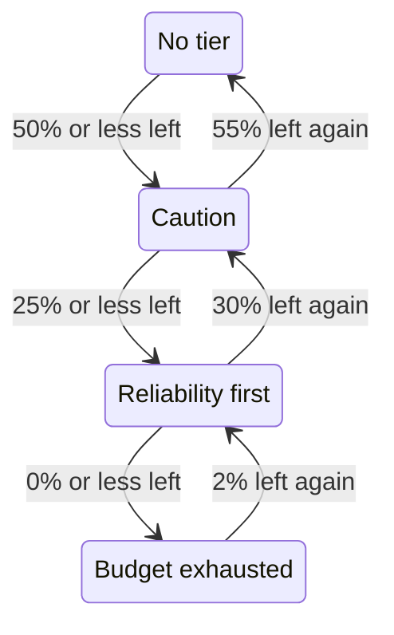

# Error Budget Policy

An error budget policy writes down what your team agreed to do as an SLO's error budget runs down, such as reviewing risky changes once half of it is spent, or freezing releases once all of it is. OneUptime puts the SLO in the tier of the policy its budget has reached, shows the team's agreement for that tier on the SLO's pages, can raise an alert or declare an incident when the SLO enters a tier, posts each tier change to the Slack, Microsoft Teams or Mattermost channels you pick, and tells your CI/CD pipelines whether to hold back releases. It is the error budget policy practice of the [Google SRE Workbook](https://sre.google/workbook/error-budget-policy/).

:::cards
- [How tiers work](#how-tiers-work): Which tier applies, and when the SLO leaves it.
- [Set up a policy](#set-up-a-policy): Start from the recommended policy, or write your own tiers.
- [Alerts and incidents](#alerts-and-incidents): Page your team when the SLO enters a tier.
- [Post to Slack, Microsoft Teams and Mattermost](#post-to-slack-microsoft-teams-and-mattermost): Tell a channel when an SLO enters a tier, without paging anyone.
- [Deployment gate](#deployment-gate): Hold back releases from CI/CD while a tier freezes deployments.
- [Read the tier from the API](#read-the-tier-from-the-api): Check the tier from CI and scripts.
:::

## How tiers work

A policy is a set of tiers. Each tier has three fields:

| Field | What it holds |
| --- | --- |
| **Name** | What the team calls the tier, for example "Reliability first". |
| **Budget Left Threshold (%)** | The share of the error budget left at or below which the tier applies. From 0 to 100, decimals allowed. Each tier of an SLO has a threshold of its own. |
| **What We Do** | What the team agreed to do while the SLO is in the tier, in Markdown. Required, up to 10,000 characters. |

A tier applies while the budget left is at or below its threshold, so a tier at 0% is the tier of an exhausted budget. When several tiers apply, the SLO is in the one with the lowest threshold: the most severe. When none applies, the SLO is in no tier. With tiers at 50%, 25% and 0%, an SLO with 30% of its budget left is in the 50% tier, and one with 10% left is in the 25% tier.

A tier can also freeze deployments while the SLO is in it: see [Deployment gate](#deployment-gate).

### Entering and leaving a tier

The tier follows the budget left the way the SLO's status does:

- Entering a tier is immediate: the evaluation that finds the budget at or below a tier's threshold puts the SLO in it. A budget that falls past several thresholds at once goes straight to the most severe tier.
- Leaving a tier for a less severe one waits until the budget is clearly back. A tier at 0% is left once 2% of the budget is left again. Any other tier is left once the budget is 5 points above its threshold.

So a tier at 0% moves with the **Budget Exhausted** status, and a tier at the SLO's at-risk threshold moves with **At Risk**: see [Status changes and the at-risk threshold](/docs/slo/error-budget#status-changes-and-the-at-risk-threshold). A rolling window that hovers at a threshold does not move the tier back and forth.



## Set up a policy

You need permission to create SLO error budget policy tiers.

:::steps
### Open Error Budget Policy

Open the SLO and go to **Error Budget Policy** in the **Rules** section of its side menu. The page lists the SLO's tiers, each with its name, the budget left it applies at, and what the team does.

### Start from the recommended policy

While the SLO has no tiers, the page offers **Use the recommended policy**. Click it, check the three tiers it lists, and confirm. Then edit each tier's wording into your team's own agreement.

### Or add a tier yourself

Click **Create SLO Error Budget Policy Tier**. Enter a **Name** and a **Budget Left Threshold (%)**, and write the team's agreement in **What We Do**. Switch on **Freeze Deployments** if pipelines should hold back releases while the SLO is in the tier.

### Choose what the tier raises

A tier records and shows the agreement. To page someone as well when the SLO enters it, open the folded alert and incident settings and switch on an alert, an incident or both. Both are off by default. See [Alerts and incidents](#alerts-and-incidents).
:::

Adding, editing or deleting a tier applies right away: OneUptime evaluates the SLO again within about a minute. A tier the budget is already at or below then puts the SLO in it, and the tier raises what it is set to raise. Turning a tier off or deleting it resolves what it raised, and the SLO moves to the tier its budget is in. Switching off a tier's alert or incident resolves that alert or incident.

### The recommended policy

**Use the recommended policy** adds three tiers, at half the budget, a quarter and none:

| Tier | Applies at | What the team does | Deployments |
| --- | --- | --- | --- |
| **Caution** | 50% left or less | Half of the error budget is spent. Review risky changes before they ship, and find out what has been spending the budget. | Allowed |
| **Reliability first** | 25% left or less | Reliability comes first. Only reliability improvements and critical fixes ship until the budget recovers. | Allowed |
| **Budget exhausted** | 0% left or less | The error budget is spent. Freeze non-critical releases: only fixes for this SLO's reliability and security fixes ship until the budget is back. | Frozen |

None of them raises an alert or declares an incident until you switch that on. **Budget exhausted** freezes deployments, as its agreement says, and the confirmation marks it so: see [Deployment gate](#deployment-gate). Tiers added before the gate existed freeze nothing until you switch it on. It adds only the tiers the SLO does not have: a tier with the same name, or with the same threshold, counts as there, whether it is on or off. So asking for it twice, from a second tab or through the API, adds nothing twice. If one of the tiers cannot be added, none is: the SLO is left as it was, and you can try again. Each tier it adds is recorded in the SLO's audit logs as added by you.

## Where the tier shows

- The SLO's **Overview** shows the tier it is in and what the team agreed to do there, so everyone who opens the SLO sees the agreement that holds now. While the tier freezes deployments, a red badge under its name says since when.
- The **Error budget burn-down** chart draws a labelled line at each tier's threshold, beside the at-risk threshold's.
- The SLO's **Feed** posts every tier change: the tier the SLO left and the tier it entered, the budget left, what the team agreed to do in the new tier, and whether the change froze deployments or allowed them again.
- The Slack, Microsoft Teams and Mattermost channels your rules name get the same post: see [Post to Slack, Microsoft Teams and Mattermost](#post-to-slack-microsoft-teams-and-mattermost).
- The SLO's **Audit Logs** record each tier change, and each time deployments are frozen or allowed again, as a change OneUptime made itself, so they show it only with **Store System Events** on: see [Turn audit logs on](/docs/slo/feed-and-audit-logs#turn-audit-logs-on). Adding, editing and removing a tier is recorded as the person who did it.
- The SLO's read API returns the tier, and whether deployments are allowed: see [Read the tier from the API](#read-the-tier-from-the-api) and [Deployment gate](#deployment-gate).

## Alerts and incidents

Each tier can raise an alert, declare an incident, or both, when the SLO enters it. They have the options of a burn rate rule's alert and incident: severity, on-call policies, title, description and remediation note templates, privacy, auto-resolve, labels, owner teams and users, and adding the SLO's owners as owners. See [What a rule declares](/docs/slo/burn-rate-alerts#what-a-rule-declares). Both are off by default, so a tier pages no one until you switch one on.

- Entering a more severe tier resolves what the previous tier raised, whatever its auto-resolve setting says, because the new tier supersedes it. So at most one tier's alert and incident are open at a time, and they belong to the tier the SLO is in.
- Recovering to a less severe tier, or out of every tier, resolves them when the tier's auto-resolve is on, as it is by default. With auto-resolve off, they stay open until someone resolves them.
- There is no re-fire suppression. A tier raises again only after the SLO has clearly left it and entered it again, so it cannot flap. If someone resolves what it raised by hand while the SLO is still in the tier, it stays resolved.
- While any monitor of the SLO is in scheduled maintenance, tiers raise nothing. The tier itself still changes, and what is open still resolves. If the SLO is still in the tier when the maintenance ends, the tier raises what it is set to raise then.

Like a burn rate rule's, an alert or incident a tier raises lists the SLO under **Affected Resources**, and an incident is never shown on status pages. The SLO's feed posts each one, and when it resolves.

### What they say

A tier's title, description and remediation notes take template variables, as a rule's do: see [What each alert and incident says](/docs/slo/burn-rate-alerts#what-each-alert-and-incident-says). A tier's fields offer the variables of the SLO and its budget, and three of the tier's own: `{{sloName}}`, `{{sloId}}`, `{{sloLink}}`, `{{sloStatus}}`, `{{policyTier}}`, `{{policyTierThresholdPercentage}}`, `{{policyTierWhatWeDo}}`, `{{targetPercentage}}`, `{{currentSliPercentage}}`, `{{errorBudgetRemainingPercentage}}`, `{{errorBudgetRemaining}}`, `{{errorBudgetRemainingMinutes}}` and `{{windowDescription}}`. A rule's own variables, such as `{{ruleName}}` and the burn rates, are not offered, and are empty in a tier's templates.

The three tier variables work in burn rate rule templates too:

| Variable | What it holds |
| --- | --- |
| `{{policyTier}}` | The name of the tier the SLO is in after the evaluation, or `None` when it is in no tier. |
| `{{policyTierThresholdPercentage}}` | That tier's threshold, such as `25`. Empty when the SLO is in no tier. |
| `{{policyTierWhatWeDo}}` | What the team agreed to do in that tier. Empty when the SLO is in no tier. |

A tier whose title is left empty uses the built-in title:

```text
SLO error budget policy: {{sloName}} — {{policyTier}}
```

The built-in description names the tier, gives the budget left against the tier's threshold, and says what the team agreed to do in it.

## Post to Slack, Microsoft Teams and Mattermost

A rule can post each change of an SLO's error budget policy to the Slack, Microsoft Teams or Mattermost channels your team reads, without paging anyone: when the SLO enters a tier, recovers to a less severe one or leaves every tier, and when its deployments are frozen or allowed again. Each rule picks the SLOs and the changes it posts. Connect the workspace to the project first: see [Slack](/docs/workspace-connections/slack), [Microsoft Teams](/docs/workspace-connections/microsoft-teams) or [Mattermost](/docs/workspace-connections/mattermost).

:::steps
### Open the SLOs' Workspace section

Go to **SLOs** → **Workspace** → **Slack**, or **Microsoft Teams**, or **Mattermost**. The **Workspace** section lists only the chat workspaces your project has connected.

### Create a rule

Click **Create SLO Notification Rule** and give it a **Rule Name**. Under **Which SLOs**, keep **All SLOs**, or pick **Only SLOs that match conditions** and add conditions: see [What a rule matches](#what-a-rule-matches).

### Pick where it posts

Under **Then, in Slack**, name the channels the rule posts in. In Microsoft Teams, pick a team and its channels, or chats the OneUptime app was added to. An SLO gets no channel of its own, so a rule posts only to channels and chats you already have.
:::

The message says the change in the words of the SLO's **Feed**: the tier the SLO left and the tier it entered, how deployments moved, the error budget left, the new tier's threshold, and what the team agreed to do there, as the team wrote it. A mention in that agreement, such as `<!channel>`, is posted as text and notifies nobody.

- A change is posted once, after the evaluation that made it is saved. An evaluation that is not saved posts nothing, and the next one posts the change.
- Nothing is posted while the SLO stays in its tier, however long the budget hovers at a threshold: see [Entering and leaving a tier](#entering-and-leaving-a-tier).
- Switching **Freeze Deployments** on or off for the tier the SLO is in posts a message of its own.
- A Paused, Misconfigured, disabled or archived SLO keeps its tier, and posts nothing.
- A message that cannot be sent is logged, and the evaluation, the SLO's feed and what the tier raises go on without it.

### What a rule matches

| Condition | What it matches |
| --- | --- |
| **SLOs** | The SLOs you pick, or every SLO but those. |
| **SLO Labels** | The SLO's labels: any of the ones you pick, all of them, or none of them. |
| **SLO Name** | The SLO's name: equal to your text or not, containing it or not, starting or ending with it. |
| **Error Budget Policy Change** | What changed: **Entered a more severe tier**, **Recovered to a less severe tier**, **Left every tier**, **Deployments frozen** or **Deployments allowed again**. |
| **SLO Owner** | The people and teams recorded as the SLO's owners: any of the ones you pick, or none of them. Being in a team that owns the SLO does not count. |

A tier change that froze deployments, or allowed them again, is one message that is both changes. So a rule for **Deployments frozen** also posts the change that entered a tier that freezes them: a release channel hears of every freeze.

## When the budget is not measured

- A **Paused** or **Misconfigured** SLO measures no budget, so its tier stays where it was, and what the tier raised stays open until measuring resumes. Burn rate rules resolve what they have open instead.
- Turning the SLO's evaluation off, or archiving the SLO, resolves what its tiers raised. The tier the SLO is in stays as it was.
- Deleting the SLO deletes its tiers and resolves what they raised.
- In each of these cases the SLO keeps the answer it gave about deployments, because it keeps its tier: see [Deployment gate](#deployment-gate).

## Deployment gate

A tier can freeze deployments. While the SLO is in a tier with **Freeze Deployments** on, the SLO's `deploymentsAllowed` field is `false`, so a CI/CD pipeline that checks it before it releases holds the release back. Otherwise it is `true`: when the SLO has no policy, while its budget is above every tier, and in a tier that does not freeze deployments. The recommended policy's **Budget exhausted** tier freezes deployments.

:::steps
### Switch on Freeze Deployments

Open the SLO's **Error Budget Policy**, edit the tier, switch on **Freeze Deployments** and save. The tier's **Deployments** column in the table says **Frozen**.

### Give the pipeline a key

Create an [API key](/docs/api-reference/api-reference) of the project that can read the SLO, and store it as a secret of the pipeline named `ONEUPTIME_API_KEY`.

### Check the SLO before the release

Add the check below as a step before the one that deploys, with the SLO's ID in place of `<slo-id>`.
:::

:::tabs
@tab Shell
```bash
ALLOWED=$(curl -sS -X POST 'https://oneuptime.com/api/service-level-objective/<slo-id>/get-item' \
  -H "ApiKey: $ONEUPTIME_API_KEY" \
  -H 'Content-Type: application/json' \
  -d '{ "select": { "deploymentsAllowed": true } }' | jq -r '.deploymentsAllowed')
[ "$ALLOWED" = "true" ]
```
@tab GitHub Actions
```yaml title=".github/workflows/deploy.yml"
name: Deploy
on:
  push:
    branches: [main]

jobs:
  deploy:
    runs-on: ubuntu-latest
    steps:
      - uses: actions/checkout@v4
      - name: Stop while the error budget policy freezes deployments
        env:
          ONEUPTIME_API_KEY: ${{ secrets.ONEUPTIME_API_KEY }}
          SLO_ID: <slo-id>
        run: |
          SLO=$(curl -sS -X POST "https://oneuptime.com/api/service-level-objective/$SLO_ID/get-item" \
            -H "ApiKey: $ONEUPTIME_API_KEY" \
            -H 'Content-Type: application/json' \
            -d '{ "select": { "deploymentsAllowed": true, "currentErrorBudgetPolicyTierName": true } }')
          if [ "$(echo "$SLO" | jq -r '.deploymentsAllowed')" != "true" ]; then
            echo "Not deploying: $SLO"
            exit 1
          fi
      - name: Deploy
        run: ./deploy.sh
```
@tab GitLab CI
```yaml title=".gitlab-ci.yml"
error-budget-gate:
  stage: test
  image: alpine:3.20
  variables:
    SLO_ID: <slo-id>
  before_script:
    - apk add --no-cache curl jq
  script:
    - >
      SLO=$(curl -sS -X POST "https://oneuptime.com/api/service-level-objective/$SLO_ID/get-item"
      -H "ApiKey: $ONEUPTIME_API_KEY"
      -H 'Content-Type: application/json'
      -d '{ "select": { "deploymentsAllowed": true, "currentErrorBudgetPolicyTierName": true } }')
    - echo "$SLO"
    - test "$(echo "$SLO" | jq -r '.deploymentsAllowed')" = "true"
```
:::

The check passes only when the answer is `true`. A frozen SLO, an answer without the field (the key cannot read the SLO, or the ID is wrong) and no answer at all each stop the step, so a pipeline never releases on an answer it did not get. In GitLab CI, the job runs in the test stage, so a frozen SLO stops the deploy stage after it; add `ONEUPTIME_API_KEY` as a masked CI/CD variable. On a self-hosted installation, use its own address instead of oneuptime.com.

The SLO answers with two fields, read with the SLO's own read permission:

| Field | What it holds |
| --- | --- |
| `deploymentsAllowed` | `false` while the SLO is in a tier that freezes deployments, `true` otherwise. |
| `deploymentsFrozenAt` | When deployments were frozen. Empty while they are allowed. |

How the answer moves:

- Deployments are frozen by the evaluation that puts the SLO in a tier that freezes them, and allowed again by the one that takes it out, with the tier's own recovery margins: see [Entering and leaving a tier](#entering-and-leaving-a-tier). From one tier that freezes to another, they stay frozen, and `deploymentsFrozenAt` keeps its time.
- Switching **Freeze Deployments** on or off for the tier the SLO is in applies within about a minute. To release before the budget recovers, switch it off: the change is recorded in the SLO's audit logs as yours.
- A **Paused** or **Misconfigured** SLO keeps the answer it had, as it keeps its tier: a maintenance window that pauses every monitor neither lifts a freeze nor starts one. A disabled or archived SLO is not evaluated at all, so it keeps its answer too.
- While deployments are frozen, the SLO's **Overview** shows since when, and its **Feed** says when they are frozen and allowed again.

## Read the tier from the API

The SLO's own read API returns the tier it is in, so a CI job or a script can check it before it acts, for example before a release. All three fields are empty while the SLO is in no tier:

| Field | What it holds |
| --- | --- |
| `currentErrorBudgetPolicyTierId` | The ID of the tier. |
| `currentErrorBudgetPolicyTierName` | The tier's name. |
| `currentErrorBudgetPolicyTierEnteredAt` | When the SLO entered the tier. |

They are read with the SLO's own read permission, the one its budget needs too. For example, with an [API key](/docs/api-reference/api-reference) of the project:

```bash
curl -X POST 'https://oneuptime.com/api/service-level-objective/<slo-id>/get-item' \
  -H "ApiKey: $ONEUPTIME_API_KEY" \
  -H 'Content-Type: application/json' \
  -d '{ "select": { "name": true, "errorBudgetRemainingPercentage": true, "currentErrorBudgetPolicyTierName": true, "currentErrorBudgetPolicyTierEnteredAt": true } }'
```

The tiers themselves are a resource of their own, `/api/service-level-objective-error-budget-policy-tier`, with the list, read, create, change and delete requests every resource has. Two more requests serve the recommended policy. Both take `{ "serviceLevelObjectiveId": "..." }` and answer with the tiers in `tiers`:

| Request | What it does |
| --- | --- |
| `POST /api/service-level-objective-error-budget-policy-tier/recommended-policy` | Lists the recommended tiers the SLO is missing. It writes nothing. |
| `POST /api/service-level-objective-error-budget-policy-tier/recommended-policy/add` | Adds them, and lists what it added. Asking again adds nothing. |

## Permissions

| Permission | Lets a role |
| --- | --- |
| **Read SLO Error Budget Policy Tier** | See an SLO's tiers. |
| **Create SLO Error Budget Policy Tier** | Add tiers, by hand or with **Use the recommended policy**. |
| **Edit SLO Error Budget Policy Tier** | Change tiers, and turn them on or off. |
| **Delete SLO Error Budget Policy Tier** | Remove tiers. |

These permissions are in the SLO group of a role. The Project Owner and Project Admin roles have them all, and the Project Member and Viewer roles can read tiers.

## Not available yet

Some parts of an error budget policy are not available yet: a workflow trigger of its own for each tier, a policy shared by several SLOs, acknowledging a tier or granting an exception to it, and tiers based on the budget runway rather than the budget left. OneUptime does not stop a release by itself: a pipeline that checks `deploymentsAllowed` does, as [Deployment gate](#deployment-gate) shows.

## Next steps

:::cards
- [Error Budgets](/docs/slo/error-budget): What the budget is, and how the status follows it.
- [Burn Rate Alerts and Incidents](/docs/slo/burn-rate-alerts): Page your team when the budget burns too fast.
- [SLO Feed and Audit Logs](/docs/slo/feed-and-audit-logs): Every tier change, and what the tiers raised.
:::
