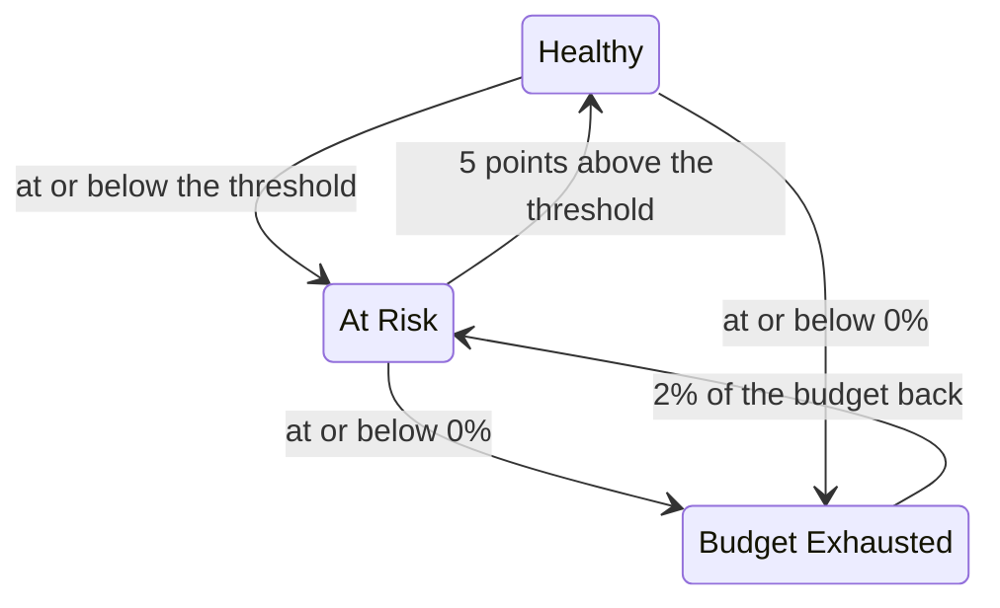

# Error Budgets

The error budget is the downtime an SLO's target allows. A 99.9% target does not mean "never go down": it means "you may be down for up to 43 minutes in 30 days, so spend them wisely". This page explains how OneUptime counts the budget, how long it lasts, how it comes back, and who hears about it.

:::cards
- [How the budget is calculated](#how-the-budget-is-calculated): The formula, and the budget for common targets.
- [Budget runway](#budget-runway): How long the budget lasts at the current pace.
- [How budget recovers](#how-budget-recovers): Rolling windows and calendar months.
- [Owner notifications](#owner-notifications): Who hears when the budget runs low.
:::

## How the budget is calculated

The total budget is the share of the window your target does not promise:

```text
total budget = (100% − target) × window length
```

| Target | 7-day window | 28-day window | 30-day window | 90-day window |
| --- | --- | --- | --- | --- |
| 99% | 1h 40m 48s | 6h 43m 12s | 7h 12m | 21h 36m |
| 99.5% | 50m 24s | 3h 21m 36s | 3h 36m | 10h 48m |
| 99.9% | 10m 5s | 40m 19s | 43m 12s | 2h 9m 36s |
| 99.95% | 5m 2s | 20m 10s | 21m 36s | 1h 4m 48s |
| 99.99% | 1m 0s | 4m 2s | 4m 19s | 12m 58s |

The SLO's **Settings** page shows the budget its objective allows next to the target, for example "43m 12s of downtime per 30-day window".

### The budget of a multi-monitor SLO

In **Any Monitor Down** mode the budget is `(100% − target) × window`, however many monitors the SLO measures: the window is one timeline.

In **Monitor Seconds Average** mode the budget is counted in monitor-seconds, summed over every monitor, so it grows with the number of monitors: a three-monitor 99.9% SLO over 30 days has about 129 minutes of budget rather than 43. The percentages (SLI, budget left, burn rate) mean the same; only the durations change.

### The budget of a calendar month

A calendar-month SLO has the budget of the whole month from the first day: a 99.9% SLO in a 31-day month has all of its 44m 38s on the 1st. The budget is not prorated by how much of the month has passed, so a one-minute outage on the morning of the 1st spends one minute of the month's budget.

## Budget left

As downtime builds up, the **Overview** shows the budget left on its **Error budget left** tile:

- as a percentage of the total, which also decides the SLO's status and fills the bar. The bar has a tick at the SLO's at-risk threshold;
- as a duration, for example "31m 4s left of 43m 12s".

Once the budget is used up, the tile says **No budget left**. Once downtime goes past it, the tile says **Budget exceeded** and shows the overage as time, for example "4d 23m over budget · 5m 47s allowed": the SLO has used all 5 minutes and 47 seconds of its budget, and 4 days and 23 minutes more. The bar stays empty and red.

The budget left is kept as a signed number for calculations and history charts, so an overspent budget shows as a negative percentage there. A large negative percentage means the overage is large compared with the budget; it is not the share of time the service was down.

Which seconds count as downtime is decided by the SLO's downtime statuses and, for an SLO with several monitors, its multi-monitor mode, both under **Settings** → **Downtime Calculation**. See [SLOs Overview](/docs/slo/introduction).

## Budget runway

The **Budget runway** tile on the **Overview** answers "if things carry on like this, when do we run out?". It divides the budget left by the burn rate of the last 60 minutes:

```text
runway = budget left ÷ (burn rate × (100% − target))
```

| The tile shows | What it means |
| --- | --- |
| A duration, such as **~2d 5h** | The budget runs out in about that long at the current pace. Amber, and red once it is a day or less. **Under 1m** means less than a minute. |
| **Not burning** | No budget was spent in the last 60 minutes. |
| **Sustainable** | Rolling windows only: the runway is at least a whole window, so budget is spent no faster than old downtime ages out. It cannot run out at this pace. |
| **Lasts until reset** | Calendar months only: the budget resets at the start of next month before it would run out. |
| **Overspent** | The budget is already spent. The tile says how far over it is. |

For calendar-month SLOs the tile also says when the budget resets.

The runway is a straight line. On a rolling window, old downtime ageing out gives budget back, which the line ignores, so read it as the least time you have. It is not shown before the first evaluation, or for SLOs in **Monitor Seconds Average** mode, whose budget is counted in monitor-seconds rather than clock time.

## Error budget burn-down

The **Error budget burn-down** chart on the **Overview** plots the budget left, as a percentage, across the current compliance window:

- A line at 0% marks where the budget is exhausted, and a dashed line marks the SLO's at-risk threshold.
- For calendar-month SLOs, a faded line runs evenly from a full budget at the start of the month to an empty one at the reset. Below it, the month is spending its budget too fast.
- A point is recorded at every evaluation, every 5 minutes, so a new SLO's chart is empty until its first evaluation.
- Drag across the chart to zoom into part of the window. Double-click, or click **Reset zoom**, to see the whole window again.

**Open metrics** opens the SLO's **Metrics** page, whose **Error Budget History** tab goes back up to 400 days. See [SLO Metrics and Dashboards](/docs/slo/metrics).

## How budget recovers

How the budget comes back depends on the SLO's window type:

:::tabs
@tab Rolling
A rolling window always looks back the same distance from now, so downtime ages out: an outage stops counting exactly one window after it happened. A 30-minute outage on June 1 is off a 30-day SLO's books on July 1, and the budget comes back gradually as each second of downtime leaves the window, not all at once.

So recovery is earned, not scheduled. If small outages keep happening, old downtime ages out while new downtime arrives, and the budget hovers instead of coming back.
@tab Calendar Month
A calendar-month SLO resets at midnight on the first of each month, in its timezone. The whole budget comes back at once, and the previous month is closed. Nothing carries over in either direction: a bad month does not dent the next one, and a good month does not pad it.
:::

### Young SLOs

A rolling-window SLO younger than its window is measured over the data that exists so far, and its total budget grows with it: a 30-day SLO created a week ago has a 7-day budget for now. Until the window is full, the **Overview** shows how full it is, with a **Window 23% full** chip and the same note on the **Error budget left** tile. Expect the numbers to steady as the window fills.

## Status changes and the at-risk threshold

The budget left decides the SLO's status:

| Status | When |
| --- | --- |
| **Healthy** | More than the at-risk threshold of the budget is left. |
| **At Risk** | The budget left is at or below the at-risk threshold: 20% by default. |
| **Budget Exhausted** | The budget left is at or below zero. |

Set the at-risk threshold on **Settings** → **Objective**.

Rolling windows recover a second at a time, so an SLO near a boundary could flap between statuses. To keep each status change meaningful, an SLO leaves a status only once it is clearly past the boundary:



With the default threshold of 20%, an At Risk SLO turns Healthy again at 25% left, and a Budget Exhausted SLO turns At Risk again at 2% left. Every status change is posted to the SLO's **Feed**, with the SLI, budget and burn rate behind it.

## Owner notifications

When an SLO turns **At Risk** or **Budget Exhausted**, OneUptime notifies its owners:

- The owners are the users and the members of the teams on the SLO's **Owners** page who are still members of the project. An SLO with no owners notifies the project owners instead.
- Each owner gets an email by default, and the notification on every other channel they turn on for **SLO status changed** in **User Settings** → **Notification Settings** → **Monitoring**.
- The email subject names the status and the SLO, for example `[SLO At Risk] API Availability`.

To keep an SLO near a boundary from notifying again and again, its owners are notified at most once an hour. A change to **Budget Exhausted** is always sent, even within that hour.

> [!TIP]
> Owner notifications tell the people accountable for an SLO that its budget is in trouble. To page your on-call team through escalation policies, use [Burn Rate Alerts and Incidents](/docs/slo/burn-rate-alerts). A burn rate rule can also add the SLO's owners to every alert and incident it creates.

## Next steps

:::cards
- [Burn Rate Alerts and Incidents](/docs/slo/burn-rate-alerts): Page your team when the budget burns too fast.
- [SLO Metrics and Dashboards](/docs/slo/metrics): Chart the budget over time.
- [SLOs Overview](/docs/slo/introduction): Targets, windows and downtime statuses.
:::
