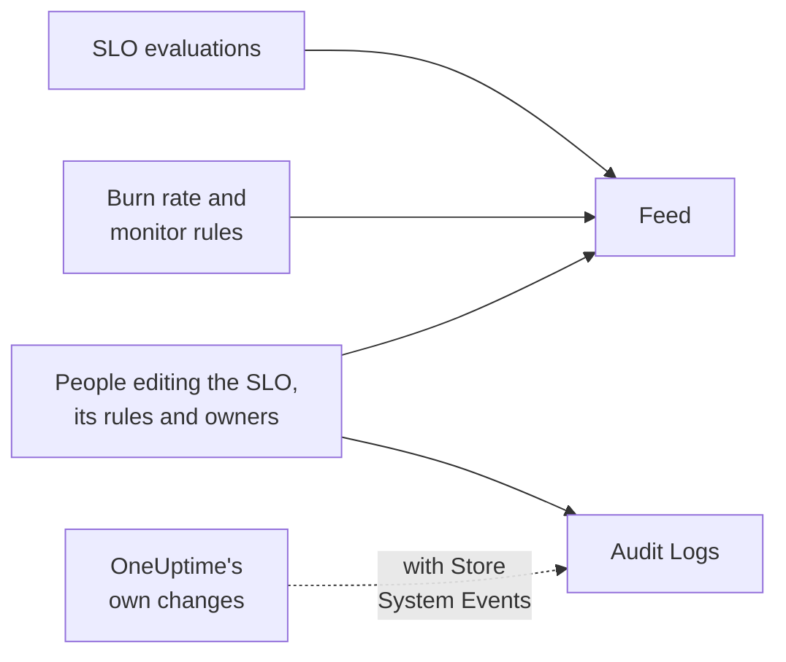

# SLO Feed and Audit Logs

An SLO keeps two records of its history, and they answer different questions. The **Feed** answers "what happened to this SLO?", written for the people who look after it. The **Audit Logs** answer "who changed what, exactly?", field by field, for review and compliance.

## Feed or audit logs?

| | **Feed** | **Audit Logs** |
| --- | --- | --- |
| Answers | What happened to the SLO | Who changed what, and when |
| Records | Status changes, burn rate alerts and incidents, and changes to the SLO, its rules, monitors and owners | Every change people made to the SLO, its burn rate rules, monitor rules and owners, with old and new values |
| Includes OneUptime's own work | Yes: evaluations and monitor rules attaching monitors | Only with **Store System Events** on |
| Plans | Every plan | The Enterprise plan on OneUptime Cloud, or the Enterprise Edition on a self-hosted installation |
| Kept | Three years on OneUptime Cloud | 7 days by default, up to 180 |

## The SLO feed

The feed is on the SLO's **Feed** page, and its latest items are under **Recent activity** on the SLO's **Overview**. Items link to the SLO, monitors, alerts and incidents they mention, and most have a **More Information** section with the numbers or the old and new values.

| Event | Posted when |
| --- | --- |
| SLO created | The SLO is created. Lists its target, compliance window, SLI, at-risk threshold, description and the default burn rate rules it started with. |
| SLO updated | The name, description, labels, target, compliance window, timezone, at-risk threshold, multi-monitor mode or downtime statuses change. Shows each old and new value. |
| SLO enabled or disabled | Evaluation is turned on or off. |
| SLO archived or restored | The SLO is archived or unarchived. |
| Status changed | An evaluation moves the SLO to a new status. Shows the SLI, error budget, burn rate and at-risk threshold behind it, and the reason for **Paused** or **Misconfigured**. |
| Burn rate alert raised | A burn rate rule creates an alert. Links to it and shows the burn rates that fired it. |
| Burn rate incident declared | A burn rate rule declares an incident. Links to it and shows the burn rates that fired it. |
| Burn rate alert or incident resolved | A rule's alert or incident closes: resolved automatically, or by hand while auto-resolve was off. |
| Burn rate rule added, changed or removed | Someone creates, edits or deletes a burn rate rule. The default rules of a new SLO are in its "SLO created" item instead. |
| Monitor rule added, changed or removed | Someone creates, edits or deletes a monitor rule. A save that changes nothing that matters is not posted. |
| Monitors attached or detached | Monitors are added to or removed from the SLO, by hand or by a monitor rule. Long lists name the first few monitors "and N more". |
| Owner added or removed | A user or team is added to or removed from the SLO's owners. |
| Label rule applied | A label rule attached labels to the SLO, when it was created or when someone ran the rule. Names the rules that matched. See [Label and Owner Rules](/docs/slo/label-and-owner-rules). |
| Owner rule applied | An owner rule added owners to the SLO. Names the rules that matched; each owner it added also gets its own "Owner added" item. |

A few details:

- Items say who made a change when a person did. Changes OneUptime makes itself, such as an evaluation or a monitor rule attaching a monitor, and changes made through the API or an automation carry no user.
- An alert or incident a rule picks up again because it was still open is not posted twice.
- For a private alert or incident, the item leaves out its title, number and link, because everyone who can read the SLO can read its feed. It still says a private record was created, and shows the burn rates that fired it.
- Nobody can edit or delete feed items. On OneUptime Cloud, items older than three years are removed.

## Audit logs

The SLO's **Audit Logs** page lists changes made to:

- the SLO itself: its details, settings, labels, monitors and archiving;
- its burn rate rules;
- its monitor rules;
- its owner users and owner teams.

Changes to rules and owners are recorded against the rule or owner and roll up to the SLO, so its page shows its whole history in one place, and each entry links to the page it belongs to. Related items such as labels and monitors are recorded with their names, not only their IDs.

Two things are left out:

- **Evaluation results.** The SLI, error budget, burn rate, status and evaluation times change every few minutes. Their history is on the **Overview**, the **Metrics** page and the **Feed**.
- **Changes OneUptime makes itself**, such as a monitor rule attaching or detaching a monitor, unless **Store System Events** is on for the project. The **Feed** records monitor attaches and detaches either way.

### Turn audit logs on

Audit logs are an Enterprise feature: they need the **Enterprise** plan on OneUptime Cloud, or the Enterprise Edition on a self-hosted installation. On other plans, the SLO's **Audit Logs** page explains how to get it. On a self-hosted installation, audit logging stops recording without a valid license (after the 14-day trial, or 30 days after a license expires), and resumes as soon as a license is activated (see [When a license expires or is missing](/docs/self-hosted/enterprise#when-a-license-expires-or-is-missing)). The **Audit Logs** pages say when it is not recording.

Audit logs are also off by default in every project. To turn them on:

:::steps
### Open the audit log settings

Go to **Project Settings**, open **Audit Logs** in the side menu and click **Settings**.

### Edit the settings

Click **Edit Audit Log Settings** and turn on **Enable Audit Logs**.

### Choose what to keep

Set **Retention (days)**, from 7 (the default) to 180, and turn on **Store System Events** to also record the changes OneUptime makes itself. Save. The change applies within about a minute.
:::

While audit logging is off, the SLO's **Audit Logs** page says **Audit logging is off**, with a link to turn it on. Entries recorded before it was turned off stay visible. The project's whole audit log, across every resource, is under **Project Settings** → **Audit Logs** → **Audit Logs**.

## Next steps

:::cards
- [SLOs Overview](/docs/slo/introduction): Every page an SLO has.
- [Monitors and Monitor Rules](/docs/slo/monitor-rules): What attaches and detaches monitors.
- [Burn Rate Alerts and Incidents](/docs/slo/burn-rate-alerts): What raises and resolves the alerts and incidents in the feed.
- [Label and Owner Rules](/docs/slo/label-and-owner-rules): What adds labels and owners automatically.
:::
