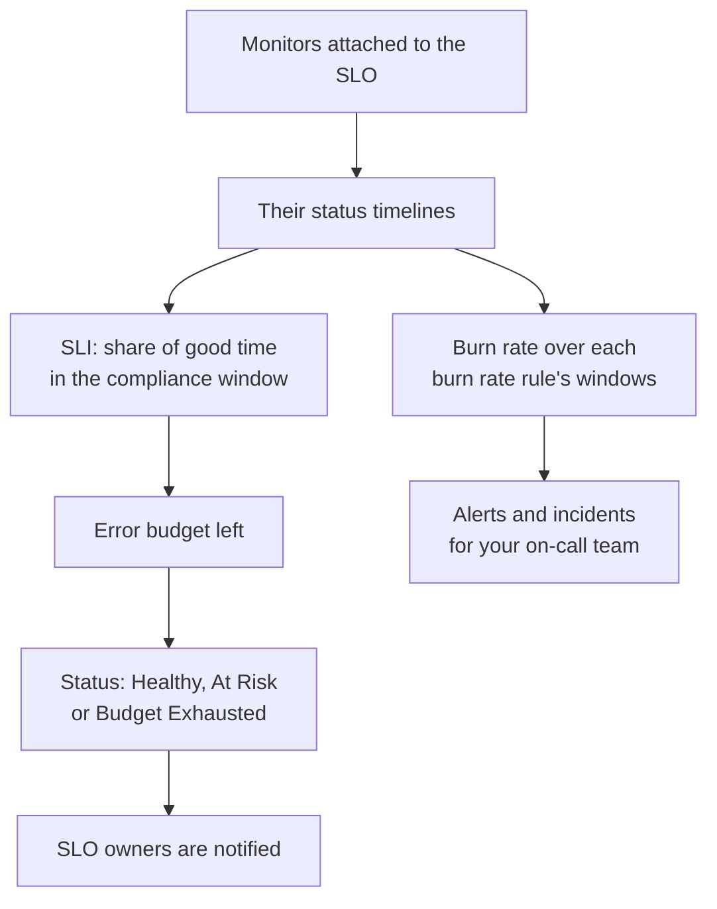

# SLOs Overview

A service level objective (SLO) is a reliability target for the things you monitor, such as "up 99.9% of the time over a rolling 30 days". OneUptime measures every SLO against its target every 5 minutes, so instead of "is it up right now?" you can answer "have we been reliable enough, over a window our users care about, and how much room for failure is left?"

:::cards
- [Create an SLO](#create-an-slo): A name and a target. Everything else starts from a default.
- [Monitors and Monitor Rules](/docs/slo/monitor-rules): Choose the monitors an SLO measures.
- [Error Budgets](/docs/slo/error-budget): How much downtime a target allows, and how it comes back.
- [Burn Rate Alerts and Incidents](/docs/slo/burn-rate-alerts): Page your team when the budget burns too fast.
:::

## How it works

An SLO reads the status timelines of the monitors attached to it: the same data your status pages show. From them OneUptime works out how much of the compliance window was good time, how much of the error budget is left, and how fast it is being spent.

## Key concepts

| Term | Meaning |
| --- | --- |
| **SLI** (service level indicator) | The measurement: the percentage of the compliance window in which the SLO's monitors were up. |
| **SLO** (service level objective) | A target for the SLI, for example "at least 99.9% over the last 30 days". |
| **Error budget** | The downtime the target allows: `(100% − target) × window`. At 99.9% over 30 days that is 43 minutes and 12 seconds. |
| **Burn rate** | How fast the budget is being spent compared with an even pace. At a burn rate of 1, the budget runs out exactly at the end of the window. |

An error budget turns reliability into something you can spend. With plenty left, ship faster and take risks; with little left, slow down and invest in stability. The SLO gives that conversation a number everyone can see.

## Create an SLO

You need a role that can create SLOs: Project Owner, Project Admin, or a custom role with the Create Service Level Objective permission.

:::steps
### Open SLOs

Open **SLOs** from the **Products** menu in the top bar. It is in the first group, beside Monitors and Incidents. Click **Create Service Level Objective**.

### Name it and set a target

Enter a **Name**, for example "API Availability", and a **Target (%)**: the share of time its monitors must be up. The target starts at `99.9`. It must be greater than 0 and at most 99.999, because a 100% target leaves no error budget to track.

### Check the defaults under More fields

**More fields** is folded, with a line saying what its defaults do: the SLO is measured over a rolling 30-day window and turns At Risk when less than 20% of its error budget is left. Open it to change any of the fields in the table below.

### Save the SLO

Click **Create Service Level Objective**. OneUptime opens the new SLO. Its **Overview** shows **Choose what this SLO measures**, because a new SLO has no monitors yet.

### Attach monitors

Click **Create a monitor rule** to attach every monitor that matches, now and later, or **Add monitors** to pick them by hand. See [Monitors and Monitor Rules](/docs/slo/monitor-rules).

### Watch the first numbers arrive

OneUptime evaluates enabled SLOs every 5 minutes. The SLI, the error budget and the burn-down chart appear after the first evaluation that has monitors to measure.
:::

The fields under **More fields**:

| Field | What you set | Default |
| --- | --- | --- |
| **Description** | What the SLO is for. | Empty |
| **At-Risk Threshold (%)** | The share of the error budget left at which the SLO turns **At Risk**. A whole number from 0 to 100. | 20 |
| **Window Type** | **Rolling**: the last N days, recovering as old downtime ages out. **Calendar Month**: each month on its own, reset on the 1st. | **Rolling** |
| **Window (Days)** | Rolling windows only: how many days to look back, from 1 to 366. 28 or 30 is typical. | 30 |
| **Timezone** | Calendar months only: the timezone each month starts and ends in. | UTC |
| **Labels** | Labels to organize and filter SLOs. | None |

Everything about how the SLO measures starts from a default that you change later:

| Setting | A new SLO starts with | Change it on |
| --- | --- | --- |
| Monitors | None | **Monitors** or **Monitor Rules** |
| Downtime statuses | Every non-operational status in the project | **Settings** → **Downtime Calculation** |
| Multi-monitor mode | **Any Monitor Down** | **Settings** → **Downtime Calculation** |
| Evaluation | On | **Settings** → **Evaluation** |
| Burn rate rules | A **Fast burn** and a **Slow burn** rule, scaled to the window | **Burn Rate Rules** |

## What an SLO is made of

| Part | What it decides |
| --- | --- |
| Monitors | Where the SLI comes from. Attach them by hand or with monitor rules: see [Monitors and Monitor Rules](/docs/slo/monitor-rules). |
| Target | The share of good time the SLO promises, greater than 0 and at most 99.999. |
| Compliance window | The time the SLI and budget are measured over: a rolling window of 1 to 366 days, or a calendar month. |
| At-risk threshold | The share of the budget left at which the SLO turns **At Risk**. |
| Downtime statuses | Which monitor statuses count as downtime. |
| Multi-monitor mode | How downtime on several monitors combines. |

### Which statuses count as downtime

Each SLO has its own list of monitor statuses that count as downtime. A new SLO starts with every status in the project that is not marked operational, such as Degraded and Offline, as your status pages do. Change the list on **Settings** → **Downtime Calculation**. Leave it empty to count every non-operational status, including statuses added to the project later.

> [!TIP]
> Measure the same monitors two ways with two SLOs: a strict availability SLO where Degraded and Offline both count, and a looser hard-down SLO where only Offline counts.

### Compliance windows

| Window type | How it behaves |
| --- | --- |
| **Rolling** | Looks back a fixed number of days from now. Old downtime ages out of the window, so the budget comes back gradually. |
| **Calendar Month** | Measures from the first of the month, in the SLO's timezone (UTC by default). The whole budget comes back at the start of each month. |

### Several monitors on one SLO

When an SLO measures more than one monitor, its **Multi Monitor Mode** decides how their downtime combines. A new SLO uses **Any Monitor Down**.

| Mode | How downtime counts | Use it when |
| --- | --- | --- |
| **Any Monitor Down** | Any moment in which at least one monitor is down counts as downtime for the whole SLO. Overlapping outages are counted once. | The monitors together are one service: if any of them is down, users notice. |
| **Monitor Seconds Average** | Each monitor's downtime counts on its own, averaged over all the monitored time: SLI = 1 − (down seconds of all monitors ÷ monitored seconds of all monitors). | The monitors are a fleet of similar resources, and partial impact should count partially. |

For example, monitor A is down from 10:00 to 11:00 while monitor B stays up. **Any Monitor Down** records 60 minutes of downtime; **Monitor Seconds Average** records the equivalent of 30 minutes, because one of two monitors was down for an hour. In that mode the budget is counted in monitor-seconds too: see [Error Budgets](/docs/slo/error-budget).

## SLO status

OneUptime gives every evaluated SLO a status:

| Status | What it means |
| --- | --- |
| **Healthy** | More than the at-risk threshold of the budget is left. |
| **At Risk** | The budget left has dropped to the at-risk threshold or below: 20% by default. |
| **Budget Exhausted** | The budget is fully spent, or overspent. |
| **Misconfigured** | The SLO cannot be measured: it has no monitors, its monitors no longer exist or have not recorded a status in its window yet, or its target is out of range. |
| **Paused** | Every monitor it measures is archived or has active monitoring turned off, by hand, by a manual incident or by scheduled maintenance. It resumes by itself once one of them is monitored again. |

A turned-off or archived SLO is not evaluated, so its status stays where it was; the SLO list shows a **Disabled** or **Archived** pill instead. SLO owners are notified when the status changes to **At Risk** or **Budget Exhausted**: see [Error Budgets](/docs/slo/error-budget).

## The SLO list

The **SLOs** page lists every SLO that is not archived, with its status, SLI, budget left, burn rate, target, window, monitors, labels and owners.

- The tiles above the list count SLOs by status: **Healthy**, **At Risk**, **Budget Exhausted**, **Misconfigured**, **Paused** and **Disabled**. Click a tile to show only those SLOs, and click it again to show them all.
- Select SLOs to add or remove labels and owners, archive them or delete them, all at once.
- The side menu's **Settings** section holds **Label Rules** and **Owner Rules**, which label new SLOs and give them owners: see [Label and Owner Rules](/docs/slo/label-and-owner-rules).
- The side menu's **Advanced** section holds **Archived**, the list of archived SLOs.

## An SLO's pages

Open an SLO to see its pages in the side menu:

| Page | What it shows |
| --- | --- |
| **Overview** | The status, the headline numbers, the error budget burn-down, recent activity, open alerts and incidents, and the burn rate rules. |
| **Metrics** | The SLO's `oneuptime.slo.*` metrics, its long-range error budget history, and metrics of the incidents and alerts that affect it. See [SLO Metrics and Dashboards](/docs/slo/metrics). |
| **Incidents** | The incidents its burn rate rules declared. The badge counts the open ones. |
| **Alerts** | The alerts its burn rate rules raised. The badge counts the open ones. |
| **Feed** | What happened to the SLO, as a timeline. See [SLO Feed and Audit Logs](/docs/slo/feed-and-audit-logs). |
| **Monitors** | The monitors it measures, and whether a person or a rule attached each one. |
| **Monitor Rules** | The rules that attach matching monitors. |
| **Burn Rate Rules** | The rules that raise alerts and declare incidents when the budget burns too fast. |
| **Owners** | The users and teams who hear about its status changes. |
| **Settings** | The objective, compliance period, downtime calculation, evaluation switch and archive card. |
| **Audit Logs** | Who changed the SLO, its rules and its owners, and when. |
| **Delete SLO** | Deletes the SLO for good, and resolves the burn rate alerts and incidents it had open. |

**Monitors**, **Monitor Rules** and **Burn Rate Rules** sit in a **Configuration** section, and **Owners**, **Settings**, **Audit Logs** and **Delete SLO** in a **Management** section. Both start folded, as does a **Developer** section for managing the SLO from code: click a section's title to open it.

When something stops an SLO from measuring, a banner at the top of each of its pages says what is wrong and links to the page that fixes it: see [Troubleshooting](#troubleshooting).

### The Overview

The **Overview** answers "are we within budget?", from top to bottom:

- **The summary**: the status, a sentence saying what it means, and the description. Beside it are **Refresh** and when the SLO was last evaluated. Under it are the target, the **Compliance window** (with a fill chip while a young rolling window fills: see [Young SLOs and the window-fill indicator](#young-slos-and-the-window-fill-indicator)), the number of monitors and the owners.
- **The headline numbers**:
  - **SLI**: the share of good time in the window, and how far above or below the target it is.
  - **Error budget left**: a percentage, a duration such as "12m 30s left of 43m 12s", and a bar with a tick at the at-risk threshold. Once the budget is overspent it says **Budget exceeded** and how far over it is.
  - **Burn rate**: how fast the budget is being spent over the last 60 minutes, the lookback the default fast-burn rule uses. It turns amber above 1× and red, with **Rule threshold reached**, at the lowest threshold of the SLO's enabled burn rate rules.
  - **Budget runway**: how long the budget lasts at that pace. See [Error Budgets](/docs/slo/error-budget#budget-runway).
- **Error budget burn-down**: the budget left across the current window. See [Error Budgets](/docs/slo/error-budget#error-budget-burn-down).
- **Recent activity**: the latest items of the SLO's feed.
- **SLO Details**: the name, description and labels, the only settings edited on the Overview.
- **Open alerts & incidents**: what the burn rate rules have open right now.
- **Burn rate rules**: each enabled rule's threshold beside the current burn rate, and what the rule declares.

### Settings

The **Settings** page holds how an SLO measures, one card each:

| Card | What you change | Worth knowing |
| --- | --- | --- |
| **Objective** | **Target (%)** and **At-Risk Threshold (%)**, with **Edit Objective**. | Shows the downtime the objective allows, for example "43m 12s of downtime per 30-day window". |
| **Compliance Period** | **Window Type**, **Window (Days)** and **Timezone**, with **Edit Period**. | Burn rate rules keep their thresholds when the window changes, so review them afterwards. |
| **Downtime Calculation** | **Multi Monitor Mode** and **Downtime Monitor Statuses**, with **Edit Downtime Calculation**. | Empty statuses count every non-operational status, including ones added later. |
| **Evaluation** | The **Evaluate this SLO** switch, which saves as soon as you flip it. | Turning it off asks first, because it also resolves the SLO's open burn rate alerts and incidents. |
| **Archive SLO** | **Archive** or **Unarchive**. | See [Archiving an SLO](#archiving-an-slo). |

After a change to the objective, period or downtime calculation, OneUptime re-evaluates the SLO on its next run.

## Archiving an SLO

Archive an SLO you no longer measure but want to keep, such as a retired service or last year's objective. Archive it from **Settings** → **Archive SLO**, or select SLOs in the SLO list and choose **Archive**.

An archived SLO:

- is hidden from the SLO list, its status tiles, and the SLO pickers and lists on dashboards;
- is not evaluated: its numbers stay as last evaluated, its burn rate rules do not fire and it posts no metrics;
- has its open burn rate alerts and incidents resolved;
- keeps its settings, history, rules and owners. Its monitor rules keep its monitor list current, so it resumes with the right monitors.

Archived SLOs are listed on the **Archived** page, under **Advanced** in the SLO list's side menu. Select them there and choose **Unarchive** to bring them back: they are evaluated again on the next run, with the SLI and budget recomputed from their monitors' history.

Archiving and turning evaluation off are separate switches. An SLO that was turned off before it was archived stays off when you unarchive it: turn it back on with **Turn evaluation on** in its banner, or **Evaluate this SLO** in **Settings** → **Evaluation**.

| You want to | Do this |
| --- | --- |
| Stop measuring for a while, and keep it listed | Turn evaluation off |
| Retire it, but keep its history and settings | Archive it |
| Remove it for good | Delete it |

## SLOs on alerts, incidents and monitors

Every alert and incident a burn rate rule creates is linked to its SLO:

- The alert or incident page lists the SLO under **Affected Resources**, with a link to it.
- Alert and incident lists show the SLO among the affected resources, and the **Affected Resources** filter narrows a list to one SLO.
- The SLO's **Alerts** and **Incidents** pages list them, and their side menu badges count the open ones.

OneUptime sets this link when a rule creates the alert or incident; you cannot add it by hand, and editing the alert or incident never removes it.

A monitor's own side menu has an **SLOs** page too: the SLOs that measure that monitor, so you know which objectives depend on it before you pause or change it.

## Young SLOs and the window-fill indicator

A rolling-window SLO younger than its window is measured over the data that exists so far: a 30-day SLO created yesterday has one day of data. Its error budget starts small and grows as the window fills, so its first numbers move more than they will later.

While that is the case, the **Overview** says so: the summary shows a **Window 23% full** chip (**Window under 1% full** on the first day), and the **Error budget left** tile repeats it under its number. Both go once the window is full. Calendar-month SLOs never show them, because their budget covers the whole month from day one, and neither do SLOs in **Monitor Seconds Average** mode, whose budget is counted across monitors.

## Troubleshooting

A banner at the top of the SLO's pages says what stops it from measuring:

| Banner | What it means | What to do |
| --- | --- | --- |
| **No monitors attached** | The SLO has no monitors, so there is nothing to measure. | Attach monitors, or create a monitor rule. |
| **Waiting for SLO evaluation** | Monitors are attached, but the last evaluation had no status data from them. | Check that the monitors are being checked. Numbers appear after the next evaluation that has data. |
| **Measurement is paused** | Every monitor it measures is archived or has active monitoring turned off. | Turn monitoring back on for at least one monitor, or wait for the maintenance to end. |
| **The target is out of range** | The target is not greater than 0 and below 100. | Set a target such as 99.9 in **Settings** → **Objective**. |
| **This SLO is disabled** | Evaluation is off. | Click **Turn evaluation on**. |
| **This SLO is archived** | The SLO is archived. | Unarchive it in **Settings**. |
| **Not evaluated yet** | The SLO was just created. | Wait for the first evaluation, at most a few minutes. |

## Next steps

:::cards
- [Monitors and Monitor Rules](/docs/slo/monitor-rules): Attach monitors by hand or with rules.
- [Error Budgets](/docs/slo/error-budget): The budget math, the runway and how budget comes back.
- [Burn Rate Alerts and Incidents](/docs/slo/burn-rate-alerts): Page your on-call team when the budget burns too fast.
- [SLO Metrics and Dashboards](/docs/slo/metrics): Chart SLOs and build an SLO dashboard.
:::
