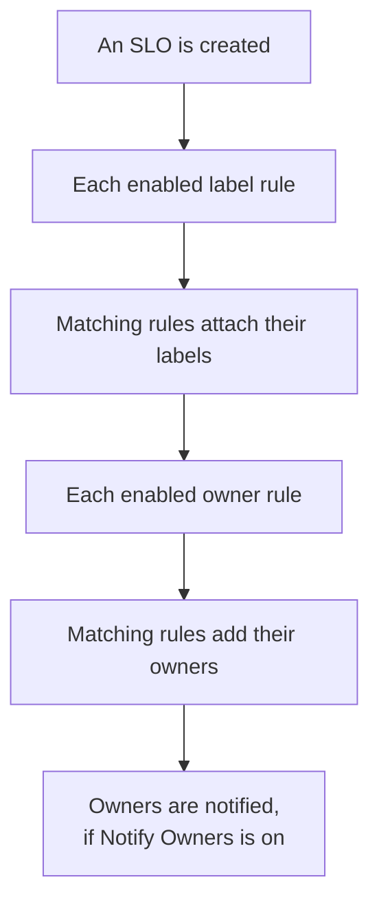

# Label and Owner Rules

Label rules and owner rules organize your SLOs for you. A **label rule** attaches labels to every new SLO that matches it, and an **owner rule** adds owner users and teams to it, so a new checkout SLO is labelled _Checkout_ and owned by the checkout team without anyone having to remember. Both work like the label and owner rules of every other product: see [Label and Owner Rules](/docs/configuration/label-and-owner-rules) for what they have in common.

## How it works

Rules run when an SLO is created, from the dashboard or through the API. Label rules run first, so an owner rule can match a label that a label rule has just attached.

Both kinds are project-wide. Find them in the SLO list's side menu, under **Settings**: **Label Rules** and **Owner Rules**. The **Settings** section starts folded; click its title to open it.

## Create a rule

:::steps
### Open the rule list

Open **SLOs**, then **Settings** → **Label Rules** or **Settings** → **Owner Rules** in the side menu, and click **Create SLO Label Rule** or **Create SLO Owner Rule**.

### Choose what the rule matches

On the **Match** step, click **Add condition** for each condition an SLO must meet (see [Match criteria](#match-criteria)). With two or more, choose **Match all** or **Match any**. A rule with no conditions matches every new SLO.

### Choose what the rule adds

A label rule's second step is **Labels**, where you pick the **Labels to Add**. An owner rule's is **Owners**, where you pick the **Owners** to add — people and teams, picked from one list with **Add owner**. A rule has to add at least one label or owner.

### Check the name and the folded fields

The **Name** is filled in from what you pick, such as _Add Checkout, Production_ or _Add Checkout team as owners_, and follows your picks until you type a name of your own. **More fields** holds the optional **Description** and, on an owner rule, **Notify Owners**.

### Save the rule

Click **Create SLO Label Rule** or **Create SLO Owner Rule** again on the last step. The rule starts enabled.
:::

**Notify Owners** (under **More fields**) is on by default: the owners an owner rule adds get the same "you were added as an owner" notification as an owner added by hand. Turn it off to add owners silently.

To pause a rule without deleting it, switch **Enabled** off on its edit form. The edit form never insists on labels or owners: an older rule that adds nothing can still be renamed, switched off or deleted, and the list marks it **Adds nothing**.

When a rule matches an SLO:

- A label rule attaches every label in **Labels to Add**. Labels the SLO already has are not added twice, and when several rules match, the SLO gets all of their labels.
- An owner rule adds every user and team on the rule as an owner. Owners the SLO already has are skipped, and when several rules match, the SLO gets all of their owners. A user who is no longer a member of the project, or a team from another project, is never added; the rule's other owners still are.

SLO owners are the people who hear about the SLO's status changes: see [Error Budgets](/docs/slo/error-budget).

## Match criteria

Each condition compares one field of the SLO:

| Field | Compared with | Operators |
| --- | --- | --- |
| **SLO Labels** | The SLO's labels. | **Has any of**, **Has all of**, **Has none of** |
| **SLO Name** | The SLO's name. | **Contains**, **Does not contain**, **Equals**, **Does not equal**, **Starts with**, **Ends with**, **Matches pattern**, **Does not match pattern** |
| **SLO Description** | The SLO's description. | The same as **SLO Name** |

A new name or description condition starts on **Contains**. A pattern is a regular expression, such as `^checkout-.*`, or a `*` wildcard, such as `*checkout*`, and ignores case. A pattern that is neither, such as `checkout-(01`, is refused when you save rather than silently matching nothing.

| You want | Conditions |
| --- | --- |
| Every SLO of the checkout service | **SLO Name** contains `checkout` |
| Every production SLO | **SLO Labels** has any of _Production_ |
| Checkout SLOs, but not the staging ones | **Match all**: **SLO Name** contains `checkout`, and **SLO Labels** has none of _Staging_ |

## When rules run

- **When an SLO is created**, from the dashboard or through the API: every enabled label rule, then every enabled owner rule.
- **When you run a rule** with **Run Now**: see below.

Editing an SLO does not apply the rules again, and a rule never removes anything: not labels or owners someone added by hand, and not ones it added itself. A turned-off rule does nothing.

## Run a rule on existing SLOs

A rule you write today applies to the SLOs created after it. To apply it to the SLOs you already have, click **Run Now** on the rule's row, or **View** and then **Run Now** on the rule's own page. You can also select several rules and run them from the table's bulk actions.

A run checks every SLO in the project, archived ones included, and reports how many it matched and how many it changed. Owners a run adds are notified only when you choose to notify them in the run dialog and the rule has **Notify Owners** on. See [Run Rules on Existing Resources](/docs/configuration/run-rules-now).

Label rules can also be copied between projects: see [Import and Export Label Rules](/docs/configuration/label-rule-import-export).

## History

Whenever a rule changes an SLO, the SLO's **Feed** records which rules did it. Every owner a rule adds also gets its own "added as an owner" feed item, so the feed says who was added and why. See [SLO Feed and Audit Logs](/docs/slo/feed-and-audit-logs).

## Permissions

| To | You need |
| --- | --- |
| Work with label rules | **Create SLO Label Rule**, **Edit SLO Label Rule**, **Delete SLO Label Rule** or **Read SLO Label Rule** |
| Work with owner rules | **Create SLO Owner Rule**, **Edit SLO Owner Rule**, **Delete SLO Owner Rule** or **Read SLO Owner Rule** |
| Run a label rule | **Edit SLO Label Rule** and **Edit Service Level Objective** |
| Run an owner rule | **Edit SLO Owner Rule**, **Edit Service Level Objective**, **Create SLO User Owner** and **Create SLO Team Owner** |

These permissions are in the SLO group of a role, and the Project Owner and Project Admin roles have them all. A run changes every SLO in the project, so a permission limited to some labels, or to the SLOs you own, is not enough to run a rule.

## Next steps

:::cards
- [Label and Owner Rules](/docs/configuration/label-and-owner-rules): How every product's label and owner rules work.
- [Run Rules on Existing Resources](/docs/configuration/run-rules-now): How Run Now works for every kind of rule.
- [SLOs Overview](/docs/slo/introduction): Every page an SLO has, and the SLO list.
:::
