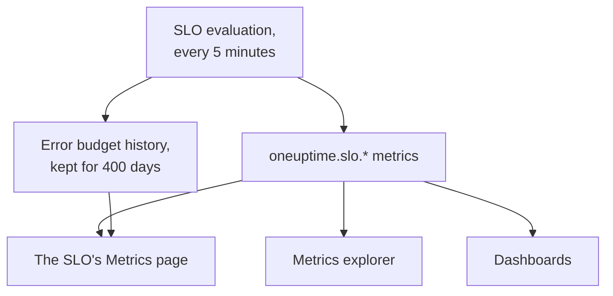

# SLO Metrics and Dashboards

Every time OneUptime evaluates an SLO, every 5 minutes, it writes the results as metrics named `oneuptime.slo.*`. They sit in the same metric store as your monitor metrics, so you can chart an SLO on its **Metrics** page, open it in the metrics explorer, and put it on any dashboard, filtered and grouped like any other series.

:::cards
- [The metrics](#the-metrics): Six series, their units and how to aggregate them.
- [The Metrics page](#the-metrics-page): An SLO's charts, history and incident and alert metrics.
- [SLOs on dashboards](#slos-on-dashboards): The SLO widget and the SLO Dashboard template.
:::

## How it works

## The metrics

| Metric | Unit | Aggregation | What it holds |
| --- | --- | --- | --- |
| `oneuptime.slo.sli.percent` | `%` | Avg | The SLI over the SLO's compliance window: the share of measured time that was good. |
| `oneuptime.slo.target.percent` | `%` | Avg | The SLO's target, posted with every evaluation so a chart can draw it over the SLI. |
| `oneuptime.slo.error.budget.remaining.percent` | `%` | Avg | Share of the error budget not yet spent in the window. Negative once the budget is overspent. |
| `oneuptime.slo.error.budget.remaining.seconds` | `seconds` | Avg | Downtime the SLO can still absorb before it breaches. Negative once the budget is overspent. |
| `oneuptime.slo.burn.rate` | `x` | Max | How fast the budget is being spent, over the last 60 minutes. 1x spends the budget exactly over the window. |
| `oneuptime.slo.status` | — | Max | The SLO's status at each evaluation: `0` is Healthy, `1` is At Risk, `2` is Budget Exhausted. |

The aggregation is how the SLO's own charts and the SLO Dashboard template combine the points that fall into one chart bucket. Percentages and durations are averaged. Burn rate and status take the maximum, so a short burn spike or a brief trip into Budget Exhausted is not averaged away.

For an SLO in **Monitor Seconds Average** mode, `oneuptime.slo.error.budget.remaining.seconds` counts monitor-seconds summed across its monitors, as its error budget does: see [Error Budgets](/docs/slo/error-budget).

### When no point is written

- A turned-off or archived SLO is not evaluated, so it posts nothing.
- A **Paused** or **Misconfigured** SLO measures nothing, so it posts only `oneuptime.slo.target.percent`, which is configuration rather than a measurement. Its SLI, budget, burn rate and status charts show a gap.
- A value that is not a real number, such as a burn rate over a window with no data, is skipped, never written as 0.

### Attributes

Every point carries these attributes:

| Attribute | Value |
| --- | --- |
| `sloId` | ID of the SLO. The SLO's own pages filter on it, so renaming an SLO never splits its charts. |
| `sloName` | Name of the SLO when the point was written. |
| `projectId` | ID of the project. |
| `oneuptime.label.<key>` | One attribute per SLO label. A label named `Tier 1` becomes `oneuptime.label.tier_1` = `true`, and a label named `product:checkout` becomes `oneuptime.label.product` = `checkout`. Keys are lowercased, with spaces and punctuation turned into `_`. |

The series belong to the SLO, not to any of its monitors, and do not count as telemetry usage.

Incident and alert metrics carry two matching attributes, `serviceLevelObjectiveIds` and `serviceLevelObjectiveNames`: comma-separated lists of the SLOs the incident or alert affects.

### Retention

`oneuptime.slo.*` metrics are kept as long as monitor metrics: **30 days** by default. On a self-hosted installation, a master admin can change that with **Monitor Metric Retention (Days)** in the Admin Dashboard's **Data Retention** settings.

This does not limit the **Error Budget History** tab of the SLO's **Metrics** page. That history is stored separately and kept for 400 days.

## The Metrics page

An SLO's **Metrics** page has four tabs:

| Tab | What it shows |
| --- | --- |
| **SLO Metrics** | The `oneuptime.slo.*` series in three cards that share one time range, the past day by default: **Objective** (the SLI with the target over it, and the budget left), **Burn** (burn rate and budget time left) and **Status**. |
| **Error Budget History** | The SLI, budget left and burn rate over the long-range history, with lines at the target, the at-risk and exhausted boundaries, and each enabled burn rate rule's threshold. |
| **Incident Metrics** | The count, time to acknowledge, time to resolve and duration of the incidents that affect this SLO, the past week by default. Incidents its burn rate rules declared are included. |
| **Alert Metrics** | The same for alerts. Alerts its burn rate rules raised are included. |

The **SLO Metrics**, **Incident Metrics** and **Alert Metrics** tabs read the metric store, which needs permission to read telemetry. A custom role that can read SLOs but not telemetry sees those tabs empty, while **Error Budget History** still works.

## SLOs on dashboards

### Chart any SLO metric

:::steps
#### Add a chart

In a dashboard's edit mode, add a chart or value widget and pick one of the `oneuptime.slo.*` metrics.

#### Group or filter it

Group by `sloName` and `sloId` for one line per SLO; `sloId` keeps two SLOs that share a name apart. Or filter on `sloName`, or on an `oneuptime.label.*` attribute.

#### Pick the aggregation

Use the aggregation from the table above: Avg for the percentages and durations, Max for burn rate and status.
:::

### The SLO widget

The [SLO widget](/docs/dashboards/widgets#slo) shows one SLO's SLI, budget left or burn rate as a tile or a chart. It gets its SLO in one of two ways:

| Setting | How it behaves |
| --- | --- |
| **Service Level Objective** | Pins the widget to one SLO. The picker lists SLOs that are not archived. |
| **Follow SLO Variable** | Shows whichever SLO is picked in a dashboard variable: a **Telemetry Attribute** variable on the `sloName` key. Ignored while an SLO is pinned. |

On a [public dashboard](/docs/dashboards/sharing), a widget that follows a variable lets viewers pick any SLO of the project that is not archived, by name. A pinned widget only ever shows its own SLO, and keeps showing the last numbers of an SLO archived later.

### The SLO Dashboard template

When you create a dashboard, choose the **SLO Dashboard** template for a ready-made board of every SLO in the project, in three bands:

1. **Service Level Objectives**: a list of every SLO that is not archived, with its status, SLI against target, budget bar and burn rate, and a count of SLOs by status. Enabled SLOs come first, least budget first; a turned-off SLO comes last as **Disabled**, its last numbers greyed out.
2. **Error Budget & Burn Rate**: the **Lowest Error Budget Remaining**, **Least Error Budget Time Left** and **Peak Burn Rate** tiles, and the **Error Budget Remaining by SLO** and **Burn Rate by SLO** charts with one line per SLO, grouped by `sloName` and `sloId`.
3. **Selected SLO**: the **SLI**, **Error Budget Remaining** and **Burn Rate** tiles and the **SLI History**, **Error Budget History** and **Burn Rate History** charts of one SLO.

One SLO variable in the toolbar scopes the whole board. It is a Telemetry Attribute variable on `sloName`, so its options are the SLO names found in the metrics. Picking an SLO narrows the list to it, scopes the band's charts and tiles, and fills in the **Selected SLO** widgets, which follow the variable. Until you pick one, they ask you to choose an SLO in the toolbar.

## Troubleshooting

:::details An SLO is missing from the toolbar's SLO picker
The picker lists the SLO names posted in the last day. A new SLO appears after its first evaluation; a **Paused** or **Misconfigured** SLO stays pickable because it still posts its target; a turned-off or archived SLO drops out about a day after its last point.
:::

:::details Picking a name shows two SLOs
Two SLOs share that name. The list and charts show both, and the **Selected SLO** widgets say the name is ambiguous. Give SLOs distinct names.
:::

:::details The SLO Metrics tab is empty
Your role cannot read telemetry, or the SLO has not been evaluated yet. **Error Budget History** reads the SLO itself and still works.
:::

## Next steps

:::cards
- [Dashboard Widgets](/docs/dashboards/widgets): Every widget, the SLO widget included.
- [Dashboard Variables](/docs/dashboards/variables): Scope a whole board with one picker.
- [Error Budgets](/docs/slo/error-budget): What the budget numbers mean.
:::
