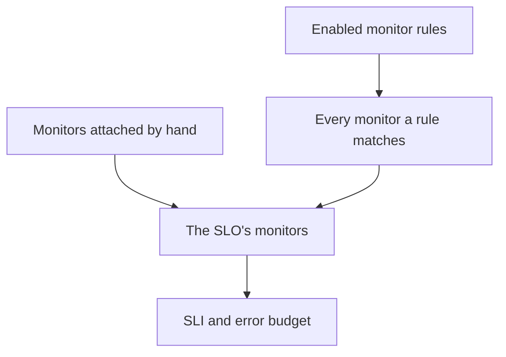

# Monitors and Monitor Rules

An SLO measures the uptime of the monitors attached to it. Attach them by hand, let monitor rules attach every monitor that matches, or do both. This page covers an SLO's **Monitors** and **Monitor Rules** pages, both under **Configuration** in its side menu.

:::cards
- [Pick monitors by hand](#attach-monitors-by-hand): Best for a small, fixed set.
- [Attach monitors with a rule](#attach-monitors-with-a-rule): "Every monitor labelled Production", kept in sync for you.
- [Match criteria](#match-criteria): The fields and operators a rule can match on.
:::

## Which monitors an SLO measures

An SLO measures the union of the monitors you attached by hand and every monitor that at least one of its enabled monitor rules matches.

A new SLO has no monitors, because the create form does not ask for them. Until it has one, it cannot be evaluated: its pages show **No monitors attached**, and its **Overview** offers both ways to attach monitors.

## Attach monitors by hand

You need permission to edit the SLO.

:::steps
### Open the Monitors page

Open the SLO and go to **Monitors**.

### Pick the monitors

Click **Add Monitors** and pick monitors from the project. Only monitors that are not attached yet are listed.

### Save the list

Click **Add Monitors**. The monitors appear in the list with the source **Manual**, and count toward the SLI from the next evaluation.
:::

To take a monitor off the SLO, click **Remove** on its row. The monitor itself does not change; it only stops counting toward the SLO's SLI and error budget.

The **Monitors** page shows, for each monitor:

| Column | What it shows |
| --- | --- |
| **Current Status** | The monitor's status now, or **Archived**, **Disabled**, **Probes Not Enabled**, **Probes Disconnected** or **Unknown** when it is not being checked or has not reported yet. |
| **Source** | **Rule** if one of the SLO's monitor rules attached it, **Manual** if someone attached it by hand. |
| **Labels** | The monitor's labels. |

## Attach monitors with a rule

A monitor rule describes the monitors an SLO should measure, such as "every monitor labelled Production" or "every monitor whose name starts with api-". Every monitor that matches is attached, now and whenever monitors are created or change, so nobody has to remember the monitor someone adds next month.

:::steps
### Open Monitor Rules

Open the SLO, go to **Monitor Rules** and click **Create SLO Monitor Rule**.

### Name the rule

On **Basic Info**, enter a **Name** and, optionally, a **Description** of why these monitors belong to this SLO.

### Choose what it matches

On **Match Criteria**, click **Add condition**, pick a field and an operator, and enter or pick the value. With two or more conditions, choose **Match all** or **Match any**. A monitor rule needs at least one condition.

### Save the rule

Click **Create SLO Monitor Rule**. The rule starts enabled, and the SLO's monitors are re-evaluated straight away: every monitor that matches is attached with the source **Rule**.
:::

The rules table shows each rule's name, its match criteria in words, and whether it is enabled. To pause a rule, switch **Enabled** off on its edit form. **View Monitors** opens the SLO's **Monitors** page.

### Match criteria

Each condition compares one field of a monitor:

| Field | Compared with | Operators |
| --- | --- | --- |
| **Monitor Labels** | The monitor's labels. | **Has any of**, **Has all of**, **Has none of** |
| **Monitor Type** | The monitor's type, picked from the list of types. | **Equals**, **Does not equal** |
| **Monitor Name** | The monitor's name. | **Contains**, **Does not contain**, **Equals**, **Does not equal**, **Starts with**, **Ends with**, **Matches pattern**, **Does not match pattern** |
| **Monitor Description** | The monitor's description. | The same as **Monitor Name** |

A pattern is a regular expression, such as `^api-.*`, or a `*` wildcard, such as `*checkout*`, and ignores case. A pattern that is neither, such as `api-(01`, is refused when you save rather than silently matching nothing. To attach every monitor in the project, add a **Monitor Name** condition that matches the pattern `.*`.

| You want | Conditions |
| --- | --- |
| Every production monitor | **Monitor Labels** has any of _Production_ |
| Every API monitor | **Monitor Type** equals _API_ |
| Every monitor except manual ones | **Monitor Type** does not equal _Manual_ |
| Every monitor whose name starts with api- | **Monitor Name** matches pattern `^api-` |
| Checkout monitors, but not staging ones | **Match all**: **Monitor Name** matches pattern `*checkout*`, and **Monitor Labels** has none of _Staging_ |

### When rules run

- When you create, edit, turn on, turn off or delete a rule, the SLO's monitors are re-evaluated straight away.
- When a monitor is created, or its labels, name or description change, every monitor rule in the project checks it, including the labels your monitor label rules give it.
- When a label is deleted, the SLOs whose rules used it are re-evaluated.
- Rules keep an SLO's monitor list current while the SLO is turned off or archived, so it resumes with the right monitors.

Rules re-sync whenever they are saved, so **Run Now** is for catching anything the SLO missed. It is on each row, on the rule's own page (**View**) and in the table's bulk actions. Running one rule re-evaluates all of the SLO's enabled monitor rules together, and the dialog then says how many monitors were attached and detached. Running a rule needs permission to edit SLO monitor rules. See [Run Rules on Existing Resources](/docs/configuration/run-rules-now).

### Which monitors a rule owns

- A monitor stays attached while any enabled rule matches it, and is detached once none does.
- Turning off or deleting a rule detaches only the monitors that no other enabled rule still matches.
- Rules only ever detach monitors a rule attached. A monitor you attached by hand is never taken over by a rule that happens to match it, and never detached when it stops matching. Its source stays **Manual**.

## Picking by hand while rules are on

While at least one rule is enabled, the rules manage the SLO's monitors:

- monitors cannot be added by hand: **Add Monitors** is turned off, and a banner says **This SLO's monitors are managed by its monitor rules**, with a **Manage Monitor Rules** link;
- monitors a rule attached cannot be removed by hand, because the rule would attach them again: their **Remove** button is locked, and its tooltip says why;
- monitors attached by hand before the rules were turned on can still be removed.

This holds for the API too. Turn every rule off to pick monitors yourself again.

## The SLOs a monitor counts toward

A monitor's own page lists the SLOs that measure it: open the monitor and go to **SLOs** in its side menu. Check it before you pause or change a monitor, to see which objectives depend on it. Archived SLOs are left out, because they are not evaluated.

## Coming from Auto-Add Monitors With Labels

Earlier versions had an **Auto-Add Monitors With Labels** setting on the SLO form. When you upgrade, every SLO that used it gets an enabled monitor rule named **Auto-add monitors with labels** that matches the same labels, so it keeps measuring exactly the monitors it did. The `monitorLabels` field of the SLO API is deprecated: use SLO monitor rules instead.

:::details What if something still saves the old setting?
A dashboard tab opened before the upgrade, or an API client or workflow written for the earlier version, can still save the old setting. So that an SLO does not quietly lose monitors that way:

- **An SLO with no monitor rules** turns the saved labels into an **Auto-add monitors with labels** rule, and its monitors are re-evaluated straight away. Saving an empty list detaches the monitors the setting attached, as before.
- **An SLO that has monitor rules**, turned on or off, ignores labels saved through the old setting, because its rules decide what it measures.
- **Creating the first monitor rule** of an SLO whose monitors the old setting attached converts the setting into a rule first, so the new rule is added beside it rather than replacing it.

A converted rule you delete stays deleted, unless its monitors are still attached afterwards, for example because a server still running the earlier version attached them again during the upgrade: the next monitor change or new rule then converts the labels again. Delete that rule again once the upgrade has finished.
:::

## History

Every attach and detach, and every rule that is created, changed or deleted, is posted to the SLO's **Feed**. Rule changes are also recorded in its **Audit Logs**. See [SLO Feed and Audit Logs](/docs/slo/feed-and-audit-logs).

## Troubleshooting

:::details Add Monitors is turned off
At least one of the SLO's monitor rules is enabled, so the rules manage its monitors. Change the rules, or turn every rule off to pick monitors by hand.
:::

:::details A monitor's Remove button is locked
A monitor rule attached that monitor, and would attach it again. Change or turn off the rule that matches it.
:::

:::details A monitor a rule should match is not attached
Check that the rule is enabled and that every condition holds under **Match all**. Labels a monitor label rule adds count too. Click **Run Now** on the rule to re-sync the SLO.
:::

:::details Saving a rule fails with a pattern error
The value is neither a regular expression nor a `*` wildcard, for example an unclosed bracket. Fix the pattern, or use **Contains** instead.
:::

## Next steps

:::cards
- [SLOs Overview](/docs/slo/introduction): How downtime on several monitors combines.
- [Error Budgets](/docs/slo/error-budget): What the monitors' downtime spends.
- [Run Rules on Existing Resources](/docs/configuration/run-rules-now): How Run Now works for every kind of rule.
:::
