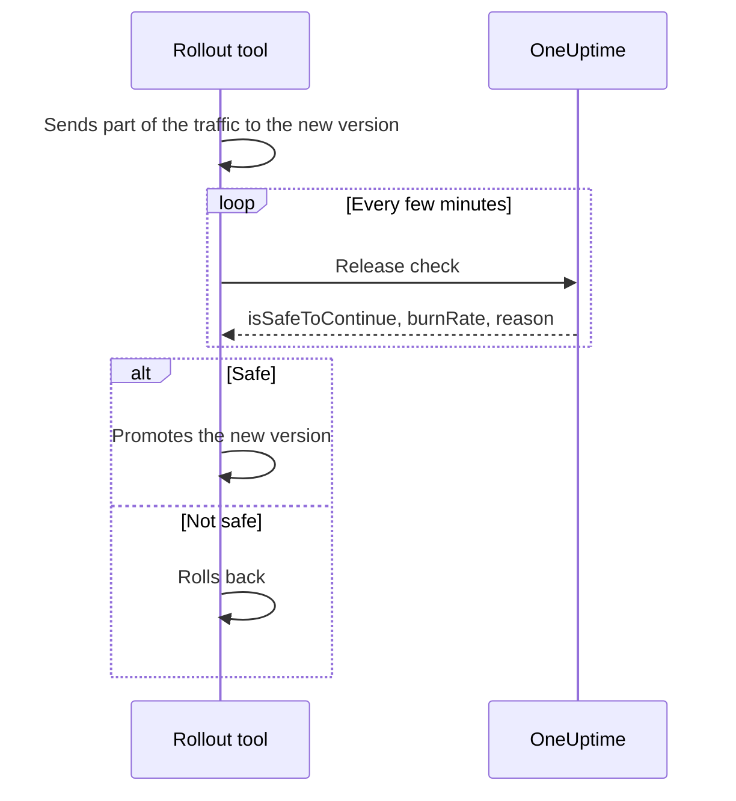

# Release Checks

A release check asks an SLO "is it safe to keep rolling this release out?" while the release goes out, and answers from how fast the SLO burned its error budget over the last few minutes. Argo Rollouts, Flagger or a deployment pipeline asks it as a canary takes traffic, and rolls the release back on a no. OneUptime deploys nothing itself: your rollout tool keeps doing the rollout, and OneUptime tells it how the release is doing.

:::cards
- [Ask the check](#ask-the-check): One request with an API key, and what it answers.
- [Argo Rollouts](#argo-rollouts): An analysis that aborts the rollout.
- [Flagger](#flagger): A webhook that halts the canary.
- [GitHub Actions](#github-actions): A step that rolls back after a deploy.
:::

## How it works

The [deployment gate](/docs/slo/error-budget-policy#deployment-gate) answers before a release, from the error budget of the whole compliance window. A release that breaks something has spent almost none of a month's budget in its first ten minutes, so the release check reads what the release changes: the burn rate over the last few minutes.



The check answers with one of three verdicts:

| Verdict | When | `isSafeToContinue` |
| --- | --- | --- |
| `Pass` | The window burned the error budget at `maxBurnRate` or slower. | `true` |
| `Fail` | It burned faster, or the SLO's error budget policy freezes deployments. | `false` |
| `NotEnoughData` | The window had fewer requests than `minimumRequestCount`, or the SLO's monitors recorded no status in it. Too little to call the release safe. | `false` |

At a burn rate of 1 the window met the SLO's target exactly, so the default `maxBurnRate` of `1` fails a release that does worse than the target.

What the check reads depends on what the SLO measures:

- A [request SLO](/docs/slo/request-slos) is judged from its services' requests in the window, read from their spans as they arrive. Add `serviceVersion` to judge only the new version's requests: OneUptime matches it against the `service.version` resource attribute of the spans, which an OpenTelemetry SDK sets from `OTEL_RESOURCE_ATTRIBUTES=service.version=1.4.2`. That way the canary is judged on its own requests, not diluted by the old version's.
- A monitor uptime SLO is judged from its monitors' status timelines over the window. `minimumRequestCount` does not apply to it, and a check with `serviceVersion` is refused: monitors have no versions.

## Before you begin

You need an SLO that measures what the release affects. A request SLO of the service you release judges a canary best, because it reads that service's own requests.

## Set up a release check

:::steps
### Give the rollout a key

Create an [API key](/docs/api-reference/api-reference) of the project whose role can read SLOs, and store it as a secret of your rollout tool or pipeline.

### Copy the SLO's ID

Open the SLO and copy its ID from the address: `/slos/<slo-id>`.

### Ask the check once by hand

Run the request under [Ask the check](#ask-the-check) with the key and the ID. It answers with `isSafeToContinue` and a `reason`.

### Add it to your rollout

Ask the check from [Argo Rollouts](#argo-rollouts), [Flagger](#flagger) or [GitHub Actions](#github-actions), and roll back when `isSafeToContinue` is `false`.
:::

## Ask the check

The check is `GET` or `POST` on the SLO's `release-check` address. Send the options in the query string, or as a JSON body with `POST`:

```bash
curl -sS "https://oneuptime.com/api/service-level-objective/<slo-id>/release-check?windowInMinutes=10&serviceVersion=1.4.2" \
  -H "ApiKey: $ONEUPTIME_API_KEY"
```

It answers with the verdict first, then what it was read from:

```json
{
  "isSafeToContinue": false,
  "verdict": "Fail",
  "reason": "The last 10 minutes burned the error budget at 3.2x, faster than the 1x this check allows (SLI 99.68% against the 99.9% target).",
  "sloId": "<slo-id>",
  "sloName": "Checkout requests",
  "sliType": "Request Success",
  "targetPercentage": 99.9,
  "windowInMinutes": 10,
  "maxBurnRate": 1,
  "burnRate": 3.2,
  "sliPercentage": 99.68,
  "deploymentsAllowed": true,
  "errorBudgetPolicyTier": null,
  "sloStatus": "Healthy",
  "checkedAt": "2026-11-15T12:00:00.000Z",
  "goodRequestCount": 2492,
  "totalRequestCount": 2500,
  "minimumRequestCount": 1,
  "serviceVersion": "1.4.2"
}
```

The options:

| Option | Default | What it does |
| --- | --- | --- |
| `windowInMinutes` | `10` | How far back the check looks, in whole minutes from 1 to 360. |
| `maxBurnRate` | `1` | The fastest burn rate that passes. `2` lets the window burn the budget twice as fast as the target allows. |
| `minimumRequestCount` | `1` | Request SLOs: the fewest requests the check judges. With `0`, a window with no requests passes. |
| `serviceVersion` | None | Request SLOs: judge only the requests whose spans carry this `service.version`. |
| `includeDeploymentGate` | `true` | Fail while the SLO's error budget policy freezes deployments. With `false`, only the burn rate decides. |
| `failWithStatusCode` | `false` | Answer a no with HTTP status 412 instead of 200, for tools that read only the status code. |

The answer's fields:

| Field | What it holds |
| --- | --- |
| `isSafeToContinue` | `true` to carry on with the rollout, `false` to roll it back. |
| `verdict` | `Pass`, `Fail` or `NotEnoughData`. |
| `reason` | One sentence for the rollout's log, saying what was measured and why the check answered as it did. |
| `burnRate` and `sliPercentage` | How fast the window burned the error budget, and the SLI over the window. |
| `goodRequestCount` and `totalRequestCount` | Request SLOs: the requests the window held, and how many of them were good. |
| `deploymentsAllowed` and `errorBudgetPolicyTier` | Whether the SLO's error budget policy allows deployments, and the tier it is in. |
| `checkedAt` | When the check was measured. |

An SLO that cannot be measured - a request SLO with no services, a latency SLO with no threshold, a monitor uptime SLO with no monitors - is answered with HTTP 400 and what to fix, so a rollout stops on a clear error rather than a guess. On a self-hosted installation, use its own address instead of oneuptime.com.

## Argo Rollouts

An analysis with a `web` metric asks the check at each step of a canary, and Argo Rollouts aborts the rollout and scales the canary down when it fails. Store the API key as a secret first:

```bash
kubectl create secret generic oneuptime --from-literal=api-key="$ONEUPTIME_API_KEY"
```

Then add the template, and run it after the canary's first step:

:::tabs
@tab AnalysisTemplate
```yaml title="oneuptime-release-check.yaml"
apiVersion: argoproj.io/v1alpha1
kind: AnalysisTemplate
metadata:
  name: oneuptime-release-check
spec:
  args:
    - name: version
    - name: api-key
      valueFrom:
        secretKeyRef:
          name: oneuptime
          key: api-key
  metrics:
    - name: slo-burn-rate
      interval: 2m
      count: 5
      failureLimit: 0
      successCondition: result == true
      provider:
        web:
          url: "https://oneuptime.com/api/service-level-objective/<slo-id>/release-check?windowInMinutes=10&serviceVersion={{args.version}}"
          headers:
            - key: ApiKey
              value: "{{args.api-key}}"
          jsonPath: "{$.isSafeToContinue}"
```
@tab Rollout
```yaml title="rollout.yaml"
apiVersion: argoproj.io/v1alpha1
kind: Rollout
metadata:
  name: checkout
spec:
  strategy:
    canary:
      steps:
        - setWeight: 10
        - analysis:
            templates:
              - templateName: oneuptime-release-check
            args:
              - name: version
                value: "1.4.2"
        - setWeight: 50
        - pause: { duration: 10m }
```
:::

The analysis asks five times, two minutes apart, and the first no aborts the rollout. Pass the same version the canary's pods set in `OTEL_RESOURCE_ATTRIBUTES`. If the canary may see no traffic at its first weight, add `&minimumRequestCount=0` to the address, or a quiet canary fails the analysis with `NotEnoughData`.

## Flagger

Flagger calls a `rollout` webhook at each step of its analysis, and halts and rolls back the canary when the webhook keeps failing. Flagger's webhooks send no headers, so ask the check through the Flagger load tester, which runs a command for the webhook:

```yaml title="canary.yaml"
apiVersion: flagger.app/v1beta1
kind: Canary
metadata:
  name: checkout
spec:
  analysis:
    interval: 1m
    threshold: 2
    maxWeight: 50
    stepWeight: 10
    webhooks:
      - name: oneuptime-release-check
        type: rollout
        url: http://flagger-loadtester.test/
        timeout: 30s
        metadata:
          type: bash
          cmd: "curl -sSf -H \"ApiKey: $ONEUPTIME_API_KEY\" 'https://oneuptime.com/api/service-level-objective/<slo-id>/release-check?windowInMinutes=5&failWithStatusCode=true'"
```

With `failWithStatusCode=true`, a no is HTTP 412, so `curl -f` exits with an error and the webhook fails. Give the load tester the key as `ONEUPTIME_API_KEY` in its environment, from a Kubernetes secret. Once `threshold` checks have failed, Flagger rolls the canary back.

## GitHub Actions

A pipeline that deploys in one go can still watch the release: deploy, ask the check a few times, and roll back when it says no.

```yaml title=".github/workflows/deploy.yml"
name: Deploy
on:
  push:
    branches: [main]

jobs:
  deploy:
    runs-on: ubuntu-latest
    steps:
      - uses: actions/checkout@v4
      - name: Deploy
        run: ./deploy.sh
      - name: Watch the release against the SLO
        env:
          ONEUPTIME_API_KEY: ${{ secrets.ONEUPTIME_API_KEY }}
          SLO_ID: <slo-id>
          VERSION: ${{ github.sha }}
        run: |
          for attempt in 1 2 3 4 5; do
            sleep 120
            CHECK=$(curl -sS "https://oneuptime.com/api/service-level-objective/$SLO_ID/release-check?windowInMinutes=10&serviceVersion=$VERSION" \
              -H "ApiKey: $ONEUPTIME_API_KEY")
            echo "$CHECK" | jq -r '.reason'
            if [ "$(echo "$CHECK" | jq -r '.isSafeToContinue')" != "true" ]; then
              exit 1
            fi
          done
      - name: Roll back
        if: failure()
        run: ./rollback.sh
```

The step fails on a no, and on any answer without `isSafeToContinue: true` - a wrong ID, a key that cannot read the SLO, no answer at all - so the pipeline never carries on with an answer it did not get. Set `service.version` to the commit (`${{ github.sha }}`) when the service starts, so the check judges only the new version.

## Next steps

:::cards
- [Request and Latency SLOs](/docs/slo/request-slos): Measure a service's requests, the SLI that judges a canary best.
- [Error Budget Policy](/docs/slo/error-budget-policy): Freeze deployments while the budget is low.
- [Burn Rate Alerts and Incidents](/docs/slo/burn-rate-alerts): Page your team when the budget burns too fast.
:::
