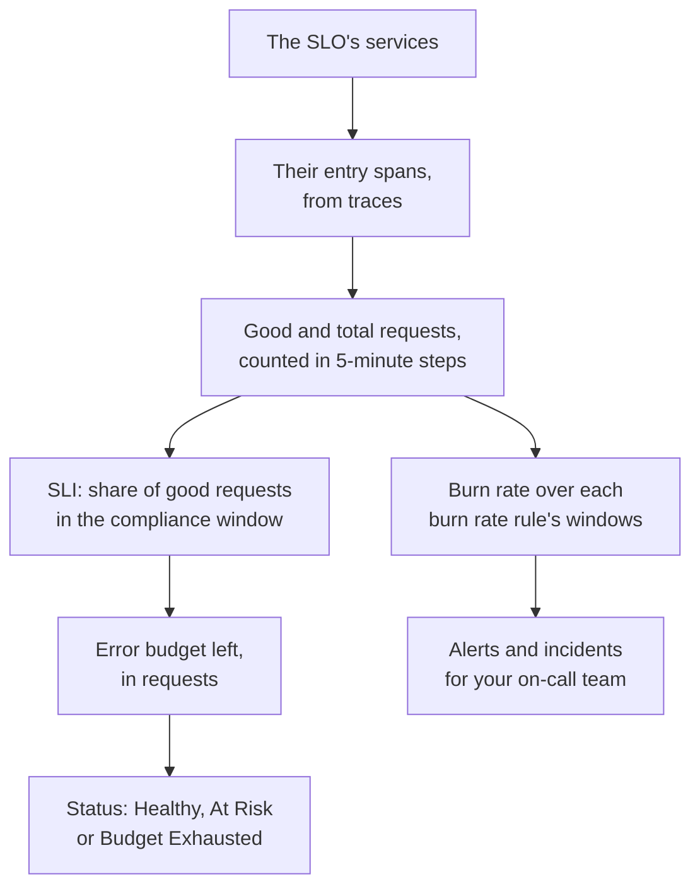

# Request and Latency SLOs

A request SLO measures what your users get from a service: the share of its requests that succeed, or that are served fast enough. OneUptime counts them from the traces your services already send, so there is no monitor to set up: choose the services and a target, and OneUptime measures them every 5 minutes.

:::cards
- [Create a request SLO](#create-a-request-slo): The services, a threshold for latency, and a target.
- [Count only some requests](#count-only-some-requests): One endpoint, or every request but health checks.
- [SLOs from a metric](#slos-from-a-metric): A counter or a histogram, for services that send no traces.
- [How requests are counted](#how-requests-are-counted): Which spans count, and when.
- [Release Checks](/docs/slo/release-checks): Roll back a release that burns the error budget.
:::

## Request success and request latency

| What it measures | A request is bad when | Its error budget counts |
| --- | --- | --- |
| **Request success** | Its span's status is `Error`. A span with no status counts as good, as OpenTelemetry means it. | Failed requests |
| **Request latency** | It took longer than the SLO's **Latency Threshold (ms)**, whatever its status. | Slow requests |

The SLI is the share of good requests in the compliance window, and the error budget is the bad requests the target allows: at 99.9%, one in every 1,000. A latency SLO counts a request that failed fast as good, so measure an important service both ways: one SLO that it works, and one that it is fast.

## How it works

A request is an entry span of one of the SLO's services: the span where a request or a message enters the service, as the [Traces](/docs/telemetry/traces-explorer#traces-and-spans) list shows them by default. A request that passes through two of the SLO's services counts once in each.

From there a request SLO works like any other. Its status, burn rate rules, error budget policy, owners and notifications are the same, with its error budget in requests instead of minutes.

## Before you begin

- The services send traces to OneUptime: see [OpenTelemetry](/docs/telemetry/open-telemetry). Each one is in the [service catalog](/docs/telemetry/services) under its `service.name`.
- A role that can create SLOs: Project Owner, Project Admin, or a custom role with the Create Service Level Objective permission.

## Create a request SLO

:::steps
### Open SLOs

Open **SLOs** from the **Products** menu in the top bar, and click **Create Service Level Objective**.

### Choose what it measures

Under **What It Measures**, pick **Request success** or **Request latency**, then the **Services** whose requests it counts. For **Request latency**, set the **Latency Threshold (ms)** too: a request served within it counts as fast enough, for example `300`. To count only some of their requests, enter a **Request Filter**: see [Count only some requests](#count-only-some-requests). Click **Next**.

### Name it and set a target

Enter a **Name**, for example "Checkout requests", and a **Target (%)**: the share of requests that must be good. Click **Create Service Level Objective**.

### Watch the first numbers arrive

The first evaluation, within 5 minutes, counts the last 6 hours of requests, so the SLO has numbers at once. The evaluations after it count older requests too, until the compliance window is covered.
:::

A service's own **SLOs** page lists the SLOs that measure it, and its **Create Service Level Objective** opens the same form with the service already chosen. To change what an SLO measures, its services, its threshold or its filter later, open its **Settings** and click **Edit What It Measures**.

## Count only some requests

A request SLO counts every request of its services. A **Request Filter** counts only the ones that matter, such as the checkout endpoint, or leaves some out, such as health checks that would make the SLI look better than what users get. Write it as a traces search, in the same [search syntax](/docs/telemetry/search-syntax#matching-values) as the Traces explorer:

| Request Filter | Counts |
| --- | --- |
| `@http.route:/checkout*` | Requests whose route starts with `/checkout`. |
| `-@http.route:/health` | Every request except health checks. |
| `@http.request.method:[POST, PUT]` | POST and PUT requests. |
| `name:"POST /checkout"` | Requests whose span is named `POST /checkout`. |

Every term must match, so `@http.route:/checkout* -@http.route:/checkout/health` counts the checkout requests except their health check. A term with `@` is an attribute of the request's span, and `name:` is the span's name. Free text and the explorer's other fields, such as `status:` and `duration:`, are not filters here: the SLO already decides which requests are bad or slow. A filter holds up to 10 terms in 500 characters.

The **Overview** shows the filter under the SLO's services, and **Settings** shows it under **What It Measures**. Changing it counts the SLO's requests again from the start.

## SLOs from a metric

When your services already count their requests as metrics, or send no traces, measure the SLO from a counter or a histogram instead. Under **What It Measures**, pick **Metric** and the **Services** that send it, then on the **Metric** step:

| Field | What to enter |
| --- | --- |
| **Metric** | The metric's name, picked from your project's metrics or typed, such as `http_requests_total` or `http.server.request.duration`. |
| **Good Events** | **A counter, by a condition**, or **A histogram, by a value**. |
| **Good When** | For a counter: the events that are good, as a search of its attributes, such as `@http.response.status_code:<500`. |
| **Good At Or Under** | For a histogram: the value a good observation is at or under, in the metric's own unit, such as `0.3` for 300 ms of a histogram in seconds. Use one of its bucket boundaries. |
| **Metric Filter** | Optional: the series that count, such as `-@http.route:/health`. |

A counter's events are what it grew by in each 5-minute step, the way Prometheus' `increase()` reads one: a counter that restarts counts from zero again, and cumulative and delta counters both count. A histogram's events are its observations, and the good ones are those in the buckets at or under the value. Only the metric's own points count, from the SLO's services: a gauge of the same name counts nothing. An SLO on a gauge, as every cloud metric is, says so on its page, and so does the metric picker: measure a cloud metric with a metric monitor, and an SLO of that monitor's uptime.

From there a Metric SLO works like a request SLO, with its error budget, burn rate rules and release checks in events. Changing the metric counts its events again from the start.

## How requests are counted

OneUptime counts each SLO's good and total requests in 5-minute steps and keeps the counts, so the SLO reads its window from its own counts rather than from every span each time:

- A step is counted 2 minutes after it ends, so spans that arrive late are in it, and the next evaluation counts the last two steps again for spans that arrive later still.
- A new SLO starts with the last 6 hours. Each evaluation after that counts up to a day of older requests, newest first, until the window is covered.
- Only requests still within your [telemetry retention](/docs/telemetry/data-retention#how-long-telemetry-is-kept) can be counted. Counted steps are kept for 400 days, longer than any compliance window, so a window longer than the retention fills as the SLO ages.
- Changing what the SLO measures, its services, its latency threshold or its request filter counts its requests again from the start. A longer compliance window is filled by counting further back.

While the counts cover only part of the compliance window, the **Overview** says so with a **Window 23% full** chip, and the **Error budget left** tile repeats it under its number. Both go once the counts cover the whole window.

## The error budget in requests

The budget is the bad requests the target allows among the requests counted in the window, so it grows with traffic: at 99.9%, a window of 2,000,000 requests allows 2,000 failed ones. On the **Overview**:

- **Error budget left** says how many bad requests are left of how many, or how many over the budget the SLO is.
- **Budget runway** says how long the budget lasts at the current burn rate, as long as traffic stays as it was.
- The summary counts the SLO's services, and a latency SLO says its threshold under its target.

Burn rate alerts, notifications and the feed say the budget in requests too. The `oneuptime.slo.error.budget.remaining.seconds` metric is not posted for a request SLO; chart `oneuptime.slo.error.budget.remaining.percent` instead.

A request SLO gets the same **Fast burn**, **Slow burn** and **Slow leak** rules as any new SLO. A quiet hour with a handful of requests can burn fast with one failure, so a rule can ignore windows with too few requests: set the rule's **Minimum Requests**, and the rule skips a long window with fewer requests than that.

## Troubleshooting

:::details The SLO says Waiting for requests
None of its services has served a request in the window yet. Check that the services send traces to OneUptime, and that their spans include entry spans: a service whose spans are all internal ones has no requests to count. If the SLO has a **Request Filter**, search the [Traces](/docs/telemetry/traces-explorer) explorer with it: a filter that matches no request there leaves the SLO none to count.
:::

:::details The SLI changed after I changed the services
Changing what the SLO measures, its services, its latency threshold or its request filter counts its requests again, starting with the last 6 hours, so the SLI and the budget start again from there. The **Window 23% full** chip shows how much of the window is counted so far.
:::

## Next steps

:::cards
- [Release Checks](/docs/slo/release-checks): Let Argo Rollouts, Flagger or a pipeline roll back a release that burns the budget.
- [Burn Rate Alerts and Incidents](/docs/slo/burn-rate-alerts): Page your team when the budget burns too fast.
- [Error Budget Policy](/docs/slo/error-budget-policy): Agree what the team does as the budget runs down.
:::
