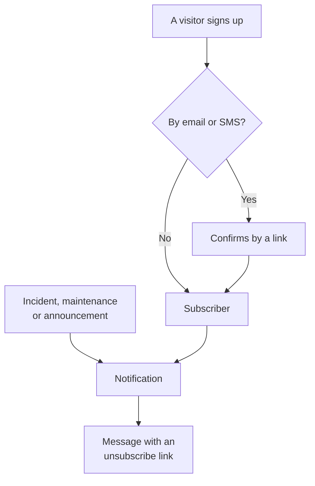

# Subscribers & Announcements

A status page is a place people go. Subscribers are the people who would rather not have to — they hand you an email address, a phone number, a Slack webhook or an HTTP endpoint once, and after that your updates come to them.

Announcements are the other half of the same job. A monitor can tell your visitors that checkout is returning 500s; no monitor can tell them that you are migrating databases on Saturday, that a third-party provider is having a bad day, or that the incident they read about yesterday is fully closed out. Announcements are the free-text channel for everything your checks cannot see, and they fan out to the same subscriber list.

This page covers both: the five subscription channels and how visitors sign up, what subscribers can choose to hear about, the double opt-in and unsubscribe flows, the email report subscribers can get every month, and how announcements are written, scheduled and templated.

:::cards
- [Subscription channels](#subscription-channels): The channels visitors can sign up on, and the page they sign up on.
- [What subscribers are told](#what-subscribers-get-notified-about): Announcements, maintenance, incidents and episodes, and edits to them.
- [Checking what was sent](#checking-what-was-sent): Every notification's status, and Retry and Resend.
- [Announcements](#announcements): Post a notice to one or more status pages.
:::

## How it works



Each status page keeps its own subscribers. A visitor signs up on the page's **Subscribe** page, where an email address or a phone number confirms with a link before it hears anything, or your team adds them on the dashboard. From then on, every incident, scheduled maintenance event and announcement that reaches the page notifies its subscribers, each on the channel they signed up with, and every message carries the link that cancels the subscription.

## Subscription channels

A status page supports five channels. They, and the page visitors sign up on, are switched in one place: the **Channels** card at **Status Pages → your page → Subscribers → Subscriber Settings**. Each switch saves as soon as you flip it:

- **Show Subscriber Page** (`showSubscriberPageOnStatusPage`) — on by default. Puts the **Subscribe** item in the status page nav bar, where visitors sign up by the channels below.
- **Email** (`enableEmailSubscribers`) — on by default. Everything else is off until you turn it on.
- **SMS** (`enableSmsSubscribers`) — off by default. On OneUptime Cloud each text is paid from the project's SMS and call balance, unless the page has its own **Twilio Config** (see [below](#email-footer-custom-smtp-and-twilio)). Turning it on also needs **SMS** switched on for the project, in the **Notification Channels** card on **Project Settings > Notifications > Notification Settings**, which a project owner, a **Billing Admin** or someone with **Manage Billing** can do.
- **Slack** (`enableSlackSubscribers`) — off by default.
- **Microsoft Teams** (`enableMicrosoftTeamsSubscribers`) — off by default.
- **Webhook** (`enableWebhookSubscribers`) — off by default.

The switches decide how visitors can sign themselves up, and the status page refuses a sign-up by a channel that is off. They do not stop notifications: subscribers your team adds on the dashboard, with the API or by a workflow get updates whichever channels are on.

On OneUptime Cloud, a switch your plan does not include has the plan's name beside it: **Growth** for **SMS** and **Show Subscriber Page**, **Scale** for **Slack**, **Microsoft Teams** and **Webhook**. Turning a channel off works on every plan, so a channel a trial turned on can always be turned off again; the switch says so under it.

Each channel also gets its own list in the status page side menu under **Subscribers**: **Email Subscribers**, **SMS Subscribers**, **Slack Subscribers**, **Microsoft Teams Subscribers** and **Webhook Subscribers**. That is where you look at who is signed up, add someone by hand with **Add Subscriber**, or leave yourself an **Internal Note** (`internalNote`) on a particular subscriber, which only your team sees. While a channel is off, the top of its list says so, with the channel's switch right there, so you can turn it on without leaving the list.

**One switch is not enough.** The **Subscribe** item in the status page nav bar only appears when **Show Subscriber Page** is on *and* at least one channel is on. If you turn on **Email** but leave **Show Subscriber Page** off, visitors have no way to reach the form.

**A calendar instead.** Visitors who only want your planned maintenance in their own calendar do not need to subscribe: **Subscribe to calendar** on the page's **Scheduled Events** page adds it to Google Calendar, Apple Calendar or Outlook, and the calendar keeps itself up to date. It sends nothing and does not depend on the channels above, and a private page does not offer it. See [Maintenance Calendar](/docs/scheduled-maintenance/calendar#a-status-pages-calendar).

## Turning every notification off

The first card on **Subscriber Settings**, **Notifications**, holds **Send Notifications to Subscribers** (`sendSubscriberNotifications`), on by default, which saves the moment you flip it. Off, the status page sends its subscribers nothing: no incident, episode, scheduled maintenance or announcement notification, no note or postmortem, and no email report, whatever its channels and event types say. Its subscribers are kept, and visitors can still subscribe while the **Subscribe** page and a channel are on; a new email subscriber still gets the email that confirms the subscription. Nothing is held back to be sent later: turned on again, the page tells its subscribers about what happens from then on.

While it is off, the top of every subscriber list says so, with a link back to **Subscriber Settings**. The summary of who will be notified, on an incident or a public note, names the page as one that does not send notifications to its subscribers, and a notification's status message and its feed item say why the page was passed over. It works on every plan. A test report sent to an address you type still goes.

## Who can subscribe

The **Who Can Subscribe** card, folded under **More settings** on **Subscriber Settings**, keeps a page's notifications to the people it is for:

- **Only Private Users Can Subscribe** (`limitSubscribersToPrivateUsers`), off by default, saves the moment you flip it. On, only the page's [private users](/docs/status-pages/index#private-users), whether added by hand, signed in with SSO or provisioned by SCIM, can subscribe, by email, with the address they sign in with. The **Subscribe** page fills that address in, does not let it be changed and offers no other channel. Your team can add only a private user's address, and no SMS, Slack, Microsoft Teams or webhook subscriber. A subscriber whose address is not a private user of the page now, one added before you turned it on or a reader removed since, by hand or by SCIM, is sent nothing and is not counted. A public page has no sign-in, so while it is on there only your team can add subscribers.
- **Allowed Email Domains** (`allowedSubscriberEmailDomains`) holds the domains an email subscriber's address may be at, one per line, such as `acme.com`. An address at a subdomain matches too (`eu.acme.com` for `acme.com`), but not one that only ends with the same letters (`evilacme.com`). Sign-ups and additions at any other domain are refused, and an email subscriber already at another domain is sent nothing. Leave it empty to allow any domain. SMS, Slack, Microsoft Teams and webhook subscribers have no domain and are not affected. Type the list and choose **Save Domains**: an entry that is not a domain is named before anything is saved, and the list is saved in lower case, one domain per line, up to 100 of them.

Neither setting deletes a subscriber, and turning them off sends to everyone again. On OneUptime Cloud, turning either on needs the **Scale** plan; turning them off works on every plan. Self-hosted, turning them on is part of the Enterprise Edition: on the Community Edition, restrictions already on keep applying and can only be turned off.

## What a visitor sees on the Subscribe page

The **Subscribe** page has a sub-menu with one tab per enabled channel; with only one channel on, there is no sub-menu, just that channel's form. Each tab asks for the minimum it needs:

| Tab | Address | Heading | What it asks for |
| --- | --- | --- | --- |
| **Email** | `/subscribe/email` | **Subscribe by Email** | **Your Email**, with the placeholder `subscriber@company.com`. |
| **SMS** | `/subscribe/sms` | **Subscribe by SMS** | **Your Phone Number**, with the placeholder `+11234567890`. |
| **Slack** | `/subscribe/slack` | **Subscribe by Slack** | **Slack Workspace Name** (used for validation) and **Slack Incoming Webhook URL**, with the placeholder `https://hooks.slack.com/services/...`. |
| **MS Teams** | `/subscribe/microsoft-teams` | **Subscribe by Microsoft Teams** | **Microsoft Teams Workspace Name** and **Microsoft Teams Incoming Webhook URL**, with the placeholder `https://outlook.office.com/webhook/...`. |
| **Webhooks** | `/subscribe/webhooks` | **Subscribe by Webhook** | **Webhook URL**, with the placeholder `https://example.com/webhook`. A JSON `POST` request is sent to it on each status page event. |

The submit button reads **Subscribe**. A signup by Slack, Microsoft Teams or webhook shows *You have been subscribed successfully.* A signup by SMS shows *We have sent a text message to this phone number. Open the link in it to confirm your subscription.* A signup by email says a confirmation link has been sent and to check the spam folder if it does not arrive (see [Email double opt-in](#email-double-opt-in)). The **Email**, **SMS**, **Slack** and **MS Teams** tabs also carry a **New Subscription** / **Manage Existing Subscription** split, so someone who already subscribed can get back to their preferences without hunting for an old message.

## Limits on signups and links

Each signup sends its contact a message at once, a confirmation email, an SMS, a Slack or Microsoft Teams message or a webhook call, and so does **Send Management Link**. So that nobody can use a status page to send messages to people who did not ask for them, or to run up your project's SMS costs, both are limited for each visitor's network and for each contact. The limits sit far above what people do: a whole office can sign up together during an incident.

| What is limited | Limit |
| --- | --- |
| Signups from one network | 60 in 15 minutes |
| Signups and management links by SMS from one network, together | 10 in 15 minutes |
| Management links asked for from one network | 30 in 15 minutes |
| Signups of one email address, phone number, Slack or Microsoft Teams channel, or webhook, on all status pages together | 10 in an hour |
| Management links for one email address or phone number on all status pages together, or for one Slack or Microsoft Teams workspace name on one status page | 5 in an hour |

Past a limit, the API answers `429` with a `Retry-After` header, in seconds, and the visitor is told that there were too many signups or links from their network, or for that contact, and to try again later. Nothing is created or sent, and your project sees nothing of it: no subscriber is added, and no message is sent or paid for. The management link limits count every request, whether or not a subscription matches, so they cannot be used to find out who is subscribed. An email address is counted however it is written, in capitals, with a `+tag` or, for Gmail, with dots, and a phone number however it is typed. A signup names one contact, an email address, a phone number, a Slack or Microsoft Teams channel or a webhook: a list of addresses, or a second contact, is refused.

Each limit per network also counts the addresses of one IPv6 /64 together, at ten times its number. The windows are fixed, not rolling. If the rate limiter cannot be reached, signups and management links by email, Slack, Microsoft Teams and webhook go on uncounted, and those by SMS are refused with `503` until it is back, because each SMS is paid for. Changing or canceling a subscription from its own link is never limited.

**One subscription per contact.** A status page takes each email address, phone number and webhook address once, Slack and Microsoft Teams webhooks included. An email address is the same in capitals, a phone number however it is typed (`+14155550100`, `14155550100` and `0014155550100` are one number), and a webhook address whether its host is in capitals, with its default port or a fragment, or with letters percent-encoded. A visitor who signs a contact up again is told they are subscribed already, or, while its subscription awaits confirmation, that the link to confirm it was sent, and nothing is sent. Your team adding it again, or changing a subscriber to it, is refused, and so is turning a canceled subscription back on while another subscription has its contact. Subscribers from before this are kept: where one number was subscribed under two spellings, delete the one you do not need.

**What your team sends counts too.** Nothing limits how fast your team adds subscribers, on the dashboard, in bulk, through the API or by a workflow. But the message an added subscriber is sent, the email asking it to confirm or the message saying it is subscribed, counts toward that contact's 10 signups in an hour, and past them that add is refused with `429`. A subscriber added without a message is never counted: **Subscribe them now** for an email address, or **Send a welcome message** turned off for the other channels. If the rate limiter cannot be reached, your team's adds go on uncounted.

A private user asking for a password reset link on the status page's sign-in page is limited the same way: 5 reset emails to one address in an hour, on all status pages together, and 30 from one network in 15 minutes. An invitation, to a private status page or to a project, is counted per address too: 10 to one address in an hour, both kinds together.

On a self-hosted installation, these environment variables of the OneUptime app change the limits:

| Variable | Default | What it sets |
| --- | --- | --- |
| `PUBLIC_MESSAGE_RATE_LIMIT_WINDOW_SECONDS` | `900` | The window of the limits per network, in seconds. |
| `PUBLIC_MESSAGE_RATE_LIMIT_PER_CONTACT_WINDOW_SECONDS` | `3600` | The window of the limits per contact, in seconds. |
| `PUBLIC_MESSAGE_RATE_LIMIT_STATUS_PAGE_SIGN_UPS_PER_IP` | `60` | Signups from one address per window. |
| `PUBLIC_MESSAGE_RATE_LIMIT_TEXT_MESSAGES_PER_IP` | `10` | Signups and management links by SMS from one address per window, together. |
| `PUBLIC_MESSAGE_RATE_LIMIT_STATUS_PAGE_MANAGE_LINKS_PER_IP` | `30` | Management links asked for from one address per window. |
| `PUBLIC_MESSAGE_RATE_LIMIT_STATUS_PAGE_SIGN_UPS_PER_CONTACT` | `10` | Signups of one contact per window. |
| `PUBLIC_MESSAGE_RATE_LIMIT_STATUS_PAGE_MANAGE_LINKS_PER_CONTACT` | `5` | Management links for one contact per window. |
| `PUBLIC_MESSAGE_RATE_LIMIT_STATUS_PAGE_PASSWORD_RESETS_PER_IP` | `30` | Private user password resets asked for from one address per window. |
| `PUBLIC_MESSAGE_RATE_LIMIT_STATUS_PAGE_PASSWORD_RESETS_PER_CONTACT` | `5` | Private user password reset emails to one address per window. |
| `PUBLIC_MESSAGE_RATE_LIMIT_INVITATIONS_PER_CONTACT` | `10` | Invitations to one address per window, to private status pages and projects together. |

Neither `config.env` nor the Helm chart's values pass them on: add them to the environment of the `app` container yourself, with `app.extraEnv`, or the chart-wide `extraEnv`, in the Helm chart, or in a `docker-compose.override.yml` for Docker Compose. `TRUSTED_PROXY_HOPS` decides which address the limits per network count.

## Letting subscribers choose resources and event types

By default a subscriber gets everything on the page. Two switches in the **Subscriber Choices** card on **Subscriber Settings** change that, each saving the moment you flip it:

- **Allow Subscribers to Choose Resources** (`allowSubscribersToChooseResources`) — off by default. Turn it on and the subscribe form grows a **Subscribe to All Resources** toggle; clear it and **Select Resources to Subscribe** appears so the visitor can pick individual resources.
- **Allow Subscribers to Choose Event Types** (`allowSubscribersToChooseEventTypes`) — off by default. Same shape: a **Subscribe to All Event Types** toggle, and **Select Event Types to Subscribe** underneath when it is cleared.

With either of them on, the subscribe form is still one page. Under where to send updates (the email address, phone number, workspace or webhook) comes **Preferences**, folded to one line that says what the visitor will get. Every resource and every kind of event are already chosen, so it starts as "You will get every update from this status page.", and a visitor who wants everything presses **Subscribe** without opening it. Anyone else opens **Preferences** and narrows the resources or event types down; folded again, the line follows what they picked ("You will get updates only about the resources you picked."). With both off, there is no **Preferences**: the form is where to send updates, then **Subscribe**.

The **Update Subscription** page (see below) shows the same choices open, since changing them is what a subscriber goes there for.

The event types are `Incident`, `Announcement` and `Scheduled Event`.

**A monitor group stands for every monitor in it.** A resource on the page is either a monitor or a monitor group, and a subscriber who picks a monitor group hears about incidents, scheduled maintenance events (their notes included) and announcements on any monitor in the group, exactly as if they had picked that monitor, which is also how the status page shows them. Someone who picked only other resources is not told, and someone who picked a monitor and the group that holds it gets one notification, not two.

The choices land on the subscriber record as **Is Subscribed to All Resources** (`isSubscribedToAllResources`, default true), **Is Subscribed to All Event Types** (`isSubscribedToAllEventTypes`, default true), **Subscribed to Resources** and **Subscribed to Event Types**.

**A subscriber chooses among its own page's resources.** **Subscribed to Resources** names resources of the subscriber's own status page, whoever writes it: a visitor on the page, a teammate on the dashboard, an API key or a workflow. A visitor picks from what the page shows them, so a resource whose monitor is archived, which the page hides, is not one they can pick. A resource of another status page, or one the page hides from a visitor, is refused with the `400` that names the field and the ID, as an ID that matches nothing is. A change asks only about the resources it adds, so a subscription keeps a resource it names already, such as one whose monitor was archived after it was picked. A subscriber is told about an event only through resources of its own page.

Good for: a page that covers several products. A customer who only uses your API does not want a page every time the marketing site wobbles — let them narrow the list themselves rather than watching them unsubscribe entirely.

**Subscriber Timezones** is under **More settings** on the same screen (see [below](#email-footer-custom-smtp-and-twilio)).

## Email double opt-in

Email subscribers always confirm. When a subscriber is created with an email address and was not created already-confirmed, **Is Subscription Confirmed** (`isSubscriptionConfirmed`) is forced to `false` and a random 32-character **Subscription Confirmation Token** is generated. OneUptime then emails a confirmation link shaped like `{statusPageUrl}/confirm-subscription/{statusPageSubscriberId}?verification-token={token}`. The visitor lands on a **Confirm Subscription** page and, once it goes through, sees *Subscription confirmed successfully*.

Slack, Microsoft Teams and webhook subscribers skip this, and so do SMS subscribers your team adds — they are created with `isSubscriptionConfirmed` already set to `true`. When your team adds an email subscriber on **Email Subscribers**, **When you add them** decides: **Subscribe them now** (the default: confirmed, and sent nothing), **Subscribe them now and tell them** (confirmed, and sent the email that says they are subscribed) or **Ask them to confirm first** (sent the confirmation link, like a sign-up). **Add in Bulk** asks the same.

**Signups by SMS confirm too.** A visitor who signs up by SMS is texted one message: the confirmation link. Nothing else is sent to the number until the link is opened, and opening it texts the message that says they are subscribed, with the link that cancels the subscription. Until then the subscriber shows as **Awaiting Confirmation**, and the SMS log shows the link with its code replaced by `[redacted]`. SMS subscribers from before this are confirmed already.

**A confirmation link works for 24 hours.** The email and the SMS say so. Opened later, it confirms nothing: the **Confirm Subscription** page says *This link to confirm your subscription has expired or is not valid. A link works for 24 hours after it is sent. To get a new one, subscribe again.* and offers **Subscribe again**, and the API answers `400`. The subscriber stays unconfirmed, is sent nothing and shows as **Link Expired** in its list, instead of **Awaiting Confirmation**.

**Signing up again.** While the link works, signing the same email address or phone number up again on that status page sends nothing more: the visitor is told a link was already sent, and the API answers `429` with a `Retry-After` header. So a contact gets at most one confirmation link a day from a status page, however often it is signed up. Once the link has expired, the subscription no longer holds its contact: a new signup, or your team adding the contact, replaces it, and a signup gets a new link. Whoever signs a contact up first cannot keep its owner from subscribing: the link goes to the owner, and a day later the owner can get one of their own. Links sent before this change work for 24 hours after their signup too.

**Unconfirmed means silent.** The query that fetches subscribers for a notification filters on `isUnsubscribed: false` and `isSubscriptionConfirmed: true`. An email address that never clicked the link will sit in your **Email Subscribers** list and receive nothing. If someone swears they are subscribed but hears nothing, check that column first.

There is no toggle to turn email confirmation off — it is unconditional for anyone who signs up through the status page. A separate per-subscriber column, **Send You Have Subscribed Message** (`sendYouHaveSubscribedMessage`, default true), controls the "you have subscribed" email that goes out once a subscriber is confirmed. On the dashboard, **When you add them** sets it for an email subscriber, and **Send a welcome message**, under **More fields**, for the other channels.

## Managing and canceling a subscription

Every message a subscriber gets carries an unsubscribe link of the form `{statusPageUrl}/unsubscribe/{statusPageSubscriberId}-{token}`: at the bottom of an email, in the text of an SMS, Slack or Microsoft Teams message, and as `unsubscribeUrl` in a webhook payload. The token is a random secret that belongs to that one subscription, so the link works without signing in. That includes a private status page, where everything else needs a signed-in visitor.

An SMS carries the same link, from a public status page as from a private one, and so does `{{unsubscribeUrl}}` in a custom SMS template. A link with only the subscriber's id would be shorter, but every project member who can see the subscriber can read its id, so such a link would let them change the subscription.

The SMS log (the **SMS** tab of **Notification Logs**, on the status page and in the project's settings) keeps the text of every SMS, and more project members can read it than can manage subscribers. So the log shows an unsubscribe or manage link with its token replaced by `[redacted]`, for example `{statusPageUrl}/unsubscribe/{statusPageSubscriberId}-[redacted]`. Only the subscriber's own phone gets the working link. A new subscriber's token is never returned by the API either, not even in the response to the request that created it.

**Opening the link changes nothing.** The page shows the status page's name and logo and the subscription the link belongs to: an email address in full, a phone number masked to its last four digits, a Slack or Microsoft Teams workspace name, or a webhook's host. It asks *Do you want to stop receiving notifications from this status page?* and only pressing **Unsubscribe** cancels the subscription, so mail scanners and link previewers that open every link in a message cannot unsubscribe anyone. Nothing else about the page is shown, and none of its custom JavaScript runs. Confirming twice, or opening the link of a subscription that is already cancelled, just says it is cancelled. On a public status page the unsubscribe page also links to the subscriber's **Update Subscription** page, to choose which notifications they receive instead.

The **Update Subscription** page, `{statusPageUrl}/update-subscription/{statusPageSubscriberId}-{token}`, opens only with the subscription's token too: the subscriber's id alone opens nothing. It is titled **Update Subscription** and tells the visitor they can update their preferences or unsubscribe there. It holds:

- Whatever resource and event-type pickers the page allows.
- An **Unsubscribe** toggle, described as unsubscribing from all resources. It writes **Is Unsubscribed** (`isUnsubscribed`, default false).
- A submit button reading **Update Subscription**; saving shows *Your changes have been saved.*

On a private status page it needs a signed-in visitor, like the rest of the page. Like the unsubscribe page, it runs none of the page's custom JavaScript, and it shows the standard header and footer in place of any custom header or footer HTML. Someone who lost the link uses **Manage Existing Subscription** on the **Subscribe** page and presses **Send Management Link**. The link goes to the subscription itself — its email address, its phone number, or its Slack or Microsoft Teams channel — never to an address in the request, and the page answers the same whether a subscription matched or not, so it cannot be used to find out who is subscribed. That message links to the **Update Subscription** page, and hands a custom template both links: `manageSubscriptionUrl` and `unsubscribeUrl`.

The endpoints behind all of this are `POST .../subscribe/:statusPageId`, `POST .../manage-subscription/:statusPageId`, `POST .../get-subscription/:statusPageId/:subscriberId/:token`, `PUT .../update-subscription/:statusPageId/:subscriberId/:token`, and `GET` and `POST .../unsubscribe/:statusPageId/:subscriberId/:token`. The unsubscribe `GET` only describes the link. The `POST` cancels the subscription whatever its body, including the `List-Unsubscribe=One-Click` body of a one-click unsubscribe request. Every endpoint that takes a token gives the same answer for a missing or wrong token, a deleted subscriber and a subscriber of another status page, so none can be used to find out who is subscribed.

Unsubscribing flips a flag rather than deleting a row, so the record stays in the channel list with **Is Unsubscribed** set — useful when you need to explain later why a particular address stopped receiving mail. It also records **Unsubscribed At** (`unsubscribedAt`), whoever cancelled the subscription: the subscriber through the link or the **Update Subscription** page, or a teammate on the dashboard or through the API. To unsubscribe several at once, select them in a subscriber list and choose **Unsubscribe** under **Bulk Actions**. Each subscriber list has an **Unsubscribed At** column and filter. Setting a subscriber's **Status** back to **Subscribed** clears it. Subscriptions cancelled before OneUptime recorded this have no date.

A link with only the subscriber's id opens nothing any more. An **Update Subscription** link in an older message, `{statusPageUrl}/update-subscription/{statusPageSubscriberId}`, opens a page that says the link has expired, with **Get a new link**, which leads to the **Subscribe** page. Very old messages carried `/api/status-page-subscriber/unsubscribe/{statusPageSubscriberId}`, which used to unsubscribe as soon as it was opened. It no longer changes anything: it leads to the unsubscribe page, which says the link is out of date and to use the one in a recent message.

### Shared addresses and mailing lists

Anyone who can read a mailbox can unsubscribe it. For an address somebody signed up themselves, that is the point. For one your team added, such as a site's mailing list like `site03-all@`, it means one reader can take everyone on the list off the page before the next outage. So:

- **Add people by their own addresses where you can.** The **Add in Bulk** form and the email subscriber form say so, in the email field's description.
- **The team is told.** A subscriber your team added is one added from the dashboard, with an API key (the REST API, Terraform, a script) or by a workflow; the API reads it as **Is Added By Team** (`isAddedByTeam`). When one unsubscribes, through its link or the **Update Subscription** page, the status page's owners (its owner users, and the members of its owner teams) each get one email naming the subscriber, with a link to the page's subscriber list. So does the teammate who added it, when a teammate did. A page with no owners emails only that teammate, so a subscriber an API key or a workflow added to a page with no owners is not reported. People who signed up themselves on the status page are never reported. Subscribers that an API key or a workflow added before OneUptime recorded this cannot be told apart from sign-ups, and are not reported either.
- **The subscriber lists show it.** Above each list, a notice names the subscribers your team added that unsubscribed in the last 30 days.

The unsubscribe page warns a reader of such a subscription before they confirm: if it is a shared address, unsubscribing stops the notifications for everyone who receives them, and the team will be told.

## What subscribers get notified about

Subscribers hear about the three event types above, but each source has its own switch, so nothing is sent by accident.

### Announcement notifications

The announcement itself carries **Should subscribers be notified?** (`shouldStatusPageSubscribersBeNotified`), exposed on the create form as the **Notify Status Page Subscribers** checkbox under **Schedule & Notifications**, and on by default. Subscribers are told once, when the announcement starts showing, so this is decided when the announcement is created; an edit cannot change it. A workflow that writes it later only stores it: writing it back unchanged never sends the announcement again, turning it on does not send it, and turning it off before the notification has gone out skips the notification. If the announcement names monitors under **Monitors Affected**, the notification is scoped to those monitors: on a page where subscribers choose resources, it goes to the subscribers of those monitors, of the monitor groups that hold them, and of every resource. Leave it empty and all subscribers are notified. On a status page that lists none of those monitors, directly or through a group, the announcement is for everyone who reads that page, so every subscriber there who gets announcements is notified.

### Scheduled maintenance events

A scheduled maintenance event has its own set of subscriber columns: **Should subscribers be notified when event is created?**, **Should subscribers be notified when event is changed to ongoing?**, **Should subscribers be notified when event is changed to ended?**, plus **Subscriber notifications before the event** and **Next subscriber notification before the event at?** for advance warnings. **Status Pages** on the event decides which pages it appears on, **Should be visible on status page?** decides whether it appears at all, and **Publish on Status Page At**, when it has one, from when: until then it is on none of them, and their subscribers are told it is scheduled at that time rather than when it is created.

**Create Scheduled Maintenance Event** walks two steps, then a review, the way **Declare Incident** does:

1. **Event** — **Title**, **Description**, **Starts At** and **Ends At**. A new event starts at the next full hour on your clock and lasts an hour; change the times only when they are wrong. Moving **Starts At** moves **Ends At** with it, so the window keeps its length, and the event has to end after it starts. **Owners** and **Labels** wait under **More fields**.
2. **Resources Affected** — **Monitors** first, then **Change Monitor Status to** right under them once a monitor is picked: the monitors change to that status when the event starts, and back to operational when it ends. Then **Other Affected Resources**: the hosts, clusters, container hosts, databases, IoT fleets, network sites and services the maintenance touches. Then **Show event on these status pages**, then **Subscriber Notifications**, folded to one line that says what will happen. By default it reads "Shown on its status pages as soon as it is saved. Subscribers of the event's status pages are notified when it is scheduled, when it starts and when it ends." Open it to pick when the event is published under **Publish on Status Pages**, and to change **When the event is scheduled**, **When the event starts**, **When the event ends** and **Reminders before the event**; the line follows what you pick, and the review step shows it too.

From the **Scheduled Maintenance** tab of a host, a Kubernetes, Proxmox, Ceph or Docker Swarm cluster, a Docker or Podman host, a vCenter, a storage array, an IoT fleet, a database, a service or a network site, **Create Scheduled Maintenance Event** (and **Create from Template**) opens the same form with that resource already picked under **Other Affected Resources**, and the breadcrumbs go back to that tab. An inventory item's **Scheduled Maintenance** tab picks the host, service or Kubernetes cluster the item points at, and the breadcrumbs go back through that resource's tab.

Only the title has to be typed: everything else has a default, so **Next** walks the other steps without asking for anything, and **Create Scheduled Maintenance Event** is on the review at the end. Nobody is notified until you pick a status page. The three **When the event…** settings are chosen when the event is created, and a workflow that writes **When the event is scheduled** later only stores it: written back unchanged or turned on, it sends nothing, and turned off before the 'scheduled' notification has gone out, that notification is skipped. The **Edit** button on the event's **Maintenance Details** card changes its title, window and labels (**Event**) and its status pages, when it is published and its reminders (**Status Pages**). The **Edit** button on its **Affected Resources** card asks the same way as the form: **Monitors**, then **Change Monitor Status to** once there is a monitor, then **Other Affected Resources**, and the card shows the status under the monitors. Anyone who can edit the event can change its monitor status until the event starts. When it starts - at its start time, or when someone moves it to an ongoing state by hand, from Slack or Microsoft Teams, or through the API - its monitors change to the status it holds at that moment, and so do monitors added while it runs. Moving it from **Scheduled** straight into a state of your own placed between **Ongoing** and **Ended**, such as "Verifying", starts it the same way: its monitors change to its status, as they would in **Ongoing**, and go back to operational when it ends. From then on the status can no longer be changed: the card's **Edit** shows it read-only, with "The event has started, so this can no longer be changed.", and the API refuses a change with "Change Monitor Status to can no longer be changed: this event has already started." Writing back the status the event already holds is still accepted. Scheduled maintenance templates (**Settings → Event Templates**) use the same steps, with the template's name in front and its recurring schedule at the end. A template asks for **Change Monitor Status to** whether or not it names monitors, because its status also applies to the monitors picked when an event is scheduled from it. An existing template's **Affected Resources** card asks the same way and shows the status the template picks, or **Monitors keep their status.** when it picks none; anyone who can edit the template can change it there.

**Which status pages?** Once the event names monitors, the status pages that show them are suggested under **Show event on these status pages**: "Status pages that show the affected monitors:" followed by each page's name. Click a name to add that page, or **Add all** to add every one. A page counts when it lists one of the monitors, directly or through a monitor group. Only the status pages you can see are suggested, and archived pages and pages that do not show scheduled maintenance events are left out. Nothing is picked for you: a status page you pick shows the event and, with the default notifications, tells its subscribers, so that stays your choice. The **Status Pages** step of the event's **Edit** and the forms of a scheduled maintenance template suggest the same way, from the event's or the template's monitors.

**States of your own.** An event is in progress in **Ongoing** and in every state of your own placed between **Ongoing** and **Ended** - a "Verifying" step, say. A state of your own placed before **Ongoing** has not started yet, and one placed after **Ended** - "Reviewing" - is over. Everything that asks whether an event is in progress asks this one rule. Such an event is listed as ongoing on its status pages - on the overview, on the event's own page and in the RSS feed - and in the **Ongoing** lists under **Scheduled Maintenance** and **Home**, their menu badges and the **Ongoing maintenance** tile on **Home**, and the Microsoft Teams app lists it as ongoing maintenance. Its monitors stay in maintenance, the network sites and telemetry series it covers stay silenced, and SLO burn-rate alerts on its monitors are held back. At its **Ends At** it is ended the way an ongoing event is, and its subscribers are told if **When the event ends** is on. Moving it from **Ongoing** or "Verifying" straight into a state of your own placed after **Ended** ends it the way **Ended** does: its monitors go back to operational, and the event's header shows how long it took. Moving it on from **Ongoing** to "Verifying", or from **Ended** to "Reviewing", starts or ends nothing again. A state's place is its place in the list on the **Event State** page, under **Scheduled Maintenance → Settings**.

**Waiting to start, over and complete.** The same place says the rest. An event waits for its **Starts At** in **Scheduled** and in every state of your own placed between **Scheduled** and **Ongoing** - a "Confirmed" step, say. At its start time it starts from there the way it starts from **Scheduled**: it moves into **Ongoing**, its monitors change to its **Change Monitor Status to**, its owners are told and its subscribers too if **When the event starts** is on. Until then it is listed among the events to come - on its status pages' overview, scheduled events page and RSS feed, and when someone asks the Microsoft Teams app for scheduled maintenance - and the reminders before the event still go out to its subscribers. Its feed and its status page's timeline show such a state with the clock they show for **Scheduled**. A state of your own placed before **Scheduled** - a "Draft" or an approval step - has not started either, but waits for a person: nothing starts an event there at its time, and it is not listed as coming up. An event is over in **Ended**, in **Completed** and in every state of your own placed after **Ended**, and the event's **Overview** treats it as over everywhere - its header, its **Measurements** card and the timeline it shows. It is complete in **Completed** and in every state of your own placed after it - "Archived": that is what stops its owners' reminders (**Remind until event is Completed**), what Slack and Microsoft Teams refuse **Mark as Complete** for, and what its feed and its status page's timeline mark as done. In **Ended**, or in "Reviewing" between **Ended** and **Completed**, it is over but not complete yet.

**Network sites follow every change of state.** The network sites an event covers stop counting its planned outage against the sites above them while it is in progress. Each change of the event's state works their status out again at once, in both directions - also when it moves back, as it does when the entry of the state it is in is deleted from its **State Timeline**: moved back from "Verifying" to **Scheduled**, it stops silencing them right away rather than at the next sweep, which still runs every five minutes as a safety net.

**What the feed records for an edit.** An edit adds a **Scheduled Maintenance was updated.** entry to the event's **Scheduled Maintenance Feed** - posted to its Slack and Microsoft Teams channels too - with a line for each thing it changed: the title, **Starts At**, **Ends At**, **Publish on Status Page At**, the description, the reminders before the event, what the event affects, **Change Monitor Status to**, the status pages it is shown on and its labels, each with its new value. A value saved as it was gets no line, so saving the **Maintenance Details** card with nothing changed - it sends the title, the window, the labels, the status pages and the reminders every time - or an API client, a workflow or Terraform writing the event back as it is, adds no entry at all. A time is the same when it names the same moment, however it is written - one written without a time zone is UTC, as it is stored - and the reminders, the status pages, the affected resources and the labels are the same set in any order. Taking every reminder, status page or label off is recorded as "No reminders before the event.", "Not shown on any status page." or "All labels removed.", and taking off the last affected resource besides the monitors - the last host, cluster or service, say - as "No other affected resources.". The event's reminder rule is matched again, and the wait for its next reminder starts over, only when its labels change or its **Send reminders** switch is flipped. A reminder rule (**Scheduled Maintenance → Rules → Reminder Rules**) that reminds **While it is in progress** counts the first reminder from the event's start, so moving **Starts At** to another time moves that reminder with it while the start is still ahead; the reminders of a rule that reminds before it starts stay where they are. A monitor's feed records an edit of its name, description and labels the same way.

If an event is created with **When the event is scheduled** turned off (under **Subscriber Notifications** on the **Resources Affected** step of the create form), new public notes on it start with **Notify status page subscribers** off, with a line under the checkbox explaining why. That applies on the event's **Public Notes** page and in **Add Public Note** on the **Scheduled Maintenance Feed**, which opens the same note composer. Notes posted without an explicit choice follow the same **When the event is scheduled** setting: Slack and Microsoft Teams notes, workflows, and API requests that leave out `shouldStatusPageSubscribersBeNotifiedOnNoteCreated`. An explicit `true` or `false` is always kept. **When the event is scheduled** only turns off the announcement sent when the event is created. Reminders (**Subscriber notifications before the event**, set with **Reminders before the event** on the create form) and the notifications set by **When the event starts** and **When the event ends** are separate settings and still go out. If subscribers have already heard about the event that way, for example from a reminder or the ongoing notification, tick the box to notify them about the note.

The **Mark Scheduled Maintenance as `<state name>`** modal, opened from the buttons at the top of the event's **Overview** page, has one **Notify Status Page Subscribers** checkbox that covers both the state change and the modal's **Public Note** (folded under **Add a public note**). On an event created with **When the event is scheduled** on, it starts on, as before. On an event created with it off, it starts off, with the same line under it, except in two cases where it starts on, matching what the automatic state change would announce:

- You move the event into its ongoing state, or from a state where it has not started into a state of your own placed between **Ongoing** and **Ended** (it starts), and **When the event starts** is on.
- You move the event into an ended or completed state, or from a state where it is in progress into a state of your own placed after **Ended** (it ends), and **When the event ends** is on.

**A note sent with a state change is the one message.** Write a **Public Note** in that modal (or in the **Change State** bulk action) with **Notify Status Page Subscribers** on, and subscribers get the note, on every channel, instead of a separate state change message: one message, not two. The state change shows **Notifications Sent**, and its status message says the note carried it. The note is posted once the state change is saved: it follows the change in the event's feed and in Slack and Microsoft Teams, and a state change that is not saved posts no note and tells nobody. A note with nothing but spaces in it is not posted, and subscribers get the state change message. With the box off, neither the state change nor its note tells anyone. Through the API, the note goes with the state change in `"miscDataProps": {"publicNote": "..."}` on `POST /api/scheduled-maintenance-state-timeline`, and `shouldStatusPageSubscribersBeNotified` decides for both (left out, the state change notifies and its note does not). Incidents work the same way; see [Incident States & Severities](/docs/incidents/states-and-severities#telling-status-page-subscribers-about-a-state-change).

**The note names the new state.** Since it is the one message, a note sent with a state change says what the event is now, on every channel, the way the state change message did: the email's subject reads `[Ongoing Scheduled Maintenance] <title>` and its details show a **Status** row, the SMS says `Maintenance <title> on <status page> is Ongoing.`, Slack and Microsoft Teams messages carry a `**Status:** Ongoing` line, and the webhook's `ScheduledMaintenanceNoteCreated` payload carries `scheduledMaintenanceState` in `data`. A note posted on its own reads as it always has. Posting the note needs **Create Scheduled Maintenance Status Page Note** (the built-in scheduled maintenance and project roles have it): someone without it is not offered **Add a public note**, and a state change they send with a note is refused, so the event keeps its state rather than changing with nobody told.

The manual form on the event's **State Timeline** page and the **Change State** bulk action in the scheduled maintenance list do not look at these settings: their **Notify Status Page Subscribers** checkbox always starts on.

Events created from a template take **When the event is scheduled** from the template, along with its other subscriber settings. **Create from Template** fills in the create form with the template's values, and recurring events scheduled by a template under **Settings → Event Templates** copy them.

### Incidents

`Incident` is the third event type. What makes an incident reach a status page in the first place — which resources it touches and which states keep it visible — is covered in [Incident States & Severities](/docs/incidents/states-and-severities). Public notes on an incident declared without notifying subscribers start with **Notify Status Page Subscribers** off; see [Incident Notes, Owners & Feed](/docs/incidents/notes-owners-and-feed#posting-a-public-note).

An incident's messages — created, state changed, public note and postmortem — go to the subscribers of every status page that lists one of its monitors. Two settings narrow that. **Limit to these status pages** on the incident keeps it to the pages you pick among those, and **Only Show Incidents Scoped to This Page** on a status page keeps away every incident that is not limited to it. For an incident limited to specific pages, an email address or phone number subscribed on several of them gets one email or text message per send, not one per page; webhook, Slack and Microsoft Teams messages are never merged. The declare form and the **Public Notes** page show who will be notified before anything is sent. See [One Status Page per Audience](/docs/status-pages/one-status-page-per-audience).

#### The postmortem

Subscribers hear about an incident's postmortem once, when it is published: the first time the status page shows it. The status page shows a postmortem when **Publish on Status Page** is on and the postmortem has a note; its attachments are shown with the note, never without it. So switching publishing on over a written note publishes it, and so does writing the note of a postmortem that is switched on. **Notify Subscribers**, on the same form, decides whether they are told at all. After that:

- **Saving it again tells nobody.** The **Edit Postmortem Note** form sends the whole postmortem with every save, and an API client, Terraform or a workflow may write the whole incident back; what was already published is not news.
- **Editing a published postmortem tells nobody either.** The status page shows the new note at once, and the incident feed records it once, as **Postmortem Note updated**, but subscribers were told already. Whitespace around the note does not count as a change.
- **Taking it off the status page tells nobody, and publishing it again tells them again**: they saw it go. Emptying the note of a published postmortem takes it off the status page too.
- **A postmortem switched on with no note shows nothing**, so nobody is told until its note is written.
- **A postmortem published while its incident is hidden is sent when the incident is made visible.** The status page shows a postmortem only on an incident it shows — **Visible on Status Page** on, and the incident not private — so nobody is told while the incident is hidden, and the notification's status reads **Not sent yet: incident hidden from status pages**. Turning **Visible on Status Page** on sends it, once (for a private incident, together with turning **Private Incident** off), and the switch on the incident's **Settings** page tells you so before you save. Hiding the incident and showing it again sends nothing more, and showing an incident whose postmortem was sent already, or is not published, sends nothing. A postmortem an earlier release skipped this way is sent the same way if its incident was still hidden when you upgraded; one whose incident was made visible since stays unsent, because the status page has shown it since then.
- **Notify Subscribers is read when the notification goes out.** A postmortem published with it off is not announced, and switching it on afterwards does not send the notification it was published without.

The notification's status is on the incident's **Postmortem** page; one that failed offers **Retry** (see [Retry and Resend](#retry-and-resend)). Through the API, writing `showPostmortemOnStatusPage` as `true` over a written `postmortemNote` publishes it, even when the request writes the whole incident back, its notification status as it stands included, and making a hidden incident visible — writing `isVisibleOnStatusPage` as `true`, and `isPrivate` as `false` for a private one — sends a postmortem that waits for it. Writing `subscriberNotificationStatusOnPostmortemPublished` as `Pending` sends it again. A notification that is already waiting or being sent is not queued a second time, and a postmortem published while one was being prepared is still announced once. The automatic AI postmortem draft is never written into a postmortem that is switched on, so an unreviewed draft never reaches subscribers.

#### Previewing the email before it is sent

**Preview** is a small link beside the value it previews: next to **Yes** under **Notify Status Page Subscribers** on the last step of **Declare New Incident**, and next to the **Notify Status Page Subscribers** checkbox while you write a public note. It opens **Preview notification**, which shows the email each status page's subscribers will get, built and rendered by the same code, template and settings the notification is sent with, so what you see is what they receive:

- pick a status page to see its email, with its subject and its "up to" counts per channel;
- a line says which template is used and why, for example that the page's custom template is not used because the page has no **Custom SMTP Config**;
- when nothing will be sent (no monitors, a private or hidden incident, **Notify Status Page Subscribers** switched off, or no status page that shows the incident) it says so instead of showing an email.

Only the status pages you can see are previewed; the others are counted. The email is shown in a sandboxed frame that runs no scripts. Its unsubscribe link is a sample, because each subscriber's email carries their own.

**Send test to me** sends the shown page's email to your own account email, with `[Test]` at the start of the subject, through the page's **Custom SMTP Config** when it has one. It never sends to any other address, it needs your account email to be verified, and each person can send ten test emails every 15 minutes.

#### Incident custom fields in notifications

Incident custom fields with **Include in Subscriber Notifications** turned on (at **Incidents → Settings → Custom Fields**) go out with the incident's messages — created, state changed, public note posted or updated, and postmortem. This works on every plan that has custom fields; it needs neither a custom template nor custom SMTP.

- **Email** lists them in the details box, below the incident's own rows, in the fields' **Order**. A field the incident has no value for is left out. A yes/no field reads **Yes** or **No**, a date is the day that was picked (the same day for every recipient, wherever they are, for a date picked in any time zone from UTC−10:59 to UTC+13), a date and time is shown in the status page's subscriber time zones, long text keeps its lines, and rich text is shown formatted, with the same link rules as notes. Its inline images are made viewable for the people it is sent to, when the first message that carries it is sent.
- **Slack** and **Microsoft Teams** list them the same way, one per line.
- **Webhook** payloads carry them in `data.customFields`, keyed by each field's **Template Variable**: `{ "name": ..., "type": ..., "value": ... }`, with the value as stored (`null` when the incident has none). Keys do not change when a field is renamed.
- **SMS** leaves them out. A text message is billed by the segment and the default one is already close to one; a custom SMS template can place any field with `{{incident.customFields.<key>}}`.
- **Incident episode** notifications carry no custom fields: an episode groups incidents that each have their own values. Each member incident's own notifications carry its fields.

The **Subscriber Notification Sent** entry in the incident feed lists, under **Custom fields sent**, the values each send put into a message. Subscribers are usually outside your team, so turn the setting on only for fields that are safe to share with them.

The **Notification Logs** section in the status page side menu (`{id}/notification-logs`) is where you go when you need to see what the page actually sent.

### Incident episodes

An incident episode records whether subscribers were told it was created in `shouldStatusPageSubscribersBeNotifiedOnEpisodeCreated`. Episodes created with the **Create Episode** button or by **Grouping Rules** have it on; an API request can create one with it set to `false`.

On an episode created with it set to `false`, new public notes start with **Notify status page subscribers** off, with a line under it explaining why, on the episode's **Public Notes** page and in **Add Public Note** on the **Episode Feed**, which opens the same note composer. You can still tick it. Notes posted without an explicit choice follow the same setting: Slack notes, workflows, and API requests that leave out `shouldStatusPageSubscribersBeNotifiedOnNoteCreated`. An explicit `true` or `false` is always kept. Only this setting counts. A private episode takes no public notes at all: see [Private incidents take private notes only](/docs/incidents/notes-owners-and-feed#private-incidents-take-private-notes-only).

This covers public notes only. The episode's state changes (**Acknowledge**, **Resolve** and auto-resolve) still notify subscribers, because neither the episode's state change modal nor the form on its **State Timeline** page has a **Notify Status Page Subscribers** checkbox.

An episode created in a later state — with **Initial State** on the **Create Episode** form, or a state sent through the API — is announced once, by its created notification: its first state is never sent on its own as a state change, whichever state it is, and an episode created with `shouldStatusPageSubscribersBeNotifiedOnEpisodeCreated` set to `false` does not announce it at all. The first row of its state timeline records that notification as skipped, with the reason.

### Telling subscribers about an edit

Subscribers hear about an announcement or a public note once, when it is posted. Editing it afterwards changes what the status page shows but tells nobody, unless you ask for it on that edit.

The edit form of an announcement, and of a public note on an incident, a scheduled maintenance event or an incident episode, has a **Notify subscribers about this update** checkbox. It starts unticked every time, so a typo fix stays quiet; tick it when the change matters — a new maintenance window, a revised impact, a corrected customer update. It is not on the create forms, which have their own **Notify Status Page Subscribers** choice. On an announcement it is on the **Announcement** step, right under the description.

When you save with the box ticked, subscribers get the edited content marked as an update rather than as a new post:

- **Email** uses its own template — for example the subject `[Announcement Updated] <title>` and the heading `Announcement Updated: <title>`, or **Updated Note** in the detail box of a note email.
- **SMS**, **Slack** and **Microsoft Teams** say the announcement or note was updated.
- **Webhook** subscribers receive `AnnouncementUpdated`, `IncidentNoteUpdated`, `ScheduledMaintenanceNoteUpdated` or `EpisodeNoteUpdated` as the `eventType`, with the latest content in `data`.

The update goes to the same people the original would reach today: the same channel toggles, the same resource and event-type preferences, and the same visibility checks (a hidden incident or a page with **Show Announcements** off still sends nothing).

Two cases send nothing on purpose, and record why:

- **The original notification has not gone out yet.** If an announcement or note is still waiting to be announced, that notification reads the item when it is sent and already carries your edit, so a separate "updated" message would only confuse people. If the original is being sent at that moment, the update waits instead and goes out once the original has finished: that send read the item before your edit, so subscribers may have been sent the text from before it.
- **The announcement is scheduled for later.** Until **Start Showing Announcement At** passes, it is not on any status page, and whoever is notified when it goes live sees the edited version.

The edited item shows an **Update Notification Status** next to the original one, with the same states (**Sending Soon**, **Notifications Sent**, **Failed** and so on). **Retry** on a failed update notification re-sends the update, never the original "posted" message. Each status page can customize these messages with the **Subscriber Announcement Updated**, **Subscriber Incident Note Updated**, **Subscriber Scheduled Maintenance Note Updated** and **Subscriber Episode Note Updated** template event types; without a custom template the built-in update wording is used.

Through the API, send the choice next to the fields you change, in `miscDataProps`:

```json
{
  "data": {
    "description": "The maintenance now starts on Sunday at 02:00 UTC."
  },
  "miscDataProps": {
    "notifySubscribersOfUpdate": true
  }
}
```

as the body of `PUT /api/status-page-announcement/<announcement-id>` (or `incident-public-note`, `scheduled-maintenance-public-note`, `incident-episode-public-note`). Leave `miscDataProps` out and the edit is silent, as before.

## Checking what was sent

Every subscriber notification has a status of its own, next to what it is about. For an incident, that is its 'created' notification on the incident's **Overview**, each row of its **State Timeline**, each public note and its **Postmortem**. Scheduled maintenance events and announcements show theirs the same way, and incident episodes on their public notes. Click the status to read its message, which says what happened. Public notes show the status as a badge with wording of their own:

| Status                       | On a public note               | What it means                                                                                                     |
| ---------------------------- | ------------------------------ | ----------------------------------------------------------------------------------------------------------------- |
| **Sending Soon**             | **Notifying subscribers soon** | Queued. The job that sends it runs every minute.                                                                  |
| **Notifications Being Sent** | **Notifying subscribers**      | The job is working through the subscribers.                                                                       |
| **Notifications Sent**       | **Subscribers notified**       | It went out. See below for what that means.                                                                       |
| **Failed**                   | **Notification failed**        | Not every subscriber was sent it, or the send stopped. The message says what was sent and what **Retry** does.    |
| **Notifications skipped.**   | **Subscribers not notified**   | Nothing was meant to be sent, for example because the incident is hidden from status pages. The message says why. |

### How a send is counted

The notifications of incidents and incident episodes — created, state changed, public note posted or updated, and postmortem — are counted message by message:

- **A message counts as sent** once the mail server or SMS provider has taken it, or once the Slack, Microsoft Teams or webhook endpoint has answered. "Sent" is as far as OneUptime can see: a mail server can still bounce an email later.
- **A message counts as failed** when it is refused, when sending it errors, or when it gets no answer within 4 minutes. One failure makes the notification **Failed**; the other subscribers are still sent it.
- **Every subscriber is reached.** A status page's subscribers are read 10,000 at a time until the last one, with 20 messages in flight at once. A notification stops starting new messages 20 minutes after it started: the status pages and subscribers it did not reach by then are listed as not sent, and it is marked **Failed**.
- **The counts are recorded per status page.** The status message lists, for each status page, how many messages were sent and failed on each channel, for example `Site 03: 41 email sent. Site 07: 16 email, 2 SMS sent; 2 email failed.` The **Subscriber Notification Sent** entry in the incident's feed lists the same counts with the subject each page's email went out with. **Notification Logs** on each status page shows every message.

Scheduled maintenance and announcement notifications are not counted this way yet. Their messages are handed to the senders without waiting for an answer, so **Notifications Sent** means they were handed over, and one send reaches at most 10,000 subscribers of each status page.

### Sends that were interrupted

A send whose server restarts or stops responding part-way cannot finish, and nothing else would settle it. So a notification still **Notifications Being Sent** after 40 minutes, longer than any send is allowed to take, is marked **Failed**, with a message that starts `Interrupted:` and says what **Retry** will do. This covers every notification above, scheduled maintenance and announcements included. The check runs every 5 minutes.

### Retry and Resend

**Retry** is offered on a notification that **Failed**. It puts the notification back in the queue, and the next run of the send job, within a minute, sends it again. On an incident, sending again after a notification went out is offered too: **Resend notification** on a public note, and **Resend** on the incident's 'created' notification, on its **Overview**. Both ask first, listing the status pages it would reach now with an "up to" count per channel. None of these is offered on a notification that was skipped, or while one is still queued or being sent. See [Incident Notes, Owners & Feed](/docs/incidents/notes-owners-and-feed#when-a-public-note-actually-reaches-subscribers).

A notification sent again is sent as things stand when it goes out: to the status pages it reaches then, and to their subscribers then. For an incident, that means the pages added to or removed from its scope since count, and so do the people who subscribed or unsubscribed since.

**Progress is kept per status page, not per subscriber.**

- **The incident's 'created' notification** records each status page once every one of its subscribers has been sent it, and **Retry** skips those pages. A page where a message failed, or that the send stopped part-way through, is sent it again in full, so the subscribers of that page who already got it get it a second time. To send it to every page again, use **Resend to all pages** (see [Adding status pages](/docs/status-pages/one-status-page-per-audience#adding-status-pages)).
- **Every other notification** — a state change, a public note, a postmortem, and those of episodes, scheduled maintenance events and announcements — keeps no such record. **Retry** sends it again to every status page, including the subscribers who already got it.

For an incident limited to specific status pages, one email or text message per person applies within each send, so a retry, which is a send of its own, can reach someone who got the first one. See [One email per person](/docs/status-pages/one-status-page-per-audience#one-email-per-person).

## Email reports

A status page can email its subscribers a report on a schedule: for each resource on the page, its uptime, its downtime and its incidents over a stretch of time. It is set in the **Email Reports** card at **Status Pages → your page → Advanced → Reports**.

- **Send email reports** turns reports on and off, and saves as soon as you flip it. There is nothing to fill in either way.
- **The first time reports are turned on**, the page gets a schedule: a report on the 1st of every month at 09:00, starting on the next 1st of the month, each covering the whole calendar month before it, so the report sent on 1 November covers October. 09:00 is in the report time zone, which is UTC unless you change it.
- **While reports are on**, the card says when the next report goes out and the dates it covers, how often reports go out, what each one covers and the time zone. **Edit Schedule** changes them on one page: **How often**, and **First report on**, which every later report follows by how often you send them, at the same time of day. Under **More fields** are the **Report Timezone** and the **Reporting period**: the previous whole calendar period (a weekly report covers Monday to Sunday) or a rolling number of days that ends when the report is sent. The next report and its dates are worked out as you edit, before you save. If the card says **Not scheduled yet** while reports are on, save the schedule with **Edit Schedule**: that works out when the next report goes out.
- **Turning reports off** keeps the schedule. Turned back on, reports go out on it again from its next date, so a page that was off for a month does not send the report it missed.
- **Send Test Report**, under the card, emails a report to an address you give, so you can see what subscribers get, whether reports are on or not. It needs what turning reports on needs: permission to edit the page and, on OneUptime Cloud, the **Growth** plan.

Reports go to the page's email subscribers; SMS, Slack, Microsoft Teams and webhook subscribers do not get them. A **Subscriber Report** template linked to the page replaces the built-in email when the page has a **Custom SMTP Config** (see [Customizing notification templates](#customizing-notification-templates)). On OneUptime Cloud, turning reports on needs the **Growth** plan or above, and on a lower plan the switch has the plan's name beside it. Turning them off works on every plan, so a page a trial left sending reports can always stop: the switch says so under it, and switching reports on again needs **Growth**.

**Through the API or Terraform**, turning `isReportEnabled` on without `reportStartDateTime` or `reportRecurringInterval` gives the page the same default schedule, instead of leaving reports on with nothing scheduled. A schedule you send with it is kept, and so is one the page already has. Send `reportRecurringInterval` without `reportStartDateTime` and the first report goes out at 09:00 at the start of the next period of that interval: the next day for a daily schedule, the next Monday for a weekly one, the 1st of next month for a monthly one and 1 January for a yearly one; an hourly schedule starts at the next full hour. The server works out `sendNextReportBy`, the time the next report goes out, and refuses a `reportStartDateTime` or `reportRecurringInterval` it cannot read.

## Customizing notification templates

The **Notification Templates** tab of **Subscriber Settings** lists the templates this status page uses, with columns **Template Name**, **Event Type** and **Notification Method** — so you can vary the wording per event type and per channel rather than accepting one house message for everything.

Project-wide templates live one level up, at **Status Pages → Settings → Subscriber Templates**, next to **Announcement Templates**.

### What a custom template needs

On OneUptime Cloud, subscriber notification templates are a **Scale** plan feature; self-hosted installations have no plan limits. A template is used only once it is linked to a status page on that page's **Notification Templates** tab, and two channels also need the page to send through your own provider:

| Channel                            | A linked template is used when the page has                                   |
| ---------------------------------- | ----------------------------------------------------------------------------- |
| **Email**                          | a **Custom SMTP Config** (see [below](#email-footer-custom-smtp-and-twilio)) |
| **SMS**                            | a **Twilio Config**                                                            |
| **Slack** and **Microsoft Teams**  | nothing more                                                                   |

Without them the page sends its default email or SMS. When a linked Email or SMS template cannot be used for that reason, the **Notification Templates** tab says so with **Custom Templates Require Configuration**. Custom SMTP and Twilio configs need the **Growth** plan or above. Webhook subscribers always get the standard JSON payload.

None of this is needed to put incident custom fields into messages. Fields marked **Include in Subscriber Notifications** are in the default email, Slack, Microsoft Teams and webhook messages on every plan that has custom fields (see [Incident custom fields in notifications](#incident-custom-fields-in-notifications)). A custom template is for placing them yourself, anywhere in your own layout.

### Incident variables

Templates for the five incident event types — **Subscriber Incident Created**, **Subscriber Incident State Changed**, **Subscriber Incident Note Created**, **Subscriber Incident Note Updated** and **Subscriber Incident Postmortem Published** — can use these on top of their own variables:

| Variable                          | Filled with                                                                                                                          |
| --------------------------------- | ------------------------------------------------------------------------------------------------------------------------------------ |
| `{{incidentLabels}}`              | The incident's labels, separated by commas.                                                                                          |
| `{{affectedStatusPages}}`         | The names of every status page the incident is shown on, separated by commas.                                                        |
| `{{incident.customFields.<key>}}` | An incident custom field's value, by the field's **Template Variable**, whether or not the field is marked **Include in Subscriber Notifications**. |

The key is the field's **Template Variable**, which does not change when the field is renamed; the template form lists the project's incident custom fields, each with its variable, under the template body (see [Putting variables in](#putting-variables-in)). Templates saved with the older `{{customFields.<key>}}` are filled in the same way. A field the incident has no value for is left empty. In an email body a plain field is escaped like any other value, while a rich text, long text or date and time field goes in as HTML: formatted Markdown, its lines, or a line per subscriber time zone. A rich text field's inline images are made viewable for the people it is sent to.

**Two of them are internal data.** `{{affectedStatusPages}}` names every audience the incident reaches: with [one status page per audience](/docs/status-pages/one-status-page-per-audience), the subscribers of one site learn which other sites are affected, and one client learns the names of others. A custom field may hold notes meant for your team. Place them only in templates whose subscribers may see them.

**Placing labels and custom fields needs incident access.** `{{incidentLabels}}` and `{{incident.customFields.<key>}}` read your team's incident records, which the status page does not show. So a template that places them can be saved only by someone who can read every incident and its custom fields — **Project Owner**, **Project Admin**, **Project Member** or **Viewer**, or **Incident Admin**, **Incident Member** or **Incident Viewer**, without a limit to some labels or to incidents they own. **Status Page Admin** and **Status Page Member** on their own can write templates, but not add these placeholders; they can still edit the rest of a template that already has them. `{{affectedStatusPages}}` needs no more than the template does.

### The state in note templates

Templates for **Subscriber Incident Note Created** and **Subscriber Scheduled Maintenance Note Created** can name the event's state with `{{incidentState}}` and `{{scheduledMaintenanceState}}`. For a note posted with a state change, that is the state the change moved to, even if the event has moved on by the time the message is sent; for any other note, it is the event's state when the message is sent. The **Note Updated** templates get the event's state when the update is sent. A custom email template with no subject of its own falls back, for a note posted with a state change, to the state change's subject: `[Incident Resolved] <title>` or `[Scheduled Maintenance Ongoing] <title>`.

### Putting variables in

You never need to type a variable's name. Under the template body — and under an email template's subject — **Template variables** lists every variable the template's event can use, with what it is filled with: the status page's, the event's own and, for an incident event, the project's incident custom fields by name. It stays collapsed until you open it, and a click on a variable puts it where the cursor is. An email template's HTML editor also has **Insert variable** in its toolbar, and in any of these fields typing `{{` opens the list under the cursor: keep typing to narrow it, choose with the arrow keys and press Enter or Tab. For a report template the list ends with what its loops reach, such as `{{this.resourceName}}` inside `{{#each report.resources}}`. A template's own page keeps the full **Template Variables Reference**.

### Values in templates

The body of an **Email** template is sent as HTML, so the values OneUptime puts into it are escaped: a title, a name, a severity or state and a URL read as the characters they hold, and markup in them (an incident titled `<a href="...">`, say) shows as text rather than becoming a link. Descriptions, notes, the postmortem and `{{resourcesAffected}}` are already HTML and go in as they are. The template's own HTML is sent as you wrote it. A subject and an SMS show text as written, so they get every plain value unchanged, and descriptions, notes, the postmortem and rich text fields as plain text: their Markdown formatting comes out, and so do HTML tags and comments, such as `<b>`, `</p>` or `<!-- draft -->`. A `<` that does not start one, as in `p99 < 200 ms`, stays. To keep angle brackets, put the text in an inline code span, as in `Map<String, Integer>` between single backticks: a fenced code block is left out, and so is anything inside a comment. A Slack or Microsoft Teams message is Markdown, so in every subscriber message - an incident's, an incident episode's, a scheduled maintenance event's or an announcement's, and the welcome and test messages - each plain value (a title, the status page's name, a severity or state, the resources affected, a custom field's text) is escaped for Markdown, in the default messages and in your own templates alike: it reads as the characters it holds, on one line, and brackets, `<` or a mention such as `<!channel>` in it show as text rather than becoming a link, an image or a ping. Descriptions and notes are Markdown already and go in as they are.

Links and images in Markdown that reaches an email (descriptions, notes, announcements) are kept only for `http`, `https` and `mailto` addresses (`http` and `https` for images); any other link shows as its text.

### Live preview

While you write a template, **Live preview** under the template body fills it in with sample values, the way each notification is filled in with real ones. An email template shows as the email would look, in a sandboxed frame, with HTML values as HTML and every other value escaped; the other channels show the text they would send. Placeholders the template's event does not offer are listed under the preview: they are sent as written. Report templates have no preview, because they are filled in with the report's own data when the report is sent.

## Email footer, custom SMTP and Twilio

Four more sections, under **More settings** at the bottom of **Subscriber Settings**, control how subscriber messages leave your project:

- **Subscriber Timezones** — the time zones the times in notifications are shown in, picked with **Edit Timezones**. With none picked, times are shown in UTC and in London, New York, Los Angeles, Kolkata and Sydney time.
- **Email Footer** — the line at the end of every email to the page's subscribers. **Edit Footer** asks for the **Footer**: **The default footer**, a line that says they get the email because they subscribed, or **Your own text**, the **Footer Text** you write (`enableCustomSubscriberEmailNotificationFooterText` and `subscriberEmailNotificationFooterText`). Your own text left empty sends the default footer.
- **Custom SMTP** — **Custom SMTP Config** sends subscriber email through your own mail server instead of the default.
- **Twilio Config** — **Twilio Config** is the Twilio account used for SMS subscribers.

Custom SMTP is worth doing early if you have email subscribers: mail that comes from your own domain is far less likely to be filtered, and far more likely to be trusted by the customer reading it at 2am.

The default text messages are written in the characters a text message carries most cheaply: curly quotes, dashes and the like go out as their plain look-alikes and an emoji is left out, so one character in a title never makes a text cost two or three parts. Links go out exactly as written. A custom SMS template goes out as you wrote it, with the values it places.

## Announcements

An announcement is a project-level record (the `StatusPageAnnouncement` model) that you fan out to one or more status pages, optionally scoped to specific monitors, with a window during which it is shown.

You create one from **Status Pages → More → Announcements**, or from **Announcements** in an individual status page's side menu. Created from a status page, that page is already picked, so a title and a description are all it asks for: **Next** walks the rest, and **Create Announcement**, on the review, brings you back to the page's **Announcements** list (or to the project's list, if you unpicked that page on the way). The create form has two steps, then a review:

1. **Announcement** — **Title** (required, at least two characters) and **Description** (Markdown, required: it is the text people read on the status page). **Attachments**, for files that should be available with the announcement on the status page, wait under **More fields**.
2. **Status Pages** — **Show announcement on these status pages**, a required multi-select (one announcement can target several pages at once), and **Monitors Affected**: if you select none, all subscribers are notified. Once monitors are picked, the status pages that show them are suggested under the status page picker ("Status pages that show the affected monitors:", then each page's name). Click a name to add that page, or **Add all**; nothing is picked for you. Below them, **Schedule & Notifications** is folded to one line that says what will happen: "Shows now and stays until you end it. Subscribers are notified when it starts showing." Open it to change **Start Showing Announcement At** (defaults to now), **End Showing Announcement At** (empty: the announcement stays up until you set an end) or **Notify Status Page Subscribers** (on by default). The line follows your answers. The end has to come after the start and, on a new announcement, still be to come: one that has already ended would never show.

The review step shows the same line. **Create from Template** fills the form in from a template; created from a status page, the template's own status pages are kept beside that page.

The announcement's own page edits it on the same two steps. **Notify subscribers about this update** sits under the description (see [Telling subscribers about an edit](#telling-subscribers-about-an-edit)), and **Schedule** holds the start and the end. Setting an end that has passed is how you take an announcement down.

Visitors read announcements at `/announcements`, split into **Active Announcements** and **Past Announcements**, each stamped with **Announced at**. Currently live announcements are also pinned to the top of the overview page. When there is nothing to show, the page reads *No Announcement* with the note that none have been posted so far.

Attachments are served from `GET {statusPageCrudPath}/status-page-announcement/attachment/:statusPageId/:announcementId/:fileId`, behind the same read check as the status page itself — so an attachment on a private page stays private.

## How announcement scheduling works

**Show At** (`showAnnouncementAt`) and **End At** (`endAnnouncementAt`) drive everything, but the overview page and the announcements list ask different questions, and the difference trips people up.

- **The overview page** shows an announcement when `showAnnouncementAt` is in the past and `endAnnouncementAt` is either in the future or empty.
- **The `/announcements` list** shows announcements whose `showAnnouncementAt` falls within the announcements' history window (`showAnnouncementHistoryInDays`, default 14), then splits them client-side into active and past.

Two consequences worth planning around:

- **An announcement with no end date never expires.** Leave **End Showing Announcement At** empty and it stays pinned to the overview page indefinitely. Set an end date on anything time-bound.
- **An old but still-active announcement can vanish from the list.** If it started more than `showAnnouncementHistoryInDays` ago it drops off `/announcements` while remaining on the overview. Raise the history window if you keep long-running notices.

**Images follow the announcement.** An image in an announcement's description opens for everyone from **Start Showing Announcement At** on, not before. While an announcement is scheduled for later, its images open only for your project's members, just as the announcement itself shows only in the dashboard. Once it starts showing, its images open for everyone, on the status page and in the emails subscribers get. They stay that way after it ends, because its status pages still list it under **Past Announcements** and its link keeps working. Move an announcement to a later time and its images are private again until then.

Whether announcements appear at all is set in the **What your status page shows** card on **Advanced Settings**: **Show Announcements** (`showAnnouncementsOnStatusPage`, default true) and, under it, **Show the last … days** (`showAnnouncementHistoryInDays`, default 14). With **Show Announcements** off, the announcements endpoint refuses the request outright.

## Announcement templates

If you post the same kind of notice repeatedly — a monthly maintenance heads-up, a recurring third-party degradation — pre-can it. **Status Pages → Settings → Announcement Templates** stores the `StatusPageAnnouncementTemplate` model. Its form walks **Template Info** (**Template Name**, **Template Description**), then the announcement's own steps: **Announcement** (**Title**, **Description**) and **Status Pages** (**Show announcement on these status pages**, **Monitors Affected** and **Notify Status Page Subscribers**, on by default), so the fan-out and the notify decision are made once instead of every time. A template holds no schedule: an announcement made from it starts showing when it is created, unless you change that under **Schedule & Notifications**.

## Webhook subscribers and SSRF protection

Webhook subscribers receive a JSON `POST` request on each status page event, which makes them the easiest way to pipe status page updates into a system of your own — a chatbot, an internal dashboard, a ticketing queue. Incident payloads include `data.customFields`, the incident's custom fields marked **Include in Subscriber Notifications** (see [Incident custom fields in notifications](#incident-custom-fields-in-notifications)).

Because subscribing is a public operation on a public page, OneUptime guards the target:

- A generic **Webhook URL** is validated before it is accepted, and private, loopback, link-local and cloud-metadata addresses are rejected. You cannot point a subscription at something inside the OneUptime deployment's own network.
- A **Slack Incoming Webhook URL** must start with `https://hooks.slack.com/services/`.
- A **Microsoft Teams Incoming Webhook URL** must be an `https` address on `office.com`, `office365.com`, `logic.azure.com` or `environment.api.powerplatform.com`, or a subdomain of one of them.

If a webhook subscription is rejected at signup, an internal or malformed URL is the first thing to check.

## Next steps

:::cards
- [Status Pages Overview](/docs/status-pages/index): What a status page is, and how it is put together.
- [Status Page Resources & Groups](/docs/status-pages/resources-and-groups): The monitors and groups subscribers choose between.
- [One Status Page per Audience](/docs/status-pages/one-status-page-per-audience): Limit an incident to the pages whose subscribers should hear about it.
- [Status Page Branding & Domains](/docs/status-pages/branding-and-domains): The look of the page your messages link to.
:::
