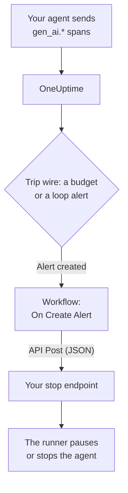

# AI Agent Circuit Breakers

An AI agent rarely fails by crashing. It fails by carrying on: retrying a broken tool, planning the same step again, or starting more sub-agents, while every turn bills more tokens. This page builds a circuit breaker for that from parts OneUptime already has: an alert that notices the runaway agent, and a workflow that calls an endpoint you own to stop it.

:::cards
- [Pick a trip wire](#pick-a-trip-wire): Alert on spend, or on one tool called again and again.
- [Build the stop endpoint](#build-the-stop-endpoint): The small service that pauses your agent.
- [Build the workflow](#build-the-workflow): From a new alert to a call to your endpoint.
- [Test the breaker](#test-the-breaker): Trip it by hand, then for real.
:::

## How it works



The breaker watches the OpenTelemetry your agent already sends, directly or [through a gateway](/docs/telemetry/ai-gateways), and acts beside the request path, not in it. Nothing is added to each model call, and changing providers, SDKs or gateways doesn't break it.

The price is speed: it stops a runaway agent in minutes, not milliseconds. Keep step limits and timeouts in the agent itself, and let the breaker catch what gets past them.

| Trip wire | Catches | Time to alert |
| --- | --- | --- |
| A budget alert, from a Metrics monitor | Spend that keeps climbing, whatever the cause | Up to 15 minutes, plus a minute for the monitor |
| A loop alert, from a Traces monitor | The same tool called over and over | 1 to 5 minutes |

## Before you begin

- Your agent sends GenAI spans to OneUptime. See [AI / LLM Observability](/docs/telemetry/ai-llm-observability).
- An HTTPS endpoint that can pause or stop your agent runner, reachable from OneUptime. You build it in [Build the stop endpoint](#build-the-stop-endpoint).
- Permission to create monitors and workflows in the project.

## Pick a trip wire

Both trip wires end the same way: a monitor creates an alert, and the new alert starts the workflow. You can set up both: the workflow doesn't care which one fired.

### A budget alert

Spend is the surest sign of a runaway agent. A budget adds up the day's AI spend every 15 minutes and publishes it as two metrics, `oneuptime.llm.budget.spend.usd` and `oneuptime.llm.budget.percent.used`, each with the budget's ID in `oneuptime.llm.budget.id`.

:::steps
1. Open **Products → AI / LLM → Budgets** and click **Create LLM Cost Budget**. Set a **Daily Budget (USD)**, and pick the agent's service in **Service (optional)** so the budget watches that agent alone.
2. In the new budget's row menu, pick **Show ID** and copy the ID.
3. Create a [Metrics monitor](/docs/monitor/metrics-monitor) on `oneuptime.llm.budget.percent.used`, filtered by the attribute `oneuptime.llm.budget.id` with the ID you copied, and set its **Time Range** to **Past 30 Minutes**.
4. Add a criteria **Greater Than Or Equal To** `100` that creates an alert, and give it an **Alert Title** that names the agent, such as `LLM budget exceeded: support-bot`. The workflow and your endpoint both read that title.
:::

Filter by the ID, not the name: renaming a budget renames its series, and a monitor filtered by the old name would quietly stop matching. Keep the time range at 30 minutes: a budget publishes one point every 15 minutes, so a shorter range finds nothing between two points and the alert opens and resolves over and over.

A second criteria at `80` with a lower severity gives a person a warning first, through the alert's on-call policy, before the breaker trips at `100`.

### A loop alert

A stuck agent leaves a trace you can recognize: the same tool span, again and again. A healthy run doesn't call one tool dozens of times in a few minutes, so a count catches the loop long before the budget does.

:::steps
1. Open **Monitors**, click **Create Monitor**, and pick **Traces** under **More monitor types**.
2. Under **More fields**, set **Filter by Telemetry Service** to the agent's service, and **Filter by Attributes** to `gen_ai.tool.name` equal to the tool you expect it to loop on, such as `search_web`. If your instrumentation names each tool's span, put that name in **Span Name** instead.
3. Set **Monitor Traces for (time)** to **Last 5 minutes**.
4. Add a criteria **Span Count** **Greater Than** a number no healthy run reaches in five minutes, such as `50`, that creates an alert titled like `Agent loop: support-bot`.
:::

A second Traces monitor with **Filter by Span Status** set to **Error** and a lower count catches retry storms: a tool that keeps failing and an agent that keeps trying it again.

## Build the stop endpoint

The workflow sends a `POST` with a JSON body to an endpoint you run. What "stop" means is up to you. From the smallest effect to the largest:

| Action | Effect |
| --- | --- |
| Stop new work | The runner starts no new runs for that agent |
| Cancel its runs | Runs of that agent that are in flight are cancelled |
| Pause the pool | Every worker drains until someone resets the breaker |

A minimal endpoint in Express that trips a breaker per agent:

```typescript title="circuit-breaker.ts"
import express from "express";

const app = express();
app.use(express.json());

const tripped = new Set<string>(); // agents whose breaker is open

app.post("/circuit-breaker", (req, res) => {
  if (req.headers["authorization"] !== `Bearer ${process.env.KILL_TOKEN}`) {
    return res.status(401).end();
  }

  const alertTitle: string = req.body.alertTitle ?? "";

  // "LLM budget exceeded: support-bot" -> "support-bot"
  const agent: string = alertTitle.split(": ").pop() ?? "unknown";

  tripped.add(agent); // your run loop checks this set
  abortActiveRuns(agent); // cancel that agent's runs in flight

  // Answer fast; do the slow cleanup in the background.
  return res.status(200).json({ tripped: agent });
});
```

Build it to these rules:

- Make tripping idempotent. A warning and a breach, or a budget alert and a loop alert together, can trip it more than once, and a second trip must change nothing.
- Answer within a second or two, and clean up in the background. The workflow counts any 2xx answer as success.
- Require a secret. Anyone who can call the endpoint can stop your agents, so check a bearer token, which the workflow sends from a secret global variable.
- Reset it by hand. A tripped breaker stays tripped until someone has looked at the run: open the agent's conversation under **Products → AI / LLM → Conversations** to read or replay what it did.

The request goes out from OneUptime. On OneUptime Cloud, your endpoint must be reachable from the internet. A self-hosted installation refuses private network addresses unless an administrator allows them: see [Outbound network access](/docs/workflows/configuration#outbound-network-access).

## Build the workflow

First save the endpoint's token where the workflow can use it without showing it: open **Workflows → Global Variables**, click **Create Workflow Variable**, name it `AGENT_KILL_TOKEN`, put the token in **Content**, and turn **Secret** on. A secret value is scrubbed out of run logs and step traces.

:::steps
### Create the workflow

Open **Products → Workflows** and click **Create Workflow**. Click **Start from scratch**, name it `AI agent circuit breaker`, and click **Create Workflow**. It opens in the **Builder**, switched off.

### Add the trigger

Click the dashed **Choose what starts this workflow** block and pick **On Create Alert** in the **Add Trigger** panel. Click the trigger, tick the title and the description in **Select Fields**, and click **Save**. The ID on the block, `alert-on-create-1`, is how later blocks refer to it.

### Check the title

Click **Add Component**, pick **If / Else**, and connect the trigger's **Success** dot to it. Set **Value to check** to the alert's title (click **{ }** and pick it), **Comparison** to **contains**, and **Compare with** to the start your trip-wire titles share, such as `LLM budget exceeded`.

### Call your endpoint

Add **API Post (JSON)** and connect the **Yes** dot of the **If / Else** to it. Set its **URL** to your endpoint, such as `https://agents.example.com/circuit-breaker`, and fill in the headers and the body below.

### Report a failure

Add **Send Message to Slack**, or **Send Email**, and connect the API block's **Error** dot to it. A breaker that fails to trip is the one alert a person must see.

### Turn it on

Switch **Enabled** on at the top of the **Builder**.
:::

The **Request Headers** of the API block:

```json title="Request Headers"
{
  "Authorization": "Bearer {{global.variables.AGENT_KILL_TOKEN}}",
  "Content-Type": "application/json"
}
```

Its **Request Body**:

```json title="Request Body"
{
  "source": "oneuptime-circuit-breaker",
  "alertId": "{{local.components.alert-on-create-1.returnValues.model._id}}",
  "alertTitle": "{{local.components.alert-on-create-1.returnValues.model.title}}",
  "alertDescription": "{{local.components.alert-on-create-1.returnValues.model.description}}"
}
```

To react to several trip wires, start all their titles the same way, or chain more **If / Else** blocks from the **No** dot. See [Authoring a workflow](/docs/workflows/authoring) for the canvas, and [Variables](/docs/workflows/variables) for the `{{…}}` references.

## Test the breaker

:::steps
1. Trip it by hand. Open **Alerts**, click **Create Alert**, and create one titled `LLM budget exceeded: test`. The run appears under **Workflows → Logs → Runs**, and your endpoint gets the post.
2. Trip it for real. Create a budget with a tiny limit, such as `0.01` USD, on a test agent's service, point a budget monitor at it, and let the agent run: the percentage passes 100, the alert opens, the workflow runs and the breaker trips. For the loop alert, give a test agent a tool that always fails.
3. Trip it twice. Create the same alert again: your endpoint must take the second trip without changing anything.
:::

## How the breaker behaves over time

- The workflow runs when an alert is created, so a trip wire trips the breaker once per alert, not once per evaluation.
- A budget counts the UTC day, so its percentage starts again from 0 at midnight UTC. A budget alert can then resolve, and the next bad day opens a new alert that trips the breaker again.
- A monitor keeps its alert open while its criteria are met. With **Auto Resolve Alert** on, the alert resolves when they stop, and the next breach opens a new alert.
- Resetting is a person's decision on both sides: resolve the alert in OneUptime, and reset the breaker in your runner.
- Every new alert in the project starts the workflow. The **If / Else** is what keeps other alerts away from the breaker: don't leave it out.

## Troubleshooting

:::details The workflow doesn't run
Check that **Enabled** is on at the top of the **Builder**: workflows are created switched off. Then check that the alert was created after you turned the workflow on: the trigger starts a run only for a new alert.
:::

:::details The workflow runs, but always takes the No branch
The title is empty or doesn't match. A field the trigger's **Select Fields** doesn't tick arrives empty, so tick the title. Then compare the alert's title with **Compare with**: **contains** must find that exact text in it.
:::

:::details Your endpoint answers 401
The `Authorization` header doesn't match the token your endpoint expects. Check the name in `{{global.variables.AGENT_KILL_TOKEN}}`, and the value saved in the global variable. A secret variable's value can't be read back, so type it again with **Update Content** if in doubt.
:::

:::details The budget alert opens and resolves over and over
The monitor's **Time Range** is shorter than the budget's 15 minutes between points. Set it to **Past 30 Minutes**.
:::

:::details The request never reaches your endpoint
Open the run under **Workflows → Logs → Runs** and the **API Post (JSON)** step: it says why the request failed. On OneUptime Cloud, the endpoint must be reachable from the internet; a self-hosted installation refuses private network addresses unless an administrator allows them.
:::

## Next steps

:::cards
- [AI / LLM Observability](/docs/telemetry/ai-llm-observability): Budgets, cost and the spans the breaker watches.
- [Traces Monitor](/docs/monitor/traces-monitor): Span filters and criteria in detail.
- [Workflows](/docs/workflows/index): Triggers, components, variables and runs.
- [AI Gateways](/docs/telemetry/ai-gateways): Every agent's model calls through one export.
:::
