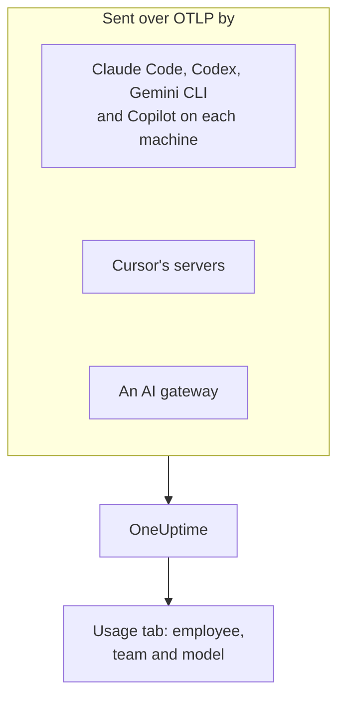

# AI Coding Assistants

Your engineers run Claude Code, Cursor, Codex, Gemini CLI and Copilot, and the invoices keep growing. This page answers the questions a manager has: **who uses which tool, on which models, and what each person and each team spends**.

Most coding assistants export OpenTelemetry themselves, so there is nothing to install on developer machines: point the export at OneUptime, and tokens, cost and tool use land next to your apps' own AI calls. Everything here arrives over OpenTelemetry; OneUptime does not poll any vendor's admin or billing API.

:::cards
- [Support matrix](#support-matrix): What each tool sends, and whether it names a person.
- [Employee and team attribution](#employee-and-team-attribution): The keys that put a name and a team on the spend.
- [The Usage tab](#the-usage-tab): What the spend tables can and cannot show for a coding assistant.
- [Where to start](#where-to-start): A rollout order that shows results on day one.
:::

## How it works

Each tool sends its telemetry to OneUptime's OTLP endpoint with your ingestion key: from every developer machine, from the vendor's servers (Cursor), or from a gateway that your model traffic goes through.



## Before you begin

1. Create a telemetry ingestion key under **Project Settings → Telemetry & APM → Ingestion Keys**.
2. Your OTLP endpoint is `https://oneuptime.com/otlp`, or `https://YOUR-ONEUPTIME-HOST/otlp` if you host OneUptime yourself.
3. Every export sends the key in the `x-oneuptime-token` header.

One ingestion key for the whole fleet is fine. It ends up on every developer machine, so treat it as a shared credential that can only send data, and rotate it like any other.

## Support matrix

Three things decide what you get from a tool: whether it sends OpenTelemetry at all, how its telemetry reaches OneUptime, and whether anything in it names a person.

| Tool | What it sends | How it reaches OneUptime | Who it names | Guide |
| --- | --- | --- | --- | --- |
| Claude Code | Metrics and logs; traces in beta | From each machine; environment variables or a managed settings file | `user.email`, when signed in with a Claude account | [Claude Code](/docs/telemetry/claude-code) |
| Cursor | Metrics and logs | From Cursor's servers, set up once in Cursor's dashboard; Enterprise plan only | `cursor.user.id`, an integer | [Cursor](/docs/telemetry/cursor) |
| OpenAI Codex | Traces, metrics and logs, each switched on in `~/.codex/config.toml` | From each machine, a full URL per signal | Nobody on spans or metrics: you set `user.id` and `user.email` in `[otel.span_attributes]` | [OpenAI Codex](/docs/telemetry/openai-codex) |
| Gemini CLI | Traces, metrics and logs | From each machine, usually through a local collector | `user.email`, when signed in | [Gemini CLI & GitHub Copilot](/docs/telemetry/gemini-cli-and-copilot) |
| GitHub Copilot | Traces, metrics and logs, from its agent surfaces only | From the editor or the agent host | Nobody: you set `enduser.id` and `user.email` on each machine | [Gemini CLI & GitHub Copilot](/docs/telemetry/gemini-cli-and-copilot) |
| Cline | Metrics and logs | Configured centrally, in Cline's organization dashboard | An anonymized `user_id` | — |
| LiteLLM and Portkey | Traces of every call through the gateway | From the gateway process | With LiteLLM, the owner of the virtual key | [AI Gateways](/docs/telemetry/ai-gateways) |
| Your own apps | What your GenAI instrumentation sends | From your app | Whoever you set as `user.id` | [AI / LLM Observability](/docs/telemetry/ai-llm-observability) |
| Windsurf, JetBrains AI, Amazon Bedrock, Azure OpenAI | No OpenTelemetry of their own | Only through a gateway you put in front | Whoever the gateway names | [AI Gateways](/docs/telemetry/ai-gateways) |

A dash means OneUptime has no guide for the tool yet. Its telemetry is still ingested like any other OpenTelemetry.

:::details What exactly GitHub Copilot exports
Copilot exports OpenTelemetry only from its agent surfaces: VS Code chat and agent mode, the agent host behind Copilot CLI, the Copilot SDK, and agent workflows in JetBrains IDEs through the Copilot plugin. GitHub documents no export for inline completions, Copilot on github.com or Copilot code review. Copilot sends no user attribute of any kind, so set `enduser.id` and `user.email` per machine through `resourceAttributes` or `OTEL_RESOURCE_ATTRIBUTES`.
:::

:::details Amazon Bedrock, Azure OpenAI, Windsurf and JetBrains AI
- **Amazon Bedrock**: the `InvokeModel` and `Converse` APIs send no OpenTelemetry. Bedrock AgentCore is different: AWS documents metrics, spans and logs for it, sent to CloudWatch by default. Setting `DISABLE_ADOT_OBSERVABILITY=true` turns off the runtime's default ADOT configuration, so you can point the ADOT SDK at OneUptime instead.
- **Azure OpenAI**: the service sends nothing, and its Azure Monitor metrics have no user dimension. Instrument the client, or put API Management or another gateway in front.
- **Windsurf**: documents no telemetry export. Per-user data lives in Windsurf's Enterprise API, which OneUptime does not poll.
- **JetBrains AI Assistant and Junie**: export no usage. JetBrains' OpenTelemetry plugin receives your own app's telemetry inside the IDE; it sends nothing out.
:::

## Employee and team attribution

OneUptime copies the person who made a call, and their team, into columns as the telemetry arrives, so the **Usage** tab can rank people and teams without attribute filters.

### Attributes read as the employee

On a span, the first key present wins, in this order:

| Column | Keys, preferred first |
| --- | --- |
| Employee id | `user.id`, `enduser.id`, `litellm.metadata.user_api_key_user_id`, `metadata.user_api_key_user_id`, `traceloop.association.properties.user_id`, `langfuse.user.id`, `user.account_uuid`, `user.account_id`, `cursor.user.id` |
| Employee email | `user.email`, `litellm.metadata.user_api_key_user_email`, `metadata.user_api_key_user_email`, `traceloop.association.properties.user_email`, `enduser.email` |
| Team / cost centre | `team.id`, `team`, `cost_center`, `department`, `litellm.metadata.user_api_key_team_id`, `litellm.team.id`, `metadata.user_api_key_team_id`, `cursor.team.id` |

On a metric data point, the list is shorter and starts with the email, because the coding assistants that send metrics send `user.email` themselves:

| Column | Keys, preferred first |
| --- | --- |
| Employee | `user.email`, `user.id`, `user.account_uuid`, `user.account_id`, `cursor.user.id` |
| Team / cost centre | `team.id`, `team`, `cost_center`, `department`, `cursor.team.id` |
| Model | `gen_ai.request.model`, `model`, `cursor.model.name` |

How these keys are read:

- **Every key is also read with a `resource.` prefix.** OTLP ingest stores resource attributes under that prefix, so `OTEL_RESOURCE_ATTRIBUTES=team.id=platform` arrives as `resource.team.id`. The bare keys are tried first, so a value on the span beats one on the whole process.
- **The Usage tab shows a person's email when the call has one, and the id otherwise.** Rows that show the same email are added together, so one engineer on two machines is one row.
- **Identity is read only from AI calls.** `user.id`, `user.email` and `team.id` are generic keys that browser and backend spans carry too; only spans already recognized as AI calls get the columns.
- **Log records are not read for identity.** That matters for Codex, which puts `user.email` on its logs only.
- LiteLLM spells these keys two ways: its default `otel` callback uses the `metadata.` prefix, and its opt-in OpenTelemetry v2 mode (`LITELLM_OTEL_V2=true`) the `litellm.` namespace. OneUptime reads both, so a stock proxy works with no extra setup.

### Teams and cost centres

No instrumentation sends `team.id`, `team`, `cost_center` or `department`: your organization sets them, usually through `OTEL_RESOURCE_ATTRIBUTES` on the tool's process.

```bash
export OTEL_RESOURCE_ATTRIBUTES="team.id=platform,team=Platform_Engineering,cost_center=eng-123,department=engineering"
```

Set it wherever you already provision developer machines: an MDM profile, a managed settings file, or a shell profile from your dotfiles. Values cannot contain spaces: use underscores, or percent-encoding such as `%20`. Codex has no resource attributes, so set the same keys in its `[otel.span_attributes]` instead.

To separate spend by application, use the service name (`OTEL_SERVICE_NAME`, or the tool's own setting). The **Application / Service** breakdown covers only tools that send GenAI spans.

### What is deliberately not treated as the employee

A call can carry two different people: the employee who made it, and the customer it was made for. These keys carry the customer, and OneUptime never reads them into an identity column:

- `gen_ai.user` and `llm.user`: how instrumentations echo OpenAI's `user` request parameter, which OpenAI describes as an identifier for your end users.
- `litellm.metadata.user_api_key_end_user_id`, `metadata.user_api_key_end_user_id` and `litellm.end_user.id`: LiteLLM's end user, as opposed to the key owner, who is the employee.

Reading a customer id as an employee would turn a support bot that serves 40,000 customers into 40,000 phantom employees, while the engineer who owns the spend would seem to spend nothing. The keys stay in the span's attributes, and the trace viewer's **LLM** tab shows them as the end user.

### Privacy

The employee email column holds personal data. The traces' **Scrub Rules** cover it exactly as they cover the attribute it was read from, so a rule that masks emails masks the column too. Find them under **Traces → Settings**.

## Coding-assistant metrics OneUptime reads

The coding assistants name their metrics with their own prefix rather than `gen_ai.*`, so OneUptime knows each one by name:

| Metric | Tool | Unit |
| --- | --- | --- |
| `claude_code.token.usage` | Claude Code | Tokens |
| `claude_code.cost.usage` | Claude Code | USD |
| `cursor.token.usage` | Cursor | Tokens |
| `cursor.cost.usage` | Cursor | USD, an estimate by Cursor's own account |
| `codex.turn.token_usage` | OpenAI Codex | Tokens |
| `codex.turn.cost_microusd` | OpenAI Codex | Millionths of a USD: OneUptime converts it, so don't |

OneUptime also reads tokens from `gen_ai.client.token.usage`, `gen_ai.client.token.count`, `llm.token.usage` and `llm.usage.tokens`, and cost from `gen_ai.client.cost`, `gen_ai.client.cost.usd`, `gen_ai.usage.cost`, `litellm_spend_metric` and `litellm.cost.total`.

Two things to know before you read the numbers:

- **`gemini_cli.token.usage` is left out on purpose.** Gemini CLI sends its tokens twice, as its own metric and as `gen_ai.client.token.usage`, and reading both would double them. Its tokens are counted once, through `gen_ai.client.token.usage`. Gemini CLI sends no cost metric: turn on its traces to have each call priced.
- **Only input and output tokens are counted.** The token type is read from `gen_ai.token.type`, `llm.token.type`, `type`, `cursor.token.type` or `token_type`, and only `input` and `output` (or the older `prompt` and `completion`) count. Cache reads and writes, Codex's `total` (which repeats the others) and `reasoning_output` (part of `output`) are left out, so a metric-sourced total is smaller than the sum of everything a tool sends.

## The Usage tab

Open **Products → AI / LLM** and go to **Usage**. It ranks **Employee**, **Team**, **Model**, **Provider** and **Application / Service** by spend, over the last 7 days unless you pick another range. Calls that name nobody are counted under **Unattributed**: a big **Unattributed** row tells you which tool still needs its identity set.

### Coding-assistant metrics are a fallback, not an addition

GenAI spans come first: the metrics are read only for a figure the spans reported nothing for, and the two are never added together ([why](/docs/telemetry/ai-llm-observability#spans-come-first-metrics-fill-in)). For coding assistants that has one blunt consequence: **if the same project receives GenAI spans with cost, the coding assistants' spend does not show.** Give the coding assistants a project of their own, with its own ingestion key.

When the fallback does apply, this is what each breakdown can show for a tool that sends only metrics:

| Breakdown | From metrics |
| --- | --- |
| **Employee** | Yes, from every identity key above, bare and `resource.`-prefixed |
| **Team** | Yes, from the team keys |
| **Model** | Yes: Claude Code and Codex send a bare `model`, Cursor `cursor.model.name` |
| **Provider** | No: the coding assistants' metrics name no provider |
| **Application / Service** | No: their metrics belong to no OneUptime service |

A row read from metrics carries cost only: its calls and token cells show `—`, because a spend counter has no per-call detail, and a 0 there would claim the person made no calls. The table is marked **from GenAI metrics**.

## No OpenTelemetry? Put a gateway in front

For Windsurf, JetBrains AI, the Bedrock model APIs, Azure OpenAI and anything else without its own export, put an AI gateway in front. Every call then goes through one process that sends OpenTelemetry, and you configure the export once.

**Use LiteLLM with one virtual key per employee.** LiteLLM stamps the key owner's id and email on each span, which OneUptime reads as the employee, and the key's team as the team. It also prices each call itself, with any custom rates you set on the proxy, and its reported cost wins over OneUptime's estimate. Don't use its end-user id for this: that is the customer. Setup is in [AI Gateways](/docs/telemetry/ai-gateways).

Two limits before you plan around a gateway:

- **A gateway sees only traffic sent through it.** Cursor's own base-URL override is a per-user setting that covers chat models only (Tab completion keeps using Cursor's models), so prefer Cursor's native export.
- **A gateway sees the model call, not the agent.** It records prompts and answers, but not the tool calls, file edits and accept or reject decisions a tool's own telemetry reports.

## Prompt content: the defaults differ per tool

Prompts and answers are the riskiest data in this pipeline: they routinely contain source code, customer data and pasted credentials. Check each tool's default:

| Tool | Prompt content by default |
| --- | --- |
| Claude Code | Off: each kind of content has its own opt-in variable |
| Cursor | Off: only the opt-in `conversation_content` family sends message text |
| OpenAI Codex | Off: `log_user_prompt` defaults to `false` |
| Gemini CLI | **On**: `logPrompts` defaults to `true`, so set it to `false` when you turn telemetry on |
| GitHub Copilot | Off: `captureContent`, which managed settings can lock with `lockCaptureContent` |
| LiteLLM | On with the default `otel` callback (turn it off with `turn_off_message_logging`); off in OpenTelemetry v2 mode |

Codex also sends its metrics to OpenAI by default: see [OpenAI Codex](/docs/telemetry/openai-codex). Where you capture content on purpose, the traces' **Scrub Rules** and **Drop Filters** apply to it like any other telemetry.

## What OneUptime does not do yet

- **No vendor admin or billing connectors.** OneUptime does not poll Anthropic's Admin API, Cursor's Admin API, OpenAI's usage and costs endpoints, GitHub's Copilot billing, Windsurf's or JetBrains' APIs. For invoice-grade figures, pull them from the vendor.
- **Cost is an estimate unless a tool reports it.** A reported cost is used as it is; otherwise OneUptime prices tokens at list prices. Cursor's `cursor.cost.usage` is itself an estimate.
- **Identity on log records is not read.** Codex's `user.email`, which it sends only on logs, is not joined to spend.
- **Cursor's `cursor.user.email` is not read yet**, so Cursor users show as their `cursor.user.id` integer.
- **Codex spans name no model**, so OneUptime cannot price them: Codex shows tokens per person, and its cost only in the totals.
- **Tools change fast.** If this page says a tool has no export, check its current documentation before you build around a gateway.

## Where to start

Roll out in this order; each step is useful on its own. Use a project that does not already receive GenAI spans from your own apps, or [the fallback rule](#coding-assistant-metrics-are-a-fallback-not-an-addition) keeps the coding assistants' spend off the page.

1. **Gemini CLI**, if anyone uses it. It sends `user.email` with no setup, so it shows attribution working end to end. Turn on its traces too: it sends no cost metric.
2. **Claude Code**: one managed settings file for the fleet, `user.email` for free, a real cost metric, and acceptance rate, commits, pull requests and lines of code per developer.
3. **Cursor**, on the Enterprise plan: one screen in Cursor's dashboard, no developer machine touched, though people arrive as integers.
4. **Copilot and Codex**, which both need an identity set on each machine. Do it when you provision machines: calls that arrived without one cannot be attributed later.
5. **A LiteLLM gateway** for everything else, with one virtual key per employee.

## Next steps

:::cards
- [Claude Code](/docs/telemetry/claude-code): Turn on Claude Code's export for one machine or the whole fleet.
- [Cursor](/docs/telemetry/cursor): Send Cursor's team telemetry from Cursor's dashboard.
- [OpenAI Codex](/docs/telemetry/openai-codex): Configure Codex's three exporters and stamp an identity on its spans.
- [AI / LLM Observability](/docs/telemetry/ai-llm-observability): Conversations, alerts, cost and budgets for every AI call.
:::
