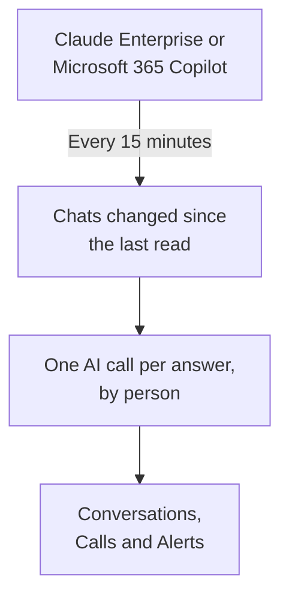

# Company AI Tools

See what your people ask the AI tools your company pays for, as conversations by person. Connect Claude Enterprise or Microsoft 365 Copilot with a credential that can only read, and OneUptime brings every new chat into **Conversations** every 15 minutes. Only project owners and admins can read them unless you choose otherwise.

:::cards
- [Tell your people first](#tell-your-people-first): Their chats are their own words.
- [Connect a tool](#connect-a-tool): Paste the credential, choose who can read, test it and connect.
- [Privacy](#privacy): Who can read the conversations, and whether the words are kept.
- [Other AI tools](#other-ai-tools): ChatGPT Enterprise, Gemini, Open WebUI, LibreChat and coding assistants.
:::

## Tell your people first

> [!IMPORTANT]
> These are your people's own words. Before you connect a tool, tell them their chats with it are kept and who can read them, and check with your legal or HR team what your policies and local law ask for.

## How it works

Every 15 minutes, OneUptime asks the tool for the chats that changed since its last read. Each answer becomes one AI call of the person who asked, with the questions asked since the previous answer, and each chat becomes one conversation.

The chats arrive the way your apps' AI calls do, so scrub rules, drop filters, retention and the AI alerts apply to them. The tools are paid per seat, so these calls carry no tokens and no cost. A question with no answer for an hour arrives on its own, so a chat the AI never answered still shows.

## Before you begin

- The Project Owner or Project Admin role. Only they can connect, change or remove a tool.
- An administrator of the tool, to make the credential: each tool's section below says which one.
- Your people told, and your legal or HR team's answer.

## Connect a tool

:::steps
### Open Connect

Open **Products → AI / LLM → Connect**. Under **Your company's AI tools**, click the tool's tile.

### Paste the credential

On **Credentials**, fill in what the tool asks for. Secrets are stored encrypted and are never shown again.

### Choose who can read

On **Privacy**, set **Who can read conversations** and **Keep what was written**, as [Privacy](#privacy) explains.

### Test it

On **Test**, click **Test connection**. OneUptime counts the chats of the last 7 days: nothing anyone wrote is read, shown or kept.

### Connect

Click **Connect**. The first read starts within a minute and brings in the last 7 days.
:::

## Claude Enterprise

OneUptime reads every claude.ai chat of your organization through the Compliance API: who asked, what they asked Claude, what it answered, and which model it used. A chat that gets a new message is read again, and the answers already brought in are recognized and skipped.

:::steps
### Turn on the Compliance API

Your organization's primary owner opens Organization settings, API in claude.ai and turns the Compliance API on.

### Create a compliance access key

There, create a key with the `read:compliance_user_data` scope. It starts with `sk-ant-api01-`.

### Connect Claude Enterprise

Paste the key as **Compliance access key**.
:::

## Microsoft 365 Copilot

OneUptime reads each person's Copilot interaction history from Microsoft Graph: what they asked Copilot in Teams, Outlook, Word, Excel, PowerPoint, Loop or Copilot Chat, what it answered, and in which app. A prompt and its answers become one AI call, and a Copilot session one conversation. A large tenant is read in parts, carrying on where the last read stopped.

:::steps
### Register an app

In Microsoft Entra ID, register an app and create a client secret for it.

### Grant the permissions

Give the app the `AiEnterpriseInteraction.Read.All` and `User.Read.All` application permissions of Microsoft Graph, and grant admin consent.

### Connect Copilot

Fill in **Directory (tenant) ID**, **Application (client) ID** and **Client secret**. To read only some people, put a group's object ID in **Only people in this group** under **More fields**, and give the app `GroupMember.Read.All` too. For Azure Government, change **Cloud** there.
:::

## Privacy

| Setting | What it does |
| --- | --- |
| **Who can read conversations** | **Project owners and admins**, the default: nobody else in the project sees these conversations, or the AI calls they are made of, anywhere in OneUptime. **Everyone who can read AI calls**: everyone who may read the project's traces. |
| **Keep what was written** | On, the default: the questions and answers are kept. Off: OneUptime keeps who asked, when, which model and in which app, but not the words. |

A change to who can read applies within a minute. Turning **Keep what was written** off applies to the chats read after it; what was kept before stays until its retention ends.

To keep the words but mask parts of them, such as email addresses or card numbers, use **Scrub Rules** under **Traces → Settings**: they apply before anything is stored. The conversations are kept as long as the connection's service keeps its traces: see [Data Retention](/docs/telemetry/data-retention). Removing a connection stops its reads; what it read stays, readable by the same people, until its retention ends.

## Other AI tools

These tools have no API OneUptime can read people's chats with, or need a different route.

### ChatGPT Enterprise

OpenAI opens its Compliance API to a workspace on request, and does not publish what its records hold, so OneUptime cannot read ChatGPT Enterprise chats yet. Connecting your OpenAI organization as a [provider account](/docs/telemetry/ai-provider-accounts#openai) shows its API usage and cost, which does not include ChatGPT.

### Gemini for Google Workspace

Google offers no API to read people's Gemini chats. Google Vault keeps them for eDiscovery.

### Coding assistants

Claude Code, Codex, Gemini CLI, GitHub Copilot and Cursor send their own OpenTelemetry: see [AI Coding Assistants](/docs/telemetry/ai-coding-assistants).

### Open WebUI and LibreChat

Self-hosted chat apps call the models through an API you set. Put a LiteLLM proxy in front of the models and send its traces to OneUptime as [AI Gateways](/docs/telemetry/ai-gateways#litellm-proxy) shows: every chat's prompts and answers arrive as AI calls. A virtual key per person names who asked; a key everyone shares names nobody. Open WebUI's own OpenTelemetry export traces its web requests and database calls, not the chats.

## Troubleshooting

:::details The test finds no chats
Nobody used the tool in the last 7 days, or the credential belongs to another organization or tenant. For Copilot, check that the group under **Only people in this group** is the one you mean.
:::

:::details The credential works, but it may not read what the connection needs
For Copilot, grant admin consent for the app's Graph permissions, and `GroupMember.Read.All` too when you name a group. For Claude Enterprise, make the key with the `read:compliance_user_data` scope.
:::

:::details Someone cannot see the conversations
**Who can read conversations** is **Project owners and admins**. An owner or admin can change it with **Edit** in the connection's row.
:::

:::details The conversations show who asked, but no words
**Keep what was written** was off when they were read. Turning it on applies to the chats read after.
:::

## Next steps

:::cards
- [AI / LLM Observability](/docs/telemetry/ai-llm-observability): Read and replay conversations, and get told when answers go wrong.
- [AI Provider Accounts](/docs/telemetry/ai-provider-accounts): Usage and cost of your OpenAI, Anthropic, Azure, Bedrock and Vertex AI accounts.
- [AI Coding Assistants](/docs/telemetry/ai-coding-assistants): Spend by engineer for the coding tools.
- [Data Retention](/docs/telemetry/data-retention): How long the conversations are kept.
:::
