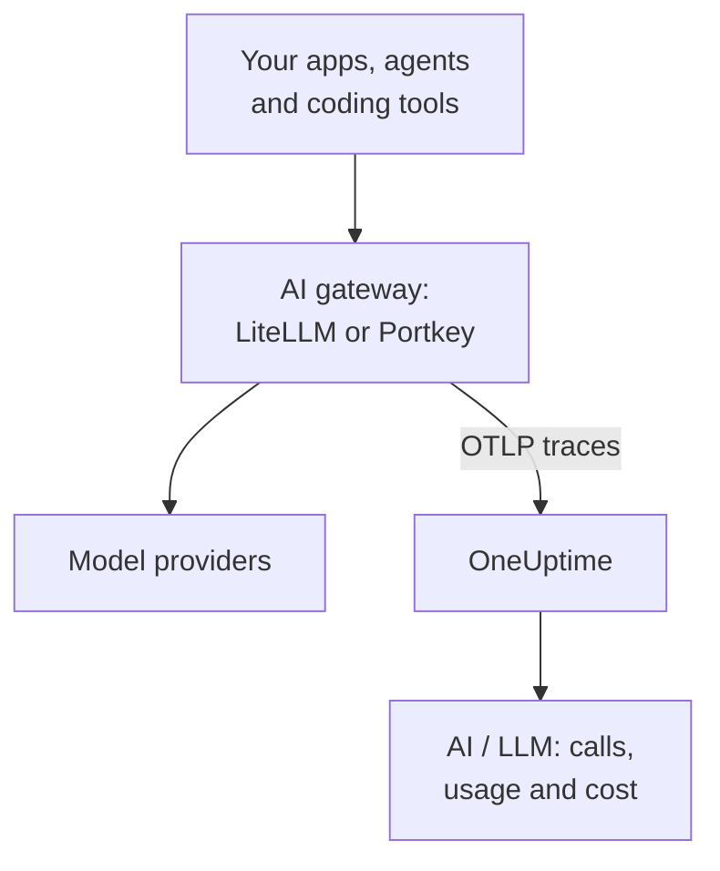

# AI Gateways (LiteLLM, Portkey)

An AI gateway sits between your apps and the model providers, so every model call passes through it. Send the gateway's OpenTelemetry to OneUptime once, and every call behind it arrives in [AI / LLM](/docs/telemetry/ai-llm-observability) with its model, tokens, cost and, unless you turn it off, the prompt and the answer, without instrumenting each app.

:::cards
- [LiteLLM Proxy](#litellm-proxy): Built-in export, set with three variables.
- [Who spent what](#one-virtual-key-per-employee): One LiteLLM virtual key per employee names each person.
- [Portkey](#portkey): Built-in export on self-hosted gateways; instrument the app elsewhere.
- [Check that calls arrive](#check-that-calls-arrive): What you should see, and what to do if you don't.
:::

## How it works



| | LiteLLM Proxy | Portkey, self-hosted or Enterprise | Portkey, open source or hosted |
| --- | --- | --- | --- |
| Export to OneUptime | Built in | Built in, experimental | None: instrument the app instead |
| Endpoint to set | `https://oneuptime.com/otlp/v1/traces` | `https://oneuptime.com/otlp` | The app's own exporter |
| Names each person | Yes, with one virtual key per employee | No | Only what the app sends |
| Prompts and answers | Sent unless you turn them off | Always sent | Depends on the instrumentation |

## Before you begin

- An ingestion key: open **Project Settings → Telemetry & APM → Ingestion Keys** and click **Create Ingestion Key**.
- Your OTLP base URL: `https://oneuptime.com/otlp`, or `https://YOUR-ONEUPTIME-HOST/otlp` if you host OneUptime yourself. OneUptime accepts OTLP over HTTP, in protobuf and in JSON.
- The key travels in the `x-oneuptime-token` header of every export request.

## LiteLLM Proxy

LiteLLM's OpenTelemetry callback is part of the open-source proxy, and the official Docker image (`ghcr.io/berriai/litellm`) ships the packages it needs.

:::steps
### Turn on the otel callback

Add `otel` to the callbacks in the proxy's `config.yaml`:

```yaml title="config.yaml"
model_list:
  - model_name: gpt-4o
    litellm_params:
      model: openai/gpt-4o
      api_key: os.environ/OPENAI_API_KEY

litellm_settings:
  callbacks: ["otel"]
```

### Point the exporter at OneUptime

Set three variables on the proxy:

```bash
export OTEL_EXPORTER="otlp_http"
export OTEL_ENDPOINT="https://oneuptime.com/otlp/v1/traces"
export OTEL_HEADERS="x-oneuptime-token=YOUR_INGESTION_TOKEN"
```

### Start the proxy

:::tabs
@tab Docker
```bash
docker run \
  -v $(pwd)/config.yaml:/app/config.yaml \
  -e OPENAI_API_KEY="sk-..." \
  -e OTEL_EXPORTER="otlp_http" \
  -e OTEL_ENDPOINT="https://oneuptime.com/otlp/v1/traces" \
  -e OTEL_HEADERS="x-oneuptime-token=YOUR_INGESTION_TOKEN" \
  -e OTEL_SERVICE_NAME="litellm-gateway" \
  -p 4000:4000 \
  ghcr.io/berriai/litellm:main-stable \
  --config /app/config.yaml
```
@tab pip
```bash
pip install 'litellm[proxy]' opentelemetry-api opentelemetry-sdk opentelemetry-exporter-otlp
litellm --config config.yaml
```
:::

`litellm[proxy]` alone doesn't include the OpenTelemetry packages, so install them with it.

### Send a request through it

Call the proxy once, then check AI / LLM as described in [Check that calls arrive](#check-that-calls-arrive).
:::

| Variable | Value | Notes |
| --- | --- | --- |
| `OTEL_EXPORTER` | `otlp_http` | Also read as `OTEL_EXPORTER_OTLP_PROTOCOL` |
| `OTEL_ENDPOINT` | `https://oneuptime.com/otlp/v1/traces` | The full `/v1/traces` path works with every LiteLLM version; also read as `OTEL_EXPORTER_OTLP_ENDPOINT` |
| `OTEL_HEADERS` | `x-oneuptime-token=YOUR_INGESTION_TOKEN` | Comma-separated `key=value` pairs; also read as `OTEL_EXPORTER_OTLP_HEADERS` |
| `OTEL_SERVICE_NAME` | Your gateway's name | The service its calls show under; `litellm` when unset |

### What LiteLLM sends

Each call carries `gen_ai.system`, `gen_ai.request.model`, `gen_ai.response.model`, `gen_ai.usage.input_tokens` and `gen_ai.usage.output_tokens`, its parameters, and the prompt and the answer: everything OneUptime needs to [read the call](/docs/telemetry/ai-llm-observability).

Since LiteLLM 1.81, these attributes are on the request's `Received Proxy Server Request` span, and there is no separate `litellm_request` span. When one request makes several model calls, each call overwrites the last one's attributes there, so set `USE_OTEL_LITELLM_REQUEST_SPAN=true` to get a `litellm_request` span for every call.

LiteLLM prices each call itself, including any custom rates you set on the proxy, and reports the price as `gen_ai.cost.total_cost`. OneUptime takes a reported cost over its own estimate, and [estimates from the tokens](/docs/telemetry/ai-llm-observability) only when LiteLLM couldn't price the call, such as a custom model with no price set.

### One virtual key per employee

Give each person their own LiteLLM virtual key, and every call they make arrives with who they are. LiteLLM writes the key owner's id, email and team on the span, and OneUptime reads them as the employee and the team, so the **Usage** tab ranks spend by person with no setup on their machines.

Virtual keys need a database and a master key on the proxy (`DATABASE_URL` and `LITELLM_MASTER_KEY`). Create a user with their email, then a key for that user:

```bash
curl -X POST "http://localhost:4000/user/new" \
  -H "Authorization: Bearer YOUR_MASTER_KEY" \
  -H "Content-Type: application/json" \
  -d '{"user_email": "alice@example.com"}'

curl -X POST "http://localhost:4000/key/generate" \
  -H "Authorization: Bearer YOUR_MASTER_KEY" \
  -H "Content-Type: application/json" \
  -d '{"user_id": "USER_ID_FROM_THE_FIRST_CALL", "team_id": "platform"}'
```

| LiteLLM span attribute | OneUptime reads it as |
| --- | --- |
| `metadata.user_api_key_user_id` | The employee's id |
| `metadata.user_api_key_user_email` | The employee's email |
| `metadata.user_api_key_team_id` | The team |
| `metadata.user_api_key_end_user_id` | Never the employee: it is the `user` your app sends for its own customer |

In LiteLLM's OpenTelemetry v2 mode the same values arrive with a `litellm.` prefix (`litellm.metadata.user_api_key_user_email` and so on), which OneUptime reads too.

### Keep prompts out

The `otel` callback sends full prompts and answers by default. To keep them out, use one of these:

:::tabs
@tab Every callback
```yaml title="config.yaml"
litellm_settings:
  callbacks: ["otel"]
  turn_off_message_logging: true
```
@tab OTel callback only
```yaml title="config.yaml"
litellm_settings:
  callbacks: ["otel"]

callback_settings:
  otel:
    message_logging: False
```
@tab Environment variable
```bash
export OTEL_INSTRUMENTATION_GENAI_CAPTURE_MESSAGE_CONTENT="NO_CONTENT"
```
:::

`callback_settings` is a top-level key, not a key under `litellm_settings`. To keep prompts but mask parts of them, use scrub rules under **Traces → Settings** instead.

:::details LiteLLM's OpenTelemetry v2 mode
Newer LiteLLM versions have an opt-in OpenTelemetry v2 mode (`LITELLM_OTEL_V2=true`, no change to `config.yaml`). It sends one trace per request, with the HTTP handling, authentication, guardrails and the model call as GenAI spans named like `chat gpt-4o`. In v2 mode prompts are off by default; turn them on with `OTEL_INSTRUMENTATION_GENAI_CAPTURE_MESSAGE_CONTENT`. Its cost arrives as `litellm.cost.total`, which OneUptime reads as well. Use one mode or the other, not both.
:::

## Portkey

What Portkey can send depends on how you run it:

| Deployment | Export to OneUptime |
| --- | --- |
| Self-hosted or Enterprise gateway | Built in (experimental): set the variables below |
| Open-source gateway (`portkey-ai/gateway`) | None: instrument the app that calls it |
| Hosted gateway (portkey.ai) | None on the gateway: instrument the app that calls it |

Portkey also has an OpenTelemetry endpoint of its own (`api.portkey.ai/v1/otel`). It receives traces into Portkey, the other direction from this page.

### Self-hosted and Enterprise gateways

Set these variables on the gateway's container:

```yaml title="docker-compose.yml"
services:
  portkey-gateway:
    environment:
      EXPERIMENTAL_GEN_AI_OTEL_TRACES_ENABLED: "true"
      EXPERIMENTAL_GEN_AI_OTEL_EXPORTER_OTLP_ENDPOINT: "https://oneuptime.com/otlp"
      EXPERIMENTAL_GEN_AI_OTEL_EXPORTER_OTLP_HEADERS: "x-oneuptime-token=YOUR_INGESTION_TOKEN"
```

- Give the base OTLP URL: Portkey adds `/v1/traces` itself.
- Headers are comma-separated `key=value` pairs. `EXPERIMENTAL_GEN_AI_OTEL_RESOURCE_ATTRIBUTES` adds resource attributes the same way, such as `deployment.environment=production`.
- Portkey sends OTLP over HTTP with JSON only, which OneUptime accepts without a collector in between.
- Each call is a span named `{operation} {model}`, such as `chat gpt-4o`, under the service `portkey`, with `gen_ai.provider.name`, the requested and served model, the token counts, `gen_ai.conversation.id`, and the messages in `gen_ai.input.messages` and `gen_ai.output.messages`.
- Full prompts and answers are always included. Mask what you must with scrub rules under **Traces → Settings**.
- Each call is sent on its own after the answer, with no batching and no retry: a failed export is lost. Treat it as observability, not as an audit log.
- When your `x-portkey-trace-id` is a valid trace id (32 hex characters), Portkey reuses it, so the gateway's spans join your app's own trace.

Portkey marks this export experimental. If the variables have no effect, check Portkey's current documentation against your gateway's version.

### Open-source and hosted gateways

The open-source gateway has no exporter, and on the hosted gateway you can't set its variables. Instrument the app that calls Portkey instead. Portkey speaks the OpenAI API, so the GenAI instrumentations from [AI / LLM Observability](/docs/telemetry/ai-llm-observability) (OpenLLMetry, OpenInference, OpenLIT) trace your SDK calls even with the base URL pointing at Portkey:

```python
from traceloop.sdk import Traceloop
from openai import OpenAI

Traceloop.init(
    app_name="my-ai-agent",
    api_endpoint="https://oneuptime.com/otlp",
    headers={"x-oneuptime-token": "YOUR_INGESTION_TOKEN"},
)

client = OpenAI(
    base_url="https://api.portkey.ai/v1",   # or your gateway's URL
    default_headers={"x-portkey-api-key": "PORTKEY_API_KEY"},
)
# Calls through Portkey are now traced to OneUptime.
```

These spans describe the call as your app made it: the model it asked for, the time it waited, the tokens it got back. What the gateway decided along the way, such as a fallback, a retry or a cache hit, stays in Portkey. To see that in OneUptime, use the self-hosted gateway's export.

## Check that calls arrive

:::steps
1. Send a request through the gateway and wait a few seconds.
2. Open **Products → AI / LLM → Calls**. The call is listed with its provider, model and tokens.
3. Click the call to open its trace, and open the span's **LLM** tab: the model, the tokens, the parameters and, unless you turned them off, the prompt and the answer.
4. Open **Usage**: the call counts in the totals, with the cost the gateway reported or the one OneUptime estimated.
:::

## Troubleshooting

:::details Nothing arrives from LiteLLM
Set `OTEL_EXPORTER="console"` for a moment. If spans print in the proxy's output, LiteLLM is tracing and the problem is the endpoint or the key. `DEBUG_OTEL="true"` prints what the exporter does.
:::

:::details The key is rejected
OneUptime answers `401` for a missing, unknown or expired key, and `422` for a disabled key or a browser key. Create a server key under **Project Settings → Telemetry & APM → Ingestion Keys** and send it in `x-oneuptime-token`.
:::

:::details The endpoint is wrong
LiteLLM takes the full path, `https://oneuptime.com/otlp/v1/traces`. Portkey takes the base URL, `https://oneuptime.com/otlp`, and adds `/v1/traces` itself.
:::

:::details Spans arrive, but not in AI / LLM
Filter **Traces** by the gateway's service (`litellm`, `portkey`, or your `OTEL_SERVICE_NAME`) to see its raw spans. A span counts as a model call only when it carries `gen_ai.*` attributes: check that the callback is `otel` and that the call went to a model.
:::

:::details Spend shows as Unattributed
The calls carry no person. Give each employee their own virtual key, as in [One virtual key per employee](#one-virtual-key-per-employee). The `user` field your app sends names its customer, not the employee, and is never read as the employee.
:::

:::details Only the last of several calls shows
Since LiteLLM 1.81, a request's model calls share one span. Set `USE_OTEL_LITELLM_REQUEST_SPAN=true` to get a span for each call.
:::

## Next steps

:::cards
- [AI / LLM Observability](/docs/telemetry/ai-llm-observability): Conversations, alerts, usage and daily cost budgets for these calls.
- [AI Coding Assistants](/docs/telemetry/ai-coding-assistants): Put a gateway in front of tools that send no telemetry of their own.
- [AI Agent Circuit Breakers](/docs/telemetry/ai-agent-circuit-breaker): Stop a runaway agent when its alert fires.
- [Traces Monitor](/docs/monitor/traces-monitor): Alert on span patterns, such as a tool called in a loop.
:::
