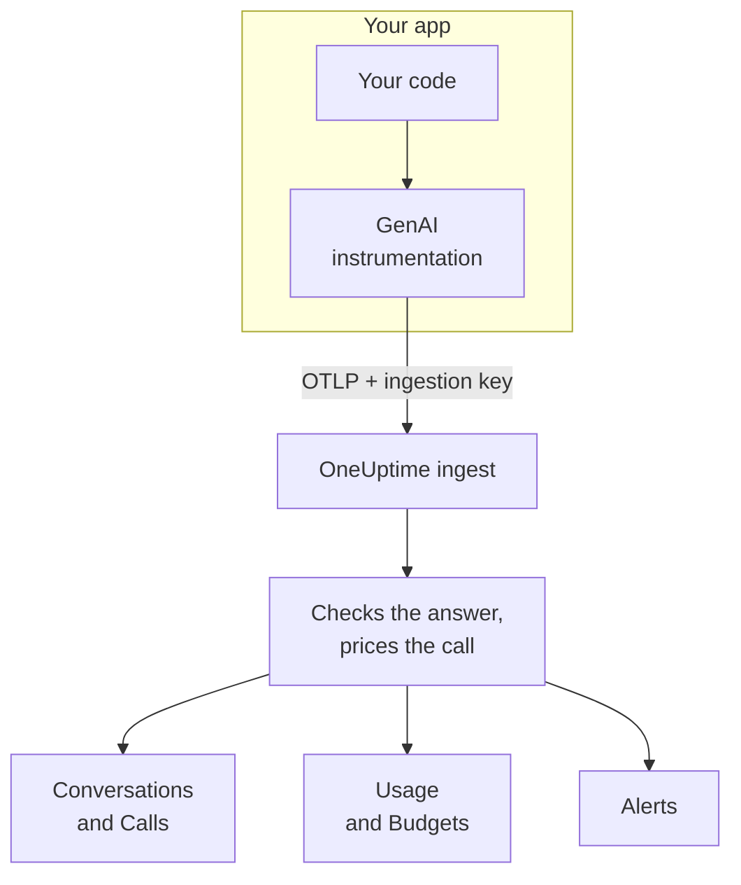
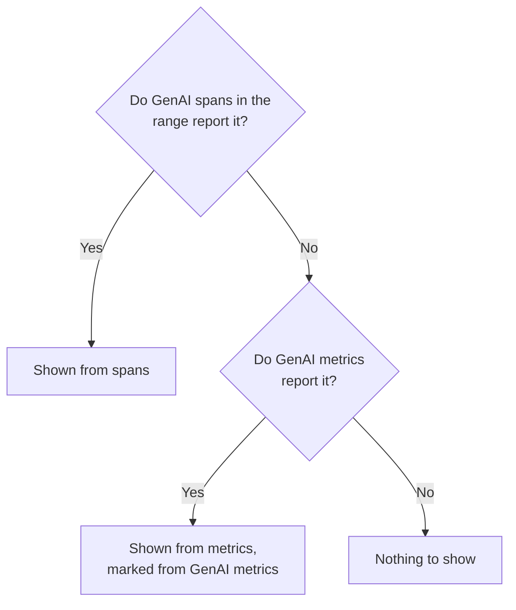

# AI / LLM Observability

Read every conversation your AI had, replay it the way it happened, and get told when it answers badly. OneUptime builds all of it from standard OpenTelemetry: if your app sends spans with the **GenAI semantic conventions** (`gen_ai.*`), you get conversations, alerts, usage and cost, with no proprietary SDK.

:::cards
- [Set it up](#set-it-up-in-five-steps): Five steps, from the first span to flagged answers.
- [Replay a conversation](#read-and-replay-a-conversation): Read a chat as the person saw it, at the pace it happened.
- [Get alerted](#get-told-when-the-ai-answers-badly): Ready-made alerts for answers that fail, get refused, cut off, flagged or slow.
- [Watch the spend](#see-who-spends-what): Cost by person, team, model and app, with daily budgets.
:::

## How it works

Your app's GenAI instrumentation exports each call to the model as an OpenTelemetry span. As the span arrives, OneUptime reads its `gen_ai.*` attributes, checks the answer for problems, prices the call and files it under its conversation.



Open **Products → AI / LLM**, under **Observability**. The product has seven tabs:

| Tab | What it shows |
| --- | --- |
| **Conversations** | Every conversation your AI had, the ones that need attention first. Above the list: conversations, AI answers, how many need attention, cost and the typical answer time. |
| **Calls** | Every model, embedding, agent and tool call. Filter by service, provider, model, operation, person, team or conversation; click a call to open it in the trace viewer. |
| **Usage** | Calls, tokens and cost for a time range, ranked by employee, team, model, provider or app. |
| **Alerts** | Ready-made alerts for when the AI answers badly, and your AI / LLM monitors. |
| **Budgets** | Daily cost limits, published as metrics you can alert on. |
| **Pricing** | Your own prices for models the built-in price list does not know. |
| **Setup** | The five steps below, with your project's endpoint. |

In the trace viewer, the span of each AI call also has an **LLM** tab: provider, model, tokens, cost, request parameters, and the prompt and the answer.

## Before you begin

- A OneUptime project where you can create a telemetry ingestion key.
- An app that calls a model, and a GenAI instrumentation for its language: **OpenLLMetry** (Traceloop), **OpenInference** (Arize), the **Vercel AI SDK**, or the OpenTelemetry instrumentations for OpenAI, Anthropic and Gemini.

> [!TIP]
> Model traffic that goes through a gateway such as LiteLLM or Portkey can be exported from the gateway instead of from every app: see [AI Gateways](/docs/telemetry/ai-gateways). For the coding assistants your engineers run, see [AI Coding Assistants](/docs/telemetry/ai-coding-assistants).

## Set it up in five steps

The first step is all you need to see calls. Each step after it shows more.

:::steps
### Send your AI calls

Create an ingestion key under **Project Settings → Telemetry & APM → Ingestion Keys** (the [OpenTelemetry quickstart](/docs/telemetry/open-telemetry#create-an-ingestion-key) walks through it). Then point your instrumentation at OneUptime:

:::tabs
@tab Python
```bash
pip install traceloop-sdk opentelemetry-exporter-otlp
```

```python
from traceloop.sdk import Traceloop

Traceloop.init(
    app_name="my-ai-agent",
    api_endpoint="https://oneuptime.com/otlp",
    headers={"x-oneuptime-token": "YOUR_INGESTION_TOKEN"},
)
# Your OpenAI, Anthropic and LangChain calls are now traced.
```
@tab Node.js
```bash
npm install @traceloop/node-server-sdk
```

```typescript
import * as traceloop from "@traceloop/node-server-sdk";

traceloop.initialize({
  appName: "my-ai-agent",
  baseUrl: "https://oneuptime.com/otlp",
  headers: { "x-oneuptime-token": "YOUR_INGESTION_TOKEN" },
});
```
@tab OpenTelemetry SDK
```bash
export OTEL_EXPORTER_OTLP_ENDPOINT="https://oneuptime.com/otlp"
export OTEL_EXPORTER_OTLP_HEADERS="x-oneuptime-token=YOUR_INGESTION_TOKEN"
export OTEL_EXPORTER_OTLP_PROTOCOL="http/protobuf"
export OTEL_SERVICE_NAME="my-ai-agent"
```
:::

Self-hosting OneUptime? Use `https://YOUR-ONEUPTIME-HOST/otlp` instead of `https://oneuptime.com/otlp`. Call your model once, and the call shows under **Calls**.

### Record what was said

A conversation shows what people asked and what the AI answered only when your instrumentation records it. OpenLLMetry records prompts and answers unless you set `TRACELOOP_TRACE_CONTENT=false`. The OpenTelemetry instrumentations record them only when you ask:

```bash
export OTEL_INSTRUMENTATION_GENAI_CAPTURE_MESSAGE_CONTENT=true
```

Newer OpenTelemetry instrumentations take `span_only`, `event_only` or `span_and_event` instead of `true`. Without recorded content, a conversation still shows its timing, cost and problems. Prompts can carry sensitive data: [Privacy and redaction](#privacy-and-redaction) shows how to mask it before it is stored.

### Group calls into conversations

A chat app makes one model call per turn. Set `gen_ai.conversation.id` (or `session.id`) to your chat's id on every AI call, and each chat shows as one conversation, however many calls and traces it took. With OpenLLMetry, set it once per request:

```python
from traceloop.sdk import Traceloop

Traceloop.set_association_properties({
    "session_id": chat.id,
    "user_email": user.email,
})
```

With the Vercel AI SDK, pass the chat's id as `experimental_telemetry: { metadata: { sessionId } }`. Calls without a conversation id still show, one request (one trace) at a time.

### Say who asked

Set `user.id` or `user.email` on every AI call (the association property above sets the email). Each conversation then shows who it was with, you can search the list by person, and the **Usage** tab ranks spend by employee. [Employee and team attribution](/docs/telemetry/ai-coding-assistants#employee-and-team-attribution) lists every identity key OneUptime reads.

### Flag bad answers

OneUptime checks every answer as it arrives and marks what went wrong with it:

| Problem | What it means | Found from |
| --- | --- | --- |
| Failed | The call ended in an error, so no answer arrived | Span status Error, `error.type`, or a finish reason of `error` |
| Refused | The AI declined, or a safety filter blocked the answer | A refusal or safety finish reason (`content_filter`, `refusal`, `SAFETY` and the like), a refusal in the answer, or an answer that opens with a stock English refusal |
| Cut off | The answer stopped at the token limit | A finish reason of `length`, `max_tokens` or `MAX_TOKENS` |
| Empty | No text and no tool call | Recorded content that holds nothing, or 0 output tokens |
| Flagged | An evaluation your app sent said the answer was bad | A `gen_ai.evaluation.result` event |

The first four need nothing from you. To flag an answer your guardrail, your eval or a thumbs-down button rejects, add a `gen_ai.evaluation.result` event to the answer's span, while the span is open, with `gen_ai.evaluation.score.label` set to `fail`:

```python
from opentelemetry import trace

trace.get_current_span().add_event(
    "gen_ai.evaluation.result",
    {
        "gen_ai.evaluation.name": "relevance",
        "gen_ai.evaluation.score.label": "fail",
        "gen_ai.evaluation.explanation": "The answer is about another product.",
    },
)
```

Labels such as `incorrect`, `wrong`, `unhelpful`, `toxic`, `unsafe` and `hallucination` count as failing too. OneUptime never sends your conversations to another AI to judge them: every check reads only what the call itself carries.
:::

## Read and replay a conversation

A conversation opens whole, the way a chat app shows its history: what the person said on the right, the AI's answers on the left with their model, time, tokens and cost, tool calls in between, and what went wrong marked where it happened. **Details** under an answer shows why it stopped, its evaluations, and a link to the call in Traces.

The bar at the bottom replays the conversation the way the person lived it:

| Control | What it does |
| --- | --- |
| **Replay** | Plays the conversation from the first message, at the pace it happened. "AI is answering…" counts up while an answer is on its way. Click the time of any message to replay from there. |
| **Skip waiting** | On by default: shortens any silence longer than 3 seconds. |
| `1x` | Changes the speed: 1x, 2x, 4x or 8x. |
| **K**, **J** or **←**, **L** or **→** | Play or pause, go back a message, go forward a message. |

The page's address keeps the message a replay stopped at (`?step=`), so a link you share opens on that moment.

## Get told when the AI answers badly

The **Alerts** tab lists the alerts most AI apps want. Picking one opens **Create Monitor** filled in, and you can change anything before you save:

| Alert | When it tells you | Severity |
| --- | --- | --- |
| Answers go wrong | More than 5% of answers in 15 minutes fail, are refused, cut off, empty or flagged | Warning |
| AI calls fail | More than 10% of the calls to the model in 5 minutes end in an error | Critical |
| The AI refuses to answer | More than 5% of answers in 30 minutes are refusals | Warning |
| Answers are cut off | 3 or more answers in 30 minutes stop at the token limit | Warning |
| Answers are flagged | An evaluation marks an answer as bad | Warning |
| Answers are slow | More than 10% of answers in 15 minutes take longer than 30 seconds | Warning |
| The AI stops answering | The AI gives no answers for 30 minutes | Critical |

The alerts on a share of answers also wait for at least 3 bad answers, so one bad answer out of two pages nobody.

Each alert is an **AI / LLM** monitor. Its settings say what counts as a bad answer (**Count an answer as bad when it**, **Or takes longer than (seconds)**), how far back each check looks (**Time window**, 15 minutes by default), which **Apps** it watches and, under **More fields**, which **Model**. A **Preview** shows what the monitor would count right now. Its criteria compare three numbers: **Bad AI Answers (in %)**, **Bad AI Answers** and **AI Answers**.

A ready-made alert raises an alert that resolves itself, and shows the monitor as **Degraded** while answers are bad. Its incident is filled in but switched off: switch it on to page someone instead.

## See who spends what

The **Usage** tab shows the calls, tokens and cost of a time range (the last 7 days unless you pick another), and a table of the top 25 under one of five breakdowns: **Employee**, **Team**, **Model**, **Provider** and **Application / Service**. Calls that name nobody are counted under **Unattributed**, never dropped.

People and teams come from identity attributes on the call: see [Employee and team attribution](/docs/telemetry/ai-coding-assistants#employee-and-team-attribution).

### Spans come first, metrics fill in

GenAI spans carry the model, tokens and cost of one call, so where they exist they answer everything. Some tools publish token and cost metrics and no GenAI spans, such as most coding assistants. OneUptime reads those metrics only for a figure the spans reported nothing for, and never adds the two together: many instrumentations send both for the same call, and adding them would count every dollar twice.



| Where | What falls back to metrics | When |
| --- | --- | --- |
| Input and output tokens | Both totals | The spans' token totals are both 0 |
| Cost (USD) | The cost, with Codex's micro-USD cost scaled to USD | The spans' cost total is 0 |
| LLM calls | Nothing: spans only | — |
| **Employee**, **Team**, **Model** tables | Cost only; the calls and token cells show `—` | That table found no span rows |
| **Provider**, **Application / Service** tables | Nothing: spans only | — |
| Conversations | Nothing: conversations are built from spans | — |

A figure taken from metrics is marked **from GenAI metrics**, because it has no matching rows in **Calls**. So once your GenAI spans report a figure, a metrics-only tool's share of it does not show. To see such a tool's spend on its own, send it to a project of its own, where no GenAI spans arrive.

## What a call costs

A cost your instrumentation reports (`gen_ai.usage.cost`) is used as it is, even when it is 0. When none is reported, OneUptime estimates one as the span arrives, from its token counts and a built-in list of prices for common OpenAI, Anthropic, Google Gemini, Mistral, DeepSeek, xAI, Cohere, Amazon Nova and Meta Llama models. The served model is priced first, then the requested model.

Models are matched by the longest name prefix, so dated and vendor-decorated ids such as `gpt-4o-2024-08-06` and `us.anthropic.claude-sonnet-4-5-20250929-v1:0` find their family's price. A model the list does not know, a new release included, is never guessed: its cost stays 0 until you price it. Estimates use list prices, without cache or batch discounts.

To price a model yourself (a negotiated rate, a fine-tune or a model you host), add it on the **Pricing** tab, in **Custom LLM Pricing**: a **Model Prefix**, an **Input Price (USD per 1M tokens)** and an **Output Price (USD per 1M tokens)**. The longest matching prefix wins across your prices and the built-in list; your price wins a tie. A price applies to calls that arrive about a minute after you save it; calls already stored keep their cost.

## Daily cost budgets

A budget tracks one day's spend, in USD, over the UTC day. Every 15 minutes OneUptime adds up the day's AI spend (from spans, or from GenAI cost metrics when no span reported any), shows it on the budget, and publishes two metrics:

| Metric | What it is |
| --- | --- |
| `oneuptime.llm.budget.spend.usd` | The day's spend so far, in USD |
| `oneuptime.llm.budget.percent.used` | The spend as a percent of the daily limit |

Both carry `oneuptime.llm.budget.id` and `oneuptime.llm.budget.name`, and the budget's scope when it has one.

:::steps
### Create the budget

On the **Budgets** tab, click **Create LLM Cost Budget**. Give it a name and a **Daily Budget (USD)**, and leave the scope empty for the whole project, or pick a **Service (optional)**, an **LLM Provider (optional)** or an **LLM Model (optional)**. Several budgets can watch different scopes.

### Alert on it

Create a [Metrics Monitor](/docs/monitor/metrics-monitor) on `oneuptime.llm.budget.percent.used`, filtered by `oneuptime.llm.budget.id` (the name changes when you rename the budget). Add a criterion `>= 80` that raises a warning and one `>= 100` that raises a critical alert.

### Widen the window

Set the monitor's rolling window to 30 minutes. A budget publishes one point every 15 minutes, so the default 1-minute window would find nothing between two points.
:::

A budget alert can also run a workflow that stops a runaway agent: see [AI Agent Circuit Breakers](/docs/telemetry/ai-agent-circuit-breaker).

## Dashboards and metric alerts

GenAI metrics such as `gen_ai.client.token.usage` and `gen_ai.client.operation.duration` arrive as ordinary OpenTelemetry metrics. Chart them on a [dashboard](/docs/dashboards/index), or alert on them with a [Metrics Monitor](/docs/monitor/metrics-monitor), for example when the p95 of `gen_ai.client.operation.duration` crosses a threshold, grouped by model.

## Privacy and redaction

AI calls are stored as trace spans, so the traces' **Scrub Rules** and **Drop Filters** apply to them: mask an attribute, or drop a span, before it is stored. Find both under **Traces → Settings**. The employee email column is scrubbed with the attribute it was read from, so a rule that masks emails covers it too.

Conversations are read with the same permission as traces: whoever can read the project's traces can read its conversations, and nobody else.

## Attributes OneUptime reads

OneUptime reads the OpenTelemetry GenAI conventions, and the spellings OpenLLMetry, OpenInference, the Vercel AI SDK and LiteLLM use, so the common libraries work as they are. For each value, the first key a span carries wins:

| Value | Keys, in the order they are tried |
| --- | --- |
| Provider | `gen_ai.system`, `gen_ai.provider.name`, `llm.system`, `llm.provider` |
| Operation | `gen_ai.operation.name`, `llm.request.type`, `openinference.span.kind` |
| Requested model | `gen_ai.request.model`, `llm.model_name`, `llm.request.model` |
| Served model | `gen_ai.response.model`, `llm.response.model` |
| Input tokens | `gen_ai.usage.input_tokens`, `gen_ai.usage.prompt_tokens`, `llm.token_count.prompt`, `llm.usage.prompt_tokens` |
| Output tokens | `gen_ai.usage.output_tokens`, `gen_ai.usage.completion_tokens`, `llm.token_count.completion`, `llm.usage.completion_tokens` |
| Total tokens | `gen_ai.usage.total_tokens`, `llm.token_count.total`, `llm.usage.total_tokens` |
| Cost (USD) | `gen_ai.usage.cost`, `gen_ai.usage.cost_usd`, `gen_ai.usage.total_cost`, `llm.usage.total_cost`, `gen_ai.cost.total_cost`, `litellm.cost.total` |
| Conversation | `gen_ai.conversation.id`, `session.id`, `langfuse.session.id`, `traceloop.association.properties.session_id`, `ai.telemetry.metadata.sessionId` |
| Agent | `gen_ai.agent.name`, `agent.name` |
| Tool | `gen_ai.tool.name`, `tool.name`, `ai.toolCall.name` |
| Finish reason | `gen_ai.response.finish_reasons`, `gen_ai.response.finish_reason`, `llm.response.finish_reason`, `ai.response.finishReason` |
| Error | `error.type` |

A span counts as an AI call when it carries any of these values, or any attribute that starts with `gen_ai.`, `llm.` or `traceloop.`. Total tokens are input plus output when no total is reported. The `gen_ai.usage.total_tokens` and `gen_ai.usage.cost` keys are not part of the conventions, which define neither; OneUptime reads them because common instrumentations send them.

The identity keys (who made the call, and their team) are listed under [Employee and team attribution](/docs/telemetry/ai-coding-assistants#employee-and-team-attribution).

### Where prompts and answers are read from

The conversation view reads a call's messages from, in this order:

- the `gen_ai.client.inference.operation.details` event;
- the `gen_ai.input.messages`, `gen_ai.output.messages` and `gen_ai.system_instructions` attributes;
- the older per-role events: `gen_ai.system.message`, `gen_ai.user.message`, `gen_ai.assistant.message`, `gen_ai.tool.message` and `gen_ai.choice`;
- the indexed attributes: OpenLLMetry's `gen_ai.prompt.N.content` and `gen_ai.completion.N.content`, OpenInference's `llm.input_messages.N.message.content` and `llm.output_messages.N.message.content`;
- the message arrays in `gen_ai.prompt`, `gen_ai.completion`, `ai.prompt.messages`, `ai.response.text`, `input.value` and `output.value`.

## Troubleshooting

:::details Calls arrive, but no conversations show any text
Your instrumentation is not recording content. Turn it on as [Record what was said](#record-what-was-said) shows; calls made before that stay without text.
:::

:::details Every call of a chat shows as its own conversation
The calls carry no conversation id. Set `gen_ai.conversation.id` or `session.id` on every call of the chat, as [Group calls into conversations](#group-calls-into-conversations) shows.
:::

:::details Calls show tokens but cost $0
The model is not in the built-in price list, or the span names no model. Add the model's prices on the **Pricing** tab; calls that arrive after that are priced.
:::

:::details The Usage tab says from GenAI metrics and shows `—` for calls and tokens
The figures come from a tool that sends metrics and no GenAI spans, such as a coding assistant. A metric carries cost but no per-call detail, so those cells stay empty. See [Spans come first, metrics fill in](#spans-come-first-metrics-fill-in).
:::

:::details A budget monitor flaps between two states
The monitor's rolling window is shorter than 15 minutes, so it sometimes finds no point. Set it to 30 minutes.
:::

## Next steps

:::cards
- [AI Coding Assistants](/docs/telemetry/ai-coding-assistants): Spend by engineer for Claude Code, Cursor, Codex, Gemini CLI and Copilot.
- [AI Gateways](/docs/telemetry/ai-gateways): Trace every app's model calls from one LiteLLM or Portkey gateway.
- [AI Agent Circuit Breakers](/docs/telemetry/ai-agent-circuit-breaker): Stop a runaway agent when a budget alert fires.
- [OpenTelemetry](/docs/telemetry/open-telemetry): Endpoints, ingestion keys and limits for every signal.
:::
