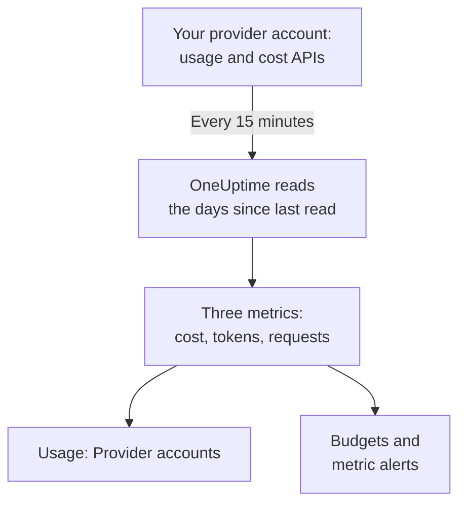

# AI Provider Accounts

See what your AI provider accounts used and what they cost, with no change to your apps. Connect an OpenAI, Anthropic, Azure OpenAI and Microsoft Foundry, Amazon Bedrock or Google Vertex AI account with a credential that can only read, and OneUptime reads its usage every 15 minutes into **Usage**, **Budgets** and metrics you can alert on.

:::cards
- [Connect an account](#connect-an-account): Pick the provider, paste the credential, test it and connect.
- [What each provider gives](#what-each-provider-gives): Cost, tokens and requests, and how each provider groups them.
- [See the usage](#see-the-usage): By model, person, project or resource, API key and connection.
- [Budgets and alerts](#budgets-and-alerts): A daily budget on the bill, and alerts on the metrics.
:::

## How it works

Every 15 minutes, OneUptime asks each connected account for its usage by UTC day and keeps it as three metrics of the connection's own service. Each read takes the days since the last read, and the last 3 days again, today included, because providers keep adding to today and correct the days just past.

An account's usage is what it was billed for, a day at a time. It holds no conversations, prompts or answers: for those, send your apps' AI calls as [AI / LLM Observability](/docs/telemetry/ai-llm-observability) shows. The two are kept apart, so nothing is counted twice.

## Before you begin

- The Project Owner or Project Admin role. Only they can connect, change or remove an account; everyone who reads the project's telemetry sees the connections and the usage.
- A credential for the account, from someone who administers it. Each provider's section below says which one and where it is made.
- Nothing to install: OneUptime calls the provider's API from its own servers.

## Connect an account

:::steps
### Open Connect

Open **Products → AI / LLM → Connect**. Under **Your AI provider accounts**, click the provider's tile.

### Read where the credential comes from

**Set up** says what you need, what arrives and where this page explains it.

### Paste the credential

On **Credentials**, fill in what the provider asks for. Secrets are stored encrypted and are never shown again, in the Dashboard or through the API. **Name** and the settings most people leave alone are under **More fields**.

### Test it

On **Test**, click **Test connection**. OneUptime reads the last 7 days of usage and shows what it found: cost, tokens, requests, models, people, keys and projects. Nothing is kept until you connect.

### Connect

Click **Connect**. The first read starts within a minute and brings in the last 30 days.
:::

Connected accounts are listed under the tiles, with their **Status** and **Last read**. **Read now** reads at once, **Test** checks the stored settings again, **Turn off** stops reading and keeps what was read, and **Edit** changes the settings: a secret left blank keeps the stored one. **View error** shows why a read failed, with any secret removed.

## What each provider gives

| Provider | Cost | Grouped by | Credential |
| --- | --- | --- | --- |
| OpenAI | What OpenAI reports | Project, API key, person and model | An admin key |
| Anthropic | What Anthropic reports | Workspace, API key, person and model | An admin key |
| Azure OpenAI and Microsoft Foundry | Estimated from tokens | Resource and model | An app with Monitoring Reader |
| Amazon Bedrock | Estimated from tokens | Region and model | An access key that reads CloudWatch |
| Google Vertex AI | Estimated from tokens | Region and model | A service account with Monitoring Viewer |

Every provider but Anthropic counts requests too: Anthropic's usage report has none. An estimated cost uses the price list of [What a call costs](/docs/telemetry/ai-llm-observability#what-a-call-costs) and your own prices from **Pricing**, and is marked as an estimate. A model the price list does not know has no cost until you price it there.

None of these credentials can call a model: each one reads usage, cost or metrics, and nothing else.

## OpenAI

OneUptime reads your OpenAI organization with an admin key: the completions and embeddings usage by day, model, project, API key and person, and each day's costs by project and line item. A cost line is shared among the keys and people that used its model, so a person's row has a cost too. Project and key names and people's emails replace OpenAI's ids.

:::steps
### Create an OpenAI admin key

In OpenAI's dashboard, open Settings, Organization, Admin keys, and create a key. Only organization owners can. It starts with `sk-admin-`.

### Connect OpenAI

Paste the key as **Admin key**.
:::

## Anthropic

OneUptime reads your Claude API organization with an admin key: the messages usage report by day, model, workspace, API key and person, and the cost report by workspace and line, shared the same way. Claude Code used with the organization's keys or Console logins is in these reports too, under the person or key that used it.

:::steps
### Create an Anthropic admin key

In the Claude Console, open Settings, Admin keys, and create a key. Only organization admins can. It starts with `sk-ant-admin01-`.

### Connect Anthropic

Paste the key as **Admin key**.
:::

## Azure OpenAI and Microsoft Foundry

OneUptime reads every Azure OpenAI and Foundry resource of a subscription from Azure Monitor: tokens and requests by day, resource and model. Azure Monitor counts tokens, not money, and names no person or key, so the cost is OneUptime's estimate and the person and key stay empty.

:::steps
### Register an app

In Microsoft Entra ID, register an app and create a client secret for it.

### Let it read the metrics

On the subscription, give the app the Monitoring Reader role.

### Connect Azure

Fill in **Directory (tenant) ID**, **Application (client) ID**, **Subscription ID** and **Client secret**. For Azure Government, change **Cloud** under **More fields**.
:::

## Amazon Bedrock

OneUptime reads the `AWS/Bedrock` CloudWatch metrics of each Region you name: input, output and cache tokens, and invocations, by day and model. CloudWatch counts tokens, not money, and names no person or key: the cost is OneUptime's estimate, and each Region is listed as a project.

:::steps
### Create an access key

Create an IAM user or role whose policy allows `cloudwatch:GetMetricData` and `cloudwatch:ListMetrics`, and an access key for it.

### Connect Bedrock

Fill in **Access key ID**, **Secret access key** and **Regions**, separated by commas: `us-east-1` unless you change it.
:::

## Google Vertex AI

OneUptime reads the Cloud Monitoring metrics Vertex AI publishes for its models, Gemini and partner models such as Claude: input and output tokens, and invocations, by day, Region and model. Cloud Monitoring counts tokens, not money, and names no person or key: the cost is OneUptime's estimate.

:::steps
### Create a service account

In the project, create a service account with the Monitoring Viewer role, and a JSON key for it.

### Connect Vertex AI

Fill in **Project ID**, and paste the whole key file as **Service account key (JSON)**.
:::

## See the usage

Open **Usage** and pick **Provider accounts**. It shows the cost, tokens and requests your accounts reported for the time range, ranked by **Model**, **Person**, **Provider**, **Project or resource**, **API key** or **Connection**. The range starts at its first day's UTC midnight, because providers report whole days.

**Provider accounts** and **Your AI calls** are never added together. A call your app makes with a key of a connected account is in both, so adding them would count it twice.

## Budgets and alerts

A budget counts one or the other. On **Budgets**, create a budget and set **Count spend from** to **Provider accounts**: it counts what the connected accounts were billed for the UTC day, narrowed by **LLM Provider (optional)** and **LLM Model (optional)** when you set them. Providers report a day's usage minutes to hours late, so for alerts within minutes, budget **Your AI calls** instead.

Each account's usage is kept as three metrics, which you can chart on a [dashboard](/docs/dashboards/index) or alert on with a [Metrics Monitor](/docs/monitor/metrics-monitor):

| Metric | What it is |
| --- | --- |
| `oneuptime.llm.provider.cost` | A day's cost, in USD |
| `oneuptime.llm.provider.tokens` | A day's tokens, by `gen_ai.token.type`: `input` (cached tokens included), `output`, `cache_read` and `cache_write` |
| `oneuptime.llm.provider.requests` | A day's requests |

Each point is stamped at the start of its UTC day. It carries `oneuptime.llm.connection.id` and `oneuptime.llm.connection.name`, and what the provider names: `gen_ai.provider.name`, `gen_ai.request.model`, `user.email`, `oneuptime.llm.provider.project` and `oneuptime.llm.provider.api_key`. An estimated cost carries `oneuptime.llm.cost.estimated`.

## How reads are scheduled

| Read | When |
| --- | --- |
| The first | Within a minute of connecting, back 30 days |
| The next ones | Every 15 minutes |
| After a key or permission is refused | 60 minutes later |
| After any other failure | 15 minutes later |
| Turned off | None until it is turned on |

A plan without telemetry features reads nothing. Removing a connection stops its reads and keeps what it read until the service's retention removes it.

## Why OneUptime has no gateway of its own

OneUptime reads your accounts; it never sits between your apps and the providers. A proxy would hold your provider keys and add a hop to every model call your apps make. If your model traffic already goes through LiteLLM, Portkey or OpenRouter, send the gateway's traces to OneUptime as [AI Gateways](/docs/telemetry/ai-gateways) shows, and connect the account for its bill.

## Troubleshooting

:::details The test says the key or secret was not accepted
Check that you copied all of it, that it has not been revoked, and that it is the kind this provider asks for: an OpenAI or Anthropic admin key, not a project or API key.
:::

:::details The credential works, but it may not read what the connection needs
Give it the role this page names for the provider: Monitoring Reader on the Azure subscription, the two CloudWatch actions on AWS, Monitoring Viewer on the Google Cloud project.
:::

:::details The test passes, but nothing shows for today
Providers report a day's usage minutes to hours after it happens, and correct it for a day or two. The next reads bring it in.
:::

:::details The cost differs from the invoice
A reported cost is the provider's figure before taxes, credits and discounts. An estimated cost is tokens at list price, or at your own prices from **Pricing**.
:::

## Next steps

:::cards
- [AI / LLM Observability](/docs/telemetry/ai-llm-observability): Conversations, alerts and cost of your apps' own AI calls.
- [Company AI Tools](/docs/telemetry/ai-company-tools): What your people ask Claude Enterprise and Microsoft 365 Copilot.
- [AI Gateways](/docs/telemetry/ai-gateways): Trace every model call through LiteLLM, Portkey or OpenRouter.
- [Metrics Monitor](/docs/monitor/metrics-monitor): Alert on the provider metrics.
:::
