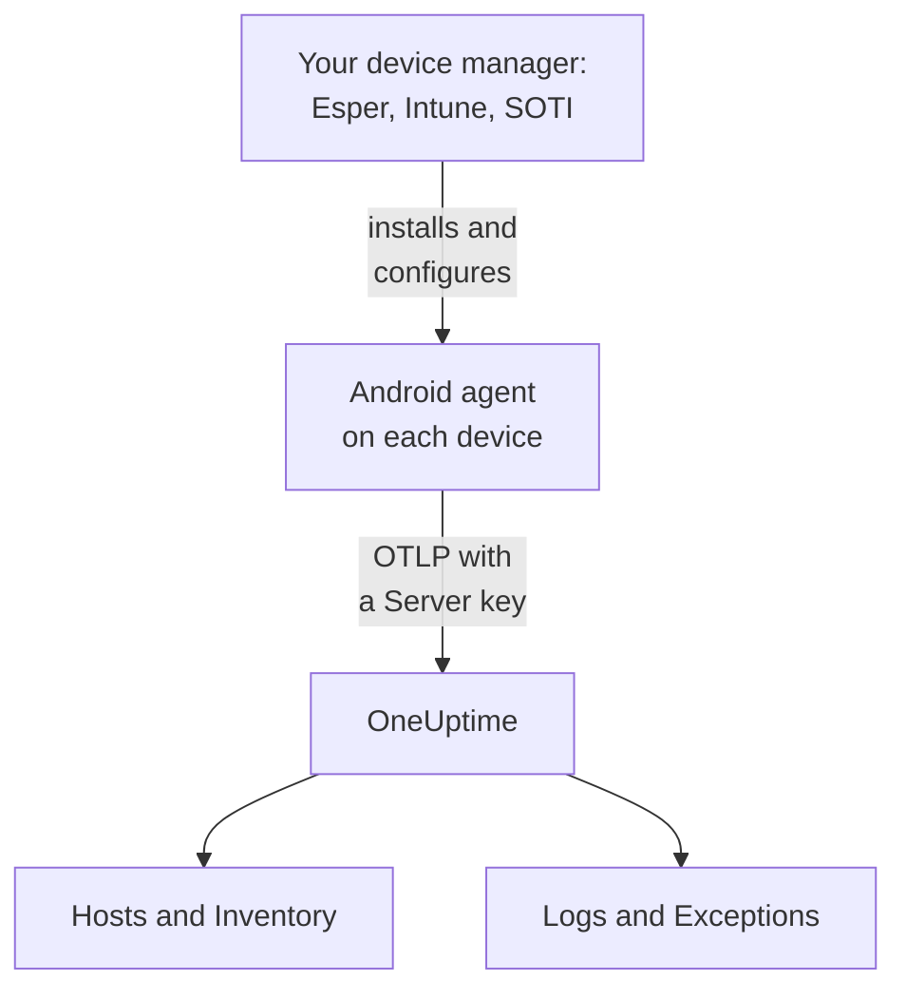

# Android Agent

The OneUptime Android agent reports an Android device your organization owns, such as an ordering kiosk, a POS terminal, a handheld or a signage player, to OneUptime: its memory, storage, network, battery and temperature, its restarts, the apps installed on it, and the crashes and logs of the apps on it. Your device manager installs and configures it on the whole fleet at once. Each device becomes a host in **Hosts** and an item in **Inventory**, beside your servers and Windows machines.

:::cards
- [When to use it](#the-agent-or-app-instrumentation): The agent sees the device, app instrumentation sees your app.
- [Deploy it with Esper](#deploy-it-with-esper): Upload the APK, push its settings, start it once.
- [Settings](#settings): Every key of its managed configuration.
- [Read other apps' logs](#read-other-apps-logs): Grant READ_LOGS once, with adb or your device manager.
:::

## How it works

The agent is a small app that runs as a foreground service. Every minute it reads the device's health and sends it to your OneUptime over OTLP with a **Server** ingestion key, with the device's restarts, installed apps and logs. It starts by itself when the device boots, keeps what it collects on the device while the network is down, and sends it once the network is back. It never keeps a sleeping device awake, and it compresses what it sends.



## The agent or app instrumentation

| | [OpenTelemetry Android](/docs/rum/android-setup) in your app | The Android agent |
| --- | --- | --- |
| What it sees | Your app: its crashes, ANRs, screens, sessions, requests and workflows | The device: memory, storage, network, battery, restarts, installed apps, and every app's crashes and ANRs |
| Where it shows | **Real User Monitoring**, **Traces** and **Exceptions** | **Hosts**, **Inventory**, **Logs** and **Exceptions** |
| How you install it | In your app's code | As an app, through your device manager |

On devices you own, use both, and give the device the same name in both: the agent's `device_name` setting and the `host.name` your app sets. The device is then one item in **Inventory**, with the app's telemetry and the device's together.

## Before you begin

- Devices on Android 7.0 or later, managed by a device manager that supports Android managed configurations: Esper, Microsoft Intune, Workspace ONE, SOTI and other Android Enterprise device managers. For a single device, adb is enough.
- A **Server** ingestion key, created under **Project Settings → Telemetry & APM → Ingestion Keys** with **Create Ingestion Key**.
- The agent: `oneuptime-android-agent.apk`, attached to every [OneUptime release](https://github.com/OneUptime/oneuptime/releases/latest).
- Outbound HTTPS from the devices to your OneUptime URL. The agent refuses a URL that is not `https://`, since every request carries the ingestion key.

## Deploy it with Esper

:::steps
### Upload the APK

In the Esper console, upload `oneuptime-android-agent.apk` to the **App Library**, and add it to the blueprint of the devices to monitor.

### Push its settings

In the blueprint, open the agent's **Managed Configuration** and paste its settings. Esper fills in the placeholders on each device, with Esper Agent 8.00.0764 or later:

```json title="Managed configuration"
{
  "oneuptime_url": "https://oneuptime.com",
  "oneuptime_token": "YOUR_TELEMETRY_INGESTION_TOKEN",
  "device_name": "${esper.deviceName}",
  "device_serial": "${esper.serialNumber}",
  "device_type": "kiosk",
  "labels": "region=emea"
}
```

If you host OneUptime yourself, put your own URL in `oneuptime_url`. Then converge the devices, so they read the new settings.

### Start it once

Android does not start a newly installed app at boot until it has been opened once. Turn on **Launch on Start** for the agent in the blueprint, in Multi-App mode, or open the agent once on each device. From then on it starts by itself whenever the device boots, and after each update.

### Find the devices in OneUptime

Within a minute each device appears under **Hosts**, named by its `device_name`, and in **Inventory**. The agent's own screen on the device says whether it is reporting, and what stops it when it is not.
:::

Other device managers work the same way: add the APK as a line-of-business or internal app, set the same keys in its app configuration, and open it once on each device.

## Settings

The agent reads these keys from its managed configuration. A device without one can be set up on the agent's own screen instead, with the URL, the ingestion key and the device's name. A key entered there is stored encrypted with the Android Keystore.

| Key | What it sets | Default |
| --- | --- | --- |
| `oneuptime_url` | Your OneUptime URL | `https://oneuptime.com` |
| `oneuptime_token` | A **Server** ingestion key | None: the agent sends nothing without one |
| `device_name` | The device's name in **Hosts** and **Inventory**, which is its identity there | Its model and the start of its Android ID |
| `device_serial` | Its serial number, which Android does not give to apps from Android 10 | None |
| `device_type` | What it is, such as a kiosk, a POS terminal or a handheld | `Android device` |
| `device_location` | Where it is, such as a store's number | None |
| `labels` | Labels for the host, as `name=value` pairs separated by commas | None |
| `collection_interval_seconds` | How often it reports, from 30 to 600 seconds | `60` |
| `logcat_enabled` | Whether it sends what it reads from Logcat | `true` |
| `logcat_min_level` | The least severe Logcat lines it sends on Android 12 and earlier: `verbose`, `debug`, `info`, `warn`, `error` or `fatal` | `warn` |
| `installed_apps_enabled` | Whether it sends the installed apps | `true` |

A placeholder your device manager did not fill in, such as `${esper.deviceName}` sent as it is, is ignored, and the agent's screen says so. Keep `device_name` the same once a device reports: a new name is a new host.

## Read other apps' logs

Android lets an app read other apps' logs only with the READ_LOGS permission, and only adb can grant it: not the app itself, and not a device policy. Grant it once on each device, and it stays granted through restarts and updates:

```bash
adb shell pm grant com.oneuptime.androidagent android.permission.READ_LOGS
```

With Esper, run that command over **Secure Remote ADB**: turn on ADB access for the device, connect with `espercli secureadb connect -d DEVICE_ID`, then run the command. Android restarts the agent when the permission is granted, and the agent starts reading at once.

What the agent then reads depends on the Android version:

- Android 13 and later: every app's crashes and ANRs. Android shows other apps' log lines only to an app that is on screen, after the person at the device allows it, so an agent running in the background cannot read them.
- Android 12 and earlier: every app's crashes and ANRs, and every app's log lines at `logcat_min_level` and above.

Without READ_LOGS, the agent reports everything else, and its screen and the device's logs say how to grant it.

## What it reports

| What | Where it shows in OneUptime |
| --- | --- |
| Memory, storage, network and uptime | The device's page in **Hosts**: the same metrics a server's collector sends, so the host alert templates work |
| Battery charge and temperature, and whether the device is on external power | The metrics `hw.battery.charge`, `hw.temperature` and `android.battery.plugged` |
| Thermal state | The metrics `android.thermal.status` and `android.thermal.headroom` |
| Restarts | **Logs**, with `@event.name:device.boot`: how long the device had been up, whether it shut down cleanly, how long it was off, and restart loops |
| Installed apps | **Logs**, with `@event.name:android.package.inventory` once a day, and each install, update and removal |
| Crashes and ANRs of every app | **Exceptions**, as unhandled, named after the app |
| Make, model, serial number, OS version and firmware | The device's item in **Inventory** |

Android 8 and later keep the device's CPU use from apps, so the agent reports CPU use only on Android 7, and on builds that allow it.

The host alert templates that fit a device are Host Stopped Reporting, High Memory Utilization, High Filesystem Usage and Host Restarted. A device that keeps restarting logs a warning at each boot, with `android.boot.recent_count` set to its boots in the last hour.

## Troubleshooting

:::details A device does not appear in Hosts
Open the agent on the device: its screen says what is missing, such as an ingestion key, a URL it cannot use, or an upload that failed and why. A device on which the agent was never opened after it was installed has not started it: open it once, or turn on **Launch on Start**.
:::

:::details The agent says OneUptime refused the ingestion key
Use a **Server** key that is turned on and not expired. A **Browser** key is refused from a device.
:::

:::details No logs from other apps
Grant READ_LOGS, as [Read other apps' logs](#read-other-apps-logs) says. On Android 13 and later only other apps' crashes and ANRs are read.
:::

:::details Two devices show up as one host
They have the same `device_name`. Use a placeholder that differs from device to device, such as `${esper.deviceName}` or `${esper.serialNumber}`.
:::

## Next steps

:::cards
- [Android Setup](/docs/rum/android-setup): Instrument your own app with OpenTelemetry Android.
- [Hosts](/docs/telemetry/hosts): A host's pages, readings and alerts.
- [Host Monitor](/docs/monitor/host-monitor): Get alerted when a device stops reporting or runs low on storage.
- [Exceptions](/docs/telemetry/exceptions): Triage the crashes and ANRs your devices report.
:::
