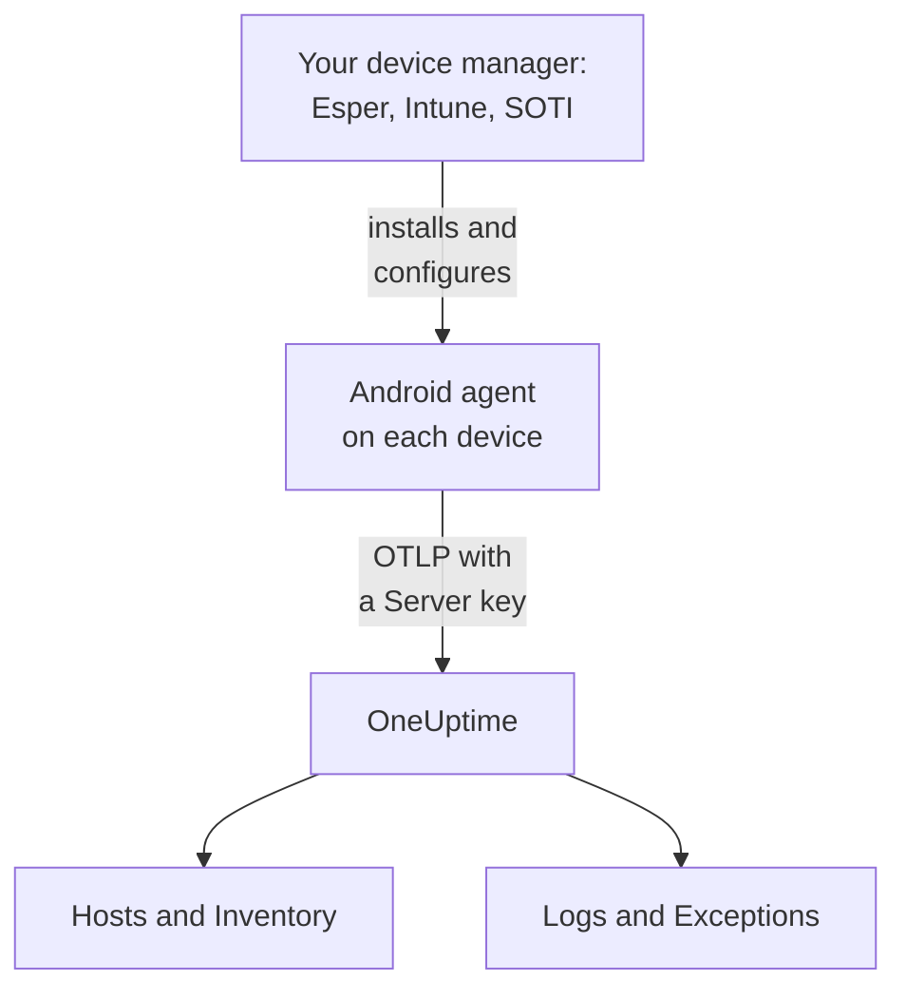

# Android Agent

The OneUptime Android agent reports an Android device your organization owns, such as an ordering kiosk, a POS terminal, a handheld or a signage player, to OneUptime: its memory, storage, network, battery and temperature, its restarts, the apps installed on it, and the crashes and logs of the apps on it. Your device manager installs and configures it on the whole fleet at once. Each device becomes a host in **Hosts** and an item in **Inventory**, beside your servers and Windows machines.

:::cards
- [When to use it](#the-agent-or-app-instrumentation): The agent sees the device, app instrumentation sees your app.
- [Deploy it with Esper](#deploy-it-with-esper): Upload the APK, push its settings, start it once.
- [Settings](#settings): Every key of its managed configuration.
- [Read other apps' logs](#read-other-apps-logs): Grant READ_LOGS once, with adb or your device manager.
- [Log sessions](#log-sessions): Every app's logs for a while, allowed by the person at the device.
:::

## How it works

The agent is a small app that runs as a foreground service. Every minute it reads the device's health and sends it to your OneUptime over OTLP with a **Server** ingestion key, with the device's restarts, installed apps and logs. It starts by itself when the device boots, keeps what it collects on the device while the network is down, and sends it once the network is back. It never keeps a sleeping device awake, and it compresses what it sends.



## The agent or app instrumentation

| | [OpenTelemetry Android](/docs/rum/android-setup) in your app | The Android agent |
| --- | --- | --- |
| What it sees | Your app: its crashes, ANRs, screens, sessions, requests and workflows | The device: memory, storage, network, battery, restarts, installed apps, and every app's crashes and ANRs |
| Where it shows | **Real User Monitoring**, **Traces** and **Exceptions** | **Hosts**, **Inventory**, **Logs** and **Exceptions** |
| How you install it | In your app's code | As an app, through your device manager |

On devices you own, use both, and give the device the same name in both: the agent's `device_name` setting and the `host.name` your app sets. The device is then one item in **Inventory**, with the app's telemetry and the device's together.

## Before you begin

- Devices on Android 7.0 or later, managed by a device manager that supports Android managed configurations: Esper, Microsoft Intune, Workspace ONE, SOTI and other Android Enterprise device managers. For a single device, adb is enough.
- A **Server** ingestion key, created under **Project Settings → Telemetry & APM → Ingestion Keys** with **Create Ingestion Key**.
- The agent: `oneuptime-android-agent.apk`, attached to every [OneUptime release](https://github.com/OneUptime/oneuptime/releases/latest).
- Outbound HTTPS from the devices to your OneUptime URL. The agent refuses a URL that is not `https://`, since every request carries the ingestion key.

## Deploy it with Esper

:::steps
### Upload the APK

In the Esper console, upload `oneuptime-android-agent.apk` to the **App Library**, and add it to the blueprint of the devices to monitor.

### Push its settings

In the blueprint, open the agent's **Managed Configuration** and paste its settings. Esper fills in the placeholders on each device, with Esper Agent 8.00.0764 or later:

```json title="Managed configuration"
{
  "oneuptime_url": "https://oneuptime.com",
  "oneuptime_token": "YOUR_TELEMETRY_INGESTION_TOKEN",
  "device_name": "${esper.deviceName}",
  "device_serial": "${esper.serialNumber}",
  "device_type": "kiosk",
  "labels": "region=emea"
}
```

If you host OneUptime yourself, put your own URL in `oneuptime_url`. Then converge the devices, so they read the new settings.

### Start it once

Android does not start a newly installed app at boot until it has been opened once. Turn on **Launch on Start** for the agent in the blueprint, in Multi-App mode, or open the agent once on each device. From then on it starts by itself whenever the device boots, and after each update.

### Find the devices in OneUptime

Within a minute each device appears under **Hosts**, named by its `device_name`, and in **Inventory**. The agent's own screen on the device says whether it is reporting, and what stops it when it is not.
:::

Other device managers work the same way: add the APK as a line-of-business or internal app, set the same keys in its app configuration, and open it once on each device.

## Settings

The agent reads these keys from its managed configuration. A device without one can be set up on the agent's own screen instead, with the URL, the ingestion key and the device's name. A key entered there is stored encrypted with the Android Keystore.

| Key | What it sets | Default |
| --- | --- | --- |
| `oneuptime_url` | Your OneUptime URL | `https://oneuptime.com` |
| `oneuptime_token` | A **Server** ingestion key | None: the agent sends nothing without one |
| `device_name` | The device's name in **Hosts** and **Inventory**, which is its identity there | Its model and the start of its Android ID |
| `device_serial` | Its serial number, which Android does not give to apps from Android 10 | None |
| `device_type` | What it is, such as a kiosk, a POS terminal or a handheld | `Android device` |
| `device_location` | Where it is, such as a store's number | None |
| `labels` | Labels for the host, as `name=value` pairs separated by commas | None |
| `collection_interval_seconds` | How often it reports, from 30 to 600 seconds | `60` |
| `logcat_enabled` | Whether it sends what it reads from Logcat | `true` |
| `logcat_min_level` | The least severe Logcat lines it sends on Android 12 and earlier: `verbose`, `debug`, `info`, `warn`, `error` or `fatal` | `warn` |
| `installed_apps_enabled` | Whether it sends the installed apps | `true` |

A placeholder your device manager did not fill in, such as `${esper.deviceName}` sent as it is, is ignored, and the agent's screen says so. Keep `device_name` the same once a device reports: a new name is a new host.

The agent's screen, its notifications and the titles and descriptions your device manager shows for these keys are in the device's language, in every language OneUptime's Dashboard speaks.

## Read other apps' logs

Android lets an app read other apps' logs only with the READ_LOGS permission, and only adb can grant it: not the app itself, and not a device policy. Grant it once on each device, and it stays granted through restarts and updates:

```bash
adb shell pm grant com.oneuptime.androidagent android.permission.READ_LOGS
```

With Esper, run that command over **Secure Remote ADB**: turn on ADB access for the device, connect with `espercli secureadb connect --device DEVICE_ID`, then run the command. Android restarts the agent when the permission is granted, and the agent starts reading at once.

What the agent then reads depends on the Android version:

- Android 13 and later: every app's crashes and ANRs. Android shows other apps' log lines only to an app that is on screen, after the person at the device allows it, so an agent running in the background cannot read them. Ask for them for a while with a [log session](#log-sessions).
- Android 12 and earlier: every app's crashes and ANRs, and every app's log lines at `logcat_min_level` and above.

Without READ_LOGS, the agent reports everything else, and its screen and the device's logs say how to grant it.

### Crash stacks and reboot reasons

Android keeps the full report of every app crash, native crash and ANR, and the reason for each reboot, in its DropBox. The agent reads them for every app when it has READ_LOGS and usage access, and on Android 15 and later READ_DROPBOX_DATA. Grant them once with adb, as READ_LOGS:

```bash
adb shell pm grant com.oneuptime.androidagent android.permission.READ_DROPBOX_DATA
adb shell appops set com.oneuptime.androidagent GET_USAGE_STATS allow
```

The first command is for Android 15 and later; usage access can also be turned on in the device's **Settings → Usage access**. A device policy cannot grant these, and the agent's screen lists the commands still to run. With them, each crash in **Exceptions** has its whole stack trace, a native crash its signal and the library it crashed in, an ANR its main thread's stack, and a restart in **Logs** the reason Android gives for it. Card numbers, email addresses, tokens and passwords in what the agent reads are replaced with `[card number]`, `[email]`, `[token]` and `[redacted]` before it is sent.

### Grant them across a fleet

Every report of the agent says which of these grants it still lacks. To list the devices that need them, open **Inventory**, then **All Items**, and filter by **Agent Permissions**: **Missing**. Turn on the **Agent Permissions** column to see what each device lacks, and export the list as CSV.

A device policy cannot grant these: READ_LOGS and READ_DROPBOX_DATA are permissions only adb, the system or the device's maker can give, and usage access is set by adb or by the person at the device. What Esper offers, and why none of it grants them:

- **App permissions**, in a blueprint or with the `SET_APP_PERMISSION` command, go through Android's device owner API, which grants only the permissions an app asks the person at the device for. Android refuses these.
- **Managed configuration** sets the agent's own settings, never Android's permissions.
- **Run Shell Script** runs on Linux and Windows devices, not on Android ones.
- **Secure Remote ADB** reaches one device at a time, from a computer that runs `espercli`. On Esper Foundation devices it needs no one at the device. On other devices, someone at the device accepts **Allow USB debugging?** the first time.

So grant them with adb:

- **Before a device ships**, when it is staged with a USB cable. This grants all three on every device connected to the computer:

  ```bash
  for serial in $(adb devices | awk 'NR > 1 && $2 == "device" { print $1 }'); do
    adb -s "$serial" shell pm grant com.oneuptime.androidagent android.permission.READ_LOGS
    adb -s "$serial" shell pm grant com.oneuptime.androidagent android.permission.READ_DROPBOX_DATA
    adb -s "$serial" shell appops set com.oneuptime.androidagent GET_USAGE_STATS allow
  done
  ```

  On Android 14 and earlier the second command says the permission is unknown: that device does not need it.
- **On a device in the field**, over Secure Remote ADB, one device of the **Missing** list at a time.
- **Usage access alone** can be turned on by the person at the device, under **Settings → Usage access**, or with the button on the agent's screen.

The device's next report, within a minute, takes it off the **Missing** list.

### CPU use

Android 8 and later keep a device's CPU use from apps. Only a device owner app can read it, and only on devices whose hardware reports it. The agent reads it when it is the device owner, which you set with adb on a device that has no accounts and no other device owner:

```bash
adb shell dpm set-device-owner com.oneuptime.androidagent/.admin.AgentDeviceAdminReceiver
```

A device that your device manager already owns cannot have a second owner, so its CPU use is not available, and the agent's screen says so. Its CPU use is then left out of the Hosts list, and the **High CPU Utilization** template is not offered for it.

## Log sessions

A log session sends every app's logs from a device for a while, to troubleshoot it. On Android 13 and later it is the only way to read other apps' log lines, because Android shows them only to an app that is on screen, after the person at the device allows it.

:::steps
### Request one

Open the device in **Hosts**, then **Logs**, and click **Request Log Session** in **Log Sessions**. Choose how long the device sends its logs, from 15 minutes to 4 hours, and the lowest level it sends: **Info**, **Debug** or **Verbose**. Add a **Note** to say why you ask, such as "Checking why the payment app crashes after 6pm".

### Allow it at the device

Within a minute, the device shows a notification that someone asked for its logs, with their name and your note. The person at the device opens the agent, where the request shows with your note under it, and taps **Allow**. On Android 13 and later Android then asks to allow access to all device logs, and they allow that too.

### Read the lines

The session reads **Collecting**, and every app's lines arrive in the device's logs. Click **Show Lines** to see the session's lines on their own, or **Download Lines** to save them as a file. The session ends when its time is up, or when someone stops it on the device or cancels it in OneUptime.
:::

The note is one line of up to 200 characters. The device shows it as you wrote it, in quotation marks, in the notification and on the agent's screen while the session waits or runs; it is never translated. Line breaks become spaces, and card numbers, email addresses, tokens and passwords in it are replaced with `[card number]`, `[email]`, `[token]` and `[redacted]` before it is kept, as in what the agent sends. The session's list shows it under who asked, and the host's **Audit Logs** keep it with the request.

**Download Lines** saves the session's lines as a text file in the format `logcat -v threadtime` prints, which a vendor's support can read: each line with its time to the millisecond, its process and thread, its level, its tag and its message. Times are in UTC. The file's first lines say which session, device and note it is, and who asked. It holds the lines **Logs** shows, as the agent redacted them, so it takes the same permission as reading the device's logs. A file holds at most 100,000 lines and 32 MB; a longer session's file ends saying how many lines the session has.

A session needs READ_LOGS and `logcat_enabled`; without them it reads **Unavailable**. One session at a time runs on a device. A request nobody allows within an hour expires, and a session the device restarts during ends with it, since Android's permission ends with the agent's process. Asking for a session takes permission to edit the host, and the host's **Audit Logs** keep who asked, and when.

## What it reports

| What | Where it shows in OneUptime |
| --- | --- |
| Memory, storage, network and uptime | The device's page in **Hosts**: the same metrics a server's collector sends, so the host alert templates work |
| Battery charge and temperature, and whether the device is on external power | The metrics `hw.battery.charge`, `hw.temperature` and `android.battery.plugged` |
| Thermal state | The metrics `android.thermal.status` and `android.thermal.headroom` |
| CPU use | The metric `system.cpu.utilization`: on Android 7, and on Android 8 and later when the agent is the [device owner](#cpu-use) |
| Restarts | **Logs**, with `@event.name:device.boot`: how long the device had been up, whether it shut down cleanly, how long it was off, why it rebooted, and restart loops |
| Installed apps | **Logs**, with `@event.name:android.package.inventory` once a day, and each install, update and removal |
| Crashes and ANRs of every app | **Exceptions**, as unhandled, named after the app, with their stacks when the agent reads [DropBox](#crash-stacks-and-reboot-reasons) |
| Make, model, serial number, OS version, security patch level and firmware | The device's item in **Inventory**, with the **Security Patch Level** filter and column |
| How old its security patch level is | The metric `android.os.security_patch.age`, in days |
| The grants the agent still lacks | The device's item in **Inventory**, with the **Agent Permissions** filter and column |

In **Hosts**, the device's OS reads Android, with Android's mark.

A device is behind on its security patches when its security patch level is more than 90 days old. Google publishes an Android security bulletin every month, and Android Enterprise Recommended holds a device's maker to shipping each one within 90 days, so a device further behind lacks fixes its maker should have shipped. In **Inventory**, the **Security Patch Level** filter lists the devices **Out of Date**; the **Security Patch Out of Date** template alerts on each.

The device's boots in the last hour are the metric `android.boot.recent_count`, and a device that keeps restarting logs a warning at each boot. In **Hosts**, an Android device is offered alert templates of its own: Device Unplugged, Low Battery, Device Overheating, Restart Loop, Storage Nearly Full and Security Patch Out of Date, with Host Stopped Reporting, Host Restarted and High Memory Utilization, and High CPU Utilization once it reports CPU use. Each alert's first debug commands are adb commands. See [Host Monitor](/docs/monitor/host-monitor#android-devices).

## Troubleshooting

:::details A device does not appear in Hosts
Open the agent on the device: its screen says what is missing, such as an ingestion key, a URL it cannot use, or an upload that failed and why. A device on which the agent was never opened after it was installed has not started it: open it once, or turn on **Launch on Start**.
:::

:::details The agent says OneUptime refused the ingestion key
Use a **Server** key that is turned on and not expired. A **Browser** key is refused from a device.
:::

:::details No logs from other apps
Grant READ_LOGS, as [Read other apps' logs](#read-other-apps-logs) says. On Android 13 and later only other apps' crashes and ANRs are read, unless a [log session](#log-sessions) runs.
:::

:::details A log session stays on Waiting for Approval
Nobody at the device has allowed it yet. Someone has to open the agent on the device and tap **Allow**, and on Android 13 and later allow Android's prompt too, while the agent is on screen. A session Android's prompt declined reads **Declined**: request another one.
:::

:::details Two devices show up as one host
They have the same `device_name`. Use a placeholder that differs from device to device, such as `${esper.deviceName}` or `${esper.serialNumber}`.
:::

## Next steps

:::cards
- [Android Setup](/docs/rum/android-setup): Instrument your own app with OpenTelemetry Android.
- [Hosts](/docs/telemetry/hosts): A host's pages, readings and alerts.
- [Host Monitor](/docs/monitor/host-monitor): Get alerted when a device stops reporting or runs low on storage.
- [Exceptions](/docs/telemetry/exceptions): Triage the crashes and ANRs your devices report.
:::
