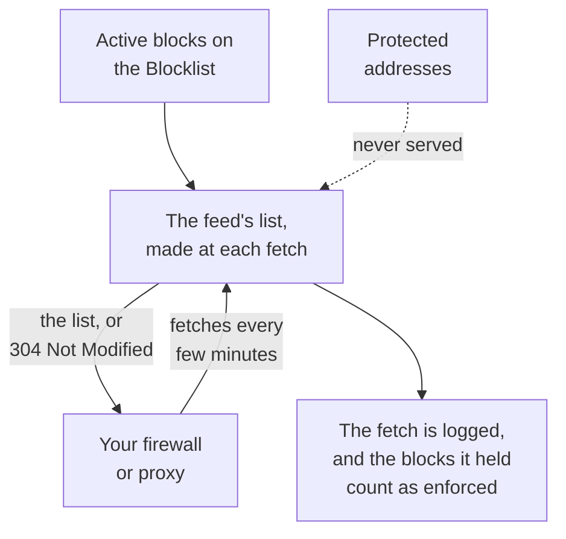

# Blocklist Feeds for Firewalls and Proxies

A blocklist feed is a secret URL your firewall or proxy reads your project's [blocklist](/docs/telemetry/security-cases#blocklist) from, every few minutes. Palo Alto Networks, FortiGate, Check Point, Cisco Secure Firewall, OPNsense and pfSense read it as an external list, and commands you copy from OneUptime apply it with nftables, ipset, nginx, HAProxy or Windows Firewall. Your firewall reaches OneUptime: OneUptime never needs a route into your network or a password for your firewall.

:::cards
- [Create a feed](#create-a-feed): Pick the firewall, copy the secret, follow its steps.
- [Set up your firewall](#set-up-your-firewall): The steps for each firewall and proxy, and how often it fetches.
- [When a block is enforced](#when-a-block-is-enforced): Only once a firewall has fetched a list that holds it.
- [Rotate or revoke the secret](#rotate-or-revoke-the-secret): A new secret with a day's overlap, or none at all at once.
:::

## How it works



Each fetch makes the list from the blocks active at that moment. A block that expires or is lifted is gone from the next fetch, and a protected address is never in it, even one protected after it was blocked. A block counts as enforced at the feed only once a firewall has fetched a list that holds it.

## Before you begin

- A firewall or proxy that reads a list of addresses from an `https` URL, or a Linux or Windows host where you can run commands as root or as an administrator.
- A way out to OneUptime over HTTPS from the firewall: `https://oneuptime.com`, or the address of your own OneUptime server.
- A role that can create feeds: Project Owner, Project Admin or Security Admin. Security Member and Security Viewer can read feeds and their fetches. See [Roles](/docs/permissions/reference#roles).

## Create a feed

:::steps
### Open Blocklist Feeds

Open **Products → Security Events → Playbooks → Blocklist Feeds**.

### Create the feed

Click **Create Blocklist Feed** and pick the **Firewall** that reads it. **Name** is what the Blocklist calls the feed where a block is enforced; left empty, it is named after the firewall, such as "FortiGate feed". Under **More fields**, **Serves** picks IPv4 and IPv6, IPv4 only or IPv6 only, and **Allowed Source Addresses** limits who may read the feed.

### Copy the secret

The feed's page opens with its secret, shown once: OneUptime keeps only its hash. Copy it, then click **Done**. Until you leave the page, the steps on it fill the secret in for you.

### Follow your firewall's steps

**Set Up Your Firewall** shows the URL to paste, how your firewall sends the secret, and the steps in its own console, filled in. Pick another firewall there to see its steps instead. After your firewall's first fetch, the feed's status says **Reading**, and **Fetches** lists the fetch.
:::

## What a feed serves

| File | For | What it holds |
| --- | --- | --- |
| `blocklist.txt` | Palo Alto Networks, pfSense, ipset, HAProxy, Windows Firewall and any other firewall | One address or range a line. |
| `blocklist.txt?comments=1` | FortiGate, Check Point, Cisco Secure Firewall and OPNsense, which skip lines that start with `#` | Each address or range after a line that says why it is blocked. |
| `nftables.nft` | nftables | A file for `nft -f` that empties the sets `blocklist_v4` and `blocklist_v6` of the table `inet oneuptime` and fills them again. |
| `nginx.conf` | nginx | A `deny` line for each address or range. |
| A file's name followed by `.md5`, such as `blocklist.txt.md5` | Cisco Secure Firewall | The file's MD5, so the firewall downloads the list only when it changed. |

A feed's URL is `https://oneuptime.com/api/blocklist-feed/<feed ID>/<file>`, and the feed's page shows it filled in for your firewall. With `?comments=1`, the list reads:

```text
# OneUptime case CASE-42 until 2026-11-21 10:42 UTC
203.0.113.7
# OneUptime blocklist until lifted
198.51.100.0/24
```

A feed serves the active blocks whose action is **Block**. It never serves a challenge, which a firewall cannot do, and a feed that serves IPv4 only or IPv6 only leaves the other addresses out. The nftables file leaves out an address that a range in the list already holds, since nftables refuses overlapping entries in a set.

When nothing is blocked, `blocklist.txt` holds one address, `192.0.2.1` (`2001:db8::1` for a feed that serves IPv6 only). It is an address set aside for documentation, which no traffic on the internet comes from: Palo Alto Networks and Cisco keep the last list they read when a list comes back empty, so an empty list would keep blocking what you lifted.

Every answer carries an `ETag`. A firewall that sends it back in `If-None-Match` gets `304 Not Modified` while the list is unchanged, and the commands OneUptime gives you do so.

## How a firewall sends the secret

| How | What the firewall sends | Used by |
| --- | --- | --- |
| Basic authentication | Any username, such as `oneuptime`, with the secret as the password | Palo Alto Networks (over HTTPS only), FortiGate and Check Point |
| Bearer token | `Authorization: Bearer <secret>` | The commands for nftables, ipset, nginx, HAProxy and Windows Firewall |
| Secret in the URL | `https://oneuptime.com/api/blocklist-feed/<feed ID>/<secret>/blocklist.txt` | Cisco Secure Firewall, OPNsense and pfSense, which document no way to send one |

A request with no secret, or a wrong one, gets `401 Unauthorized`. A URL with a wrong secret in it gets `404 Not Found`, as an address that does not exist does. OneUptime's own web server does not write feed URLs to its access log, so a secret in a URL does not end up there.

## Limit who may read a feed

**Allowed Source Addresses**, under **More fields**, takes up to 50 addresses and ranges, one a line, such as `203.0.113.7` or `198.51.100.0/24`. A request from any other address gets `403 Forbidden`, even with the right secret. Leave it empty to let any address that has the secret read the feed.

Each address can fetch a feed 60 times a minute, and fetch feeds 600 times a minute in all. Past that, it gets `429 Too Many Requests` with a `Retry-After` header.

## When a block is enforced

A block counts as enforced at a feed once a firewall has fetched a list that holds it, after the block was made, and for ten minutes after each such fetch. A `304 Not Modified` answer counts as a fetch of the same list. On the **Blocklist**, the feed's chip in **Enforced At** then turns green, and its tooltip says how long after the block the firewall fetched it, such as "A firewall fetched this block from FortiGate feed 3 min after it was made. Last fetched 2 minutes ago."

Ten minutes without a fetch, and the chip says the firewall has not fetched the feed since: the firewall may still block the address, but OneUptime cannot tell. So have your firewall fetch the feed every five minutes or more often. A firewall that fetches less often, such as OPNsense, still blocks between its fetches, and OneUptime calls the block enforced there only for the ten minutes after each.

A block that expires or is lifted is gone from the next fetch, and its chip waits for a firewall to fetch the list without it. When OneUptime cannot read which addresses are protected, the feed answers `503 Service Unavailable` with `Retry-After: 60` rather than a list that might hold one, and the firewall keeps the list it has.

## When a firewall stops reading

OneUptime learns how often each feed is fetched. When a feed has not been fetched for three times its usual interval, and at least ten minutes, its status says **Stopped reading**, the **Blocklist** names it above its list, and the project's owners get one email: "Your firewall stopped reading the blocklist feed _feed name_". Until a firewall has fetched a feed twice, OneUptime expects a fetch every five minutes, every hour from OPNsense and every day from pfSense.

The next fetch clears it, and a later stop sends another email. A feed whose secret was revoked never counts as stopped.

## Rotate or revoke the secret

**Rotate Secret**, on the feed's page, makes a new secret and shows it once. The secret it replaces keeps working for 24 hours, so you can give every firewall the new one; **Fetches** marks a fetch that still sent the old one as **Previous secret**. Rotating again within those 24 hours ends the oldest secret at once.

**Revoke Secret** ends the secret, and the one before it, at once: use it when a secret has leaked. The feed then answers no one, and its firewalls keep the list they have without refreshing it, until **Rotate Secret** makes a new secret. Deleting a feed ends it, its secret and its fetches.

## Set up your firewall

The feed's page shows these steps for the firewall you pick, with the URL, the username and, right after the secret is made, the secret filled in.

| Firewall | File | Secret | Fetch every | Holds at most |
| --- | --- | --- | --- | --- |
| Palo Alto Networks | `blocklist.txt` | Basic authentication | 5 minutes, the shortest it offers | 30 custom lists, and 50,000 addresses in all (150,000 on the PA-3200, PA-5200 and PA-7000 Series) |
| FortiGate | `blocklist.txt?comments=1` | Basic authentication | 5 minutes (1 to 43,200; 5 by default) | 300,000 addresses across all its threat feeds |
| Check Point | `blocklist.txt?comments=1`, IPv4 | Basic authentication | 5 minutes (every hour by default) | 50,000 addresses in a feed |
| Cisco Secure Firewall | `blocklist.txt?comments=1` and its MD5 | In the URL | 5 minutes (2 hours by default) | |
| OPNsense | `blocklist.txt?comments=1` | In the URL | 1 hour, the shortest it offers | |
| pfSense | `blocklist.txt` | In the URL | 1 day, the shortest it offers | |
| nftables, ipset, nginx, HAProxy, Windows Firewall | Their own | Bearer token | 1 minute | |

### Palo Alto Networks

1. In the web interface, go to **Objects → External Dynamic Lists** and click **Add**.
2. Set **Type** to **IP List** and **Source** to the feed's URL, `https://oneuptime.com/api/blocklist-feed/<feed ID>/blocklist.txt`.
3. Turn on **Client Authentication**, with **Username** `oneuptime` and the feed's secret as the **Password**.
4. Set **Check for updates** to **Every Five Minutes**, click **OK** and commit.
5. In **Policies → Security**, add a rule with the list as its **Source Address** and the action **Deny**, and commit.

Palo Alto Networks sends the username and password over HTTPS only. It reads a comment only after an address, never on a line of its own, so its feed is the plain list. See [Configure the Firewall to Access an External Dynamic List](https://docs.paloaltonetworks.com/pan-os/11-1/pan-os-admin/policy/use-an-external-dynamic-list-in-policy/configure-the-firewall-to-access-an-external-dynamic-list).

### FortiGate

1. Go to **Security Fabric → External Connectors**, click **Create New** and choose **IP Address** under **Threat Feeds**.
2. Set **URL of external resource** to the feed's URL, `https://oneuptime.com/api/blocklist-feed/<feed ID>/blocklist.txt?comments=1`.
3. Turn on **HTTP basic authentication**, with **Username** `oneuptime` and the feed's secret as the **Password**.
4. Set **Refresh Rate** to 5 minutes and click **OK**.
5. In **Policy & Objects → Firewall Policy**, use the feed as a policy's **Source** and set **Action** to **DENY**.

See [Configuring a threat feed](https://docs.fortinet.com/document/fortigate/7.6.0/administration-guide/379433/configuring-a-threat-feed).

### Check Point

1. In SmartConsole, open the **Object Explorer** and choose **New → More → Network Object → Network Feed**.
2. Set **Feed URL** to the feed's URL, `https://oneuptime.com/api/blocklist-feed/<feed ID>/blocklist.txt?comments=1`, **Format** to **Flat list** and **Data type** to **IP Address**.
3. Under **Advanced Settings**, enter **Username** `oneuptime` and the feed's secret as the password for **Authentication**.
4. Set **Check feed interval** to 5 minutes, click **Test Feed**, then **OK**.
5. Use the feed as the **Source** of an Access Control rule whose action is **Drop**, and install the policy.

Check Point documents IPv4 addresses for a network feed, so a feed made for it serves IPv4 only. See [Network Feed](https://sc1.checkpoint.com/documents/R82/WebAdminGuides/EN/CP_R82_SecurityManagement_AdminGuide/Content/Topics-SECMG/Network_Feed.htm).

### Cisco Secure Firewall

1. In the management center, choose **Objects → Security Intelligence** and click **Add Network Lists and Feeds**.
2. Set **Type** to **Feed**, **Feed URL** to the feed's URL, `https://oneuptime.com/api/blocklist-feed/<feed ID>/<secret>/blocklist.txt?comments=1`, and **MD5 URL** to the same URL with `.md5` after `blocklist.txt`.
3. Set **Update Frequency** to 5 minutes and save.
4. In your access control policy, open **Security Intelligence → Networks**, add the feed to the **Block List**, then save and deploy.

Cisco needs an MD5 URL for an update frequency of 30 minutes or less, and its managed devices take updates from the management center every 30 minutes, so a block reaches them up to 30 minutes after the feed is fetched. See [Creating Security Intelligence feeds](https://docs.manage.security.cisco.com/cdfmc/t_creating_security_intelligence_feeds.html).

### OPNsense

1. Go to **Firewall → Aliases** and add an alias of type **URL Table (IPs)**.
2. Set **Content** to the feed's URL, `https://oneuptime.com/api/blocklist-feed/<feed ID>/<secret>/blocklist.txt?comments=1`, and **Refresh Frequency** to 0 days and 1 hour.
3. Save and **Apply**, then in **Firewall → Rules** add a rule that blocks traffic whose **Source** is the alias.

OPNsense fetches a URL table every hour at most, so OneUptime confirms its blocks only for the ten minutes after each fetch. It still blocks them in between. See [Aliases](https://docs.opnsense.org/manual/aliases.html).

### pfSense

1. Go to **Firewall → Aliases**, click **Add** and choose **URL Table (IPs)**.
2. Enter the feed's URL, `https://oneuptime.com/api/blocklist-feed/<feed ID>/<secret>/blocklist.txt`, and set it to refresh every 1 day.
3. **Save** and **Apply Changes**, then in **Firewall → Rules** add a rule with the alias as its **Source** and the action **Block**.

> [!WARNING]
> pfSense fetches a URL table once a day at most: too slow to block an attack while it happens. Use it for long blocks, beside a firewall that fetches every few minutes.

See [Alias Types](https://docs.netgate.com/pfsense/en/latest/firewall/aliases-types.html).

### nftables

As root, run the commands the feed's page shows once. They make the table `inet oneuptime` with two sets, `blocklist_v4` and `blocklist_v6`, rules in its `input` and `forward` chains that drop traffic from the addresses in them, and the script `/usr/local/sbin/oneuptime-blocklist`, which keeps the secret in `/etc/oneuptime-blocklist`, readable by root only.

The script runs every minute from `/etc/cron.d/oneuptime-blocklist`. It loads `nftables.nft` only when the list changed, in one transaction, so the sets are never half full. See [Sets](https://wiki.nftables.org/wiki-nftables/index.php/Sets).

### ipset and iptables

As root, run the commands the feed's page shows once. They make two sets, `oneuptime_v4` and `oneuptime_v6`, and rules in the `raw` table's `PREROUTING` chain, for iptables and ip6tables, that drop traffic from the addresses in them.

The script runs every minute from cron. When the list changed, it fills two new sets and swaps them in, so the rules never see a set half full. See [ipset](https://ipset.netfilter.org/ipset.man.html).

### nginx

Add the include line to the `server` block of each site to protect, then run the commands the feed's page shows once, as root:

```nginx
server {
    include /etc/nginx/oneuptime-blocklist.conf;
}
```

The script runs every minute from cron. When the list changed, it writes `/etc/nginx/oneuptime-blocklist.conf`, checks the configuration with `nginx -t` and reloads nginx, and puts the previous file back if the check fails.

Behind a load balancer or a CDN, nginx sees the balancer's address, not the visitor's, unless the realip module is set up: set `set_real_ip_from` to the balancer's addresses and `real_ip_header` to the header it sends, or block at the balancer instead. See [ngx_http_access_module](https://nginx.org/en/docs/http/ngx_http_access_module.html).

### HAProxy

As root, create the list file and add two lines to `haproxy.cfg`, then reload HAProxy once: its Runtime API updates only a list HAProxy already reads.

```text
global
    stats socket /run/haproxy/admin.sock mode 660 level admin

frontend www
    http-request deny if { src -n -f /etc/haproxy/oneuptime-blocklist.lst }
```

Then run the rest of the commands the feed's page shows. The script runs every minute from cron and, when the list changed, writes `/etc/haproxy/oneuptime-blocklist.lst` and updates HAProxy through its Runtime API, with no reload. See [The Runtime API](https://docs.haproxy.org/3.4/management.html#9.3).

### Windows Firewall

In PowerShell as an administrator, run the commands the feed's page shows once. They save a script and the secret in `C:\ProgramData\OneUptime\Blocklist`, which only SYSTEM and Administrators can read, and register the scheduled task "OneUptime Blocklist", which runs the script every minute as SYSTEM.

The script keeps inbound rules that block every address on the list, 1,000 to a rule: "OneUptime blocklist 0", "OneUptime blocklist 1" and on. See [Set-NetFirewallRule](https://learn.microsoft.com/en-us/powershell/module/netsecurity/set-netfirewallrule).

### Other firewalls

1. Point your firewall or proxy at the feed's URL, `https://oneuptime.com/api/blocklist-feed/<feed ID>/blocklist.txt`: one address or range a line.
2. Send the feed's secret as the password of basic authentication, with any username, or as a bearer token.
3. Have it fetch the list every 5 minutes or more often: a block counts as enforced there for ten minutes after each fetch.

### Kubernetes

Block at the edge or the cloud WAF in front of the cluster, connected as a blocklist destination under **Security Connections** or **Cloud Connections**, or on a proxy you run in front of it with the nginx or HAProxy commands. The community Ingress NGINX controller was retired, and its repository archived in March 2026, so OneUptime does not document its annotations. See [Ingress NGINX Retirement](https://kubernetes.io/blog/2025/11/11/ingress-nginx-retirement/).

## Limits

| What | Limit |
| --- | --- |
| Entries in a feed | 20,000 |
| Allowed Source Addresses | 50 addresses and ranges |
| Fetches of one feed from one address | 60 a minute |
| Fetches of all feeds from one address | 600 a minute |
| A replaced secret keeps working | 24 hours |
| A block counts as enforced after a fetch | 10 minutes |
| Fetches kept | 30 days |

## Troubleshooting

:::details The firewall gets 401 Unauthorized
The secret it sends is not the feed's. Check that the password, or the bearer token, is the whole secret, with nothing before or after it. A secret replaced more than 24 hours ago no longer works: **Rotate Secret** makes a new one.
:::

:::details The firewall gets 404 Not Found
The URL names a feed that does not exist, a file a feed does not serve, or a wrong secret in the URL. Copy the URL again from the feed's page.
:::

:::details The firewall gets 403 Forbidden
The feed's **Allowed Source Addresses** does not hold the address the firewall fetches from. **Fetches** shows the address each fetch came from.
:::

:::details A block's chip says it is waiting for a firewall to fetch the feed
No firewall has fetched the feed since the block was made. Check **Fetches** on the feed's page: a firewall that fetches every five minutes holds the block within five minutes.
:::

## Next steps

:::cards
- [Security Cases and Playbooks](/docs/telemetry/security-cases): Block an address from a case, by hand or from a playbook.
- [Threat Intelligence](/docs/telemetry/threat-intelligence): Bring known-bad addresses into OneUptime.
- [Security Events](/docs/telemetry/security-events): Find the addresses worth blocking.
:::
