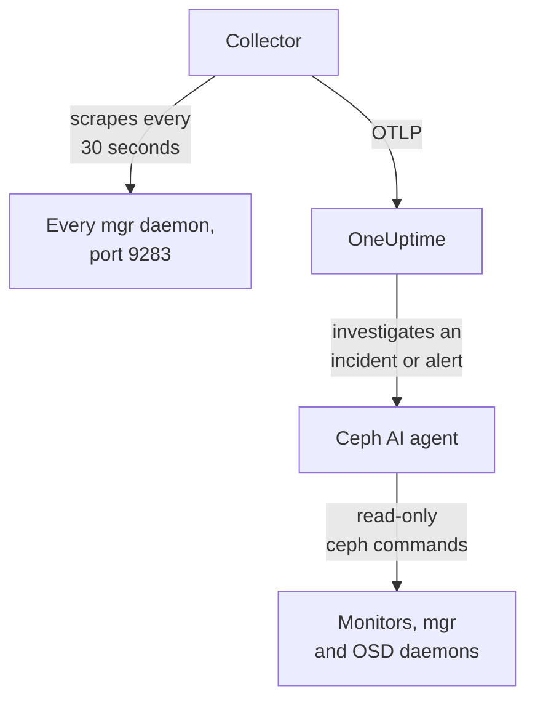

# Ceph Agent

The OneUptime Ceph agent monitors a Ceph cluster: its health, monitor quorum, OSDs, pools and placement groups. It scrapes the Ceph mgr `prometheus` module on every mgr daemon, stamps every metric with your cluster's name and sends it to OneUptime, where the cluster appears with its OSDs, pools and daemons. [Ceph monitors](/docs/monitor/ceph-monitor) alert on what arrives.

:::cards
- [Install the agent](#install-the-agent): Enable the mgr module, then the install script or Docker Compose.
- [What the agent collects](#what-the-agent-collects): The series behind the Ceph pages, metrics and alert templates.
- [AI agent](#ai-agent): Let OneUptime AI read the cluster while it investigates.
- [Troubleshooting](#troubleshooting): A diagnostic script, and the usual problems.
:::

## How it works

The agent is two containers you run with Docker Compose on one machine. An OpenTelemetry Collector scrapes the mgr `prometheus` module on every mgr daemon every 30 seconds. Only the active mgr answers with metrics, so when it fails over to a standby, metrics keep flowing with no change. The Ceph AI agent beside it lets OneUptime AI run read-only `ceph` commands while it investigates an incident or alert.



The cluster registers itself with its first data, under the name the agent stamps on every metric as `ceph.cluster.name`.

## Before you begin

- Docker Engine 20.10 or later with the Docker Compose v2 plugin, on a machine that can reach your Ceph mgr daemons on port 9283.
- A shell on a Ceph admin node, where the `ceph` CLI works with admin rights.
- An ingestion key. Create one under **Project Settings → Telemetry & APM → Ingestion Keys** and copy its value.
- Outbound HTTPS from that machine to your OneUptime URL.

## Install the agent

:::steps
### Enable the mgr prometheus module

On a Ceph admin node:

```bash
ceph mgr module enable prometheus
```

Every mgr daemon then serves Prometheus metrics on port `9283` at `/metrics`. Only the active mgr returns metrics: standby mgrs answer with an empty response, or with an HTTP error if `mgr/prometheus/standby_behaviour` is set to `error`. That is why the agent scrapes every mgr. List them:

```bash
ceph mgr stat                    # active mgr
ceph orch ps --daemon-type mgr   # all mgrs (cephadm clusters)
```

### Install and start the agent

:::tabs
@tab install.sh
Download the install script and run it on the machine that will host the agent:

```bash
curl -sSL https://raw.githubusercontent.com/OneUptime/oneuptime/master/agents/CephAgent/install.sh -o install.sh
bash install.sh
```

The script asks for your OneUptime URL, the ingestion key, a name for the cluster and the mgr endpoints, and whether the [AI agent](#ai-agent) may apply fixes. Where `ceph` works with admin rights, it also offers to create the AI agent's own Ceph client. It installs to `/opt/oneuptime-ceph-agent`, writes a `0600` `.env` file, and starts the agent with Docker Compose. Running the script again reuses everything in that `.env` instead of prompting again, which is how you [upgrade the agent](#upgrading-the-agent).
@tab Docker Compose
Download `docker-compose.yml` and `otel-collector-config.yaml` from the [CephAgent directory](https://github.com/OneUptime/oneuptime/tree/master/agents/CephAgent) into a new folder:

```bash
mkdir oneuptime-ceph-agent && cd oneuptime-ceph-agent
curl -fsSLO https://raw.githubusercontent.com/OneUptime/oneuptime/master/agents/CephAgent/docker-compose.yml
curl -fsSLO https://raw.githubusercontent.com/OneUptime/oneuptime/master/agents/CephAgent/otel-collector-config.yaml
```

Create a `.env` file next to them:

```bash title=".env"
ONEUPTIME_URL=YOUR_ONEUPTIME_URL
ONEUPTIME_TELEMETRY_INGESTION_KEY=YOUR_TELEMETRY_INGESTION_TOKEN
CEPH_CLUSTER_NAME=my-ceph-cluster
CEPH_MGR_ENDPOINTS=[ceph-mon-1:9283,ceph-mon-2:9283,ceph-mon-3:9283]
```

List every mgr daemon, active and standbys, comma-separated and wrapped in square brackets: the brackets make the collector read the value as a list of scrape targets. Start the agent:

```bash
docker compose up -d
```

The AI agent's container starts too, and waits for a Ceph client of its own: see [AI agent](#ai-agent).
:::

### Check the agent is running

```bash
docker compose ps
docker logs -f oneuptime-ceph-agent
```

`docker compose ps` lists the collector (`oneuptime-ceph-agent`) and the AI agent (`oneuptime-ceph-ai-agent`). The collector's logs should show this line once it has started:

```text
Everything is ready. Begin running and processing data.
```

### Find the cluster in OneUptime

Open **Products → Infrastructure → Ceph → All Clusters**. The cluster appears under its `CEPH_CLUSTER_NAME` within a minute or so, with its OSDs, pools and daemons.
:::

## Environment variables

The install script writes these to `/opt/oneuptime-ceph-agent/.env`; a Docker Compose install reads them from the `.env` next to `docker-compose.yml`. After changing one, run `docker compose up -d` in that folder.

| Variable | Required | Description |
| --- | --- | --- |
| `ONEUPTIME_URL` | Yes | Your OneUptime URL, such as `https://oneuptime.com` or your self-hosted instance. Use `http://` and its port if the instance is HTTP-only. |
| `ONEUPTIME_TELEMETRY_INGESTION_KEY` | Yes | The ingestion key from **Project Settings → Telemetry & APM → Ingestion Keys**. |
| `CEPH_CLUSTER_NAME` | Yes | The cluster's name in OneUptime, stamped on every metric as the `ceph.cluster.name` resource attribute. Keep it stable: changing it later registers a second cluster. Defaults to `ceph`. |
| `CEPH_MGR_ENDPOINTS` | Yes | Every mgr daemon as a comma-separated `host:port` list in square brackets, such as `[ceph-mon-1:9283,ceph-mon-2:9283,ceph-mon-3:9283]`. The install script adds the brackets for you. |

The AI agent's own settings are under [AI agent](#ai-agent).

## How the agent scrapes

- **Every mgr, every 30 seconds.** The mgr `prometheus` module caches each scrape for `mgr/prometheus/scrape_interval` (15 seconds by default). Never scrape more often than that: you would only read the cache again.
- **`honor_labels: true`.** The labels Ceph exports (`ceph_daemon`, `pool_id`, per-daemon instance labels) are kept as they are. Without it, the `instance` label would be rewritten for each scrape target and change every time the active mgr changes, which breaks every series.

## What the agent collects

The agent sends everything the mgr `prometheus` module exports. OneUptime's Ceph pages, metric catalog and alert templates are built on these series:

| Category | Metrics |
| --- | --- |
| Cluster health | `ceph_health_status` (0 = OK, 1 = WARN, 2 = ERR), `ceph_health_detail` (one series per active health check, labelled `name` and `severity`, from Quincy on; behind the health-check alert templates and the Overview's **Active Health Checks**), `ceph_healthcheck_slow_ops`, `ceph_daemon_health_metrics` (per daemon, keyed by `type`), `ceph_mon_quorum_status`, `ceph_mon_metadata`, `ceph_cluster_total_bytes`, `ceph_cluster_total_used_bytes` |
| OSD | `ceph_osd_up`, `ceph_osd_in`, `ceph_osd_apply_latency_ms`, `ceph_osd_commit_latency_ms`, `ceph_osd_stat_bytes`, `ceph_osd_stat_bytes_used`, `ceph_osd_numpg`, `ceph_osd_metadata`, per OSD by the `ceph_daemon` label (such as `osd.3`) |
| Pool | `ceph_pool_stored`, `ceph_pool_max_avail`, `ceph_pool_objects`, `ceph_pool_rd`, `ceph_pool_wr`, `ceph_pool_rd_bytes`, `ceph_pool_wr_bytes`, `ceph_pool_metadata`. The data series carry only a `pool_id` label; the pool's name is on `ceph_pool_metadata`. |
| Placement groups | `ceph_pg_total`, `ceph_pg_active`, `ceph_pg_clean`, `ceph_pg_degraded`, `ceph_pg_undersized` (all per pool, by `pool_id`), `ceph_num_objects_degraded`, `ceph_num_objects_misplaced` |
| Daemons | `ceph_mgr_metadata`, `ceph_mds_metadata` and `ceph_rgw_metadata`, beside the monitor and OSD metadata above. Each names a daemon and carries its version in the `ceph_version` label: the **Daemons** page lists them. |

### More scrape targets

The mgr module covers the cluster's health and capacity. For a closer look, add more jobs under `scrape_configs` in `otel-collector-config.yaml`:

- **`ceph-exporter` (Reef 18.2 and later).** cephadm runs a `ceph-exporter` daemon on every cluster host, serving per-daemon performance counters on port `9926`. Add one target per host.
- **`node_exporter`.** The usual companion for each Ceph host's CPU, memory, disk and network metrics, on port `9100` by default.

Both get the `ceph.cluster.name` resource attribute from the shipped `resource` processor, so they land on the same cluster in OneUptime.

## Optional — Ship the Ceph cluster log

The agent can tail `/var/log/ceph/ceph.log` and ship it to OneUptime, which fills the cluster's **Cluster Log** page. It is off by default because the agent must run on a host that has the cluster log: a monitor host, by default.

:::steps
### Turn the receiver on

In `otel-collector-config.yaml`, uncomment the `filelog` receiver and the `logs` pipeline.

### Mount the log directory

In `docker-compose.yml`, uncomment the volume that mounts the directory into the collector:

```yaml
- /var/log/ceph:/var/log/ceph:ro
```

### Restart the agent

```bash
docker compose up -d
```
:::

Lines ship as they are written. OneUptime reads the `ceph.log` format (time, daemon, `INF`/`WRN`/`ERR` level, message) when it shows them, and the `resource` processor stamps `ceph.cluster.name`, so the log lands on this cluster.

## Tag the cluster with project labels

A resource attribute that starts with `oneuptime.label.` becomes a project label on the cluster: `oneuptime.label.<dimension>=<value>` is the label `<dimension>:<value>`. Add the attributes to the `resource` processor in `otel-collector-config.yaml`, next to `ceph.cluster.name`:

```yaml
processors:
  resource:
    attributes:
      # ...existing attributes...
      - key: oneuptime.label.team
        value: storage
        action: upsert
      - key: oneuptime.label.env
        value: production
        action: upsert
```

The collector reads its config only when it starts: run `docker compose restart oneuptime-ceph-agent`. The cluster then shows the labels `team:storage` and `env:production`. Labels are matched without regard to case, so an existing `Production` label is reused rather than duplicated, and the agent never removes a label someone added in OneUptime.

## Run as a systemd service

To start the agent with the machine and restart it when it fails, install its systemd unit. It assumes the agent lives in `/opt/oneuptime-ceph-agent`, where the install script puts it:

```bash
sudo curl -fsSL https://raw.githubusercontent.com/OneUptime/oneuptime/master/agents/CephAgent/systemd/oneuptime-ceph-agent.service -o /etc/systemd/system/oneuptime-ceph-agent.service
sudo systemctl daemon-reload
sudo systemctl enable --now oneuptime-ceph-agent
```

## Upgrading the agent

The agent reports the collector version its files pin as its **Agent Version**. When that is older than the version this OneUptime release pins, a warning sign appears beside it on the cluster's **Overview**. Select it to see these commands. An agent installed before its files reported a version shows none until it is upgraded this way.

The collector image is pinned in `docker-compose.yml` and its config is a file next to it, so pulling alone does not move the agent forward. Run `install.sh` again: it reuses every value in your existing `.env` (nothing is prompted for again), refreshes `docker-compose.yml` and `otel-collector-config.yaml` (a file you edited is kept as `<file>.bak.<timestamp>`), pulls the images and recreates the agent so the collector reads its new config. The AI agent's `ceph/` folder stays as it is.

```bash
curl -sSL https://raw.githubusercontent.com/OneUptime/oneuptime/master/agents/CephAgent/install.sh -o install.sh
bash install.sh
```

Installed it with Docker Compose instead? In the agent's folder, download both files again (and make again any change you made to them), then pull the images and recreate the agent:

```bash
curl -fsSLO https://raw.githubusercontent.com/OneUptime/oneuptime/master/agents/CephAgent/docker-compose.yml
curl -fsSLO https://raw.githubusercontent.com/OneUptime/oneuptime/master/agents/CephAgent/otel-collector-config.yaml
docker compose pull
docker compose up -d --force-recreate
```

## Uninstalling the agent

```bash
cd /opt/oneuptime-ceph-agent
docker compose down
```

If you created the AI agent's Ceph client, remove it on an admin node with `ceph auth del client.oneuptime-ai`.

## AI agent

The agent's `docker-compose.yml` also runs the **Ceph AI agent**, `oneuptime-ceph-ai-agent` (image `oneuptime/resource-ai-agent:release`). While OneUptime AI investigates an incident or alert on this cluster it runs read-only `ceph` commands through it — `ceph health detail`, `ceph osd tree`, `ceph pg dump_stuck`, `ceph crash ls` — and, only if you allow it, applies fixes such as marking an OSD back in or clearing `noout`. It registers as the cluster named `CEPH_CLUSTER_NAME`, like the collector, and shows up on the cluster's **AI → AI agent** page in OneUptime.

- **AI investigations are on by default.** Once the agent connects, OneUptime AI investigates incidents and alerts on this cluster with it, and the cluster's **Overview** shows the agent's status. To stop, set `ONEUPTIME_AI_INVESTIGATION=false` where the agent runs (**Change** under **What AI may do** on the AI agent page shows how), or leave the agent out.
- **Its own Ceph client is the hard limit.** It connects as `client.oneuptime-ai`, with the cluster's minimal `ceph.conf` and that client's keyring in a `ceph/` folder next to `docker-compose.yml` (mounted read-only at `/etc/ceph`). With read caps, nothing it runs can change the cluster. On a fresh install, `install.sh` offers to create the client; running it again never does. Never put the admin keyring in that folder.
- It is **read-only** unless you set `ONEUPTIME_AI_ALLOW_WRITES=true` and give the client the caps for the fixes (the agent's README lists them); `ONEUPTIME_AI_WRITE_TARGETS` (for example `osd.*,cluster`) limits what a fix may touch. `ONEUPTIME_AI_FIXES` in the same `.env` says how fixes run — `ask-for-approval` (a person approves each one), `automatic` or `bypass-approval` — and the AI agent page shows it read-only ([What AI may do, set by the agent](/docs/ai/infrastructure-ai-agents#what-ai-may-do-set-by-the-agent)).
- It connects out to the monitors (TCP 3300 and 6789) and the mgr and OSD daemons (TCP 6800–7300), runs as UID 1000 with no capabilities, and never runs `auth`, `config-key`, `tell` or anything that deletes data. Delete the `oneuptime-ceph-ai-agent` service from `docker-compose.yml` if you do not use OneUptime AI.

To create the client by hand, run this on a Ceph admin node, in the agent's folder (copy the two files into the `ceph/` folder of the agent's machine if it is another one):

```bash
mkdir -p ceph
ceph config generate-minimal-conf > ceph/ceph.conf
ceph auth get-or-create client.oneuptime-ai mon 'allow r' mgr 'allow r' osd 'allow r' -o ceph/ceph.client.oneuptime-ai.keyring
sudo chown 1000:1000 ceph/ceph.client.oneuptime-ai.keyring
sudo chmod 600 ceph/ceph.client.oneuptime-ai.keyring
docker compose up -d
```

What it may run, how fixes work and how to troubleshoot it: [Infrastructure AI Agents](/docs/ai/infrastructure-ai-agents#ceph-clusters).

## Troubleshooting

:::details Run the diagnostic script first
The agent ships with a script, [`troubleshoot.sh`](https://github.com/OneUptime/oneuptime/blob/master/agents/CephAgent/troubleshoot.sh), that checks the whole chain: the container runtime, every mgr endpoint you configured, the cluster name stamped on every metric, the token's shape, the collector's own metrics, and whether OneUptime accepts the ingestion key. It warns when no endpoint returns `ceph_health_status`, or when only one is configured, since only the active mgr serves metrics. The key check matters most. OneUptime refuses a bad key with `401` (`422` for a disabled key or a browser key), and the collector treats both as permanent: it drops the batch and logs one `Exporting failed` error, which is easy to miss while the container stays healthy. The script asks `GET <url>/otlp/v1/validate` from inside the agent's network for a direct `200` (valid) or `401` (invalid), and falls back to `POST /fluentd/v1/logs` on older servers.

```bash
curl -sSL https://raw.githubusercontent.com/OneUptime/oneuptime/master/agents/CephAgent/troubleshoot.sh -o troubleshoot.sh
bash troubleshoot.sh    # add -d <dir> if you installed outside /opt/oneuptime-ceph-agent
```

It ends with a verdict naming the most likely cause.
:::

:::details No cluster appears in OneUptime
1. Read the collector's logs: `docker logs oneuptime-ceph-agent`. A `401` on export means a bad ingestion key; connection refused means a wrong `ONEUPTIME_URL`.
2. Check that a mgr serves metrics: `curl http://ACTIVE_MGR_HOST:9283/metrics | head` should print `ceph_*` lines. If it does not, enable the module with `ceph mgr module enable prometheus`.
3. Check that `CEPH_MGR_ENDPOINTS` is wrapped in square brackets. Without them, the collector reads the whole comma-separated list as one target, which does not exist.
:::

:::details The cluster shows as Disconnected
A cluster turns Disconnected when OneUptime has received nothing from it for 15 minutes; OneUptime checks every 5 minutes, and time it was not receiving data itself does not count. Check that the collector is running (`docker compose ps`), that its logs show no export errors, and that the machine still reaches your OneUptime URL. The cluster turns Connected again with its next data.
:::

:::details Metrics stop after a mgr failover
You are probably scraping only the mgr that used to be active. List every mgr daemon in `CEPH_MGR_ENDPOINTS`: scraping the standbys costs almost nothing, and they answer with empty responses.
:::

:::details Scrape errors for standby mgrs in the collector's logs
Expected when `mgr/prometheus/standby_behaviour` is set to `error` on your cluster: standbys then answer with HTTP 500. The active mgr's scrape still succeeds, so the errors are noise; set the behaviour back to `default` to silence them.
:::

:::details Metrics land under the wrong cluster
OneUptime registers a Ceph cluster by its `ceph.cluster.name`, which the agent takes from `CEPH_CLUSTER_NAME`. Changing it after the first data creates a second cluster rather than renaming the first.
:::

## Next steps

:::cards
- [Ceph Monitor](/docs/monitor/ceph-monitor): Alert on health, OSDs, placement groups, capacity, crashes and slow operations.
- [Proxmox Agent](/docs/telemetry/proxmox): Running Ceph under Proxmox VE? Monitor the cluster too.
- [Infrastructure AI Agents](/docs/ai/infrastructure-ai-agents): What the Ceph AI agent may run, and how fixes work.
- [Host OpenTelemetry Collector](/docs/telemetry/host-otel-collector): The operating system view of each Ceph host.
:::
