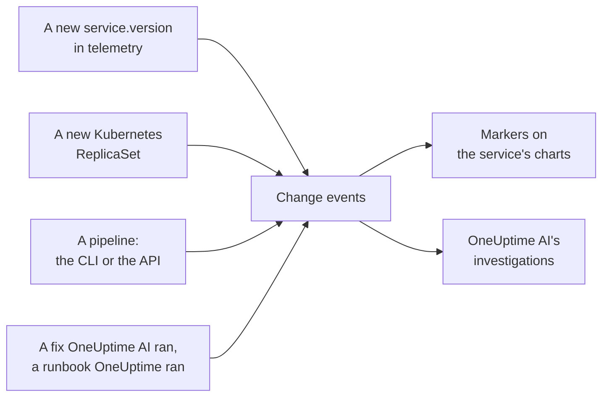

# Deploys and Changes

OneUptime keeps a record of what changed in your project: deploys, Kubernetes rollouts, config changes, and the fixes it ran itself. Each change is drawn as a marker on the charts of its service, and OneUptime AI reads them when it investigates an incident, so "it started right after the 10:02 deploy" is the first thing you learn, not the last.

:::cards
- [What OneUptime records on its own](#what-oneuptime-records-on-its-own): Deploys and rollouts from telemetry, and its own fixes.
- [Record a deploy from a pipeline](#record-a-deploy-from-a-pipeline): The CLI, GitHub Actions and the API.
- [How OneUptime AI uses changes](#how-oneuptime-ai-uses-changes): The suspects in every investigation.
- [Reference](#reference): Fields, attributes and limits.
:::

## How it works



## What OneUptime records on its own

You do not have to send anything for these. OneUptime records them from the telemetry it already receives, and from what it does itself.

| Change | Recorded when | Source |
| --- | --- | --- |
| A deploy | A service starts reporting a `service.version` it has not reported before in its environment | `service-version` |
| A rollout | The pods of a Kubernetes Deployment start running a ReplicaSet they have not run before: a new image, a changed environment variable or config reference, or a restart | `kubernetes` |
| A fix OneUptime AI ran | An AI agent reports the result of a command that changes something, such as `kubectl rollout restart` | `oneuptime-ai` |
| A runbook | A runbook OneUptime ran completes, fails, or is cancelled after it started | `runbook` |

- **The first version a service reports is its baseline, not a deploy.** A service that has run for months is not deployed the moment OneUptime starts receiving its telemetry.
- **A rollback to a version seen in the last 30 days is not recorded,** because that version is not new. A rollback OneUptime AI runs is recorded as a fix.
- **More than six new versions or ReplicaSets in an hour stop being recorded until the hour is over.** A "version" that changes with every pod, such as a build timestamp, would otherwise record a deploy for each pod.

A deploy is only recorded for a service that reports `service.version`. Set it, with the environment and the commit, in the resource attributes of your OpenTelemetry SDK or collector:

```bash
OTEL_RESOURCE_ATTRIBUTES="service.version=2.3.1,deployment.environment.name=production,vcs.ref.head.revision=$GIT_SHA"
```

A rollout needs the [Kubernetes agent](/docs/telemetry/kubernetes-agent), which stamps each pod's telemetry with its Deployment and ReplicaSet.

## Record a deploy from a pipeline

A pipeline can record a deploy, or any other change, as it happens: a config change, a migration, a feature flag. It writes with a telemetry ingestion key of your project, the kind your applications send telemetry with. Create one under **Project Settings → Telemetry & APM → Ingestion Keys**.

A key pinned to one service records every change under that service.

:::tabs
@tab CLI
```bash
oneuptime deploy \
  --service checkout \
  --service-version 2.3.1 \
  --commit "$GIT_SHA" \
  --environment production \
  --url https://oneuptime.com \
  --ingestion-key "$ONEUPTIME_TELEMETRY_INGESTION_KEY"
```
@tab GitHub Actions
```yaml title=".github/workflows/deploy.yml"
- name: Record the deploy in OneUptime
  env:
    ONEUPTIME_URL: https://oneuptime.com
    ONEUPTIME_TELEMETRY_INGESTION_KEY: ${{ secrets.ONEUPTIME_TELEMETRY_INGESTION_KEY }}
  run: |
    npx -y @oneuptime/cli deploy \
      --service checkout \
      --service-version "${{ github.ref_name }}" \
      --commit "${{ github.sha }}" \
      --repository "${{ github.server_url }}/${{ github.repository }}" \
      --environment production
```
@tab API
```bash
curl -X POST https://oneuptime.com/telemetry/change-events/v1/ingest \
  -H "Content-Type: application/json" \
  -H "x-oneuptime-token: $ONEUPTIME_TELEMETRY_INGESTION_KEY" \
  -d '{"events": [{"serviceName": "checkout", "version": "2.3.1", "commit": "1a2b3c4", "environment": "production"}]}'
```
:::

On a self-hosted OneUptime, use your own address instead of `https://oneuptime.com`. The API answers with how many events it stored and how many it skipped:

```json
{ "ingested": 1, "skipped": 0 }
```

See [`oneuptime deploy`](/docs/cli/command-reference#oneuptime-deploy) for every option of the CLI.

## How OneUptime AI uses changes

Every [AI investigation](/docs/ai/ai-sre) of an incident or an alert starts from the changes recorded in the two hours before it, and in the ten minutes after, for a pipeline that records its deploy once the rollout finished. The changes on the services, clusters and hosts the incident is linked to come first.

For up to four of them that name a service, OneUptime reads the service's telemetry in the 30 minutes before and after the change, and marks the change a **suspect** when the service got measurably worse right after it:

| Signal | A suspect when |
| --- | --- |
| Failed spans | The error rate at least doubled and rose by at least one percentage point, over at least 10 failed spans |
| Latency | The p99 grew at least half as slow again, and by at least 100 ms |
| Exceptions | At least three times as many a minute, and at least 10 of them |
| New exceptions | An exception type first seen in the version the change shipped, between 10 minutes before the change and 30 minutes after it, occurred at least 3 times |

OneUptime decides which change is a suspect from these numbers, not from what a change's title says. The investigation checks a suspect first, says whether it caused the incident, and says whether rolling it back is the fastest safe fix.

In an investigation and in [Ask AI](/docs/ai/ask-ai), `recent_changes` lists the changes in any window, and `get_change_details` shows what a deploy shipped: the commits since the service's previous deploy, their authors, the pull requests and the files they touched. That needs the commit on the change and a repository connected through the [GitHub App](/docs/ai/github-app).

## Reference

### Fields

| Field | What it is |
| --- | --- |
| `title` | What changed, such as `Deploy 2.3.1`. A deploy that sends `version` may leave it out |
| `eventType` | The kind of change: `deployment` (the default), `config-change`, `scaling`, `rollback`, `feature-flag` or your own |
| `serviceName` | The service it belongs to. Without one, the change is project-wide |
| `time` | When it happened, as ISO 8601 or epoch seconds or milliseconds. The default is when it arrived |
| `description` | Details of the change |
| `version` | The version deployed |
| `previousVersion` | The version it replaced |
| `commit` | The commit deployed (also `commitSha` or `sha`) |
| `repository` | The repository of the commit (also `repositoryUrl`) |
| `branch` | The branch deployed |
| `pullRequest` | The pull request deployed |
| `environment` | The environment deployed to |
| `attributes` | Up to 50 more attributes, as text, numbers or booleans |

The top-level fields are stored as attributes under the OpenTelemetry names: `version` as `service.version`, `commit` as `vcs.ref.head.revision`, `repository` as `vcs.repository.url.full`, `branch` as `vcs.ref.head.name`, `pullRequest` as `vcs.change.id` and `environment` as `deployment.environment.name`. An attribute sent under one of those names wins over its field.

Attributes whose names start with `oneuptime.` are OneUptime's own and are dropped from what a pipeline sends. Every change a pipeline records says so in `oneuptime.change.source`, which is `api`.

### Limits

| Limit | Value |
| --- | --- |
| Events in one request | 100 |
| Title | 500 characters |
| Description | 5,000 characters |
| Attributes | 50 |
| Time | A time more than 366 days ago, or more than 60 minutes ahead, is replaced with the time the event arrived |

## Next steps

:::cards
- [AI SRE](/docs/ai/ai-sre): What an investigation reads, and how it fixes what it finds.
- [Command Reference](/docs/cli/command-reference): Every command of the CLI.
- [OpenTelemetry](/docs/telemetry/open-telemetry): Send your services' telemetry, with their versions.
:::
