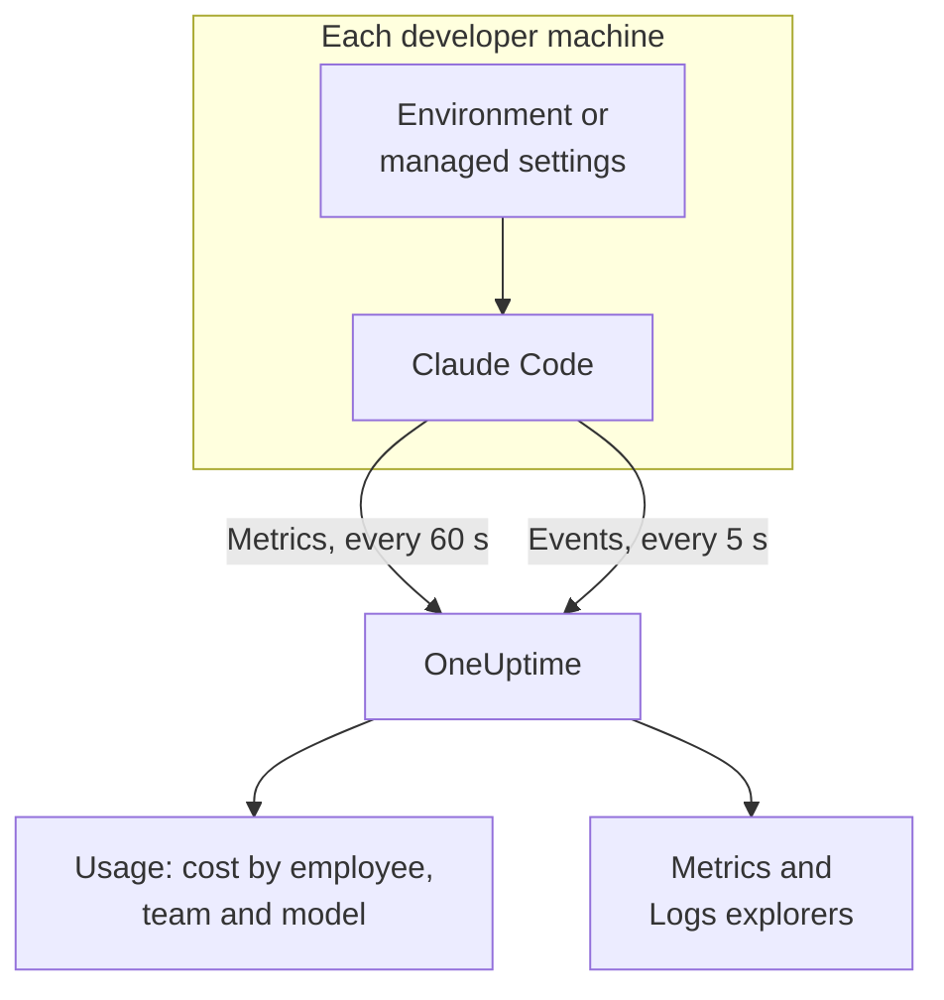

# Claude Code

Claude Code exports OpenTelemetry metrics and events itself, straight to OneUptime: no collector and no gateway in between. Turn it on with a few environment variables, or for a whole fleet with one managed settings file, and see cost, tokens, sessions, commits and accepted edits per developer.

:::cards
- [Set up one machine](#set-up-one-machine): Six environment variables and a restart.
- [Roll out to the fleet](#roll-out-to-the-fleet): One managed settings file on every machine.
- [Attribute spend to people](#attribute-usage-to-people-and-teams): Who is signed in, and when you must set the identity yourself.
- [Troubleshooting](#troubleshooting): What to check when nothing arrives.
:::

## How it works



Claude Code sends:

- **Cost and tokens**: `claude_code.cost.usage` (USD) and `claude_code.token.usage`, by model, by main agent or subagent, and by the agent, skill, plugin or MCP server that made the call.
- **Activity**: sessions, commits, pull requests, lines of code added and removed, and active time.
- **Edit decisions**: `claude_code.code_edit_tool.decision` counts accepted and rejected edits, so the acceptance rate is `accept / (accept + reject)`, by language and by tool.
- **Events**: prompts, tool results, API requests and errors, permission-mode changes and MCP server connections, as OTLP log records.

Every metric data point and event carries `user.email` when the developer is signed in with a Claude account, and OneUptime reads it as the employee on the metrics, where the cost and tokens are.

## Before you begin

1. Create a telemetry ingestion key under **Project Settings → Telemetry & APM → Ingestion Keys**.
2. Your OTLP endpoint is `https://oneuptime.com/otlp`, or `https://YOUR-ONEUPTIME-HOST/otlp` if you host OneUptime yourself.
3. Use one key for the whole fleet. It ends up on every developer machine, so treat it as a shared credential that can only send data, and rotate it like any other.

## Set up one machine

:::steps
### Export the variables

Add these to your shell profile (`.zshrc` or `.bashrc`), or export them in the terminal you start Claude Code from:

```bash
export CLAUDE_CODE_ENABLE_TELEMETRY=1
export OTEL_METRICS_EXPORTER=otlp
export OTEL_LOGS_EXPORTER=otlp
export OTEL_EXPORTER_OTLP_PROTOCOL=http/protobuf
export OTEL_EXPORTER_OTLP_ENDPOINT="https://oneuptime.com/otlp"
export OTEL_EXPORTER_OTLP_HEADERS="x-oneuptime-token=YOUR_INGESTION_TOKEN"
```

| Variable | What it does |
| --- | --- |
| `CLAUDE_CODE_ENABLE_TELEMETRY` | The main switch: nothing is exported without it. |
| `OTEL_METRICS_EXPORTER`, `OTEL_LOGS_EXPORTER` | `otlp` sends to OneUptime. `otlp,console` also prints what is sent, handy while you set up. |
| `OTEL_EXPORTER_OTLP_PROTOCOL` | `http/protobuf`; `http/json` and `grpc` work too. |
| `OTEL_EXPORTER_OTLP_ENDPOINT` | The base URL. Claude Code adds `/v1/metrics` and `/v1/logs` itself. |
| `OTEL_EXPORTER_OTLP_HEADERS` | Comma-separated `key=value` pairs; here, your ingestion key. |

### Restart Claude Code

The variables are read when Claude Code starts. Metrics are sent every 60 seconds and events every 5 seconds, so use Claude Code for a minute before you look.

### Check that data arrives

Open **Metrics** and look for `claude_code.token.usage`, then open **Products → AI / LLM** and go to **Usage**: your cost shows under your email, marked **from GenAI metrics**.
:::

To send metrics and events to different places, set `OTEL_EXPORTER_OTLP_METRICS_ENDPOINT` and `OTEL_EXPORTER_OTLP_LOGS_ENDPOINT` instead, with the full path (`https://oneuptime.com/otlp/v1/metrics`, `https://oneuptime.com/otlp/v1/logs`).

## Roll out to the fleet

For an organization, ship the same variables in a managed settings file. It has the shape of `settings.json`, with the variables in an `env` block:

```json title="managed-settings.json"
{
  "env": {
    "CLAUDE_CODE_ENABLE_TELEMETRY": "1",
    "OTEL_METRICS_EXPORTER": "otlp",
    "OTEL_LOGS_EXPORTER": "otlp",
    "OTEL_EXPORTER_OTLP_PROTOCOL": "http/protobuf",
    "OTEL_EXPORTER_OTLP_ENDPOINT": "https://oneuptime.com/otlp",
    "OTEL_EXPORTER_OTLP_HEADERS": "x-oneuptime-token=YOUR_INGESTION_TOKEN",
    "OTEL_RESOURCE_ATTRIBUTES": "team.id=platform,cost_center=eng-123"
  }
}
```

:::steps
### Put the file where Claude Code reads it

| Platform | Path |
| --- | --- |
| macOS | `/Library/Application Support/ClaudeCode/managed-settings.json` |
| Linux and WSL | `/etc/claude-code/managed-settings.json` |
| Windows | `C:\Program Files\ClaudeCode\managed-settings.json` |

Claude Code no longer reads the old Windows path `C:\ProgramData\ClaudeCode\managed-settings.json`. If you already ship a managed settings file, add a drop-in instead, such as `managed-settings.d/10-telemetry.json` next to it: Claude Code merges `managed-settings.json` first, then every `*.json` file in `managed-settings.d/` in alphabetical order.

### Check one machine

Run `/status` in Claude Code. The `Setting sources` line should read `Enterprise managed settings (file)`, or `(drop-ins)` or `(file + drop-ins)` for a drop-in. A different source in brackets means a higher-ranked source won, and yours was not used.

### Watch the fleet arrive

On the **Usage** tab, each developer shows up as a row once they have used Claude Code with the new settings.
:::

The same JSON can also come from server-managed settings in the claude.ai admin console (fetched at startup and every hour), a macOS configuration profile in the `com.anthropic.claudecode` domain, or a `Settings` value under `HKLM\SOFTWARE\Policies\ClaudeCode` on Windows.

:::details Which managed source wins, and how the telemetry variables combine
By default, Claude Code uses the highest-ranked source that sets any policy key, and ignores the others: server-managed settings, then an MDM or OS policy, then the managed settings files, then the per-user `HKCU` registry value. The `env` block is the exception: since version 2.1.223 it merges variable by variable across the admin sources.

The telemetry variables don't: the `OTEL_EXPORTER_OTLP_*` variables, the `OTEL_LOG_*` content switches, `OTEL_LOGS_EXPORTER` and the beta tracing variables come together from the highest-ranked source that sets any of them, so an endpoint from one source never pairs with credentials from another. If a higher-ranked source sets any of them, a telemetry drop-in contributes nothing.

Server-managed settings need one more step: a non-empty `OTEL_EXPORTER_OTLP_ENDPOINT` is applied only after each developer accepts a security approval dialog in an interactive session, and changes to the exporter settings apply at the next launch. Files and MDM policies have no dialog.
:::

:::details Rotating the ingestion key without editing every machine
Instead of a fixed header, set `"otelHeadersHelper": "/path/to/generate-otel-headers.sh"` in the settings. The script prints a flat JSON object of headers, such as `{"x-oneuptime-token":"..."}`. Claude Code runs it at startup and again every `CLAUDE_CODE_OTEL_HEADERS_HELPER_DEBOUNCE_MS` milliseconds (`1740000` by default, 29 minutes). Failures show in `/status`.
:::

## Attribute usage to people and teams

**The employee is `user.email`.** Claude Code sends it when the developer is signed in with a Claude account, and there is no variable to turn it off. OneUptime reads it from every cost and token data point with no setup.

**Other sign-ins send no email.** With an API key, or with Claude on Amazon Bedrock, Google Cloud or Microsoft Foundry, there is no Claude account in the session, and Claude Code sends only `user.id` and `session.id`. Set the identity yourself, per machine, in the managed settings or a launch wrapper:

```bash
export OTEL_RESOURCE_ATTRIBUTES="user.email=jdoe@example.com,team.id=platform"
```

**`user.id` is not a person.** It is a random id Claude Code writes to `~/.claude.json` on first run: one per install, and a new one if the file is deleted. Without an email, each install shows as its own row. One exception: a session signed in to a Claude apps gateway sends the signed-in identity (`user.id` is the identity provider's subject, `user.email` the email) and ignores `user.*` keys you set yourself.

**Teams and cost centres** come from `OTEL_RESOURCE_ATTRIBUTES`: OneUptime reads `team.id`, `team`, `cost_center` and `department`. Values cannot contain spaces, and quotes do not escape them: write `team=Platform_Engineering`, or percent-encode, as in `team=Platform%20Engineering`. Claude Code copies these keys onto every data point (`OTEL_METRICS_INCLUDE_RESOURCE_ATTRIBUTES`, on by default), and OneUptime reads them either way. A key you set never overrides one Claude Code sets itself.

## What OneUptime shows

On **Products → AI / LLM → Usage**, `claude_code.cost.usage` feeds the **Employee**, **Team** and **Model** tables, and `claude_code.token.usage` the token totals. Two rules decide what you see:

- **The metrics fill in for spans; they are never added to them.** If the same project gets GenAI spans with cost from your own apps, Claude Code's spend does not show. Send Claude Code to a project of its own. See [Spans come first, metrics fill in](/docs/telemetry/ai-llm-observability#spans-come-first-metrics-fill-in).
- **A row from metrics carries cost only.** Its calls and token cells show `—`, and the **Provider** and **Application / Service** tables stay empty: the metrics name no provider and belong to no OneUptime service.

Everything else, such as acceptance rate, lines of code, commits and pull requests per developer, or spend by `query_source`, you chart on a [dashboard](/docs/dashboards/index) from the metrics below, and alert on with a [Metrics Monitor](/docs/monitor/metrics-monitor).

## Metrics

Every metric is a counter, and carries the standard attributes as well as its own.

| Metric | Unit | Its own attributes |
| --- | --- | --- |
| `claude_code.session.count` | none | `start_type`: `fresh`, `resume`, `continue`, `agents_view` |
| `claude_code.lines_of_code.count` | none | `type`: `added`, `removed`; `model` |
| `claude_code.commit.count` | none | none |
| `claude_code.pull_request.count` | none | none |
| `claude_code.cost.usage` | USD | `model`; `query_source`: `main`, `subagent`, `auxiliary`; `speed`: `fast`, `normal`; `effort`; `agent.name`, `skill.name`, `plugin.name`, `marketplace.name`, `mcp_server.name`, `mcp_tool.name` |
| `claude_code.token.usage` | tokens | `type`: `input`, `output`, `cacheRead`, `cacheCreation`; and the same attributes as `claude_code.cost.usage` |
| `claude_code.code_edit_tool.decision` | none | `tool_name`: `Edit`, `Write`, `NotebookEdit`; `decision`: `accept`, `reject`; `source`; `language` |
| `claude_code.active_time.total` | s | `type`: `user` (at the keyboard), `cli` (tools and model responses) |

The standard attributes are `session.id`, `app.version`, `app.entrypoint`, `organization.id`, `user.account_uuid`, `user.account_id`, `user.id`, `user.email` and `terminal.type`, plus your `OTEL_RESOURCE_ATTRIBUTES`. Some of them can be turned off: see [Keep metric volume down](#keep-metric-volume-down).

- The cache token types are camelCase: `cacheRead` and `cacheCreation`. OneUptime's token totals count only `input` and `output`.
- On the cost and token metrics, the names of your own agents and MCP servers, and of third-party plugins and skills, read `custom` or `third-party` unless `OTEL_LOG_TOOL_DETAILS=1` is set (Claude Code 2.1.273 or later).

## Events

Events arrive as OTLP log records, each with `event.name`, `event.timestamp` and `event.sequence`. The ones you will use most:

| Event | What it records |
| --- | --- |
| `claude_code.user_prompt` | A prompt: its length and command; the text only if you turn it on |
| `claude_code.api_request` | A model request: `model`, `cost_usd`, `cost_usd_micros`, `duration_ms`, `input_tokens`, `output_tokens`, cache tokens |
| `claude_code.api_error` | A request that failed after its retries: `model`, `error`, `status_code`, `attempt` |
| `claude_code.tool_result` | A tool run: `tool_name`, `success`, `duration_ms`, and the decision that allowed it |
| `claude_code.tool_decision` | Whether a tool was allowed, and by what |
| `claude_code.mcp_server_connection` | An MCP server connecting or failing |

Claude Code sends many more, such as refusals, permission-mode changes and plugin, hook and skill events: Anthropic's [monitoring reference](https://code.claude.com/docs/en/monitoring-usage) lists them all. In `cost_usd_micros`, cost is a whole number of millionths of a USD, which adds up without rounding drift.

## Keep metric volume down

Claude Code puts `session.id` on every data point by default, and every session is a new series. Across a fleet that one attribute drives metric volume, and cost reporting doesn't need it:

```bash
export OTEL_METRICS_INCLUDE_SESSION_ID=false
```

| Variable | Default | Adds |
| --- | --- | --- |
| `OTEL_METRICS_INCLUDE_SESSION_ID` | `true` | `session.id`, a new value every session |
| `OTEL_METRICS_INCLUDE_VERSION` | `false` | `app.version` |
| `OTEL_METRICS_INCLUDE_ACCOUNT_UUID` | `true` | `user.account_uuid` and `user.account_id` |
| `OTEL_METRICS_INCLUDE_ENTRYPOINT` | `false` | `app.entrypoint` |
| `OTEL_METRICS_INCLUDE_RESOURCE_ATTRIBUTES` | `true` | Your `OTEL_RESOURCE_ATTRIBUTES` keys |
| `OTEL_METRICS_INCLUDE_REPOSITORY` | `false` | The repository's `vcs.*` attributes |

`user.email`, `user.id`, `organization.id` and `terminal.type` have no switch. Events are the busier signal: each active developer flushes every 5 seconds (`OTEL_LOGS_EXPORT_INTERVAL`, in milliseconds). Raise it to send fewer, larger batches, or set `OTEL_LOGS_EXPORTER=none` if you only need cost and usage, which all live in the metrics.

## Prompt and tool content are off by default

Claude Code does not export prompts, answers, tool arguments or tool output unless you turn each one on:

| Variable | Default | What `1` turns on |
| --- | --- | --- |
| `OTEL_LOG_USER_PROMPTS` | off | Prompt text |
| `OTEL_LOG_ASSISTANT_RESPONSES` | off | Answer text; when unset, it follows `OTEL_LOG_USER_PROMPTS` |
| `OTEL_LOG_TOOL_DETAILS` | off | Tool parameters, Bash commands, and the real names of agents, plugins, skills and MCP servers |
| `OTEL_LOG_TOOL_CONTENT` | off | Tool input and output, on trace spans only |
| `OTEL_LOG_RAW_API_BODIES` | off | Full API request and response bodies (`file:<dir>` writes them to disk instead) |

We recommend leaving them off: the metrics and the redacted events already answer who spent what, on which model, with what acceptance rate. Content capture moves prompts, source code and tool output into a telemetry store with different access controls than your repositories. If you turn it on for an investigation, `CLAUDE_CODE_OTEL_CONTENT_MAX_LENGTH` (`61440` by default) limits how much travels per record, and the traces' **Scrub Rules** and **Drop Filters** under **Traces → Settings** mask or drop it before it is stored.

## Metrics arrive as deltas

Claude Code sends delta metrics by default: each data point is the increase since the last export, not a running total. When you chart or alert on them, add the data points up over the window, and don't apply a rate or counter-reset function as you would to a cumulative counter: the numbers come out wrong without looking broken.

```bash
export OTEL_EXPORTER_OTLP_METRICS_TEMPORALITY_PREFERENCE=cumulative
```

Pin `cumulative` only if every exporter in your organization uses it, and don't mix the two across a fleet.

## Traces (beta)

Claude Code also has a beta traces exporter, which draws each interaction as a span tree: `claude_code.interaction`, with `claude_code.llm_request` and `claude_code.tool` beneath it.

```bash
export CLAUDE_CODE_ENHANCED_TELEMETRY_BETA=1
export OTEL_TRACES_EXPORTER=otlp
```

> [!WARNING]
> Keep the traces beta out of the project you use for spend. Its model spans carry `gen_ai.system` and `gen_ai.request.model`, so OneUptime lists them under **Calls**, but their tokens are in `input_tokens` and `output_tokens`, not the `gen_ai.usage.*` keys, so they arrive with no tokens and no cost. Once they exist, they are the rows the **Employee**, **Team** and **Model** tables show, at $0, in place of the metrics' spend.

In Agent SDK and non-interactive `-p` sessions, Claude Code picks up an incoming `TRACEPARENT`, so its spans join the caller's trace; interactive sessions ignore it. It sends the `traceparent` header to the model only when `ANTHROPIC_BASE_URL` is unset or the Anthropic API; behind your own proxy, set `CLAUDE_CODE_PROPAGATE_TRACEPARENT=1`.

## Troubleshooting

:::details Nothing arrives at all
Check `CLAUDE_CODE_ENABLE_TELEMETRY=1` first: without it, no other variable does anything. Then add `console` to the exporters (`OTEL_METRICS_EXPORTER=otlp,console`) and watch the terminal: if data points print, Claude Code is fine and the problem is the endpoint, the key or the network.
:::

:::details The managed settings file seems to be ignored
Run `/status` and read the `Setting sources` line. No managed source listed means the file is at the wrong path, is not valid JSON, or cannot be read by the developer's account. Another source listed means it won, and yours was not used. Settings from server-managed settings also wait for the developer to accept the approval dialog in an interactive session.
:::

:::details Spend shows as Unattributed, or as one row per install
Those developers are not signed in with a Claude account: they use an API key, Amazon Bedrock, Google Cloud or Microsoft Foundry. Set `user.email` in `OTEL_RESOURCE_ATTRIBUTES` for them, as [Attribute usage to people and teams](#attribute-usage-to-people-and-teams) shows.
:::

:::details The team or cost centre is missing
Check that `OTEL_RESOURCE_ATTRIBUTES` is set on the machine, holds no spaces, and doesn't reuse a key Claude Code sets itself: Claude Code's value wins.
:::

:::details The numbers look too small or too large
Claude Code sends deltas: add the data points up over the window, as [Metrics arrive as deltas](#metrics-arrive-as-deltas) explains. And wait a full minute: metrics are sent every 60 seconds.
:::

:::details The key is rejected
OneUptime refuses a wrong `x-oneuptime-token`. Copy the key again from **Project Settings → Telemetry & APM → Ingestion Keys**, and check that the header reads `x-oneuptime-token=YOUR_INGESTION_TOKEN` with no spaces around the `=`.
:::

## Next steps

:::cards
- [AI Coding Assistants](/docs/telemetry/ai-coding-assistants): How spend is attributed across every coding assistant.
- [AI / LLM Observability](/docs/telemetry/ai-llm-observability): Conversations, alerts, cost and budgets for your own AI calls.
- [Metrics Monitor](/docs/monitor/metrics-monitor): Alert on spend or tokens per developer.
:::
