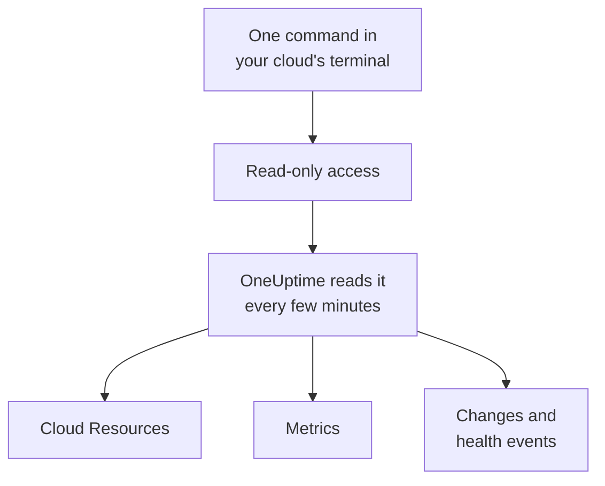

# Connect a Cloud Account

Connect an AWS account, an Azure subscription or a Google Cloud project from the dashboard, and OneUptime lists every resource in it, reads their key metrics, and records what changed in them and what your cloud provider says about their health. You run one command in your cloud's own browser terminal and paste what it prints: there is no collector to run and nothing to install.

:::cards
- [Amazon Web Services](#amazon-web-services): An IAM role OneUptime signs in to, or an access key.
- [Microsoft Azure](#microsoft-azure): An app with the Monitoring Reader role.
- [Google Cloud](#google-cloud): A service account with four read-only roles.
- [What OneUptime reads](#what-oneuptime-reads): Resources, metrics, changes and health events, how often, and what it costs.
- [Let AI fix problems](#let-ai-fix-problems): One more command, and OneUptime AI can fix what it finds.
:::

## How it works



- **The access can only read.** The command creates access that reads your resources and how they are set up, their metrics, what changed and your provider's health events, and nothing else: the actions listed below on AWS, the **Monitoring Reader** role on Azure and four viewer roles on Google Cloud. OneUptime never reads data or secrets with it, except log lines when you let AI read an account's logs. Delete it to cut OneUptime off.
- **OneUptime reads on a schedule.** Every 5 minutes for Azure and Google Cloud, and every 10 minutes for AWS, unless you pick another interval when you connect. Each read also records what changed since the last one, and every 30 minutes a read lists every resource again.
- **Each resource has a page of its own.** Resources appear under **Cloud → All Resources** with their key metrics, owners and labels. A listed resource's page also shows its **Connected Resources** (what it runs in, what sends it traffic), its endpoints, tags and settings, and its **Incidents**, **Alerts** and **Changes**.
- **Each account has a page of its own.** Accounts appear under **Cloud → Accounts** with their resources by type and Region, their **Changes**, and a **Topology** of how their resources fit together.
- **OneUptime AI reads what changed.** An investigation of an incident or an alert linked to a cloud resource reads that resource's changes first, and reads the account's activity log again as it starts.

## Before you begin

- **A project owner or admin.** Only they can connect, test and edit cloud accounts.
- **Your cloud's terminal** (AWS CloudShell, Azure Cloud Shell or Google Cloud Shell), signed in as someone who can create an IAM role or user, an app registration or a service account.

## Amazon Web Services

:::steps
### Open the AWS form

Go to **Cloud → Connect** and pick **Amazon Web Services**.

### Run the command in AWS CloudShell

Pick how OneUptime signs in. An **IAM role** is the recommended way: nothing secret is stored, and you can delete the role at any time. The form shows the command written for your project: it creates a role that trusts OneUptime's AWS account with your project's external ID, and prints the role's ARN.

Under **What to read**, pick this account, or every account in your AWS Organization. Run the organization's command in its management account: it adds a StackSet that puts the same role in every account, now and as accounts join, and lets the management account's role list the accounts. One connection reads up to 50 accounts.

Use an **Access key** when a role is not possible: it reads its own account only. This command creates a user with the same permissions and prints its key:

```bash
aws iam create-user --user-name OneUptimeReadOnly > /dev/null 2>&1 || true
aws iam put-user-policy --user-name OneUptimeReadOnly --policy-name OneUptimeReadOnly --policy-document '{"Version":"2012-10-17","Statement":[{"Effect":"Allow","Action":["cloudwatch:GetMetricData","cloudwatch:ListMetrics","tag:GetResources","iam:ListAccountAliases","cloudformation:ListResources","ec2:DescribeInstances","ec2:DescribeVolumes","ec2:DescribeVpcs","ec2:DescribeNatGateways","autoscaling:DescribeAutoScalingGroups","elasticloadbalancing:DescribeLoadBalancers","elasticloadbalancing:DescribeLoadBalancerAttributes","elasticloadbalancing:DescribeTargetGroups","elasticloadbalancing:DescribeTargetGroupAttributes","elasticloadbalancing:DescribeTargetHealth","elasticloadbalancing:DescribeTags","ecs:ListClusters","ecs:DescribeClusters","ecs:ListServices","ecs:DescribeServices","lambda:ListFunctions","rds:DescribeDBInstances","rds:DescribeDBClusters","elasticache:DescribeReplicationGroups","sqs:ListQueues","sqs:GetQueueAttributes","sns:ListTopics","sns:GetTopicAttributes","sns:ListSubscriptionsByTopic","dynamodb:ListTables","dynamodb:DescribeTable","kinesis:ListStreams","kinesis:DescribeStreamSummary","states:ListStateMachines","states:DescribeStateMachine","cloudfront:ListDistributions","elasticfilesystem:DescribeFileSystems","es:ListDomainNames","es:DescribeDomains","apprunner:ListServices","apprunner:DescribeService","cloudtrail:LookupEvents","health:DescribeEvents","health:DescribeEventDetails","rds:DescribeEvents","autoscaling:DescribeScalingActivities","ec2:DescribeInstanceStatus","ecs:DescribeTaskDefinition","lambda:GetFunctionConfiguration","lambda:GetFunctionConcurrency","lambda:GetAlias","servicequotas:ListServiceQuotas","logs:DescribeLogGroups","logs:FilterLogEvents"],"Resource":"*"},{"Effect":"Allow","Action":["apigateway:GET"],"Resource":["arn:aws:apigateway:*::/restapis","arn:aws:apigateway:*::/restapis/*","arn:aws:apigateway:*::/apis","arn:aws:apigateway:*::/apis/*"]}]}'
aws iam create-access-key --user-name OneUptimeReadOnly
```

### Paste what the AWS command printed

Paste everything the command printed into **What the command printed**. OneUptime picks out the role's ARN, or the access key ID and its secret.

### Test and connect AWS

OneUptime tests the connection as this step opens: it signs in, counts the resources it finds and says what reading them costs. Select **Connect** to save.
:::

The role and the user can do these things, and nothing else:

| What OneUptime uses them for | Actions |
| --- | --- |
| Find the resources that report metrics, and read their metrics | `cloudwatch:GetMetricData`, `cloudwatch:ListMetrics` |
| Name each resource and read its tags | `tag:GetResources`, `iam:ListAccountAliases` |
| List every resource and how it is configured, through Cloud Control | `cloudformation:ListResources`, `ec2:DescribeInstances`, `ec2:DescribeVolumes`, `ec2:DescribeVpcs`, `ec2:DescribeNatGateways`, `autoscaling:DescribeAutoScalingGroups`, `elasticloadbalancing:DescribeLoadBalancers`, `elasticloadbalancing:DescribeLoadBalancerAttributes`, `elasticloadbalancing:DescribeTargetGroups`, `elasticloadbalancing:DescribeTargetGroupAttributes`, `elasticloadbalancing:DescribeTargetHealth`, `elasticloadbalancing:DescribeTags`, `ecs:ListClusters`, `ecs:DescribeClusters`, `ecs:ListServices`, `ecs:DescribeServices`, `lambda:ListFunctions`, `rds:DescribeDBInstances`, `rds:DescribeDBClusters`, `elasticache:DescribeReplicationGroups`, `sqs:ListQueues`, `sqs:GetQueueAttributes`, `sns:ListTopics`, `sns:GetTopicAttributes`, `sns:ListSubscriptionsByTopic`, `dynamodb:ListTables`, `dynamodb:DescribeTable`, `kinesis:ListStreams`, `kinesis:DescribeStreamSummary`, `states:ListStateMachines`, `states:DescribeStateMachine`, `cloudfront:ListDistributions`, `elasticfilesystem:DescribeFileSystems`, `es:ListDomainNames`, `es:DescribeDomains`, `apprunner:ListServices`, `apprunner:DescribeService`, `apigateway:GET` |
| Read what changed: the account's management events | `cloudtrail:LookupEvents` |
| Read AWS's own health events for the account | `health:DescribeEvents`, `health:DescribeEventDetails` |
| Read a resource's live status and recent events during an investigation | `rds:DescribeEvents`, `autoscaling:DescribeScalingActivities`, `ec2:DescribeInstanceStatus`, `ecs:DescribeTaskDefinition`, `lambda:GetFunctionConfiguration`, `lambda:GetFunctionConcurrency`, `lambda:GetAlias` |
| Read the account's quotas during an investigation | `servicequotas:ListServiceQuotas` |
| Read log lines, only when you let AI read an account's logs | `logs:DescribeLogGroups`, `logs:FilterLogEvents` |
| List the organization's accounts, from its management account | `organizations:ListAccounts` |

`apigateway:GET` is allowed on the APIs' own definitions only, never on their keys, and only the management account's role may list the organization's accounts. AWS Health answers only accounts on a Business, Enterprise On-Ramp or Enterprise support plan: without one, OneUptime asks again a day later.

> [!NOTE]
> On a self-hosted OneUptime, the **IAM role** way needs an AWS identity of OneUptime's own: set `CLOUD_CONNECT_AWS_ACCESS_KEY_ID` and `CLOUD_CONNECT_AWS_SECRET_ACCESS_KEY` to the key of an IAM user that may call `sts:AssumeRole`. Without them, the form offers an **Access key**.

## Microsoft Azure

:::steps
### Open the Azure form

Go to **Cloud → Connect** and pick **Microsoft Azure**.

### Run the command in Azure Cloud Shell

The command creates an app with the **Monitoring Reader** role on your current subscription, and prints its details with the date its secret expires:

```bash
SCOPE="/subscriptions/$(az account show --query id --output tsv)"
OUT=$(az ad sp create-for-rbac --name OneUptimeReadOnly --role "Monitoring Reader" --scopes "$SCOPE")
APP=$(echo "$OUT" | jq -r .appId)
END=$(az ad app credential list --id "$APP" --query "max([].endDateTime)" --output tsv)
echo "$OUT" | jq --arg end "$END" '. + {endDateTime: $end}'
```

Under **What to read**, pick every subscription in the tenant instead, and the role goes on the tenant's root management group:

```bash
SCOPE="/providers/Microsoft.Management/managementGroups/$(az account show --query tenantId --output tsv)"
OUT=$(az ad sp create-for-rbac --name OneUptimeReadOnly --role "Monitoring Reader" --scopes "$SCOPE")
APP=$(echo "$OUT" | jq -r .appId)
END=$(az ad app credential list --id "$APP" --query "max([].endDateTime)" --output tsv)
echo "$OUT" | jq --arg end "$END" '. + {endDateTime: $end}'
```

### Paste what the Azure command printed

Paste everything the command printed into **What the command printed**. OneUptime picks out the `tenant`, the `appId`, the `password` and the date it expires.

### Test and connect Azure

OneUptime tests the connection as this step opens. Select **Connect** to save.
:::

To read more subscriptions with the same app, give it the role on each of them:

```bash
az role assignment create --assignee <APP_ID> --role "Monitoring Reader" --scope /subscriptions/<SUBSCRIPTION_ID>
```

OneUptime reads every subscription the app can read, up to 50, unless you list some under **Subscriptions**. The app's secret stops working on the date it expires: from 30 days before, each read warns about it. Run the command again and paste what it prints to give it a new one.

## Google Cloud

:::steps
### Open the Google Cloud form

Go to **Cloud → Connect** and pick **Google Cloud**.

### Run the command in Google Cloud Shell

Run it in the project to monitor. It turns on the APIs OneUptime reads, creates a service account with the **Monitoring Viewer**, **Cloud Asset Viewer**, **Logs Viewer** and **Service Health Viewer** roles, and prints its key:

```bash
PROJECT_ID=$(gcloud config get-value project)
gcloud services enable monitoring.googleapis.com cloudasset.googleapis.com logging.googleapis.com cloudresourcemanager.googleapis.com servicehealth.googleapis.com
gcloud iam service-accounts create oneuptime-read-only --display-name "OneUptime (read only)" > /dev/null 2>&1 || true
gcloud projects add-iam-policy-binding "$PROJECT_ID" --member "serviceAccount:oneuptime-read-only@$PROJECT_ID.iam.gserviceaccount.com" --role roles/monitoring.viewer --condition=None > /dev/null
gcloud projects add-iam-policy-binding "$PROJECT_ID" --member "serviceAccount:oneuptime-read-only@$PROJECT_ID.iam.gserviceaccount.com" --role roles/cloudasset.viewer --condition=None > /dev/null
gcloud projects add-iam-policy-binding "$PROJECT_ID" --member "serviceAccount:oneuptime-read-only@$PROJECT_ID.iam.gserviceaccount.com" --role roles/logging.viewer --condition=None > /dev/null
gcloud projects add-iam-policy-binding "$PROJECT_ID" --member "serviceAccount:oneuptime-read-only@$PROJECT_ID.iam.gserviceaccount.com" --role roles/servicehealth.viewer --condition=None > /dev/null
gcloud iam service-accounts keys create oneuptime-key.json --iam-account "oneuptime-read-only@$PROJECT_ID.iam.gserviceaccount.com"
cat oneuptime-key.json && rm oneuptime-key.json
```

Under **What to read**, pick every project in the organization instead, and the roles go on the project's organization:

```bash
PROJECT_ID=$(gcloud config get-value project)
ORG_ID=$(gcloud projects get-ancestors "$PROJECT_ID" --format="value(id)" | tail -1)
gcloud services enable monitoring.googleapis.com cloudasset.googleapis.com logging.googleapis.com cloudresourcemanager.googleapis.com servicehealth.googleapis.com
gcloud iam service-accounts create oneuptime-read-only --display-name "OneUptime (read only)" > /dev/null 2>&1 || true
gcloud organizations add-iam-policy-binding "$ORG_ID" --member "serviceAccount:oneuptime-read-only@$PROJECT_ID.iam.gserviceaccount.com" --role roles/monitoring.viewer --condition=None > /dev/null
gcloud organizations add-iam-policy-binding "$ORG_ID" --member "serviceAccount:oneuptime-read-only@$PROJECT_ID.iam.gserviceaccount.com" --role roles/cloudasset.viewer --condition=None > /dev/null
gcloud organizations add-iam-policy-binding "$ORG_ID" --member "serviceAccount:oneuptime-read-only@$PROJECT_ID.iam.gserviceaccount.com" --role roles/logging.viewer --condition=None > /dev/null
gcloud organizations add-iam-policy-binding "$ORG_ID" --member "serviceAccount:oneuptime-read-only@$PROJECT_ID.iam.gserviceaccount.com" --role roles/servicehealth.viewer --condition=None > /dev/null
gcloud iam service-accounts keys create oneuptime-key.json --iam-account "oneuptime-read-only@$PROJECT_ID.iam.gserviceaccount.com"
cat oneuptime-key.json && rm oneuptime-key.json
```

### Paste the key

Paste everything the command printed. OneUptime reads the key's own project, and stores the key encrypted.

### Test and connect Google Cloud

OneUptime tests the connection as this step opens. Select **Connect** to save.
:::

To read more projects with the same service account, give it the four roles in each of them and list them under **Projects**:

```bash
for ROLE in roles/monitoring.viewer roles/cloudasset.viewer roles/logging.viewer roles/servicehealth.viewer; do gcloud projects add-iam-policy-binding <PROJECT_ID> --member "serviceAccount:oneuptime-read-only@<KEY_PROJECT_ID>.iam.gserviceaccount.com" --role "$ROLE"; done
```

An organization's connection reads up to 50 of its projects, unless you list some under **Projects**.

## What OneUptime reads

| | AWS | Azure | Google Cloud |
| --- | --- | --- | --- |
| Resources | Every resource of the types OneUptime knows, in every Region you use, from Cloud Control | Every resource in the subscriptions, from Resource Graph | Every resource in the projects, from Cloud Asset Inventory |
| Metrics | The key metrics of each service, such as an instance's CPU, network and status checks | Up to 8 key metrics per resource | The key metrics of each resource type |
| Changes | CloudTrail management events | The Activity Log's administrative events | The Admin Activity audit log |
| Health events | AWS Health | Service Health and Resource Health | Service Health |
| Read every | 10 minutes | 5 minutes | 5 minutes |
| A deleted resource | Archived once a full listing no longer has it | Archived once a full listing no longer has it | Archived once a full listing no longer has it |

Each read picks up where the last one stopped, so every data point and every change is written once. A new connection's first read starts within a minute and goes an hour back for metrics and 2 hours back for changes; after a pause, a read goes back 6 hours at most. A resource that only reports metrics, which no listing has, is archived after 7 days without metrics.

The calls OneUptime makes are billed to your cloud account, at your cloud's prices. Listing resources and reading changes and health events cost nothing on all three clouds; reading metrics does. The test estimates the cost of what it finds, and reading less often costs less: change **Read metrics every** under **More fields**.

| Cloud | Price |
| --- | --- |
| AWS | CloudWatch `GetMetricData`: $0.01 per 1,000 metrics, and each key metric of a resource is one metric a read |
| Azure | The first 1,000,000 metric reads a month of each subscription are free, then $0.01 per 1,000 |
| Google Cloud | The first 1,000,000 time series read a month are free, then $0.50 per million |

## What you see in OneUptime

- **An account's page.** Under **Cloud → Accounts**, an account's Overview counts its resources by type and Region and says when a connection last read it. Its **Resources** lists them, its **Changes** lists what changed in it, newest first, and its **Topology** draws its Regions, the networks in them and what runs in each, with the open incidents and alerts on the resources they are linked to.
- **A resource's changes.** A change is kept as a change event tied to the resource it changed and to its account, and drawn as a marker on the resource's metric charts with its incidents and alerts. Charts filtered to no resource leave a cloud account's activity log out, so a busy account cannot crowd out your deploys; the provider's health events stay on them.
- **Incidents and alerts.** Link a cloud resource to a monitor, an incident or an alert under its linked resources, and its incidents and alerts are listed on the resource's page. A website, API, SSL, ping or port monitor whose host leads to a resource's endpoint, directly or through its DNS, lists the resource under **Suggested Cloud Resources** on its **Linked Resources** card: select **Link resource** to link it.

## Let AI fix problems

OneUptime AI reads every connected account while it investigates, with the read-only access above. To let it fix problems too, such as restarting a service, scaling it out or rolling it back, open the account under **Cloud → Accounts** and select **Let AI fix problems** in the **AI agent** card of its **Overview**.

The dialog asks one question, **How far may AI go?**: **Ask me first**, the default, where OneUptime AI proposes each fix and a person approves it with one click, or **Fix safe problems on its own**, where safe changes run on their own and riskier ones still wait for approval. Everything else has a safe default under **Advanced**. It then shows one command, written for this account: run it in AWS CloudShell, Azure Cloud Shell or Google Cloud Shell, signed in as someone who may create roles in the account. The command creates a role that may make only the changes turned on, and starts the Cloud AI agent with it in your account. The agent connects on its own within a few minutes, and the dialog says so: there is nothing to paste back.

The agent is one small container that runs all month in your account, billed by your cloud at its list prices:

| Cloud | What runs | About |
| --- | --- | --- |
| AWS | One ECS Fargate task of 0.25 vCPU and 0.5 GB, and its public IPv4 address, at `us-east-1` prices | $13 a month |
| Azure | One Container Apps replica of 0.25 vCPU and 0.5 GiB, after the subscription's monthly free grant of 180,000 vCPU-seconds and 360,000 GiB-seconds | $14 a month |
| Google Cloud | One Cloud Run instance of 1 vCPU and 0.5 GiB with CPU always allocated, which takes a whole vCPU, after the monthly free tier of 240,000 vCPU-seconds and 450,000 GiB-seconds | $45 a month |

What the agent may change, how each change is tiered and undone, and how to read its logs: [Infrastructure AI Agents](/docs/ai/infrastructure-ai-agents#in-a-cloud-account).

## Troubleshooting

:::details The test says the key or secret was not accepted
Copy everything the command printed and paste it again. A key made a minute ago can take a minute to work. An Azure secret that has expired is refused too: run the command again.
:::

:::details The test signs in, but cannot read
Run the command again: it grants the roles OneUptime needs. On AWS, run the command the form shows for this project: a role made for another project trusts that project's external ID, not this one's.
:::

:::details Google Cloud does not let the command create a key
An organization policy, `iam.disableServiceAccountKeyCreation`, can forbid service account keys. Ask your organization's admin for an exception for the project, or [send the metrics with your own collector](/docs/telemetry/cloud-resources).
:::

:::details No resources appear
The first read lists every resource of the account, whether it reports metrics or not. If a connection is not working, **View error** under **Cloud → Connect** says why its last read failed.
:::

:::details Some accounts of the organization are missing
One connection reads up to 50 accounts, subscriptions or projects, and each read says so when there are more. Connect the others with a connection of their own.
:::

## Next steps

:::cards
- [Cloud Resources](/docs/telemetry/cloud-resources): Run your own OpenTelemetry Collector instead, or stream CloudWatch metrics.
- [Deploys and Changes](/docs/telemetry/change-events): Every change OneUptime records, and how OneUptime AI reads them.
- [Metrics Monitor](/docs/monitor/metrics-monitor): Alert on a resource's metrics.
:::
