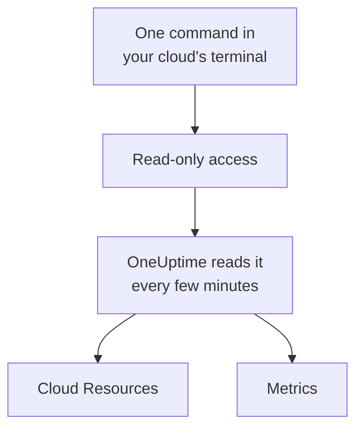

# Connect a Cloud Account

Connect an AWS account, an Azure subscription or a Google Cloud project from the dashboard, and OneUptime lists its resources and reads their key metrics on a schedule. You run one command in your cloud's own browser terminal and paste what it prints: there is no collector to run and nothing to install.

:::cards
- [Amazon Web Services](#amazon-web-services): An IAM role OneUptime signs in to, or an access key.
- [Microsoft Azure](#microsoft-azure): An app with the Monitoring Reader role.
- [Google Cloud](#google-cloud): A service account with the Monitoring Viewer role.
- [What OneUptime reads](#what-oneuptime-reads): Which resources and metrics, how often, and what it costs.
:::

## How it works



- **The access can only read.** The command creates access that reads metrics and nothing else: three read actions on AWS, the **Monitoring Reader** role on Azure and the **Monitoring Viewer** role on Google Cloud. Delete it to cut OneUptime off.
- **OneUptime reads on a schedule.** Every 5 minutes for Azure and Google Cloud, and every 10 minutes for AWS, unless you pick another interval when you connect.
- **Each resource has a page of its own.** Resources appear under **Cloud → All Resources** with their key metrics, owners and labels, like the resources a collector reports.

## Before you begin

- **A project owner or admin.** Only they can connect, test and edit cloud accounts.
- **Your cloud's terminal** (AWS CloudShell, Azure Cloud Shell or Google Cloud Shell), signed in as someone who can create an IAM role or user, an app registration or a service account.

## Amazon Web Services

:::steps
### Open the AWS form

Go to **Cloud → Connect** and pick **Amazon Web Services**.

### Run the command in AWS CloudShell

Pick how OneUptime signs in. An **IAM role** is the recommended way: nothing secret is stored, and you can delete the role at any time. The form shows the command written for your project: it creates a role that trusts OneUptime's AWS account with your project's external ID, and prints the role's ARN. Use an **Access key** when a role is not possible. This command creates a user with the same permissions and prints its key:

```bash
aws iam create-user --user-name OneUptimeReadOnly > /dev/null 2>&1 || true
aws iam put-user-policy --user-name OneUptimeReadOnly --policy-name OneUptimeReadOnly --policy-document '{"Version":"2012-10-17","Statement":[{"Effect":"Allow","Action":["cloudwatch:GetMetricData","cloudwatch:ListMetrics","tag:GetResources"],"Resource":"*"}]}'
aws iam create-access-key --user-name OneUptimeReadOnly
```

### Paste what the AWS command printed

Paste everything the command printed into **What the command printed**. OneUptime picks out the role's ARN, or the access key ID and its secret.

### Test and connect AWS

OneUptime tests the connection as this step opens: it signs in, counts the resources it finds and says what reading them costs. Select **Connect** to save.
:::

The role and the user can do three things, and nothing else:

| Action | What OneUptime uses it for |
| --- | --- |
| `cloudwatch:ListMetrics` | Find the resources that report metrics, in each Region |
| `cloudwatch:GetMetricData` | Read their key metrics |
| `tag:GetResources` | Name each resource by its `Name` tag |

> [!NOTE]
> On a self-hosted OneUptime, the **IAM role** way needs an AWS identity of OneUptime's own: set `CLOUD_CONNECT_AWS_ACCESS_KEY_ID` and `CLOUD_CONNECT_AWS_SECRET_ACCESS_KEY` to the key of an IAM user that may call `sts:AssumeRole`. Without them, the form offers an **Access key**.

## Microsoft Azure

:::steps
### Open the Azure form

Go to **Cloud → Connect** and pick **Microsoft Azure**.

### Run the command in Azure Cloud Shell

The command creates an app with the **Monitoring Reader** role on your current subscription, and prints its details:

```bash
az ad sp create-for-rbac --name OneUptimeReadOnly --role "Monitoring Reader" --scopes "/subscriptions/$(az account show --query id --output tsv)"
```

### Paste what the Azure command printed

Paste everything the command printed into **What the command printed**. OneUptime picks out the `tenant`, the `appId` and the `password`.

### Test and connect Azure

OneUptime tests the connection as this step opens. Select **Connect** to save.
:::

To read more subscriptions with the same app, give it the role on each of them:

```bash
az role assignment create --assignee <APP_ID> --role "Monitoring Reader" --scope /subscriptions/<SUBSCRIPTION_ID>
```

OneUptime reads every subscription the app can read, unless you list some under **Subscriptions**.

## Google Cloud

:::steps
### Open the Google Cloud form

Go to **Cloud → Connect** and pick **Google Cloud**.

### Run the command in Google Cloud Shell

Run it in the project to monitor. It turns on the Cloud Monitoring API, creates a service account with the **Monitoring Viewer** role, and prints its key:

```bash
PROJECT_ID=$(gcloud config get-value project)
gcloud services enable monitoring.googleapis.com
gcloud iam service-accounts create oneuptime-read-only --display-name "OneUptime (read only)"
gcloud projects add-iam-policy-binding "$PROJECT_ID" --member "serviceAccount:oneuptime-read-only@$PROJECT_ID.iam.gserviceaccount.com" --role roles/monitoring.viewer --condition=None > /dev/null
gcloud iam service-accounts keys create oneuptime-key.json --iam-account "oneuptime-read-only@$PROJECT_ID.iam.gserviceaccount.com"
cat oneuptime-key.json && rm oneuptime-key.json
```

### Paste the key

Paste everything the command printed. OneUptime reads the key's own project, and stores the key encrypted.

### Test and connect Google Cloud

OneUptime tests the connection as this step opens. Select **Connect** to save.
:::

To read more projects with the same service account, give it the role in each of them and list them under **Projects**:

```bash
gcloud projects add-iam-policy-binding <PROJECT_ID> --member "serviceAccount:oneuptime-read-only@<KEY_PROJECT_ID>.iam.gserviceaccount.com" --role roles/monitoring.viewer
```

## What OneUptime reads

| | AWS | Azure | Google Cloud |
| --- | --- | --- | --- |
| Resources | Those that report metrics to CloudWatch, in every Region you use | Every resource in the subscriptions | Those that report metrics to Cloud Monitoring |
| Metrics | The key metrics of each service, such as an instance's CPU, network and status checks | Up to 8 key metrics per resource | The key metrics of each resource type |
| Read every | 10 minutes | 5 minutes | 5 minutes |
| A deleted resource | Archived after 7 days without metrics | Archived at the next read | Archived after 7 days without metrics |

Each read picks up where the last one stopped, so every data point is written once. A new connection's first read starts within a minute and goes an hour back; after a pause, a read goes back 6 hours at most.

The calls OneUptime makes are billed to your cloud account, at your cloud's prices. The test estimates the cost of what it finds, and reading less often costs less: change **Read metrics every** under **More fields**.

| Cloud | Price |
| --- | --- |
| AWS | CloudWatch `GetMetricData`: $0.01 per 1,000 metrics, and each key metric of a resource is one metric a read |
| Azure | The first 1,000,000 metric reads a month of each subscription are free, then $0.01 per 1,000 |
| Google Cloud | The first 1,000,000 time series read a month are free, then $0.50 per million |

## Troubleshooting

:::details The test says the key or secret was not accepted
Copy everything the command printed and paste it again. A key made a minute ago can take a minute to work.
:::

:::details The test signs in, but cannot read
Run the command again: it grants the role OneUptime needs. On AWS, run the command the form shows for this project: a role made for another project trusts that project's external ID, not this one's.
:::

:::details Google Cloud does not let the command create a key
An organization policy, `iam.disableServiceAccountKeyCreation`, can forbid service account keys. Ask your organization's admin for an exception for the project, or [send the metrics with your own collector](/docs/telemetry/cloud-resources).
:::

:::details No resources appear
On AWS and Google Cloud, a resource appears once it reports metrics. If a connection is not working, **View error** under **Cloud → Connect** says why its last read failed.
:::

## Next steps

:::cards
- [Cloud Resources](/docs/telemetry/cloud-resources): Run your own OpenTelemetry Collector instead, or stream CloudWatch metrics.
- [Metrics Monitor](/docs/monitor/metrics-monitor): Alert on a resource's metrics.
:::
