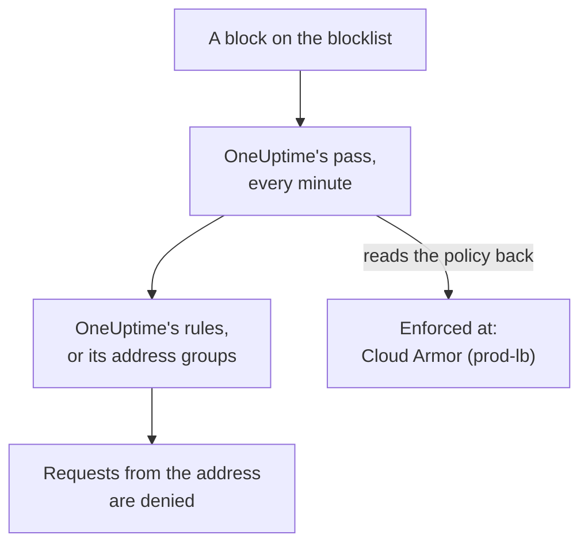

# Block Addresses in Cloud Armor

Your project's blocklist can be enforced in the Google Cloud Armor security policies of your load balancers. Turn it on for a Google Cloud connection you already have, pick the security policies, and every address the blocklist blocks is blocked there, whether a person, a playbook or OneUptime AI blocked it.

:::cards
- [Turn it on](#turn-it-on): One setting on the Google Cloud connection, and the role it needs.
- [What OneUptime creates](#what-oneuptime-creates): Rules of its own in each policy, or address groups with Cloud Armor Enterprise.
- [Which address is matched](#which-address-is-matched): The address that connected, or the user IP behind a proxy.
:::

## How it works

OneUptime keeps rules of its own in each security policy you pick, and puts the addresses the blocklist blocks in them. Every minute it changes what changed, one rule at a time, then reads the policy back. On the **Blocklist** page, a block's **Enforced At** names Cloud Armor (prod-lb) only once the policy holds the block; until then it is not enforced.

## Before you begin

- A Google Cloud project connected to OneUptime (see [Connect a Cloud Account](/docs/telemetry/cloud-accounts#google-cloud)).
- A role that may change where the blocklist is enforced: **Project Owner**, **Project Admin** or **Security Admin**.
- Someone who may create roles and grant them in the Google Cloud project, to run one command in Cloud Shell.

## Turn it on

:::steps
### Open the connection
Open **Cloud → Connect** and edit the Google Cloud connection.

### Turn the setting on
Under **More fields**, set **Block addresses in Cloud Armor** to **On**, and save. The setup command the form shows now grants the role below where it grants the others. A connection you already have need not run it again: the **Add WAF** dialog gives the lines that grant the role in the policy's project.

### Add the security policies
Open **Security Events → Playbooks → Blocklist**. Under **Cloud WAFs**, click **Add WAF** and pick a security policy. OneUptime asks Google Cloud whether the connection may write it, without writing anything.

### Grant the role, if it is missing
When a permission is missing, the dialog shows the lines that grant it in the policy's project. Run them in Cloud Shell, click **Check Again**, then add the policy. Its **Status** says **Enforcing** once OneUptime has set it up.
:::

The security policies come from the connection's inventory: one OneUptime has not read yet is listed after the next read. While a policy enforces the blocklist, its connection's setting cannot be turned off and the connection cannot be deleted: remove the policy first, so OneUptime takes its rules out.

## What OneUptime creates

OneUptime picks how a policy holds the blocklist when you add it.

| What | Name | Where |
| --- | --- | --- |
| Rules that deny with 403, each holding up to 10 addresses or ranges | Their description starts `OneUptime blocklist <project> #1`, `#2`, ... | In each policy you pick, at most 20 of them. |
| Two address groups, IPv4 and IPv6 | `oneuptime-<project>-block-ipv4`, `oneuptime-<project>-block-ipv6` | Global, in the policy's project. With Cloud Armor Enterprise only. |
| One rule that denies with 403 whatever either group holds | Its description starts `OneUptime blocklist <project>, address groups` | In each global backend policy you pick, with Cloud Armor Enterprise. |

`<project>` is the first eight characters of your project's external ID, so two OneUptime projects that pick one policy never write each other's rules. Cloud Armor names a rule by its priority alone, so OneUptime tells its own rules by their description.

- **Rules.** Cloud Armor holds 10 addresses or ranges in a rule, so a policy holds up to 200 blocks in OneUptime's 20 rules; a block that does not fit says so on its row.
- **Address groups.** A global backend policy of a project with Cloud Armor Enterprise holds the blocklist in two address groups instead: 10,000 IPv4 and 2,000 IPv6 ranges. Every such policy of the project shares them, and one rule in each policy denies what they hold. The groups take 16,000 units of the project's address group quota.

OneUptime adds, changes and removes each of its rules on its own, with Cloud Armor's rule methods: it never writes the policy whole, and never writes a rule of yours. A single address is written as `/32` or `/128`.

## The rules' place in the policy

OneUptime puts its rules at free priorities before your first rule that lets a request through, lowest first, so no rule of yours lets a blocked address through: a rule that allows, throttles, bans by rate or shares fairly. A rule of yours that denies may come first. OneUptime never renumbers, changes or removes a rule of yours: when no priority is free before your first such rule, the policy says **No Free Priority**, and OneUptime adds its rule once you free one.

## Which address is matched

| Security policy | Client Address | When to pick it |
| --- | --- | --- |
| Backend | **The address that connected to the load balancer (origin.ip)** | The default. |
| Backend | The user IP from the policy's request headers (origin.user_ip) | For a load balancer behind another proxy or CDN. |
| Edge | The address that connected to the load balancer (origin.ip) | The only choice: an edge policy reads no other address. |

`origin.user_ip` is the address in the policy's user IP request headers (`userIpRequestHeaders`), which a proxy or CDN in front of the load balancer writes. With none set, or no valid address in them, it is `origin.ip`. Pick it only when such a proxy writes them, since a client that reaches the load balancer directly can write them itself. The choice is under **More fields** in the **Add WAF** dialog, and you can change it later with **Client Address** on the policy's row.

A network edge security policy, for passthrough Network Load Balancers, cannot be picked, and the **Add WAF** dialog says why: its rules match packets, not requests.

OneUptime's rules in Cloud Armor only deny. A block that asks to challenge an address is not applied in Cloud Armor, and says so. An automatic response policy's challenge is enforced there as a block for the same time.

## When a rule is changed by hand

When someone sets one of OneUptime's rules to preview, changes it or deletes it, or deletes one of its address groups, OneUptime leaves it as they left it. The policy says **Changed by Hand**, and the blocks it held are not enforced, with why, until someone clicks **Put It Back** on the policy's row. Put It Back writes the rule again as OneUptime writes it, at its own priority while that is free, and makes a deleted address group again.

OneUptime does not check that a policy is attached to a backend service. A policy attached to none blocks nothing.

## Keep a policy in Terraform

A `google_compute_security_policy` with `rule` blocks owns every rule of the policy, so its next plan removes OneUptime's rules. Keep your rules as `google_compute_security_policy_rule` resources, which leave other rules alone, or add `ignore_changes = [rule]` to the policy's `lifecycle` block.

## Permissions

The setup command adds a custom role, `oneuptimeCloudArmorBlocklist`, where it grants the connection's other roles, and grants it to the connection's service account. The lines the **Add WAF** dialog shows add the same role in the policy's project. A policy in rules mode needs only its own permissions.

| Permission | Why |
| --- | --- |
| `compute.securityPolicies.get`, `compute.securityPolicies.update` | Read a global policy and change OneUptime's rules in it. |
| `compute.regionSecurityPolicies.get`, `compute.regionSecurityPolicies.update` | Read a regional policy and change OneUptime's rules in it. |
| `compute.globalOperations.get`, `compute.regionOperations.get` | Wait until a change is done. |
| `compute.projects.get` | Read whether the project has Cloud Armor Enterprise. |
| `networksecurity.addressGroups.get`, `networksecurity.addressGroups.list`, `networksecurity.addressGroups.create`, `networksecurity.addressGroups.update`, `networksecurity.addressGroups.delete`, `networksecurity.addressGroups.use` | Keep OneUptime's address groups, and refer to them from its rule. With Cloud Armor Enterprise only. |
| `networksecurity.operations.get` | Wait until an address group's change is done. |

The role cannot delete a policy, and OneUptime never writes anything else. The setup command also turns on the Compute Engine and Network Security APIs.

## Remove it

:::steps
### Remove the security policy
On **Security Events → Playbooks → Blocklist**, click **Remove** on the policy's row. OneUptime takes its rules out of the policy, and deletes its address groups once no other policy of the project uses them.

### Turn the setting off
Edit the connection, set **Block addresses in Cloud Armor** to **Off**, and save. The setting can be turned off once no policy of the connection enforces the blocklist.
:::

When OneUptime may no longer write the policy, check **Remove From OneUptime Only** in the **Remove WAF** dialog. OneUptime removes the policy from the blocklist and names the rules and address groups it left: they keep blocking what they hold until you delete them in Google Cloud.

## Troubleshooting

:::details Not Enforcing
The policy's status says what Google Cloud answered and what to do. A refusal names the permission it lacks: run the lines **Add WAF** shows for the policy, then click **Check Again**. A refusal over a quota names it: ask Google Cloud for more, or delete rules you no longer use.
:::

:::details No Free Priority
Every priority before your first rule that lets a request through is taken. Move that rule to a higher number, then click **Check Again**.
:::

:::details A policy is not in the list
OneUptime lists the security policies of connections with the setting on, once it has read them. A policy added since appears after the connection's next read.
:::

## Next steps

:::cards
- [Security Cases and Playbooks](/docs/telemetry/security-cases): Block an address from a case, and see its step checked.
- [Connect a Cloud Account](/docs/telemetry/cloud-accounts): The connection this setting is part of.
:::
