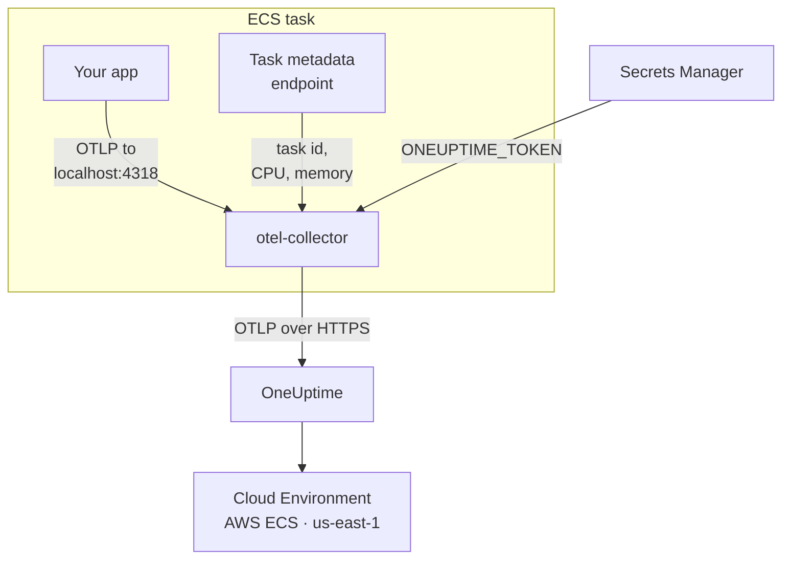

# AWS ECS / Fargate

Send the traces, logs and metrics of your Amazon ECS tasks to OneUptime, on the Fargate and EC2 launch types alike. Every task that reports `cloud.platform=aws_ecs` joins one **Cloud Environment** per AWS account and region, such as _AWS ECS · us-east-1 · 123456789012_, whether it runs one service or fifty.

:::cards
- [How it works](#how-it-works): What the ECS detector and the sidecar collector do.
- [Set it up](#set-it-up): Store the token, add the settings to the task definition, deploy and check.
- [The full task definition](#the-full-task-definition): A complete Fargate task definition to register.
- [Troubleshooting](#troubleshooting): Tasks stuck in PENDING, refused exports, empty instances or tiles.
:::

## How it works



- **The ECS detector names the environment.** The OpenTelemetry ECS resource detector, in the SDK or in a collector, reads the task metadata endpoint ECS gives every container and stamps the account, region and task on everything the task sends. Nothing is hard-coded.
- **The task names each instance.** The environment's **Instances** tab lists the running tasks by task ID, with their CPU and memory.
- **A sidecar collector adds CPU and memory.** Its `awsecscontainermetrics` receiver reads each task's CPU and memory from the same endpoint, and it holds the token so the application never sees it.

The ECS detector sets these resource attributes:

| Attribute                                                          | Set by the ECS detector | Used for                                                                                                  |
| ------------------------------------------------------------------ | ----------------------- | --------------------------------------------------------------------------------------------------------- |
| `cloud.platform`                                                   | `aws_ecs`               | Files the telemetry under **Cloud Environments**. The value must be exact                                 |
| `cloud.account.id`                                                 | `123456789012`          | Part of the environment key                                                                               |
| `cloud.region`                                                     | `us-east-1`             | Part of the environment key                                                                               |
| `aws.ecs.task.arn`                                                 | the task ARN            | Names one running task under **Instances**, by the task ID at its end                                     |
| `aws.ecs.task.id`                                                  | the task ID             | The same; newer detector versions set both                                                                |
| `aws.ecs.cluster.arn`, `aws.ecs.task.family`, `aws.ecs.launchtype` | the cluster and task    | Kept on every span, log and metric for you to search on; not part of the environment                       |

The environment key is `aws_ecs|123456789012|us-east-1`. The task ID names an instance even when the SDK also sets `service.instance.id`: the sidecar's container metrics carry only the task ID, so keying on it keeps a task's spans and its CPU and memory on one row. See [Cloud Environments](/docs/telemetry/cloud-environments) for the full rule.

## Before you begin

- **An ingestion key.** Create a **Server** key under **Project Settings → Telemetry & APM → Ingestion Keys** and copy its token.
- **An ECS cluster and a task definition you can revise**, and the AWS CLI configured for that account.
- **Your application instrumented with an OpenTelemetry SDK** that exports OTLP, in any language.

## Choose how telemetry leaves the task

|                         | Sidecar collector                              | SDK direct                                      |
| ----------------------- | ---------------------------------------------- | ----------------------------------------------- |
| Extra container         | `otel-collector` in every task                 | None                                            |
| Per-task CPU and memory | Yes, from the `awsecscontainermetrics` receiver | No                                              |
| Holds the token         | The collector                                  | The application                                 |
| The secret holds        | The bare token                                 | The whole header `x-oneuptime-token=...`        |

Most teams use the sidecar collector: it stamps the `cloud.*` attributes even on telemetry from libraries that know nothing of ECS. SDK direct is the simplest choice for a single service. Each step below has a tab for both; pick one and every step follows it.

## Set it up

:::steps
### Store the token in Secrets Manager

> [!IMPORTANT]
> The token is a secret. Keep it in AWS Secrets Manager and reference it from the task definition with `secrets` and `valueFrom`. A token in a plain `environment` entry is visible to anyone who can read the task definition, and shows up in every `describe-task-definition` output and CloudFormation diff.

:::tabs
@tab Sidecar collector
```bash
aws secretsmanager create-secret \
  --name oneuptime/ingestion-token \
  --region us-east-1 \
  --secret-string "YOUR_TELEMETRY_INGESTION_TOKEN"
```

The collector's configuration adds the header name, so this secret holds just the token.
@tab SDK direct
```bash
aws secretsmanager create-secret \
  --name oneuptime/ingestion-token \
  --region us-east-1 \
  --secret-string "x-oneuptime-token=YOUR_TELEMETRY_INGESTION_TOKEN"
```

ECS puts a secret's value into the variable as it is, and `OTEL_EXPORTER_OTLP_HEADERS` needs the whole `name=value` pair, so this secret holds the complete header.
:::

Note the ARN the command prints. It ends in a random suffix, such as `oneuptime/ingestion-token-AbCdEf`, and you paste it into the task definition.

### Let the task read the secret

The **task execution role** (the role ECS starts the task with, not the role your code runs as) needs to read the secret. Attach this policy to `ecsTaskExecutionRole`:

```json title="secret-access-policy.json"
{
  "Version": "2012-10-17",
  "Statement": [
    {
      "Effect": "Allow",
      "Action": ["secretsmanager:GetSecretValue"],
      "Resource": "arn:aws:secretsmanager:us-east-1:123456789012:secret:oneuptime/ingestion-token-*"
    }
  ]
}
```

If a customer-managed KMS key encrypts the secret, the role also needs `kms:Decrypt` on that key. Without either, the task does not start: it stops with `ResourceInitializationError: unable to pull secrets`.

### Add the settings to the task definition

:::tabs
@tab Sidecar collector
1. **AWS Console → Amazon Elastic Container Service → Task definitions** → select the family → **Create new revision**.
2. Under **Container - 1** (your application), expand **Environment variables** and add the application variables below.
3. **+ Add container**: name `otel-collector`, image `otel/opentelemetry-collector-contrib:latest` (pin a version once it works), **Essential container: No**. Under **Docker configuration → Command** enter `--config=env:OTEL_COLLECTOR_CONFIG`.
4. On the collector container, add the environment variable `ONEUPTIME_TOKEN` with **Value type: ValueFrom** and the secret ARN, and `OTEL_COLLECTOR_CONFIG` with **Value type: Value** and the collector configuration below.
5. Under **Startup dependency ordering** on the application container, add `otel-collector` with the condition **Start**, so the application never starts before something listens on port 4318.
6. Under **Task execution role**, check that it is the role you attached the policy to.

Application variables. In `awsvpc` network mode (always, on Fargate) the containers of a task share one network, so `localhost` is the sidecar:

```bash
OTEL_SERVICE_NAME=checkout-api
OTEL_EXPORTER_OTLP_ENDPOINT=http://localhost:4318
OTEL_EXPORTER_OTLP_PROTOCOL=http/protobuf
```

Collector configuration. The collector reads all of it from the `OTEL_COLLECTOR_CONFIG` variable, so there is no file to build into an image, and it expands `${env:ONEUPTIME_TOKEN}` from the secret ECS puts in its environment:

```yaml title="OTEL_COLLECTOR_CONFIG"
receivers:
  otlp:
    protocols:
      http:
        endpoint: 0.0.0.0:4318
      grpc:
        endpoint: 0.0.0.0:4317
  # Per-task and per-container CPU / memory from the ECS task metadata
  # endpoint. This is what fills the CPU and memory tiles in OneUptime.
  awsecscontainermetrics:
    collection_interval: 20s
processors:
  # Stamps cloud.provider, cloud.platform=aws_ecs, cloud.account.id,
  # cloud.region and aws.ecs.task.arn on every span, log and metric.
  resourcedetection:
    detectors: [env, ecs]
    timeout: 5s
  batch: {}
exporters:
  otlphttp/oneuptime:
    endpoint: https://oneuptime.com/otlp
    headers:
      x-oneuptime-token: ${env:ONEUPTIME_TOKEN}
service:
  pipelines:
    traces:
      receivers: [otlp]
      processors: [resourcedetection, batch]
      exporters: [otlphttp/oneuptime]
    metrics:
      receivers: [otlp, awsecscontainermetrics]
      processors: [resourcedetection, batch]
      exporters: [otlphttp/oneuptime]
    logs:
      receivers: [otlp]
      processors: [resourcedetection, batch]
      exporters: [otlphttp/oneuptime]
```

Neither the `ecs` detector nor the `awsecscontainermetrics` receiver needs an IAM permission: both read the metadata endpoint ECS gives every container in `ECS_CONTAINER_METADATA_URI_V4`.
@tab SDK direct
1. **AWS Console → Amazon Elastic Container Service → Task definitions** → select the family → **Create new revision**.
2. Under **Container - 1** (your application), expand **Environment variables** and add the variables below. Add `OTEL_EXPORTER_OTLP_HEADERS` with **Value type: ValueFrom** and the secret ARN as its value.
3. Add the switch that turns on your language's ECS resource detector, from the table below.
4. Under **Task execution role**, check that it is the role you attached the policy to.

```bash
OTEL_SERVICE_NAME=checkout-api
OTEL_EXPORTER_OTLP_ENDPOINT=https://oneuptime.com/otlp
OTEL_EXPORTER_OTLP_PROTOCOL=http/protobuf
# Injected from Secrets Manager (secrets / valueFrom), not typed here.
OTEL_EXPORTER_OTLP_HEADERS=x-oneuptime-token=YOUR_TELEMETRY_INGESTION_TOKEN
```

| Language | Turn on the ECS detector                                                                                        |
| -------- | --------------------------------------------------------------------------------------------------------------- |
| Node.js  | `OTEL_NODE_RESOURCE_DETECTORS=env,host,os,aws` (auto-instrumentations-node)                                     |
| Python   | `pip install opentelemetry-sdk-extension-aws`, then `OTEL_EXPERIMENTAL_RESOURCE_DETECTORS=aws_ecs`              |
| Java     | `-Dotel.resource.providers.aws.enabled=true` (the agent ships the provider turned off)                          |
| Go       | `import "go.opentelemetry.io/contrib/detectors/aws/ecs"` and pass `ecs.NewResourceDetector()` to `resource.New` |
| .NET     | The `OpenTelemetry.Resources.AWS` package: `.ConfigureResource(r => r.AddAWSECSDetector())`                     |

In a task definition file, the secret is `"secrets": [{ "name": "OTEL_EXPORTER_OTLP_HEADERS", "valueFrom": "<secret ARN>" }]`.
:::

If you host OneUptime yourself, use `https://YOUR-ONEUPTIME-HOST/otlp` as the endpoint.

### Deploy the new revision

Click **Create**, then **Clusters → your cluster → Services → select the service → Update → Task definition revision: latest → Deploy**. Or from the CLI:

```bash
aws ecs update-service \
  --cluster production \
  --service checkout-api \
  --task-definition checkout-api
```

### Check the connection

Check the token first: it is the cheapest check, and nothing after it works without it.

```bash
curl -i https://oneuptime.com/otlp/v1/validate \
  -H "x-oneuptime-token: YOUR_TELEMETRY_INGESTION_TOKEN"
```

`200` with `"valid": true` means the token is accepted. `401` means it is unknown, revoked, disabled or expired. Run the same command from inside the task with ECS Exec, to prove the task itself can reach OneUptime:

```bash
aws ecs execute-command --cluster production --task <task id> \
  --container app --interactive --command "sh"
```

The collector's CloudWatch log stream (`otel/otel-collector/...`) should say `Everything is ready`, with no `401` or `connection refused` lines. Within a minute of the first span, log or metric, the environment appears under **Cloud → All Environments** as _AWS ECS · us-east-1 · 123456789012_.
:::

## The full task definition

The sidecar setup as a file you register with `aws ecs register-task-definition --cli-input-json file://task-definition.json`. Replace the account ID, region, image and secret ARN:

```json title="task-definition.json"
{
  "family": "checkout-api",
  "requiresCompatibilities": ["FARGATE"],
  "networkMode": "awsvpc",
  "cpu": "512",
  "memory": "1024",
  "executionRoleArn": "arn:aws:iam::123456789012:role/ecsTaskExecutionRole",
  "taskRoleArn": "arn:aws:iam::123456789012:role/checkout-api-task-role",
  "containerDefinitions": [
    {
      "name": "app",
      "image": "123456789012.dkr.ecr.us-east-1.amazonaws.com/checkout-api:1.4.2",
      "essential": true,
      "portMappings": [{ "containerPort": 8080, "protocol": "tcp" }],
      "environment": [
        { "name": "OTEL_SERVICE_NAME", "value": "checkout-api" },
        {
          "name": "OTEL_EXPORTER_OTLP_ENDPOINT",
          "value": "http://localhost:4318"
        },
        { "name": "OTEL_EXPORTER_OTLP_PROTOCOL", "value": "http/protobuf" }
      ],
      "dependsOn": [
        { "containerName": "otel-collector", "condition": "START" }
      ],
      "logConfiguration": {
        "logDriver": "awslogs",
        "options": {
          "awslogs-group": "/ecs/checkout-api",
          "awslogs-region": "us-east-1",
          "awslogs-stream-prefix": "app"
        }
      }
    },
    {
      "name": "otel-collector",
      "image": "otel/opentelemetry-collector-contrib:latest",
      "essential": false,
      "command": ["--config=env:OTEL_COLLECTOR_CONFIG"],
      "secrets": [
        {
          "name": "ONEUPTIME_TOKEN",
          "valueFrom": "arn:aws:secretsmanager:us-east-1:123456789012:secret:oneuptime/ingestion-token-AbCdEf"
        }
      ],
      "environment": [
        {
          "name": "OTEL_COLLECTOR_CONFIG",
          "value": "receivers:\n  otlp:\n    protocols:\n      http:\n        endpoint: 0.0.0.0:4318\n      grpc:\n        endpoint: 0.0.0.0:4317\n  awsecscontainermetrics:\n    collection_interval: 20s\nprocessors:\n  resourcedetection:\n    detectors: [env, ecs]\n    timeout: 5s\n  batch: {}\nexporters:\n  otlphttp/oneuptime:\n    endpoint: https://oneuptime.com/otlp\n    headers:\n      x-oneuptime-token: ${env:ONEUPTIME_TOKEN}\nservice:\n  pipelines:\n    traces:\n      receivers: [otlp]\n      processors: [resourcedetection, batch]\n      exporters: [otlphttp/oneuptime]\n    metrics:\n      receivers: [otlp, awsecscontainermetrics]\n      processors: [resourcedetection, batch]\n      exporters: [otlphttp/oneuptime]\n    logs:\n      receivers: [otlp]\n      processors: [resourcedetection, batch]\n      exporters: [otlphttp/oneuptime]\n"
        }
      ],
      "logConfiguration": {
        "logDriver": "awslogs",
        "options": {
          "awslogs-group": "/ecs/checkout-api",
          "awslogs-region": "us-east-1",
          "awslogs-stream-prefix": "otel"
        }
      }
    }
  ]
}
```

The `OTEL_COLLECTOR_CONFIG` value is the collector configuration as one JSON string. Rather than escape it by hand, keep the YAML in `collector.yaml` and let `jq` do it:

```bash
jq --rawfile cfg collector.yaml \
  '.containerDefinitions[1].environment[0].value = $cfg' \
  task-definition.json > task-definition.rendered.json
aws ecs register-task-definition --cli-input-json file://task-definition.rendered.json
```

## Networking

The task has to reach two things outside your VPC: Secrets Manager, to start, and OneUptime, to export.

- **Fargate tasks in private subnets** need a route to the internet: a **NAT gateway** on the subnet's route table, or a public subnet with `assignPublicIp=ENABLED`. A task with neither hangs at `PENDING` on the secret, before the collector sends anything.
- **Security group egress** must allow TCP 443 to the OneUptime host: `oneuptime.com`, or your own host on the port it listens on. The default security group allows all egress; a locked-down one often does not. Telemetry needs no inbound rule.
- **VPC interface endpoints** for `com.amazonaws.us-east-1.secretsmanager` (and `ecr.api`, `ecr.dkr` and S3 for image pulls) keep the AWS calls off the NAT path. OneUptime itself still needs the route to the internet.

```bash
aws ecs update-service \
  --cluster production \
  --service checkout-api \
  --task-definition checkout-api \
  --network-configuration "awsvpcConfiguration={subnets=[subnet-0abc1234],securityGroups=[sg-0def5678],assignPublicIp=ENABLED}"
```

## What you get

- **Overview**: requests, error rate and p95 latency from your traces, the **CPU** and **Memory** tiles and **Top instances by CPU**. The tiles fill from the `awsecscontainermetrics` receiver's `ecs.task.cpu.utilized` and `ecs.task.memory.utilized`, or from any `container.cpu.utilization` and `container.memory.usage` metric that carries the task's identity. SDK direct ships neither.
- **Instances**: one row per running task, named by its task ID (the end of `aws.ecs.task.arn`), with its latest CPU, memory and last-seen time. A task that stops reporting turns **Stale**.
- **Logs**, **Traces** and **Metrics**: everything that carried `cloud.platform=aws_ecs` for this account and region.
- **Services**: the same tasks, broken down by `service.name`.

## Troubleshooting

The ECS failures, in the order they happen:

:::details A task is stuck in PENDING with "unable to pull secrets"
The full error is `ResourceInitializationError: unable to pull secrets`. Either the task execution role lacks `secretsmanager:GetSecretValue` on the secret (or `kms:Decrypt` on its key), or the task has no route to Secrets Manager: no NAT gateway and no VPC endpoint. See [Networking](#networking).
:::

:::details The collector logs 401
The secret holds the wrong value. For the sidecar collector it must be the bare token; for SDK direct, the whole header `x-oneuptime-token=...`. Check the token itself with the command in [Check the connection](#check-the-connection).
:::

:::details The environment appears, but Instances is empty
The telemetry carries no task identity. Make sure the `ecs` detector runs: the resource must carry `aws.ecs.task.arn`, `aws.ecs.task.id` or `service.instance.id`.
:::

:::details Instances fill, but the CPU and Memory tiles stay empty
The `awsecscontainermetrics` receiver is missing from the `metrics` pipeline, or that pipeline skips the `resourcedetection` processor, so the container metrics arrive without `cloud.platform`. SDK direct never fills these tiles.
:::

An environment that never appears, lands under **Hosts** or **Serverless Functions**, shows **Disconnected** or splits in two is covered on [Cloud Troubleshooting](/docs/telemetry/cloud-troubleshooting).

## Next steps

:::cards
- [Cloud Environments](/docs/telemetry/cloud-environments): How environments and instances are identified.
- [Cloud Troubleshooting](/docs/telemetry/cloud-troubleshooting): The failures every platform shares.
- [Cloud Resources (IaaS & PaaS)](/docs/telemetry/cloud-resources): Your load balancers, RDS databases and buckets, from CloudWatch.
- [OpenTelemetry](/docs/telemetry/open-telemetry): Instrument your application, and the endpoints and limits.
:::
