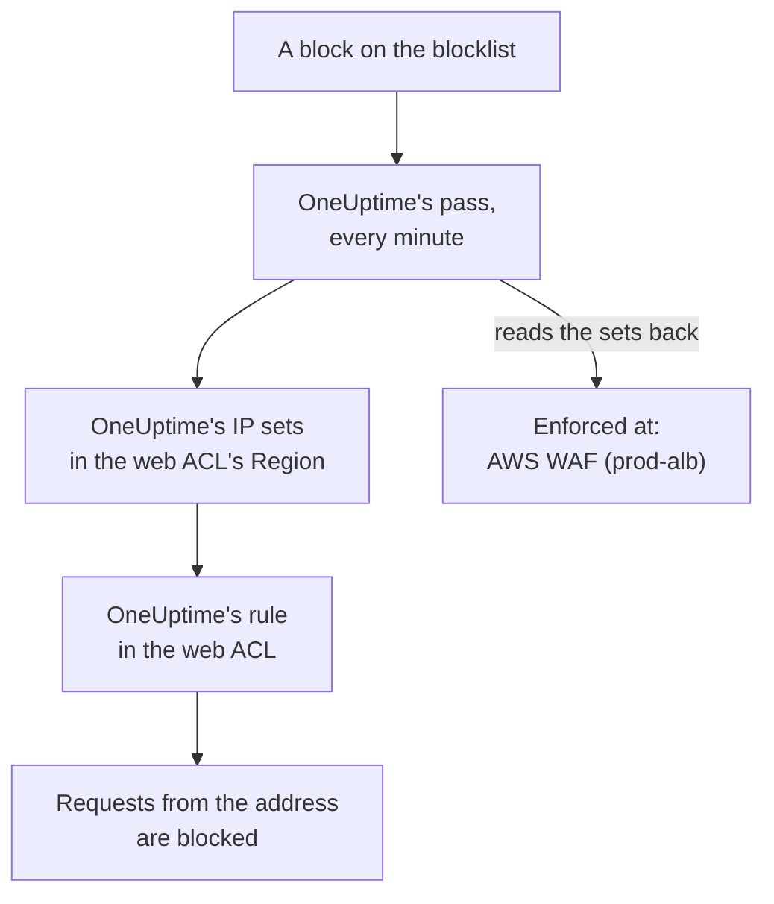

# Block Addresses in AWS WAF

Your project's blocklist can be enforced in the AWS WAF web ACLs in front of your CloudFront distributions, load balancers and API Gateways. Turn it on for an AWS cloud connection you already have, pick the web ACLs, and every address the blocklist blocks is blocked there, whether a person, a playbook or OneUptime AI blocked it.

:::cards
- [Turn it on](#turn-it-on): One setting on the AWS connection, and its setup command again.
- [What OneUptime creates](#what-oneuptime-creates): Four IP sets per Region, and two rules per web ACL.
- [Manage the web ACL in code](#manage-the-web-acl-in-code): Add the rules in Terraform or CloudFormation yourself.
:::

## How it works

OneUptime keeps its own IP sets in each Region a picked web ACL is in, and a rule in each web ACL that blocks the addresses in them. Every minute it writes each set once with what the blocklist holds, then reads the sets back. On the **Blocklist** page, a block's **Enforced At** names AWS WAF (prod-alb) only once AWS WAF holds the block and the web ACL's rule blocks its set; until then it is not enforced.

## Before you begin

- An AWS account connected to OneUptime (see [Connect a Cloud Account](/docs/telemetry/cloud-accounts#amazon-web-services)).
- A role that may change where the blocklist is enforced: **Project Owner**, **Project Admin** or **Security Admin**.
- Someone who can run the connection's setup command in the AWS account again.

## Turn it on

:::steps
### Open the connection
Open **Cloud → Connect** and edit the AWS connection.

### Pick who adds the rule
Under **More fields**, set **Block addresses in AWS WAF** to **On, and OneUptime adds its rule**, or to **On, and I add the rule in code** if your web ACLs are managed in Terraform or CloudFormation.

### Run the setup command again
The command the form shows now grants the IP sets, and the rule when OneUptime adds it. Run it in AWS CloudShell, then save the connection.

### Add the web ACLs
Open **Security Events → Playbooks → Blocklist**. Under **Cloud WAFs**, click **Add Web ACL**, pick a web ACL and where it reads the client's address, and add it. OneUptime sets it up at once, and its **Status** says **Enforcing** when its rule blocks the sets.
:::

The web ACLs come from the connection's inventory: one OneUptime has not read yet is listed after the next read. While a web ACL enforces the blocklist, its connection's setting cannot be turned off or moved from OneUptime adding its rule to adding it in code, and the connection cannot be deleted: remove the web ACL first, so OneUptime takes its rule out.

## What OneUptime creates

| What | Name | Where |
| --- | --- | --- |
| Four IP sets: block and challenge, IPv4 and IPv6 | `oneuptime-<project>-block-ipv4`, `oneuptime-<project>-block-ipv6`, `oneuptime-<project>-challenge-ipv4`, `oneuptime-<project>-challenge-ipv6` | In each Region a picked web ACL is in. CloudFront's web ACLs are global, and their sets are in `us-east-1`. |
| Two rules: one blocks, one challenges | `OneUptime-Blocklist-<project>`, `OneUptime-Challenge-<project>` | In each picked web ACL, when OneUptime adds its rule. |

`<project>` is the first eight characters of your project's external ID, so two OneUptime projects in one account never write each other's sets. Web ACLs of one Region share the sets. A single address is written as `/32` or `/128`. AWS WAF holds 10,000 addresses in a set, and 100 IP sets in a Region unless AWS raised it for you; a block that does not fit says so on its row.

## The rule's place in the web ACL

OneUptime puts its two rules at free priorities below your first rule, so they run before the rules you wrote. With no rule in the web ACL, they take priorities 0 and 1. OneUptime never renumbers, changes or removes a rule of yours: when no two priorities are free below your first rule, the web ACL says **No Free Priority**, and OneUptime adds its rules once you free two.

Each rule matches when either of its sets, IPv4 or IPv6, holds the client's address. AWS WAF updates a web ACL whole, so OneUptime reads it, adds its rules and writes it back with the web ACL's lock token, and reads it again when someone else wrote it in between.

## Forwarded addresses

A web ACL behind another proxy or CDN sees the proxy's address, not the client's. Pick where it reads the client's address under **Client Address**:

| Client Address | What the rule reads |
| --- | --- |
| **The request's source address** | The address the request came from. The default. |
| The last address in the `X-Forwarded-For` header | The address the last proxy appended. An address before it is one the request claimed. |
| The `CF-Connecting-IP` header | The one address Cloudflare writes. |
| The `True-Client-IP` header | The one address Akamai or Cloudflare Enterprise writes. |

A request without the header does not match: AWS WAF lets it through rather than block a proxy's address.

## Manage the web ACL in code

With **On, and I add the rule in code**, OneUptime makes only the IP sets, and never writes your web ACL. Click **Show Rule** on the web ACL's row: it gives both rules as Terraform (`rule` blocks of `aws_wafv2_web_acl`) and as CloudFormation, with each set's ARN and the header the web ACL reads. Add them to your code before your other rules and apply it.

Until the rules are there, the web ACL says **Waiting for Your Rule**, and its blocks are not enforced. OneUptime reads the web ACL on each pass, and its blocks are enforced from the first pass that finds a rule blocking each set, whatever you named it.

## Permissions

The setup command adds an inline policy, `OneUptimeWafBlocklist`, to the role. With an access key, IAM's limit on a user's own policies puts it on a group, `OneUptimeWafBlocklist-<project>`, that the user joins.

| Action | Resource | Why |
| --- | --- | --- |
| `wafv2:ListIPSets` | Any | Find OneUptime's IP sets in a Region. |
| `wafv2:GetIPSet`, `wafv2:CreateIPSet`, `wafv2:UpdateIPSet`, `wafv2:DeleteIPSet` | OneUptime's IP sets only (`oneuptime-<project>-*`) | Keep the sets, and delete them when you remove the last web ACL of a Region. |
| `wafv2:GetSampledRequests` | Web ACLs | Read the requests a rule turned away: the evidence a case's block step is checked by. |
| `wafv2:UpdateWebACL` | Web ACLs, and the IP sets, regex sets and rule groups they reference | Add OneUptime's rules. Only with **On, and OneUptime adds its rule**. |

Reading a web ACL, `wafv2:GetWebACL`, is in the connection's read-only policy already.

## Remove it

:::steps
### Remove the web ACL
On **Security Events → Playbooks → Blocklist**, click **Remove** on the web ACL's row. OneUptime takes its rules out of the web ACL, and empties and deletes its IP sets once no other web ACL of the Region uses them.

### Turn the setting off
Edit the connection, set **Block addresses in AWS WAF** to **Off**, and save. The setting can be turned off once no web ACL of the connection enforces the blocklist.
:::

When OneUptime may no longer write the web ACL, check **Remove From OneUptime Only** in the **Remove Web ACL** dialog. OneUptime removes the web ACL from the blocklist and names the rules and IP sets it left in AWS WAF: they keep blocking what they hold until you delete them there. A rule of yours that still references a set keeps it too: OneUptime empties it, and names it.

## Troubleshooting

:::details Not Enforcing
The web ACL's status says what AWS answered and what to do. A refusal names the action and the setting that grants it: turn the setting on, or pick **On, and OneUptime adds its rule**, then run the connection's setup command again and click **Check Again**.
:::

:::details No Free Priority
Your first rule is at priority 0 or 1, so no two priorities are free below it. Move your rules up by two, then click **Check Again**.
:::

:::details A web ACL is not in the list
OneUptime lists the web ACLs of connections with the setting on, once it has read them. Web ACLs seen only by their metrics need the connection's setup command again, which lets OneUptime read them.
:::

## Next steps

:::cards
- [Security Cases and Playbooks](/docs/telemetry/security-cases): Block an address from a case, and see its step checked.
- [Connect a Cloud Account](/docs/telemetry/cloud-accounts): The connection this setting is part of.
:::
