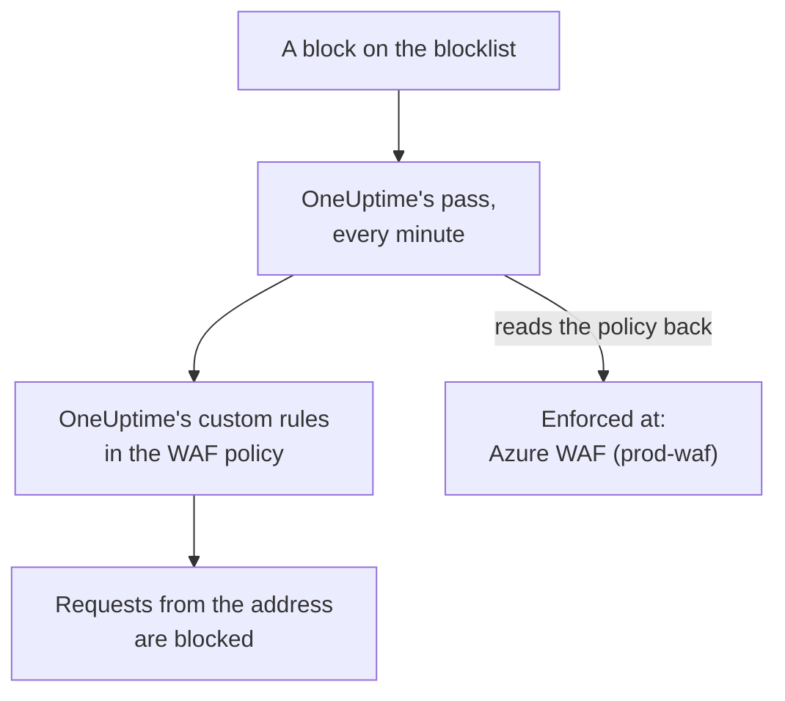

# Block Addresses in Azure WAF

Your project's blocklist can be enforced in the Azure WAF policies of your Application Gateways and Front Doors. Turn it on for an Azure cloud connection you already have, pick the WAF policies, and every address the blocklist blocks is blocked there, whether a person, a playbook or OneUptime AI blocked it.

:::cards
- [Turn it on](#turn-it-on): One setting on the Azure connection, and the role it needs.
- [What OneUptime creates](#what-oneuptime-creates): Custom rules of its own in each policy you pick.
- [Which address is matched](#which-address-is-matched): The address that connected, or the original client behind a proxy.
:::

## How it works

OneUptime keeps custom rules of its own in each WAF policy you pick, and puts the addresses the blocklist blocks in them. Every minute it writes the policy once with what the blocklist holds, then reads it back. On the **Blocklist** page, a block's **Enforced At** names Azure WAF (prod-waf) only once the policy holds the block and Azure has applied the change; until then it is not enforced.

## Before you begin

- An Azure subscription connected to OneUptime (see [Connect a Cloud Account](/docs/telemetry/cloud-accounts#microsoft-azure)).
- A role that may change where the blocklist is enforced: **Project Owner**, **Project Admin** or **Security Admin**.
- Someone who may assign roles in the Azure subscription, to run one command in Azure Cloud Shell.

## Turn it on

:::steps
### Open the connection
Open **Cloud → Connect** and edit the Azure connection.

### Turn the setting on
Under **More fields**, set **Block addresses in Azure WAF** to **On**, and save. The setup command the form shows now grants the role below on the whole subscription. A connection you already have need not run it again: the **Add WAF** dialog gives the lines that grant the role on one policy alone.

### Add the WAF policies
Open **Security Events → Playbooks → Blocklist**. Under **Cloud WAFs**, click **Add WAF** and pick a WAF policy. OneUptime asks Azure whether the connection may write it, without writing anything.

### Grant the role, if it is missing
When a permission is missing, the dialog shows the lines that grant it on that policy alone. Run them in Azure Cloud Shell, click **Check Again**, then add the policy. Its **Status** says **Enforcing** once OneUptime has read it.
:::

The WAF policies come from the connection's inventory: one OneUptime has not read yet is listed after the next read. While a policy enforces the blocklist, its connection's setting cannot be turned off and the connection cannot be deleted: remove the policy first, so OneUptime takes its rules out.

## What OneUptime creates

| What | Name | Where |
| --- | --- | --- |
| Custom rules, each one IP match condition with the action Block | `OneUptime<project>Block1`, `OneUptime<project>Block2`, ... | In each WAF policy you pick, at most 10 of them. |

`<project>` is the first eight characters of your project's external ID, so two OneUptime projects that pick one policy never write each other's rules. A rule holds 540 addresses or ranges on Application Gateway, 600 with CRS 3.2 or a Default Rule Set, and 600 on Front Door. With ten rules, a policy holds 5,400 or 6,000 blocks; a block that does not fit says so on its row.

OneUptime changes nothing in a policy but its own rules. Azure writes a WAF policy only whole, so OneUptime reads the policy with its ETag, changes its own rules, and writes it back with the ETag in `If-Match`: every other rule, setting and managed rule set is written as it was read. When someone else wrote the policy in between, Azure refuses the write, and OneUptime reads it again and makes its change on what they wrote.

## The rules' place in the policy

OneUptime puts its rules at free priorities before your first rule that allows traffic, lowest first, so no rule of yours lets a blocked address through. A rule of yours that blocks or logs may come first. OneUptime never renumbers, changes or removes a rule of yours: when no priority is free before your first Allow rule, the policy says **No Free Priority**, and OneUptime adds its rule once you free one.

## Which address is matched

| WAF policy | Client Address | When to pick it |
| --- | --- | --- |
| Front Door | **The address that connected to Front Door (SocketAddr)** | The default. |
| Front Door | The original client, from X-Forwarded-For (RemoteAddr) | For a Front Door behind another proxy or CDN. |
| Application Gateway | The address that connected to the gateway (RemoteAddr) | The only choice: its IP match reads no other address. |

Front Door takes `RemoteAddr` from the `X-Forwarded-For` header, which a client that connects to Front Door directly writes itself. Pick it only when another proxy or CDN in front of Front Door writes that header. The choice is under **More fields** in the **Add WAF** dialog, and you can change it later with **Client Address** on the policy's row.

Application Gateway's IP match reads IPv4 addresses only, so an IPv6 block is not applied there, and its row says why.

OneUptime's rules in Azure WAF only block. A block that asks to challenge an address is not applied in Azure WAF, and says so. An automatic response policy's challenge is enforced there as a block for the same time.

## How long a change takes

Application Gateway applies a change as Azure writes it. Front Door accepts the change and spreads it to its edges over the next few minutes: the policy says **Applying**, and a new block's **Enforced At** waits for the policy until Azure reports it provisioned. The block is enforced from then on.

## When a rule is changed by hand

When someone turns off, changes or deletes one of OneUptime's rules in Azure, OneUptime leaves it as they left it. The policy says **Changed by Hand**, and the blocks that rule held are not enforced, with why, until someone clicks **Put It Back** on the policy's row. Put It Back writes the rule again as OneUptime writes it, at its own priority while that is free.

A policy that blocks nothing says so too, and its blocks are not enforced:

- A policy that is turned off.
- A policy in **Detection** mode, which only logs what OneUptime's rules match.
- A policy that is not associated with an application gateway, a listener, a path rule or a Front Door domain.

## Keep a policy in Terraform

Terraform also writes a WAF policy whole, so its next plan removes OneUptime's rules. To let OneUptime keep them, add `ignore_changes = [custom_rules]` to the `lifecycle` block of an `azurerm_web_application_firewall_policy`, or `ignore_changes = [custom_rule]` to that of an `azurerm_cdn_frontdoor_firewall_policy`, and keep your own custom rules out of that policy's code.

## Permissions

The setup command adds a custom role, `OneUptime WAF Blocklist`, and assigns it to the connection's app on the subscription. The lines the **Add WAF** dialog shows assign the same role on one policy alone.

| Action | Why |
| --- | --- |
| `Microsoft.Network/ApplicationGatewayWebApplicationFirewallPolicies/read`, `Microsoft.Network/ApplicationGatewayWebApplicationFirewallPolicies/write` | Read an Application Gateway WAF policy and write OneUptime's rules in it. |
| `Microsoft.Network/FrontDoorWebApplicationFirewallPolicies/read`, `Microsoft.Network/FrontDoorWebApplicationFirewallPolicies/write` | Read a Front Door WAF policy and write OneUptime's rules in it. |

The role cannot delete a policy, and OneUptime never writes anything else.

## Remove it

:::steps
### Remove the WAF policy
On **Security Events → Playbooks → Blocklist**, click **Remove** on the policy's row. OneUptime takes its rules out of the policy, and changes nothing else in it.

### Turn the setting off
Edit the connection, set **Block addresses in Azure WAF** to **Off**, and save. The setting can be turned off once no policy of the connection enforces the blocklist.
:::

When OneUptime may no longer write the policy, check **Remove From OneUptime Only** in the **Remove WAF** dialog. OneUptime removes the policy from the blocklist and names the rules it left in it: they keep blocking what they hold until you delete them in Azure.

## Troubleshooting

:::details Not Enforcing
The policy's status says what Azure answered and what to do. A refusal names the permission it lacks: run the lines **Add WAF** shows for the policy, then click **Check Again**.
:::

:::details No Free Priority
Your first rule that allows traffic is at priority 1, or every priority before it is taken. Give it a higher priority number, then click **Check Again**.
:::

:::details A policy is not in the list
OneUptime lists the WAF policies of connections with the setting on, once it has read them. A policy added since appears after the connection's next read.
:::

## Next steps

:::cards
- [Security Cases and Playbooks](/docs/telemetry/security-cases): Block an address from a case, and see its step checked.
- [Connect a Cloud Account](/docs/telemetry/cloud-accounts): The connection this setting is part of.
:::
