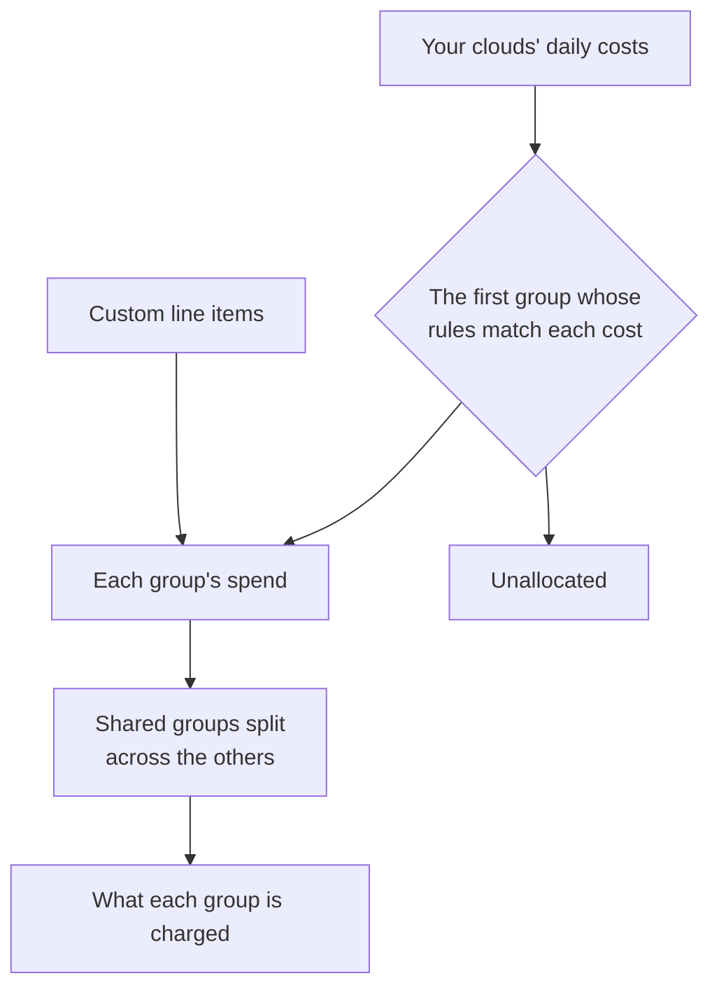

# Cloud Cost Allocation

Cost groups answer the first question of every month's cloud bill: who spent it. A **cost view** such as "By team" or "By cost center" sorts your connected accounts' spend into **cost groups** by rules, with nothing counted twice. Whatever no rule matches stays in plain sight as unallocated spend, and shared costs are split across the groups. Find them under **Cloud → Spend → Cost Groups**.

:::cards
- [Create a view](#create-a-view): By team from the owners you already set, by a tag, or your own groups.
- [Write a group's rules](#write-a-groups-rules): Accounts, services, tags, owner teams, labels and more.
- [Unallocated spend](#unallocated-spend): What no rule matches, and one click to sort it.
- [Shared costs](#shared-costs): A support plan or a shared cluster, split across the groups.
:::

## How it works



- **The first group that matches takes the cost.** A view's groups are in order, and every cost falls into the first group whose rules match it, so nothing is counted twice. The groups and the unallocated spend always add up to the period's total.
- **Rules read everything a cost carries.** The account, the cloud, the service, the Region, the resource and its tags, and what OneUptime knows of the resource: its owner teams, its labels, its App Platforms environment and app.
- **Everything is worked out when you look.** Nothing is written per cost. A rule you change sorts every month OneUptime keeps again, up to 400 days back, with nothing to wait for.
- **Several views can sort the same spend.** "By team" and "By cost center" each sort all of it, their own way.

## Before you begin

- **Costs that are read.** [Connect a cloud account](/docs/telemetry/cloud-accounts) and let it [read its costs](/docs/telemetry/cloud-costs).
- **Tags or owners, if you want them.** Rules on tags need costs that carry them; on AWS, turn on [Costs per resource](/docs/telemetry/cloud-costs#costs-per-resource). Owner teams come from each resource's owners, set by hand or by [owner rules](/docs/configuration/label-and-owner-rules).

## Create a view

Open **Cloud → Spend → Cost Groups**. A project without a view yet is offered three ways to start:

| Start | What it makes |
| --- | --- |
| **By team, from owners** | A group for each team that owns cloud resources, linked to the team. |
| **By a tag** | A group for each value of a tag your costs carry, such as `team` or `cost-center`. |
| **Your own groups** | An empty view. You write each group's rules. |

OneUptime makes the groups of a view by tag or by owner team when you save it, then every hour as new tag values and owners appear. You can rename those groups, link them to a team or share them. Their rules stay OneUptime's. To make the missing groups now, open the view and press **Make Groups Now**.

## Write a group's rules

Open a view, then **Create Cost Group** under **Groups**. A cost is the group's when **any** of its rules matches it, and a rule matches when **all** of its conditions do. A condition compares one thing a cost carries with the values you pick or type:

| Field | What it reads |
| --- | --- |
| **Tag** | One tag's value, by the tag's key. **is set** and **is not set** ask whether the cost carries it. |
| **Account** | The connected account the cost is billed to. |
| **Owner team** | The teams that own the resource in OneUptime. |
| **Service** | The service, as your cloud's billing names it. |
| **Label** | The labels of the resource, or of its account, in OneUptime. |
| **Region** | The Region. Leave the value empty for a global service. |
| **Cloud** | AWS, Azure or Google Cloud. |
| **Resource** | The resource, as your cloud names it. |
| **App Platforms environment** and **App** | What an environment or an app is billed, as **Cloud → Spend → Costs** counts it. |
| **Kubernetes namespace** and **Kubernetes cluster** | A cluster's namespaces, when a shared group is split by them. See [Kubernetes clusters](#kubernetes-clusters). |

Text is compared whatever its case: `Payments` and `payments` are one team. A tag's key is matched as written, as your clouds keep it.

For example, a **Payments** group with three rules takes a cost that is tagged `team: payments`, **or** billed to the payments account, **or** owned by the Payments team.

### The order of groups

Drag the groups under **Groups** to change their order. A group whose rules an earlier group already covers can never take a cost, and its row says which group takes it all. A group whose rules also match costs an earlier group takes says how much of them it gets.

### Resources with several owner teams

A resource owned by two teams is split evenly between them: each team's half goes through the rules on its own. A rule that asks nothing about owners, such as a tag or an account, still takes the whole cost. A half whose team has no group stays unallocated.

## Unallocated spend

A view's page lists what no rule matches yet: the services, accounts, tag values and owner teams it is made of, the costliest first. Press **Add to Group** beside one to add a rule for it to a group, or to a new group. Its costs move into the group at once, past months too.

## Shared costs

A support plan, a shared cluster or a network hub is everyone's. Make it a group of its own, then under **More fields** turn on **Shared** and choose how its costs are split across the view's other groups:

| Split | How |
| --- | --- |
| **Split by share of spend** | Each group takes its share of that month's cloud spend of the other groups. A month they spent nothing in is split evenly. |
| **Split evenly** | The same amount to each group. |
| **Split by fixed percentages** | The percentages you set for each group, which add up to 100. |
| **Split by Kubernetes namespaces** | What each namespace of a cluster cost that month. See below. |

A shared group's costs are split day by day with each month's shares, so a month comes to the same figures read by the day or by the month. Unallocated spend never takes a share.

### Kubernetes clusters

A cluster's nodes are billed by your cloud, while the cluster's own cost engine says what each namespace used. To charge each team for its workloads inside a shared cluster:

1. Make a group whose rules match the cluster's nodes, for example **Tag** `eks:cluster-name` **is any of** `prod`.
2. Make it **Shared**, choose **Split by Kubernetes namespaces**, and pick the **Kubernetes Cluster**.
3. Give the teams' groups rules that read the namespaces' labels, which count as tags. For example, **Tag** `team` **is any of** `payments`, or **Kubernetes namespace** **starts with** `payments-`.

Each month, the nodes' costs are split by what each namespace cost in the cluster's [cost engine](/docs/telemetry/kubernetes-cost), and each namespace's part goes to the first group whose rules match it. Idle capacity, and a namespace no group takes, stay with the cluster's group. The cluster's own priced costs are never added to your bill, so nothing is counted twice.

## Custom line items

Under **Custom Line Items** on **Cloud → Spend → Cost Groups**, add a charge or credit your clouds' bills do not carry: a share of a support contract, an enterprise discount, an internal markup or a platform fee.

- **Once or every month.** A monthly item is spread over each month's days, so part of a month takes its part.
- **On an account or a group.** One added to an account goes through each view's rules as the account's costs do. One added to a group goes straight to it.
- **Always apart.** Every figure keeps line items apart from what the clouds billed, so the clouds' own figures still match their consoles.

## See each group's spend

- **Cloud → Spend → Costs**: under **Where the money goes**, choose **Cost groups** and a view. Each group's spend, against the period before.
- **A view's page**: what each group was charged, with its shared costs, what no rule matches, and **Download CSV** for the month's chargeback.
- **A group's page**: its spend day by day, the services, resources and accounts it is charged for most, and its rules. It shows that group's spend alone, so link the group to its **Team** and send the team its page: anyone who may read the cloud's spend can open it.

## API, CLI and MCP

Views, groups and line items are API resources (`cloud-cost-view`, `cloud-cost-group`, `cloud-cost-line-item`), with CLI commands and MCP tools as every resource has. A group's rules are JSON:

```json
[
  { "conditions": [{ "field": "tag", "key": "team", "operator": "is", "values": ["payments"] }] },
  { "conditions": [{ "field": "ownerTeam", "operator": "is", "values": ["<team ID>"] }] }
]
```

To read what a view allocates, for whole UTC days from `startDate` to `endDate`:

```bash
curl -X POST "https://oneuptime.com/api/cloud-cost-view/<view ID>/allocation" \
  -H "apikey: <API key>" -H "tenantid: <project ID>" -H "Content-Type: application/json" \
  -d '{"startDate": "2026-11-01", "endDate": "2026-11-30", "currency": "USD"}'
```

The answer has each group's `total` and what it is made of (`cloud`, `lineItems`, `sharedIn`, `sharedOut`), its figures by day or by month, the period before, and what the unallocated spend is made of. `POST /cloud-cost-group/<group ID>/spend` answers for one group.

## Limits

- A view holds at most 500 groups. A view by tag makes groups for the 500 costliest values.
- A group has at most 25 rules, a rule 20 conditions, and a condition 200 values.
- Costs are kept for 400 days, so a view reads at most 400 days.

## Troubleshooting

:::details A group gets nothing
Its rules may match no cost yet, or an earlier group takes every cost they match. Its row under **Groups** then names that group: drag this one above it, or narrow the earlier group's rules.
:::

:::details A cost is in the wrong group
A cost falls into the first group whose rules match it. Drag the group it belongs to above the group that takes it, or narrow that group's rules.
:::

:::details A rule on a tag matches nothing
A cost keeps the tags it had when it was read: a Google Cloud billing export's labels, else the tags of the resource it is billed to, which on AWS needs [Costs per resource](/docs/telemetry/cloud-costs#costs-per-resource). A tag's key is matched as written.
:::

:::details A view by tag or by owner team misses a group
OneUptime makes the missing groups every hour: one for each tag value of the last 400 days' costs, or each team that owns cloud resources, up to 500 groups. Press **Make Groups Now** on the view's page to make them at once.
:::

:::details The figures leave an account out
A view's figures are in the currency most of your accounts are billed in. An account billed in another is left out of them, and so is a line item in another currency.
:::

## Next steps

:::cards
- [Cloud Costs and Savings](/docs/telemetry/cloud-costs): What your connected accounts cost, and how to spend less.
- [Label and Owner Rules](/docs/configuration/label-and-owner-rules): Give resources owner teams and labels for the rules to read.
- [Kubernetes Cost Observability](/docs/telemetry/kubernetes-cost): What each Kubernetes workload costs.
:::
