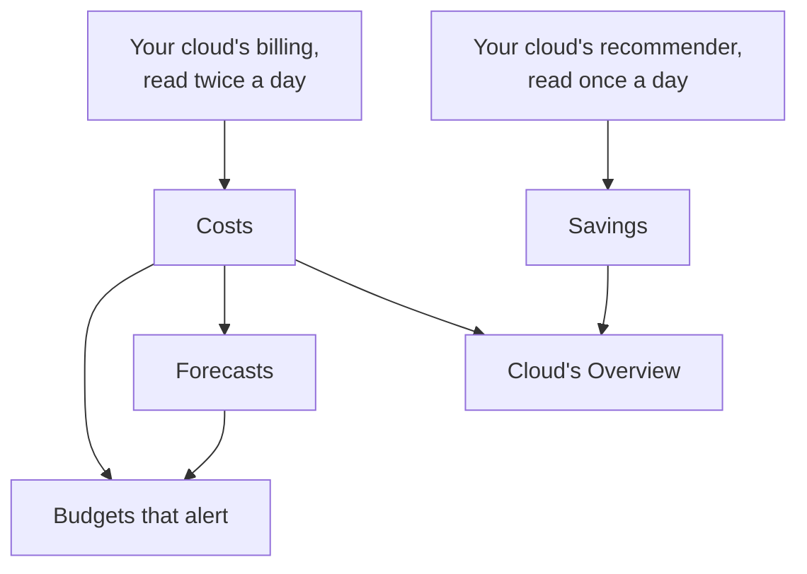

# Cloud Costs and Savings

A connected cloud account also says what it costs and how it could cost less. OneUptime reads each day's costs from your cloud's own billing and the recommendations of your cloud's own recommender, shows them under **Cloud → Spend → Costs** and **Cloud → Spend → Savings**, lists your Savings Plans, reservations and committed use discounts under **Cloud → Spend → Commitments**, tells you before a month, a quarter or a year costs more than its budget under **Cloud → Spend → Budgets**, and forecasts the months ahead under **Cloud → Spend → Forecast**. Once you let it, it also makes the savings an owner approves, stops non-production resources outside working hours, and checks each change against the bill.

:::cards
- [Amazon Web Services](#amazon-web-services): Cost Explorer and Cost Optimization Hub, each turned on once.
- [Microsoft Azure](#microsoft-azure): Cost Management and Azure Advisor, with one more role.
- [Google Cloud](#google-cloud): Your billing export to BigQuery, and the Recommender.
- [Billed, amortized and net](#billed-amortized-and-net): Each cost three ways, so commitments and credits land where the money went.
- [Commitments and renewals](#commitments-and-renewals): Every commitment, alerts before one ends or while it is under-used, and what to renew or buy.
- [Act on savings](#act-on-savings): Apply a saving with its owner's approval, and undo it.
- [Off-hours schedules](#off-hours-schedules): Stop non-production resources at night and on weekends.
- [AI rules for savings](#ai-rules-for-savings): Proposals for owners, or changes within a limit.
- [Budgets](#budgets): A month's, a quarter's or a year's budget for any account, cost group or service.
- [Forecasts](#forecasts): What the next 12 months are on course to cost, and how sure that is.
:::

## How it works



- **Costs come from your cloud's own billing.** AWS Cost Explorer, Azure Cost Management and Google Cloud's billing export to BigQuery, in the currency the account is billed in, each kept billed, amortized and net: see [Billed, amortized and net](#billed-amortized-and-net). Each figure is a day's, in UTC days as your cloud bills them.
- **A cloud reports the last day or two late.** Each read takes the last week again, and all of last month in a month's first days, so a day's cost settles as your cloud finishes it. A connection's first read goes back to the start of the month before last.
- **The month's projection is the last week's pace.** It is what the month cost so far, with each day still to come at the average of the last seven full days.
- **Savings come from your cloud's own recommender.** AWS Cost Optimization Hub, Azure Advisor and Google Cloud's Recommender: a smaller size, a resource left idle, a commitment worth making, each with what it would save a month. One you act on or dismiss in your cloud's console goes away on the next read.

## Before you begin

- **A connected account.** [Connect a Cloud Account](/docs/telemetry/cloud-accounts) with today's setup command: it lets the connection read costs and recommendations. A connection made before reads neither until you run its command again.

## Amazon Web Services

The connection reads costs with `ce:GetCostAndUsage`, its commitments with `ce:GetSavingsPlansCoverage`, `ce:GetSavingsPlansUtilization`, `ce:GetSavingsPlansUtilizationDetails`, `ce:GetReservationCoverage` and `ce:GetReservationUtilization`, the Savings Plans bought with `savingsplans:DescribeSavingsPlans`, and recommendations with `cost-optimization-hub:ListRecommendations` and `cost-optimization-hub:GetRecommendation`. The setup command grants Cost Explorer's reads as three families, `ce:GetCostAndUsage*`, `ce:GetSavingsPlans*` and `ce:GetReservation*`, all of them reads, so an access key's user still fits the 2,048 characters IAM allows its policy. Cost Explorer and Cost Optimization Hub each need turning on in the account first:

:::steps
### Turn on Cost Explorer

Open Cost Explorer once in the AWS Billing and Cost Management console: AWS prepares the account's costs within a day. Connect the organization's management account to read every member account's costs.

### Opt in to Cost Optimization Hub

Open Cost Optimization Hub in the same console and opt in, for the organization from its management account or for the account alone. Its recommendations come within a day.
:::

Cost Explorer charges $0.01 for each request: a read of the costs makes two or a few more, one for billed and amortized and one for net, and the commitments are read with four a day for their coverage and use, and six to twelve more a day for each one's own. The Savings Plans API and Cost Optimization Hub are free.

### Costs per resource

Cost Explorer also says what each resource costs, for the last 14 days, once resource-level data is turned on. In the AWS Billing and Cost Management console, open Cost Management preferences and turn on resource-level data at daily granularity, for the organization from its management account. AWS prepares it within 48 hours.

Then edit the connection under **Cloud → Connect**, and under **More fields** turn on **Costs per resource**. The connection reads them with `ce:GetCostAndUsageWithResources` once a day: the 14 days the first time, then the last three again, with a few requests each time. What it reads stays with the account's costs after Cost Explorer forgets it. A connection made before needs its setup command run again, which adds the action.

## Microsoft Azure

The app reads costs with the **Cost Management Reader** role, on the same scope as **Monitoring Reader**: the setup command grants both. Azure Advisor's recommendations are read with **Monitoring Reader**, so there is nothing to turn on. To give an app made before the role, run:

```bash
az role assignment create --assignee <APP_ID> --role "Cost Management Reader" --scope /subscriptions/<SUBSCRIPTION_ID>
```

Cost Management answers for each subscription, with the resource each cost is for, and costs nothing to read. When it cannot answer for a subscription, the account's **Costs** says why.

Cost Management limits how fast a tenant's costs are read, the same for everyone who reads them: each query costs a query processing unit (QPU) for every month of data it reads, and a tenant has 12 QPU every 10 seconds, 60 a minute and 600 an hour. OneUptime reads a tenant's subscriptions one after another within two thirds of each, waits as long as Cost Management asks when it turns a query away, and goes on at the next read where it stopped. A subscription not read yet says **Queued**, with when it is read, and one that already has figures keeps them meanwhile. Its amortized cost is read at every read and its actual cost once a day, so a subscription's first read asks Cost Management twice and takes twice the query units: a large tenant's first figures take a few reads more.

The tenant's reservations and savings plans are read with **Reservations Reader** and **Savings plan Reader**, which Azure gives at the tenant's own scope, where only a Global Administrator with elevated access may grant them. The setup command tries, and says so when it may not. To grant them later, as a Global Administrator with elevated access:

```bash
az role assignment create --assignee <APP_ID> --role "Reservations Reader" --scope /providers/Microsoft.Capacity
az role assignment create --assignee <APP_ID> --role "Savings plan Reader" --scope /providers/Microsoft.BillingBenefits
```

Without them, costs and recommendations are read as before, and **Cloud → Spend → Commitments** says which role to grant.

## Google Cloud

Google Cloud has no API for a project's costs: OneUptime reads them from your billing account's export to BigQuery.

:::steps
### Export your billing to BigQuery

In the Google Cloud console, open Billing, then Billing export, and turn on the detailed usage cost export to a BigQuery dataset. Google writes it a few hours behind, from the day you turn it on.

### Let the service account read it

Give the connection's service account **BigQuery Data Viewer** on the export's dataset. The setup command already gave it **BigQuery Job User**, to run the query in its own project.

### Name the export's table

Edit the connection under **Cloud → Connect**, and under **More fields** set **Billing export table** to the table's full name: `<PROJECT_ID>.<DATASET>.gcp_billing_export_resource_v1_<BILLING_ACCOUNT_ID>`.
:::

The detailed export names the resource each cost is for; the standard one says the service and Region only. BigQuery bills the query: the first 1 TiB a month is free, then $6.25 per TiB, and a month of an export is a few megabytes to a few gigabytes. The Recommender's machine type and idle resource recommendations are read with **Compute Recommender Viewer**, which the setup command grants, and cost nothing. Compute Engine's commitments are listed from Cloud Asset Inventory with **Cloud Asset Viewer**, which the setup command already grants: nothing more to give.

## Billed, amortized and net

Every cost is kept three ways, and **Cloud → Spend → Costs**, an account's **Costs**, Cloud's Overview and budgets show the one you choose:

- **Billed** is each charge on the day your cloud billed it, before credits and refunds. A Savings Plan or a reservation paid up front is one large charge on the day it was bought, and the usage it covers looks free for the rest of its term.
- **Amortized** spreads each commitment's fees over the days and resources it covers, so the money lands where it was spent. Still before credits and refunds. It is what the pages show unless you choose another.
- **Net** is amortized, less credits, refunds and discounts: what the invoice comes to.

| | Billed | Amortized | Net |
|---|---|---|---|
| AWS | Cost Explorer's unblended cost | Cost Explorer's amortized cost | Cost Explorer's net amortized cost, credits and refunds included |
| Azure | Cost Management's actual cost | Cost Management's amortized cost | The amortized cost: Azure takes credits off at the billing account, which a subscription's connection does not read |
| Google Cloud | The export's cost | The cost less the committed use discounts' and subscriptions' credits | The cost less every credit |

The switch above the figures changes the basis on the page, and OneUptime remembers your choice on this project, in your browser. The project's own basis, the one the pages open on and budgets watch, is under **Cloud → Settings → Cost Settings**. A budget can watch a basis of its own: edit it and set **Cost Basis**.

Costs read before the three were kept read their billed figure on every basis. Each connection reads its costs again once, as far back as a first read, so each basis fills in.

## Ways to spend less

**Cloud → Spend → Savings** lists every recommendation, the largest saving first: what to do, to which resource, what would change and what it saves a month. The strip above it adds them up, in all and by kind: a smaller size, a resource left idle, a commitment. A recommendation links to its resource's page when OneUptime holds the resource, and one OneUptime can make has **Apply**: see [Act on savings](#act-on-savings).

### Right-sizing from OneUptime's own readings

A resource no recommender speaks for, because the recommender is not turned on, does not cover its type or finds it too new, is sized by OneUptime from the CPU and memory readings its connection took over the last 14 days. OneUptime sizes EC2 instances, RDS databases and ElastiCache clusters on AWS, virtual machines, PostgreSQL and MySQL flexible servers and App Service plans on Azure, and Compute Engine VMs and Cloud SQL instances on Google Cloud:

- **Over-provisioned** when the size half as big, or a quarter, would still have room: on the smaller size, its CPU's 95th percentile would be at most 60%, its highest CPU reading at most 100%, and its memory's peak at most 70% when its memory is read.
- **Under-provisioned** when its CPU's 95th percentile is 85% or more, or its memory's peak 90% or more: the size twice as big.

A resource is sized once it has 6 days of readings. Its page shows its **Right-sizing** beside what it costs, and an over-provisioned one is listed under **Cloud → Spend → Savings** with OneUptime as its source. What a change saves is its share of what the resource cost over the last 30 days, so it is known once your cloud bills the resource by name: Azure and Google Cloud's detailed export do, and AWS does once Costs per resource is on. An EC2 instance reports its memory only with the CloudWatch agent, and a Compute Engine VM only with the Ops Agent: without one, it is sized by its CPU alone. Burstable sizes, such as t3, B-series and e2-micro, are never sized.

### Commitments

**Cloud → Spend → Savings** and an account's **Costs** show how much of the last 30 days' spend each account's commitments paid for, and how much of them was used, a line for each kind:

- AWS: Savings Plans and Reserved Instances, from Cost Explorer. An organization's management account reads them for every account of the organization.
- Azure: savings plans and reservations, from Cost Management, in amortized cost.
- Google Cloud: committed use discounts, from your billing export. The export does not say how much of a commitment went unused, so how much is used is not shown.

An account with none says what ran at on-demand rates that a commitment would pay for at a lower rate. Each kind's figures are its cloud's own, and kinds are never added together: a reservation and a savings plan can both count the same machine's spend as theirs to cover. Each commitment on its own is listed under **Cloud → Spend → Commitments**: see [Commitments and renewals](#commitments-and-renewals).

## Commitments and renewals

**Cloud → Spend → Commitments** lists every Savings Plan, reservation and committed use discount your connections can read, so none ends unnoticed:

- **Active Commitments**, above them, counts the active ones and those that end within 90 days, **Utilization** how much of them was used over the last 30 days and what was left unused, and **Coverage** how much of the spend they cover.
- **Ending Soon** lists the ones that end within 90 days and do not renew themselves, each with its renewal plan: what to buy to keep its discount (its hourly commitment, or its instances, at the share of it that was used), what that costs and saves a month, when it breaks even, and how much of the spend is covered now and once it ends. **Renew in Console** opens the page your cloud renews it on.
- **All Commitments** is the whole list: what each one is and covers, its account, when it ends, its term and payment option, how much of it was used over the last 30 days, and the usage it paid for and what that saved.
- **Purchase Plans** are what your cloud's recommender suggests buying, each with what it would cost and save a month, when it would break even, and how coverage would change. **Buy in Console** opens the page to buy it on.
- Under them, each account's commitments by kind, as its **Costs** shows them, and when the commitments alert, with **Change Alerts**.

OneUptime only plans: it never buys, renews or returns a commitment. You buy in your cloud's console.

| | Where the commitments come from | What is known of each |
|---|---|---|
| AWS | Cost Explorer's Savings Plans and Reserved Instances, each with its own use, and the Savings Plans API for the plans bought, those queued to start included | Its end, term, payment option, hourly commitment or instances, fees, and use over the last 30 and 7 days |
| Azure | The tenant's reservations and savings plans | Its end, term, billing plan, whether it renews itself, and use over the last 30 and 7 days |
| Google Cloud | Compute Engine's commitments, from Cloud Asset Inventory | Its end, plan, resources and whether it renews itself. Google Cloud does not say how much of a commitment is used |

An organization's management account lists every account's on AWS. Spend-based committed use discounts, which Google Cloud keeps on the billing account rather than in a project, are not listed yet.

### Commitment alerts

Commitments raise alerts, paged through on-call policies as any alert is. Under **Cloud → Settings → Cost Settings**, **Commitment Alerts** says when:

- **Alert Before a Commitment Ends**: 90, 30 and 7 days before its end to start with. One alert at the nearest of those days the commitment has reached, each nearer one taking over from the one before. A commitment that renews itself, or whose renewal is queued to start when it ends, raises none.
- **Alert When Utilization Is Below**: 80% to start with, of a commitment's last 7 days, once it has run a week. The alert resolves when its use is back.
- **Alert When Coverage Falls Below**: 60% to start with, of the spend an account's commitments of one kind could cover, having covered more. It resolves when coverage is back. Empty, coverage raises no alert.

**Alert On Commitments** turns them all off, and **Alert Severity**, **On-Call Policies** and **Owners** say how severe they are, who is paged and who owns them. Each alert says what the commitment covers and what it paid for, and points to its renewal plan. An alert resolves by itself when its commitment ends, renews or is no longer listed.

## Act on savings

OneUptime makes a saving through the account's cloud connection once its **Savings actions** setting allows it: [Savings actions](/docs/telemetry/cloud-accounts#savings-actions) says what each choice grants. It makes only changes of one step: it stops an idle instance or database, changes a gp2 volume to gp3, deletes an unattached disk, an old snapshot or an unused image, releases an unused address, and, when you allow it, resizes an instance or a database to the size recommended. It never buys a commitment: **Buy in Console** opens your cloud's page for one.

:::steps
### Select Apply

Under **Cloud → Spend → Savings**, select **Apply** on a saving. The dialog says what changes, what it saves a month, how it is undone or that it cannot be, and who approves it.

### An owner approves it

A person named an owner of the resource, or a member of a team that owns it, who may also edit it, approves the change. A resource nobody owns is approved by a Project Owner or Project Admin. When you may approve it yourself, **Apply** makes it at once, as you. Otherwise it waits under **Waiting for Approval** for an owner to **Approve** it, or to **Dismiss** it with a reason.

### OneUptime makes it

The change is made through the connection and is on the resource's and the account's timelines, with who approved it. A deleted disk gets a final snapshot first, unless you turn off **Take a final snapshot first**.
:::

Every change says how it is undone: **Undo** under **Changes Made** starts a stopped instance again, sets a volume or a size back, or makes a deleted disk again from its final snapshot. What deletes for good, such as a snapshot, an image or a released address, cannot be undone, and the dialog says so before you apply it. Where the project asks for two approvals with **Require Two Approvals for Riskier Fixes**, a change that cannot be undone takes two people.

A resource whose tags say it is managed as code, such as by Terraform or CloudFormation, is changed in its code instead: the dialog offers **Open Pull Request** to the repository that declares it, so the next apply does not undo the saving.

### Proved by the bill

**Saved this month** counts only what your cloud's bill shows. Once three days after a change have settled on the bill, the resource's cost a day is held to the week before the change: it is **Seen in the bill** when the cost fell by at least a quarter of what was promised, **Not seen in the bill** when it did not, and **Cannot be measured** when your cloud does not bill the resource by name. **Checking the bill** counts the changes still waiting for those days.

## Off-hours schedules

Under **Cloud → Spend → Schedules**, a schedule stops non-production instances and databases outside working hours, and starts them again:

:::steps
### Pick the resources

Name the cloud tag that picks them, such as `Schedule` = `office-hours`, in one account or in all of them.

### Say when they run

Pick the working days, the time they start and the time they stop, on a 24-hour clock, and the time zone.
:::

When working hours end, a schedule stops every running resource its tag picks that is known not to be production, through its account's connection, and when they begin it starts again only what it stopped: a resource someone stopped by hand stays stopped. **See Resources** lists what a schedule picks now, and why it leaves any running. It stops EC2 instances and RDS databases on AWS, virtual machines on Azure and Compute Engine instances on Google Cloud. AWS starts a database that has been stopped for seven days again on its own.

A schedule never stops production, or a resource whose environment nothing says. A resource is known not to be production when:

- one of its tags says so, under a key such as `environment`, `env`, `stage`, `tier` or `deployment.environment`, with a word such as `dev`, `test`, `qa`, `staging` or `sandbox`;
- its account is marked **Non-production** under **Environment** on the account's **Settings**;
- or one of its labels says so, such as `Staging` or `env: dev`.

Production wins: a tag that says `prod`, `production` or `live`, or an account marked **Production**, keeps a resource running whatever else says. A resource's name is never read for it. Turn a schedule off and it stops nothing more, and starts what it stopped when its working hours begin; delete it and what it stopped is started at once.

## AI rules for savings

With **Enable AI** on, OneUptime AI proposes each saving it can make to the resource's owners after each read of the account's savings, and they approve or dismiss it under **Waiting for Approval**. Under **Cloud → Settings → Savings AI Rules**, a rule says what OneUptime AI does with the savings it matches, by the kind of change, the resource's environment and its cloud: **Off**, **Propose to the owner**, or **Act without asking**, up to a monthly limit. With no rule, every saving is proposed and none is made; with rules, only what a rule matches, and between rules that match, the more careful one wins.

A rule acts without asking only on a resource known not to be production, only for a change that can be undone, only up to the smallest limit of the rules that match, and at most 10 times an hour in a project: everything else is proposed. A change made without asking is on the timelines with the rule that made it, and its owners can undo it. A saving dismissed or undone is not proposed again for 30 days.

## Budgets

:::steps
### Create a budget

Under **Cloud → Spend → Budgets**, create a budget and choose what it **Applies To**: every account, one **Account**, a **Cost Group** as its rules sort the spend, or the services, Regions and tags a **Filter** names, written as a cost group's rules are. Leave its **Cost Basis** empty to count the project's.

### Say what it may cost

Its **Period** is a month, a quarter or a year, and its **Amount** is what one period may cost. Quarters and years start in the **First Month of the Year**: from April, a year runs from April to March. A year's **Budget Plan** can split its amount equally over its months, or give each month its own in a **Monthly Plan**. Each month is then held to its own share, so a quiet month is never warned for a busy month's spend.

### Choose when it alerts

**Alert At** takes the shares of the budget to act at, in percent: 80 and 100 to start with. **Alert When On Course To Pass** also alerts, once a period, when the period is on course to cost more than the budget. **Alert On Unusual Days** also alerts the day after a day that cost far more than usual: see [Unusual days](#unusual-days). **Alert Severity** says how severe its alerts are.

### Choose who hears

The people and teams to **Notify** are told by email and chat as the spend passes a share below 100%, with no alert, so nobody is paged for spend within the budget. **Notify the Cost Group's Team** tells the team the cost group belongs to as well. From 100%, an alert is raised, they own it, and the **On-Call Policies** are paged. A budget with nobody to tell raises an alert at every share.
:::

A budget is checked after every read of the costs and every hour. As the period's spend passes a share, the people to notify are told, or from 100% an alert is raised, once for the highest when a read passes several at once, and a new period resolves the last period's alerts. A year split by month is checked a month at a time, against that month's share. A budget counts only the accounts billed in its currency, on its basis: an amortized budget is not set off by a commitment bought up front, which a billed one counts on the day it was bought.

A period is on course to pass when what it cost so far, the rest of this month at the last full week's pace, and a quarter's or a year's later months as [forecast](#forecasts) come to more than the budget.

Each budget's row says what it counts, its period and the period so far: for a year split by month, this month against its share, with the year beside it. Its page shows the period month by month against each month's share, this month day by day, what cost the most, and who hears. A yearly budget's page can save its forecast as its plan.

AI agents can create and change budgets through the [MCP server](/docs/ai/mcp-server), and scripts with the CLI's `oneuptime cloud-budget` command: see [Resource Operations](/docs/cli/resource-operations).

### Unusual days

After every read, each of an account's last 14 full days is held to the 14 days before it. A day is unusual when a service cost twice its usual day or more, or the whole account one and a half times its usual day or more. Either must be at least 10 more than usual, in the account's currency, and at least 5% of the account's usual day, so a few cents are never a spike. A day's usual is the median of the 14 days before it, so one spike moves it little, and an account is judged only once it has a week of costs.

**Cloud → Spend → Costs** marks the unusual days on the daily spend, above their bars, and lists them under it. Over every account, each mark opens its account's **Costs**. A monthly budget for every account or one raises one alert for each account and day, the day after, naming every service that ran high. Any other budget holds what it counts to its own usual day the same way. A spike that goes on for days is reported on the day it began, and a day more than a week old is not reported. A budget made before these alerts existed does not raise them until you edit it and turn them on.

## Forecasts

**Cloud → Spend → Forecast** says what the spend is on course to cost in each of the next 12 months, for everything, an account, a cost group or a service, on the cost basis you pick. It says how each forecast is made, from the full months of costs OneUptime keeps, a year or a little more:

- **This month** is what it cost so far, with each day still to come at the average of the last seven full days, as a budget projects it.
- **With fewer than 3 full months**, each month ahead is that pace carried forward, with no likely range: too little has been read to tell a trend from a blip.
- **From 3 full months**, a trend runs through each month's average day: the median of the slopes between every two months, so one odd month barely moves it.
- **From 12 full months**, each calendar month also keeps how far it ran above or below the trend last year, so a December peak is forecast for the next December too.

Each month ahead has a likely range, where it should land 8 times in 10, from how far the past months fell from their trend and never narrower than 5% either side. It widens the further ahead a month is, and the fewer months the forecast was made from. From 12 full months, every range is wider still, because a year shows each calendar month only once. A forecast is no promise: a new service, a migration or a price change moves the months ahead in ways no past month shows.

**What If** grows or shrinks every month ahead from the month you choose, by the share you type, such as 20% from January. **Save as Budget Plan** makes the next twelve months a yearly budget's plan, in a new budget or one you have, each month held to its forecast share.

## Budgets and forecasts in the API

Budgets are an API resource (`cloud-budget`), with CLI commands and MCP tools as every resource has. A budget's `scope` is `allAccounts`, `account` (with `cloudAccountId`), `costGroup` (with `cloudCostGroupId`) or `filter` (with `filterRules`, written as a cost group's rules are). Its `period` is `month`, `quarter` or `year`, from `fiscalYearStartMonth`, 1 to 12. A year's `planSplit` is `none`, `equal` or `byMonth`, with its twelve months in `monthlyPlan`, in the fiscal year's order.

To read a budget's period month by month, this month's days and what cost the most, as its page does:

```bash
curl -X POST "https://oneuptime.com/api/cloud-budget/<budget ID>/spend" \
  -H "apikey: <API key>" -H "tenantid: <project ID>"
```

To forecast a scope, for 1 to 24 months ahead, with an optional what-if:

```bash
curl -X POST "https://oneuptime.com/api/cloud-budget/forecast" \
  -H "apikey: <API key>" -H "tenantid: <project ID>" -H "Content-Type: application/json" \
  -d '{"scope": "costGroup", "cloudCostGroupId": "<group ID>", "monthsAhead": 12, "growth": {"percent": 20, "fromMonth": "2027-01"}}'
```

The answer's `forecast` has its `method` (`pace`, `trend` or `trendAndSeason`), the months it was made from, and each month with its `amount` and, ahead, its `low` and `high`. Send `basis` as `billed`, `amortized` or `net` to forecast on that basis; without it the forecast is on the project's, and the answer's `basis` says which. A budget's spend is on its own basis.

## Where the money goes

**Cloud → Spend → Costs** breaks a period's spend down by service, Region, account or resource, and three more ways:

- By App Platforms environment: each environment's platform service in its account and Region, such as Amazon ECS or Cloud Run, and an Elastic Beanstalk environment's resources by the tag AWS gives them.
- By app: what a platform bills an app by name, such as a Cloud Run service or a Container App. Amazon ECS bills its tasks and App Service its plans, so their apps' costs stay their environment's.
- By tag: each value of the tag you pick. A cost keeps the tags it had when it was read: a Google Cloud billing export's labels, else the tags of the resource it is billed to, which on AWS needs Costs per resource.

Under the list, the card says what the rest came to: what is in no environment, what an environment is billed as a whole, or what does not carry the tag. Costs read before tags were kept are read again once, as far back as a first read, so their tags fill in.

## What you see in OneUptime

- **Cloud's Overview.** **Cloud → Overview** shows the month's spend against last month's by the same day, the services that cost the most and the largest ways to spend less, beside what needs attention.
- **Every day's spend.** **Cloud → Spend → Costs** draws each of the last 30 days with the days that cost far more than usual marked, lists those days and breaks a period down by service, Region, account, resource, App Platforms environment, app or tag, billed, amortized or net. The accounts whose costs are not read are listed under it, each with why.
- **Every commitment.** **Cloud → Spend → Commitments** lists each one with when it ends and how much of it is used, the ones ending soon with what to renew, and what to buy.
- **An account's costs.** An account's **Costs** shows the same for the account alone, with its commitments and its ways to spend less.
- **A resource's cost.** A resource's page shows what it cost this month and in the last 30 days when its cloud bills it by name, with its ways to spend less and its right-sizing.
- **Every budget.** **Cloud → Spend → Budgets** lists each budget with what it counts, its period and the period so far, and each opens its page.
- **The months ahead.** **Cloud → Spend → Forecast** draws the months a forecast was made from, this month on course and the next 12, with how it was made.
- **What was saved.** **Cloud → Spend → Savings** opens on what the changes made saved this month, as the bill shows it, the changes waiting for approval and those made, and the hours schedules stopped resources for.

## Troubleshooting

:::details An account says Needs permission
The connection may not read the account's costs yet. Run its setup command again from **Cloud → Connect**: it adds what reading costs needs. On Google Cloud, also give the service account **BigQuery Data Viewer** on the export's dataset.
:::

:::details An account says Not set up
Its cloud has no costs to give yet. On AWS, turn on Cost Explorer; on Google Cloud, name the export's table under **Billing export table**. The first figures come with the next read, within 12 hours.
:::

:::details An account says Queued
Its costs wait their turn: Azure Cost Management limits how fast a tenant's costs are read. The account says when they are read, at the connection's first read from then, and nothing needs doing. An account that already has figures keeps them meanwhile.
:::

:::details Costs per resource says Not set up
Resource-level data is not turned on for the account. Turn it on at daily granularity in the Cost Management preferences of the AWS Billing and Cost Management console, from the organization's management account for its members. AWS prepares it within 48 hours, and the next day's read takes it.
:::

:::details The commitments say Needs permission
The connection may not read the account's Savings Plans and reservations yet. Run its setup command again from **Cloud → Connect**: it adds the actions they are read with. On Azure, a Global Administrator with elevated access grants **Reservations Reader** and **Savings plan Reader**: see [Microsoft Azure](#microsoft-azure).
:::

:::details Amortized and net show the same as billed
Costs read before the three were kept show their billed figure on every basis until the connection's next read of costs, which reads them again as far back as its first read. On Azure, net is always the amortized cost.
:::

:::details A commitment ends and no alert came
A commitment that renews itself, or whose renewal is queued to start when it ends, raises none, and neither does one in a project whose commitment alerts are off under **Cloud → Settings → Cost Settings**. An alert also needs the project to have an alert severity.
:::

:::details The figures leave an account out
The figures are in the currency most of your accounts are billed in. An account billed in another is listed under them with its currency, and a budget counts only the accounts billed in its own.
:::

:::details A saving has no Apply
OneUptime makes only a change of one step: a commitment, or a recommendation that changes more than one thing, is made in your cloud's console. Apply opens a dialog that says why it cannot be made from here when the account's connection does not allow it: turn on its **Savings actions** and run its setup command again.
:::

:::details A schedule leaves a resource running
**See Resources** says why: it is production, nothing says it is not production, or its account's connection does not allow Savings actions. Tag it, for example `environment` = `dev`, or mark its account **Non-production**.
:::

:::details A forecast has no likely range
It was made from fewer than 3 full months of costs, so each month ahead is the last full week's pace carried forward, and no range is claimed. The range comes once the third full month is read. A connection's first read goes back to the start of the month before last.
:::

:::details Someone was told of a budget but no alert came
Below 100%, a budget that names people or teams to notify tells them, and raises no alert, so nobody is paged. From 100% it raises an alert, and its on-call policies are paged. A budget with nobody to tell raises an alert at every share.
:::

:::details This month is lower than in your cloud's console
Your cloud reports the last day or two late, and billed and amortized figures are before credits and refunds. The next reads catch up. Compare the basis your cloud's console shows: AWS opens on unblended costs, which is billed.
:::

## Next steps

:::cards
- [Cloud Cost Allocation](/docs/telemetry/cloud-cost-allocation): Sort the spend into teams, products and cost centers.
- [Connect a Cloud Account](/docs/telemetry/cloud-accounts): Connect another account, or run its command again.
- [Cloud Resources](/docs/telemetry/cloud-resources): Every resource's metrics, from a collector of your own.
- [Kubernetes Cost Observability](/docs/telemetry/kubernetes-cost): What each Kubernetes workload costs.
:::
