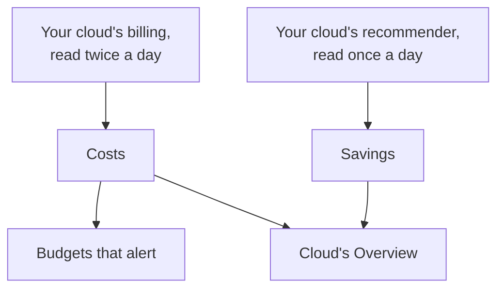

# Cloud Costs and Savings

A connected cloud account also says what it costs and how it could cost less. OneUptime reads each day's costs from your cloud's own billing and the recommendations of your cloud's own recommender, shows them under **Cloud → Spend → Costs** and **Cloud → Spend → Savings**, and alerts before a month costs more than its budget under **Cloud → Spend → Budgets**.

:::cards
- [Amazon Web Services](#amazon-web-services): Cost Explorer and Cost Optimization Hub, each turned on once.
- [Microsoft Azure](#microsoft-azure): Cost Management and Azure Advisor, with one more role.
- [Google Cloud](#google-cloud): Your billing export to BigQuery, and the Recommender.
- [Budgets](#budgets): An alert as a month's spend passes a share of its budget.
:::

## How it works



- **Costs come from your cloud's own billing.** AWS Cost Explorer, Azure Cost Management and Google Cloud's billing export to BigQuery, before credits and refunds, in the currency the account is billed in. Each figure is a day's, in UTC days as your cloud bills them.
- **A cloud reports the last day or two late.** Each read takes the last week again, and all of last month in a month's first days, so a day's cost settles as your cloud finishes it. A connection's first read goes back to the start of the month before last.
- **The month's projection is the last week's pace.** It is what the month cost so far, with each day still to come at the average of the last seven full days.
- **Savings come from your cloud's own recommender.** AWS Cost Optimization Hub, Azure Advisor and Google Cloud's Recommender: a smaller size, a resource left idle, a commitment worth making, each with what it would save a month. One you act on or dismiss in your cloud's console goes away on the next read.

## Before you begin

- **A connected account.** [Connect a Cloud Account](/docs/telemetry/cloud-accounts) with today's setup command: it lets the connection read costs and recommendations. A connection made before reads neither until you run its command again.

## Amazon Web Services

The connection reads costs with `ce:GetCostAndUsage`, its commitments with `ce:GetSavingsPlansCoverage`, `ce:GetSavingsPlansUtilization`, `ce:GetReservationCoverage` and `ce:GetReservationUtilization`, and recommendations with `cost-optimization-hub:ListRecommendations`. Cost Explorer and Cost Optimization Hub each need turning on in the account first:

:::steps
### Turn on Cost Explorer

Open Cost Explorer once in the AWS Billing and Cost Management console: AWS prepares the account's costs within a day. Connect the organization's management account to read every member account's costs.

### Opt in to Cost Optimization Hub

Open Cost Optimization Hub in the same console and opt in, for the organization from its management account or for the account alone. Its recommendations come within a day.
:::

Cost Explorer charges $0.01 for each request: a read of the costs makes a few, and the commitments are read with four a day. Cost Optimization Hub is free.

### Costs per resource

Cost Explorer also says what each resource costs, for the last 14 days, once resource-level data is turned on. In the AWS Billing and Cost Management console, open Cost Management preferences and turn on resource-level data at daily granularity, for the organization from its management account. AWS prepares it within 48 hours.

Then edit the connection under **Cloud → Connect**, and under **More fields** turn on **Costs per resource**. The connection reads them with `ce:GetCostAndUsageWithResources` once a day: the 14 days the first time, then the last three again, with a few requests each time. What it reads stays with the account's costs after Cost Explorer forgets it. A connection made before needs its setup command run again, which adds the action.

## Microsoft Azure

The app reads costs with the **Cost Management Reader** role, on the same scope as **Monitoring Reader**: the setup command grants both. Azure Advisor's recommendations are read with **Monitoring Reader**, so there is nothing to turn on. To give an app made before the role, run:

```bash
az role assignment create --assignee <APP_ID> --role "Cost Management Reader" --scope /subscriptions/<SUBSCRIPTION_ID>
```

Cost Management answers for each subscription, with the resource each cost is for, and costs nothing to read. When it cannot answer for a subscription, the account's **Costs** says why.

## Google Cloud

Google Cloud has no API for a project's costs: OneUptime reads them from your billing account's export to BigQuery.

:::steps
### Export your billing to BigQuery

In the Google Cloud console, open Billing, then Billing export, and turn on the detailed usage cost export to a BigQuery dataset. Google writes it a few hours behind, from the day you turn it on.

### Let the service account read it

Give the connection's service account **BigQuery Data Viewer** on the export's dataset. The setup command already gave it **BigQuery Job User**, to run the query in its own project.

### Name the export's table

Edit the connection under **Cloud → Connect**, and under **More fields** set **Billing export table** to the table's full name: `<PROJECT_ID>.<DATASET>.gcp_billing_export_resource_v1_<BILLING_ACCOUNT_ID>`.
:::

The detailed export names the resource each cost is for; the standard one says the service and Region only. BigQuery bills the query: the first 1 TiB a month is free, then $6.25 per TiB, and a month of an export is a few megabytes to a few gigabytes. The Recommender's machine type and idle resource recommendations are read with **Compute Recommender Viewer**, which the setup command grants, and cost nothing.

## Ways to spend less

**Cloud → Spend → Savings** lists every recommendation, the largest saving first: what to do, to which resource, what would change and what it saves a month. The strip above it adds them up, in all and by kind: a smaller size, a resource left idle, a commitment. A recommendation links to its resource's page when OneUptime holds the resource.

### Right-sizing from OneUptime's own readings

A resource no recommender speaks for, because the recommender is not turned on, does not cover its type or finds it too new, is sized by OneUptime from the CPU and memory readings its connection took over the last 14 days. OneUptime sizes EC2 instances, RDS databases and ElastiCache clusters on AWS, virtual machines, PostgreSQL and MySQL flexible servers and App Service plans on Azure, and Compute Engine VMs and Cloud SQL instances on Google Cloud:

- **Over-provisioned** when the size half as big, or a quarter, would still have room: on the smaller size, its CPU's 95th percentile would be at most 60%, its highest CPU reading at most 100%, and its memory's peak at most 70% when its memory is read.
- **Under-provisioned** when its CPU's 95th percentile is 85% or more, or its memory's peak 90% or more: the size twice as big.

A resource is sized once it has 6 days of readings. Its page shows its **Right-sizing** beside what it costs, and an over-provisioned one is listed under **Cloud → Spend → Savings** with OneUptime as its source. What a change saves is its share of what the resource cost over the last 30 days, so it is known once your cloud bills the resource by name: Azure and Google Cloud's detailed export do, and AWS does once Costs per resource is on. An EC2 instance reports its memory only with the CloudWatch agent, and a Compute Engine VM only with the Ops Agent: without one, it is sized by its CPU alone. Burstable sizes, such as t3, B-series and e2-micro, are never sized.

### Commitments

**Cloud → Spend → Savings** and an account's **Costs** show how much of the last 30 days' spend each account's commitments paid for, and how much of them was used, a line for each kind:

- AWS: Savings Plans and Reserved Instances, from Cost Explorer. An organization's management account reads them for every account of the organization.
- Azure: savings plans and reservations, from Cost Management, in amortized cost.
- Google Cloud: committed use discounts, from your billing export. The export does not say how much of a commitment went unused, so how much is used is not shown.

An account with none says what ran at on-demand rates that a commitment would pay for at a lower rate. Each kind's figures are its cloud's own, and kinds are never added together: a reservation and a savings plan can both count the same machine's spend as theirs to cover.

## Budgets

:::steps
### Create a budget

Under **Cloud → Spend → Budgets**, create a budget: its **Monthly Amount**, and the **Account** it is for, or none for every account.

### Choose when it alerts

**Alert At** takes the shares of the budget to alert at, in percent: 80 and 100 to start with. **Alert When On Course To Pass** also alerts, once a month, when the last week's pace would take the month past the budget. **Alert On Unusual Days** also alerts the day after a day that cost far more than usual: see [Unusual days](#unusual-days). **Alert Severity** and **On-Call Policies** say how severe the alerts are and who is paged.
:::

A budget is checked after every read of the costs and every hour. As the month's spend passes a threshold, one alert is raised for it, the highest when a read passes several at once, and a new month resolves the last month's alerts. A budget counts only the accounts billed in its currency.

AI agents can create and change budgets through the [MCP server](/docs/ai/mcp-server), and scripts with the CLI's `oneuptime cloud-budget` command: see [Resource Operations](/docs/cli/resource-operations).

### Unusual days

After every read, each of an account's last 14 full days is held to the 14 days before it. A day is unusual when a service cost twice its usual day or more, or the whole account one and a half times its usual day or more. Either must be at least 10 more than usual, in the account's currency, and at least 5% of the account's usual day, so a few cents are never a spike. A day's usual is the median of the 14 days before it, so one spike moves it little, and an account is judged only once it has a week of costs.

**Cloud → Spend → Costs** marks the unusual days on the daily spend, above their bars, and lists them under it. Over every account, each mark opens its account's **Costs**. A budget that counts the account raises one alert for each account and day, the day after, naming every service that ran high. A spike that goes on for days is reported on the day it began, and a day more than a week old is not reported. A budget made before these alerts existed does not raise them until you edit it and turn them on.

## Where the money goes

**Cloud → Spend → Costs** breaks a period's spend down by service, Region, account or resource, and three more ways:

- By App Platforms environment: each environment's platform service in its account and Region, such as Amazon ECS or Cloud Run, and an Elastic Beanstalk environment's resources by the tag AWS gives them.
- By app: what a platform bills an app by name, such as a Cloud Run service or a Container App. Amazon ECS bills its tasks and App Service its plans, so their apps' costs stay their environment's.
- By tag: each value of the tag you pick. A cost keeps the tags it had when it was read: a Google Cloud billing export's labels, else the tags of the resource it is billed to, which on AWS needs Costs per resource.

Under the list, the card says what the rest came to: what is in no environment, what an environment is billed as a whole, or what does not carry the tag. Costs read before tags were kept are read again once, as far back as a first read, so their tags fill in.

## What you see in OneUptime

- **Cloud's Overview.** **Cloud → Overview** shows the month's spend against last month's by the same day, the services that cost the most and the largest ways to spend less, beside what needs attention.
- **Every day's spend.** **Cloud → Spend → Costs** draws each of the last 30 days with the days that cost far more than usual marked, lists those days and breaks a period down by service, Region, account, resource, App Platforms environment, app or tag. The accounts whose costs are not read are listed under it, each with why.
- **An account's costs.** An account's **Costs** shows the same for the account alone, with its commitments and its ways to spend less.
- **A resource's cost.** A resource's page shows what it cost this month and in the last 30 days when its cloud bills it by name, with its ways to spend less and its right-sizing.

## Troubleshooting

:::details An account says Needs permission
The connection may not read the account's costs yet. Run its setup command again from **Cloud → Connect**: it adds what reading costs needs. On Google Cloud, also give the service account **BigQuery Data Viewer** on the export's dataset.
:::

:::details An account says Not set up
Its cloud has no costs to give yet. On AWS, turn on Cost Explorer; on Google Cloud, name the export's table under **Billing export table**. The first figures come with the next read, within 12 hours.
:::

:::details Costs per resource says Not set up
Resource-level data is not turned on for the account. Turn it on at daily granularity in the Cost Management preferences of the AWS Billing and Cost Management console, from the organization's management account for its members. AWS prepares it within 48 hours, and the next day's read takes it.
:::

:::details The commitments say Needs permission
The connection may not read the account's Savings Plans and reservations yet. Run its setup command again from **Cloud → Connect**: it adds the four actions they are read with.
:::

:::details The figures leave an account out
The figures are in the currency most of your accounts are billed in. An account billed in another is listed under them with its currency, and a budget counts only the accounts billed in its own.
:::

:::details This month is lower than in your cloud's console
Your cloud reports the last day or two late, and the figures are before credits and refunds. The next reads catch up.
:::

## Next steps

:::cards
- [Connect a Cloud Account](/docs/telemetry/cloud-accounts): Connect another account, or run its command again.
- [Cloud Resources](/docs/telemetry/cloud-resources): Every resource's metrics, from a collector of your own.
- [Kubernetes Cost Observability](/docs/telemetry/kubernetes-cost): What each Kubernetes workload costs.
:::
