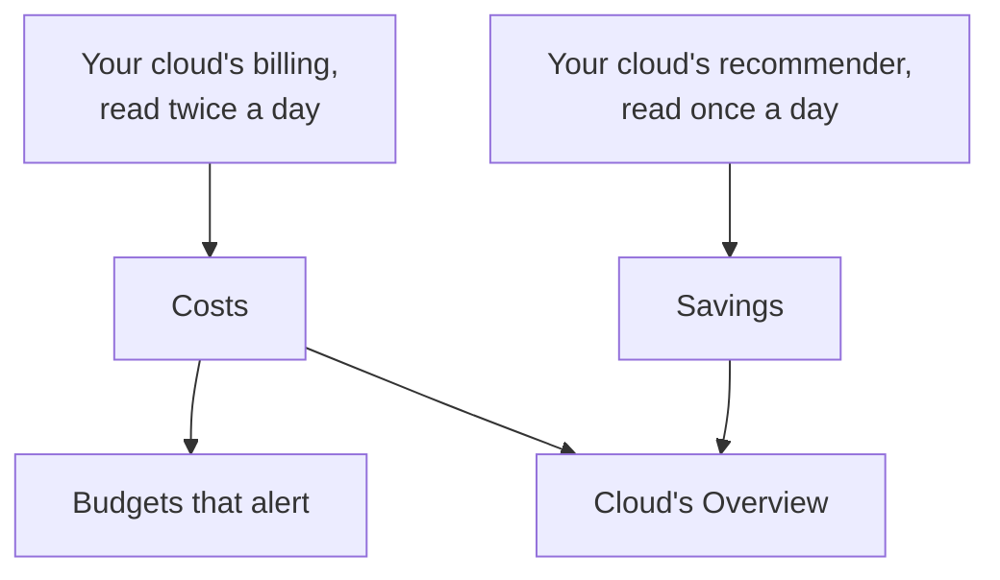

# Cloud Costs and Savings

A connected cloud account also says what it costs and how it could cost less. OneUptime reads each day's costs from your cloud's own billing and the recommendations of your cloud's own recommender, shows them under **Cloud → Spend → Costs** and **Cloud → Spend → Savings**, and alerts before a month costs more than its budget under **Cloud → Spend → Budgets**. Once you let it, it also makes the savings an owner approves, stops non-production resources outside working hours, and checks each change against the bill.

:::cards
- [Amazon Web Services](#amazon-web-services): Cost Explorer and Cost Optimization Hub, each turned on once.
- [Microsoft Azure](#microsoft-azure): Cost Management and Azure Advisor, with one more role.
- [Google Cloud](#google-cloud): Your billing export to BigQuery, and the Recommender.
- [Act on savings](#act-on-savings): Apply a saving with its owner's approval, and undo it.
- [Off-hours schedules](#off-hours-schedules): Stop non-production resources at night and on weekends.
- [AI rules for savings](#ai-rules-for-savings): Proposals for owners, or changes within a limit.
- [Budgets](#budgets): An alert as a month's spend passes a share of its budget.
- [Required tags](#required-tags): How much of your spend carries the tags you require, and new resources without them.
:::

## How it works



- **Costs come from your cloud's own billing.** AWS Cost Explorer, Azure Cost Management and Google Cloud's billing export to BigQuery, before credits and refunds, in the currency the account is billed in. Each figure is a day's, in UTC days as your cloud bills them.
- **A cloud reports the last day or two late.** Each read takes the last week again, and all of last month in a month's first days, so a day's cost settles as your cloud finishes it. A connection's first read goes back to the start of the month before last.
- **The month's projection is the last week's pace.** It is what the month cost so far, with each day still to come at the average of the last seven full days.
- **Savings come from your cloud's own recommender.** AWS Cost Optimization Hub, Azure Advisor and Google Cloud's Recommender: a smaller size, a resource left idle, a commitment worth making, each with what it would save a month. One you act on or dismiss in your cloud's console goes away on the next read.

## Before you begin

- **A connected account.** [Connect a Cloud Account](/docs/telemetry/cloud-accounts) with today's setup command: it lets the connection read costs and recommendations. A connection made before reads neither until you run its command again.

## Amazon Web Services

The connection reads costs with `ce:GetCostAndUsage`, its commitments with `ce:GetSavingsPlansCoverage`, `ce:GetSavingsPlansUtilization`, `ce:GetReservationCoverage` and `ce:GetReservationUtilization`, and recommendations with `cost-optimization-hub:ListRecommendations`. Cost Explorer and Cost Optimization Hub each need turning on in the account first:

:::steps
### Turn on Cost Explorer

Open Cost Explorer once in the AWS Billing and Cost Management console: AWS prepares the account's costs within a day. Connect the organization's management account to read every member account's costs.

### Opt in to Cost Optimization Hub

Open Cost Optimization Hub in the same console and opt in, for the organization from its management account or for the account alone. Its recommendations come within a day.
:::

Cost Explorer charges $0.01 for each request: a read of the costs makes a few, and the commitments are read with four a day. Cost Optimization Hub is free.

### Costs per resource

Cost Explorer also says what each resource costs, for the last 14 days, once resource-level data is turned on. In the AWS Billing and Cost Management console, open Cost Management preferences and turn on resource-level data at daily granularity, for the organization from its management account. AWS prepares it within 48 hours.

Then edit the connection under **Cloud → Connect**, and under **More fields** turn on **Costs per resource**. The connection reads them with `ce:GetCostAndUsageWithResources` once a day: the 14 days the first time, then the last three again, with a few requests each time. What it reads stays with the account's costs after Cost Explorer forgets it. A connection made before needs its setup command run again, which adds the action.

## Microsoft Azure

The app reads costs with the **Cost Management Reader** role, on the same scope as **Monitoring Reader**: the setup command grants both. Azure Advisor's recommendations are read with **Monitoring Reader**, so there is nothing to turn on. To give an app made before the role, run:

```bash
az role assignment create --assignee <APP_ID> --role "Cost Management Reader" --scope /subscriptions/<SUBSCRIPTION_ID>
```

Cost Management answers for each subscription, with the resource each cost is for, and costs nothing to read. When it cannot answer for a subscription, the account's **Costs** says why.

Cost Management limits how fast a tenant's costs are read, the same for everyone who reads them: each query costs a query processing unit (QPU) for every month of data it reads, and a tenant has 12 QPU every 10 seconds, 60 a minute and 600 an hour. OneUptime reads a tenant's subscriptions one after another within two thirds of each, waits as long as Cost Management asks when it turns a query away, and goes on at the next read where it stopped. A subscription not read yet says **Queued**, with when it is read, and one that already has figures keeps them meanwhile.

## Google Cloud

Google Cloud has no API for a project's costs: OneUptime reads them from your billing account's export to BigQuery.

:::steps
### Export your billing to BigQuery

In the Google Cloud console, open Billing, then Billing export, and turn on the detailed usage cost export to a BigQuery dataset. Google writes it a few hours behind, from the day you turn it on.

### Let the service account read it

Give the connection's service account **BigQuery Data Viewer** on the export's dataset. The setup command already gave it **BigQuery Job User**, to run the query in its own project.

### Name the export's table

Edit the connection under **Cloud → Connect**, and under **More fields** set **Billing export table** to the table's full name: `<PROJECT_ID>.<DATASET>.gcp_billing_export_resource_v1_<BILLING_ACCOUNT_ID>`.
:::

The detailed export names the resource each cost is for; the standard one says the service and Region only. BigQuery bills the query: the first 1 TiB a month is free, then $6.25 per TiB, and a month of an export is a few megabytes to a few gigabytes. The Recommender's machine type and idle resource recommendations are read with **Compute Recommender Viewer**, which the setup command grants, and cost nothing.

## Ways to spend less

**Cloud → Spend → Savings** lists every recommendation, the largest saving first: what to do, to which resource, what would change and what it saves a month. The strip above it adds them up, in all and by kind: a smaller size, a resource left idle, a commitment. A recommendation links to its resource's page when OneUptime holds the resource, and one OneUptime can make has **Apply**: see [Act on savings](#act-on-savings).

### Right-sizing from OneUptime's own readings

A resource no recommender speaks for, because the recommender is not turned on, does not cover its type or finds it too new, is sized by OneUptime from the CPU and memory readings its connection took over the last 14 days. OneUptime sizes EC2 instances, RDS databases and ElastiCache clusters on AWS, virtual machines, PostgreSQL and MySQL flexible servers and App Service plans on Azure, and Compute Engine VMs and Cloud SQL instances on Google Cloud:

- **Over-provisioned** when the size half as big, or a quarter, would still have room: on the smaller size, its CPU's 95th percentile would be at most 60%, its highest CPU reading at most 100%, and its memory's peak at most 70% when its memory is read.
- **Under-provisioned** when its CPU's 95th percentile is 85% or more, or its memory's peak 90% or more: the size twice as big.

A resource is sized once it has 6 days of readings. Its page shows its **Right-sizing** beside what it costs, and an over-provisioned one is listed under **Cloud → Spend → Savings** with OneUptime as its source. What a change saves is its share of what the resource cost over the last 30 days, so it is known once your cloud bills the resource by name: Azure and Google Cloud's detailed export do, and AWS does once Costs per resource is on. Burstable sizes, such as t3, B-series and e2-micro, are never sized.

Your cloud reads a VM's memory only with an agent of its own inside the VM: the CloudWatch agent on an EC2 instance, the Ops Agent on a Compute Engine VM, and none for an Azure VM, which reports the memory left rather than the memory used. A VM that [OneUptime's host collector](/docs/telemetry/hosts) runs on is sized on the memory the host collector reads instead:

- **The VM and the host are one machine** when the provider, the account, the Region and the instance ID all match: the EC2 instance ID, a Compute Engine VM's numeric ID or an Azure VM's `vmId`. A host name alone never makes a match, and a VM that two hosts claim, such as a cloned machine, is linked to neither. The VM's page names its host, and the host's page names its VM, each a link to the other.
- **Memory is the host's used memory, without cache and buffers**, the figure the host's page charts, over the same 14 days. A busy file cache never reads as a full machine. The host needs 6 days of readings too.
- **Where both read memory**, as a Compute Engine VM with the Ops Agent and the host collector does, the one with more readings is used. CPU is always your cloud's reading.

The VM's **Right-sizing** says where its memory came from, and so does its line under **Cloud → Spend → Savings**. A VM sized by its CPU alone says so, with a link to install the host collector. The host collector stamps its cloud's identity with the `resourcedetection/cloud` step that [the Hosts guide's configuration](/docs/telemetry/host-otel-collector) carries. A host on OneUptime's default config gets the step with OneUptime's next release, and one on a config of your own needs it added. Kubernetes nodes are left to [Kubernetes Cost Observability](/docs/telemetry/kubernetes-cost), which sizes the requests of what runs on them.

### Commitments

**Cloud → Spend → Savings** and an account's **Costs** show how much of the last 30 days' spend each account's commitments paid for, and how much of them was used, a line for each kind:

- AWS: Savings Plans and Reserved Instances, from Cost Explorer. An organization's management account reads them for every account of the organization.
- Azure: savings plans and reservations, from Cost Management, in amortized cost.
- Google Cloud: committed use discounts, from your billing export. The export does not say how much of a commitment went unused, so how much is used is not shown.

An account with none says what ran at on-demand rates that a commitment would pay for at a lower rate. Each kind's figures are its cloud's own, and kinds are never added together: a reservation and a savings plan can both count the same machine's spend as theirs to cover.

## Act on savings

OneUptime makes a saving through the account's cloud connection once its **Savings actions** setting allows it: [Savings actions](/docs/telemetry/cloud-accounts#savings-actions) says what each choice grants. It makes only changes of one step: it stops an idle instance or database, changes a gp2 volume to gp3, deletes an unattached disk, an old snapshot or an unused image, releases an unused address, and, when you allow it, resizes an instance or a database to the size recommended. It never buys a commitment: **Buy in Console** opens your cloud's page for one.

:::steps
### Select Apply

Under **Cloud → Spend → Savings**, select **Apply** on a saving. The dialog says what changes, what it saves a month, how it is undone or that it cannot be, and who approves it.

### An owner approves it

A person named an owner of the resource, or a member of a team that owns it, who may also edit it, approves the change. A resource nobody owns is approved by a Project Owner or Project Admin. When you may approve it yourself, **Apply** makes it at once, as you. Otherwise it waits under **Waiting for Approval** for an owner to **Approve** it, or to **Dismiss** it with a reason.

### OneUptime makes it

The change is made through the connection and is on the resource's and the account's timelines, with who approved it. A deleted disk gets a final snapshot first, unless you turn off **Take a final snapshot first**.
:::

Every change says how it is undone: **Undo** under **Changes Made** starts a stopped instance again, sets a volume or a size back, or makes a deleted disk again from its final snapshot. What deletes for good, such as a snapshot, an image or a released address, cannot be undone, and the dialog says so before you apply it. Where the project asks for two approvals with **Require Two Approvals for Riskier Fixes**, a change that cannot be undone takes two people.

A resource whose tags say it is managed as code, such as by Terraform or CloudFormation, is changed in its code instead: the dialog offers **Open Pull Request** to the repository that declares it, so the next apply does not undo the saving.

### Proved by the bill

**Saved this month** counts only what your cloud's bill shows. Once three days after a change have settled on the bill, the resource's cost a day is held to the week before the change: it is **Seen in the bill** when the cost fell by at least a quarter of what was promised, **Not seen in the bill** when it did not, and **Cannot be measured** when your cloud does not bill the resource by name. **Checking the bill** counts the changes still waiting for those days.

## Off-hours schedules

Under **Cloud → Spend → Schedules**, a schedule stops non-production instances and databases outside working hours, and starts them again:

:::steps
### Pick the resources

Name the cloud tag that picks them, such as `Schedule` = `office-hours`, in one account or in all of them.

### Say when they run

Pick the working days, the time they start and the time they stop, on a 24-hour clock, and the time zone.
:::

When working hours end, a schedule stops every running resource its tag picks that is known not to be production, through its account's connection, and when they begin it starts again only what it stopped: a resource someone stopped by hand stays stopped. **See Resources** lists what a schedule picks now, and why it leaves any running. It stops EC2 instances and RDS databases on AWS, virtual machines on Azure and Compute Engine instances on Google Cloud. AWS starts a database that has been stopped for seven days again on its own.

A schedule never stops production, or a resource whose environment nothing says. A resource is known not to be production when:

- one of its tags says so, under a key such as `environment`, `env`, `stage`, `tier` or `deployment.environment`, with a word such as `dev`, `test`, `qa`, `staging` or `sandbox`;
- its account is marked **Non-production** under **Environment** on the account's **Settings**;
- or one of its labels says so, such as `Staging` or `env: dev`.

Production wins: a tag that says `prod`, `production` or `live`, or an account marked **Production**, keeps a resource running whatever else says. A resource's name is never read for it. Turn a schedule off and it stops nothing more, and starts what it stopped when its working hours begin; delete it and what it stopped is started at once.

## AI rules for savings

With **Enable AI** on, OneUptime AI proposes each saving it can make to the resource's owners after each read of the account's savings, and they approve or dismiss it under **Waiting for Approval**. Under **Cloud → Settings → Savings AI Rules**, a rule says what OneUptime AI does with the savings it matches, by the kind of change, the resource's environment and its cloud: **Off**, **Propose to the owner**, or **Act without asking**, up to a monthly limit. With no rule, every saving is proposed and none is made; with rules, only what a rule matches, and between rules that match, the more careful one wins.

A rule acts without asking only on a resource known not to be production, only for a change that can be undone, only up to the smallest limit of the rules that match, and at most 10 times an hour in a project: everything else is proposed. A change made without asking is on the timelines with the rule that made it, and its owners can undo it. A saving dismissed or undone is not proposed again for 30 days.

## Budgets

:::steps
### Create a budget

Under **Cloud → Spend → Budgets**, create a budget: its **Monthly Amount**, and the **Account** it is for, or none for every account.

### Choose when it alerts

**Alert At** takes the shares of the budget to alert at, in percent: 80 and 100 to start with. **Alert When On Course To Pass** also alerts, once a month, when the last week's pace would take the month past the budget. **Alert On Unusual Days** also alerts the day after a day that cost far more than usual: see [Unusual days](#unusual-days). **Alert Severity** and **On-Call Policies** say how severe the alerts are and who is paged.
:::

A budget is checked after every read of the costs and every hour. As the month's spend passes a threshold, one alert is raised for it, the highest when a read passes several at once, and a new month resolves the last month's alerts. A budget counts only the accounts billed in its currency.

AI agents can create and change budgets through the [MCP server](/docs/ai/mcp-server), and scripts with the CLI's `oneuptime cloud-budget` command: see [Resource Operations](/docs/cli/resource-operations).

### Unusual days

After every read, each of an account's last 14 full days is held to the 14 days before it. A day is unusual when a service cost twice its usual day or more, or the whole account one and a half times its usual day or more. Either must be at least 10 more than usual, in the account's currency, and at least 5% of the account's usual day, so a few cents are never a spike. A day's usual is the median of the 14 days before it, so one spike moves it little, and an account is judged only once it has a week of costs.

**Cloud → Spend → Costs** marks the unusual days on the daily spend, above their bars, and lists them under it. Over every account, each mark opens its account's **Costs**. A budget that counts the account raises one alert for each account and day, the day after, naming every service that ran high. A spike that goes on for days is reported on the day it began, and a day more than a week old is not reported. A budget made before these alerts existed does not raise them until you edit it and turn them on.

## Where the money goes

**Cloud → Spend → Costs** breaks a period's spend down by service, Region, account or resource, and three more ways:

- By App Platforms environment: each environment's platform service in its account and Region, such as Amazon ECS or Cloud Run, and an Elastic Beanstalk environment's resources by the tag AWS gives them.
- By app: what a platform bills an app by name, such as a Cloud Run service or a Container App. Amazon ECS bills its tasks and App Service its plans, so their apps' costs stay their environment's.
- By tag: each value of the tag you pick. A cost keeps the tags it had when it was read: a Google Cloud billing export's labels, else the tags of the resource it is billed to, which on AWS needs Costs per resource.

Under the list, the card says what the rest came to: what is in no environment, what an environment is billed as a whole, or what does not carry the tag. Costs read before tags were kept are read again once, as far back as a first read, so their tags fill in.

## Required tags

Spend is only as well allocated as the tags it carries. Under **Cloud → Spend → Tags**, say which tags every resource must carry, such as `team`, `env` and `cost-center`, and see how much of your spend and of your resources carry them, which resources do not, and who created each new one without them.

:::steps
### Require a tag

Select **Require a Tag** and enter its **Tag Key**. Under **Allowed Values**, list the values it may take, separated by commas, or leave it empty to take any value. Pick an **Account** to require the tag in one account only. A **Description**, under **More fields**, says what the tag is for in the emails about it.

### Read the coverage

The page opens on how much of the last 30 days' spend and of your resources carry every required tag. Under that are the resources that lack a tag, the costliest first, then each tag on its own, the trend over the last 12 weeks and each account.

### Tag what is missing

Each resource missing a tag shows the value OneUptime suggests and the command that sets it in your cloud. A resource declared in code says which code declares it: add the tag there, or the next deploy takes it off again.
:::

- **Keys match whatever their case.** `Team`, `team` and `TEAM` are one key, and a resource carries the tag when any spelling of it holds an allowed value. Values match whatever their case too, and an empty value is no value.
- **An allowed value can be a pattern.** `*` stands for any characters and `?` for one, so `prod-*` takes `prod-eu` and `prod-us`. Patterns are not regular expressions.
- **One account's own tags.** A tag required in one account replaces the project's tag of the same key there, and an account can require a key of its own. An account's **Tags** shows both.
- **Nothing is changed in your cloud.** OneUptime never stops or tags a resource for a missing tag. It tells people, and suggests the value.

### Coverage

- **Spend Tagged** is the share of the last 30 days' costs that carry every required tag, by the tags each cost was read with. It is worked out each time you open the page, so a tag you require today is measured over the past 30 days too. AWS costs carry tags only once [Costs per resource](#costs-per-resource) is on: until then, an AWS account's spend says **Not measured** rather than 0%.
- **Resources Tagged** is the share of the resources your connections list that carry every required tag, as they are tagged now.
- **Coverage Over Time** shows each of the last 12 weeks: spend from the costs, and resources from the count OneUptime makes each day.

### New resources

A resource your connection lists after its account's first full listing is new. The connection lists every 30 minutes, so a new resource is found within the hour it is created. One that lacks a required tag is told about once:

- **Who is told.** The person who created it, when the account's change log names a member of your project by their email address, and the resource's owners, from owner rules and teams. When neither can be told, the Project Owners are. Each must be able to read your cloud resources.
- **How often.** One email an hour lists everything new for each person. Under **More settings**, **One Email for Each Resource** sends each one on its own, and **Raise an Alert** also raises an alert for each account, with the severity and on-call policies under **Where Alerts Go**.
- **When it is tagged.** A resource tagged before the email goes is left out of it, and the **New Resources** list marks each one **Tagged** once it carries them.

### Suggested values

OneUptime suggests a value only when it is one the tag allows:

- **A team-like key**, such as `team`, `owner` or `squad`: the team that owns the resource.
- **An environment-like key**, such as `env`, `environment` or `stage`: the App Platforms environment of an app that runs as the resource, or for a VM, the deployment environment its host reports.
- **Any key**: the value most of the resources beside it carry, in the same CloudFormation stack, the same Azure resource group or with the same name before their number, such as `web-1` and `web-2`. At least two must agree.
- **A tag that allows one value**: that value.

The command sets the tag in one step, from your cloud's own shell: `aws resourcegroupstaggingapi tag-resources` on AWS, `az tag update --operation Merge` on Azure, and `gcloud ... add-labels` or `--update-labels` for Compute Engine VMs and disks, Cloud Storage buckets and Cloud SQL instances on Google Cloud.

## What you see in OneUptime

- **Cloud's Overview.** **Cloud → Overview** shows the month's spend against last month's by the same day, the services that cost the most and the largest ways to spend less, beside what needs attention.
- **Every day's spend.** **Cloud → Spend → Costs** draws each of the last 30 days with the days that cost far more than usual marked, lists those days and breaks a period down by service, Region, account, resource, App Platforms environment, app or tag. The accounts whose costs are not read are listed under it, each with why.
- **An account's costs.** An account's **Costs** shows the same for the account alone, with its commitments and its ways to spend less.
- **Required tags.** **Cloud → Spend → Tags** shows how much of the spend and of the resources carry your required tags, and an account's **Tags** shows the same for the account alone.
- **A resource's cost.** A resource's page shows what it cost this month and in the last 30 days when its cloud bills it by name, with its ways to spend less and its right-sizing.
- **What was saved.** **Cloud → Spend → Savings** opens on what the changes made saved this month, as the bill shows it, the changes waiting for approval and those made, and the hours schedules stopped resources for.

## Troubleshooting

:::details An account says Needs permission
The connection may not read the account's costs yet. Run its setup command again from **Cloud → Connect**: it adds what reading costs needs. On Google Cloud, also give the service account **BigQuery Data Viewer** on the export's dataset.
:::

:::details An account says Not set up
Its cloud has no costs to give yet. On AWS, turn on Cost Explorer; on Google Cloud, name the export's table under **Billing export table**. The first figures come with the next read, within 12 hours.
:::

:::details An account says Queued
Its costs wait their turn: Azure Cost Management limits how fast a tenant's costs are read. The account says when they are read, at the connection's first read from then, and nothing needs doing. An account that already has figures keeps them meanwhile.
:::

:::details Costs per resource says Not set up
Resource-level data is not turned on for the account. Turn it on at daily granularity in the Cost Management preferences of the AWS Billing and Cost Management console, from the organization's management account for its members. AWS prepares it within 48 hours, and the next day's read takes it.
:::

:::details The commitments say Needs permission
The connection may not read the account's Savings Plans and reservations yet. Run its setup command again from **Cloud → Connect**: it adds the four actions they are read with.
:::

:::details The figures leave an account out
The figures are in the currency most of your accounts are billed in. An account billed in another is listed under them with its currency, and a budget counts only the accounts billed in its own.
:::

:::details A saving has no Apply
OneUptime makes only a change of one step: a commitment, or a recommendation that changes more than one thing, is made in your cloud's console. Apply opens a dialog that says why it cannot be made from here when the account's connection does not allow it: turn on its **Savings actions** and run its setup command again.
:::

:::details A schedule leaves a resource running
**See Resources** says why: it is production, nothing says it is not production, or its account's connection does not allow Savings actions. Tag it, for example `environment` = `dev`, or mark its account **Non-production**.
:::

:::details This month is lower than in your cloud's console
Your cloud reports the last day or two late, and the figures are before credits and refunds. The next reads catch up.
:::

## Next steps

:::cards
- [Cloud Cost Allocation](/docs/telemetry/cloud-cost-allocation): Sort the spend into teams, products and cost centers.
- [Connect a Cloud Account](/docs/telemetry/cloud-accounts): Connect another account, or run its command again.
- [Cloud Resources](/docs/telemetry/cloud-resources): Every resource's metrics, from a collector of your own.
- [Kubernetes Cost Observability](/docs/telemetry/kubernetes-cost): What each Kubernetes workload costs.
:::
