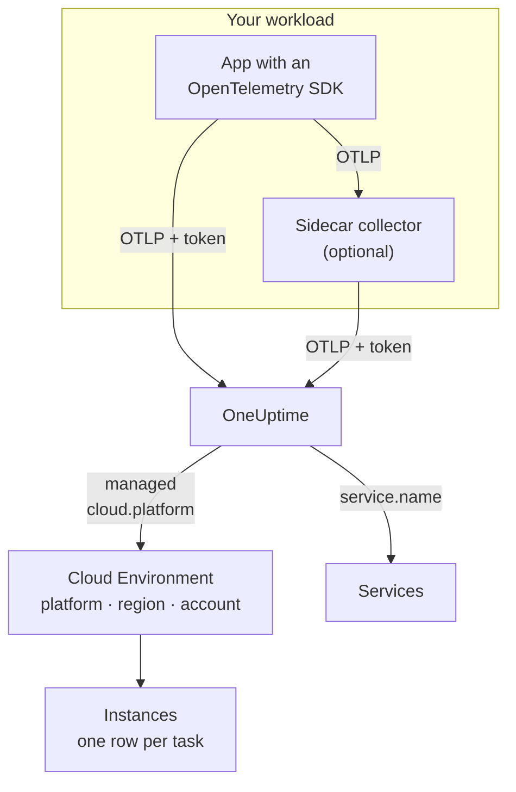

# Cloud Environments

A **Cloud Environment** is the place your containers run on a managed cloud platform: an ECS cluster's account and region, a Cloud Run project and region, a Container Apps subscription and region. OneUptime creates one the first time your telemetry arrives with the right resource attributes, and rolls up every workload that runs there. There is nothing to register by hand.

:::cards
- [AWS ECS / Fargate](/docs/telemetry/cloud-aws-ecs): Tasks on Fargate or EC2, with per-task CPU and memory.
- [Google Cloud Run](/docs/telemetry/cloud-gcp-cloud-run): Services and jobs, also listed as serverless functions.
- [Azure Container Apps](/docs/telemetry/cloud-azure-container-apps): Replicas, with the region and subscription set by hand.
- [Other Cloud Platforms](/docs/telemetry/cloud-other-platforms): Elastic Beanstalk, App Runner, App Engine, App Service and Container Instances.
:::

## How it works



- **A resource detector says where the workload runs.** An OpenTelemetry resource detector, in the SDK or in a collector, reads the platform's metadata and sets `cloud.platform`, `cloud.account.id` and `cloud.region` on everything the workload sends. Where no detector exists, you set them yourself.
- **The environment is the roll-up.** Every workload with the same platform, account and region lands in one environment. The services keep their own rows under **Services**.
- **Each running task is an instance.** The environment's **Instances** tab lists its running tasks, instances or replicas, with live CPU and memory where the platform can supply them.

## Before you begin

- **An ingestion key.** Create a **Server** key under **Project Settings → Telemetry & APM → Ingestion Keys** and copy its token: see [Create an ingestion key](/docs/telemetry/open-telemetry#create-an-ingestion-key). It is a secret: each platform page shows where to keep it in that cloud's secret store.
- **OpenTelemetry in your application.** An OpenTelemetry SDK that exports OTLP, or an OpenTelemetry Collector running beside the application.

## Supported platforms

| Platform                  | `cloud.platform`            | `cloud.*` filled in by | Instance identity                 | Guide                                                              |
| ------------------------- | --------------------------- | ---------------------- | --------------------------------- | ------------------------------------------------------------------ |
| AWS ECS / Fargate         | `aws_ecs`                   | resource detector      | `aws.ecs.task.arn`                | [AWS ECS / Fargate](/docs/telemetry/cloud-aws-ecs)                 |
| AWS Elastic Beanstalk     | `aws_elastic_beanstalk`     | resource detector      | `host.id`                         | [Other Cloud Platforms](/docs/telemetry/cloud-other-platforms)     |
| AWS App Runner            | `aws_app_runner`            | set by hand            | `host.name`                       | [Other Cloud Platforms](/docs/telemetry/cloud-other-platforms)     |
| Google Cloud Run          | `gcp_cloud_run`             | resource detector      | `faas.instance`                   | [Google Cloud Run](/docs/telemetry/cloud-gcp-cloud-run)            |
| Google App Engine         | `gcp_app_engine`            | resource detector      | `faas.instance`                   | [Other Cloud Platforms](/docs/telemetry/cloud-other-platforms)     |
| Azure Container Apps      | `azure_container_apps`      | resource detector      | `azure.container_app.instance.id` | [Azure Container Apps](/docs/telemetry/cloud-azure-container-apps) |
| Azure Container Instances | `azure_container_instances` | set by hand            | `host.name`                       | [Other Cloud Platforms](/docs/telemetry/cloud-other-platforms)     |
| Azure App Service         | `azure_app_service`         | resource detector      | `host.id`                         | [Other Cloud Platforms](/docs/telemetry/cloud-other-platforms)     |

- **Resource detector:** an OpenTelemetry resource detector, in the SDK or in the Collector's `resourcedetection` processor, sets the `cloud.*` attributes for you.
- **Set by hand:** no detector exists, so you put the attributes in `OTEL_RESOURCE_ATTRIBUTES`. The platform's page shows the exact line.
- **Azure detectors know less.** The Container Apps detectors know neither the region nor the subscription, and the App Service detectors do not know the subscription: set what is missing yourself.
- **Dotted Azure spellings work.** The Node.js and .NET Azure detectors write `azure.container_apps` and `azure.app_service`. OneUptime rewrites them to the underscore values above when it receives them.

## How OneUptime identifies an environment

One environment exists for each combination of three resource attributes:

| Attribute          | Required | What it is                                                                                  |
| ------------------ | -------- | ------------------------------------------------------------------------------------------- |
| `cloud.platform`   | Yes      | One of the values in [Supported platforms](#supported-platforms)                             |
| `cloud.account.id` | No       | The AWS account ID, Google Cloud project ID or Azure subscription ID                         |
| `cloud.region`     | No       | The region, such as `us-east-1`, `us-central1` or `eastus`                                  |

OneUptime joins the three with `|` into the **environment key**, and names the environment after the same values, such as _AWS ECS · us-east-1 · 123456789012_:

```text title="Environment keys"
aws_ecs|123456789012|us-east-1
gcp_cloud_run|my-project|us-central1
azure_container_apps|00000000-0000-0000-0000-000000000000|eastus
```

> [!IMPORTANT]
> A missing part stays in the key as an empty segment: `aws_ecs||us-east-1`. So a workload that leaves out `cloud.account.id` lands in a different environment from one that sets it. That is the usual reason for seeing two environments where you expected one.

### Instance identity

Within an environment, each running task, instance or replica gets one row under **Instances**. Its name comes from the first of these resource attributes the telemetry carries:

1. `aws.ecs.task.id`
2. `aws.ecs.task.arn` (shortened to the task ID)
3. `faas.instance`
4. `azure.container_app.instance.id`
5. `service.instance.id`
6. `container.id`
7. `host.id`
8. `host.name`

The platform's own identity comes first on purpose. A sidecar collector and the application's SDK both see it, and it survives restarts. An SDK usually makes up a new `service.instance.id` for every process (the Node.js SDK does by default), so keying on it first would split one ECS task into two rows. `service.instance.id` is used when the platform sets no identity of its own. The **Instance identity** column in [Supported platforms](#supported-platforms) names the attribute a typical setup on each platform uses.

### Environments you create by hand

You rarely need to: ingest creates environments for you. To create one ahead of its telemetry, open **Cloud → All Environments** and click **Create Cloud Resource**. Pick the **Cloud Platform**, then type the **Cloud Account ID** and **Cloud Region** exactly as your telemetry reports them. OneUptime builds the key `platform|account|region` from these three, and ingest matches an environment on its key alone. It names the environment as ingest would; to show another name, open **More fields** and type a **Display Name**.

## What is not a cloud environment

| You run on                                                                                        | Where it appears         | Why                                                                                                  |
| ------------------------------------------------------------------------------------------------- | ------------------------ | ---------------------------------------------------------------------------------------------------- |
| EC2, Compute Engine, Azure VM (`aws_ec2`, `gcp_compute_engine`, `azure_vm`)                       | **Hosts**                | A virtual machine is a host. See [Host OpenTelemetry Collector](/docs/telemetry/host-otel-collector) |
| EKS, GKE, AKS, self-managed Kubernetes                                                            | **Kubernetes**           | Routed by the `k8s.*` attributes. See [Kubernetes Agent](/docs/telemetry/kubernetes-agent)           |
| Lambda, Cloud Functions, Azure Functions (`aws_lambda`, `gcp_cloud_functions`, `azure_functions`) | **Serverless Functions** | Routed by `faas.name`, or `service.name` on a FaaS `cloud.platform`. See [Serverless Functions](/docs/telemetry/serverless-functions) |
| Load balancers, buckets, managed databases and other IaaS or PaaS resources                       | **Cloud Resources**      | Discovered from the metrics Azure Monitor, CloudWatch and Cloud Monitoring publish. See [Cloud Resources](/docs/telemetry/cloud-resources) |

> [!NOTE]
> Cloud Run and App Engine appear in two places on purpose. Their detector sets both a managed `cloud.platform` and `faas.name`, so each service is also a **Serverless Function** of its own, while the **Cloud Environment** groups every service in that project and region. The same telemetry is filed under both.

## Connect a workload

Each platform page has these steps with that cloud's own commands and console screens. In outline:

:::steps
### Put the cloud attributes on your telemetry

:::tabs
@tab Sidecar collector
A second container in the task, instance or replica. The application exports to `localhost:4318`, and the collector's `resourcedetection` processor stamps `cloud.*` on everything that passes through. The collector holds the token, and on ECS it also ships per-task CPU and memory:

```yaml title="collector.yaml"
processors:
  resourcedetection:
    detectors: [env, ecs] # [env, gcp] on Cloud Run and App Engine; [env, azurecontainerapps] on Container Apps
    timeout: 5s
```
@tab SDK direct
The application's SDK exports straight to OneUptime. Turn on the platform's resource detector in the SDK, such as `OTEL_NODE_RESOURCE_DETECTORS=env,host,os,aws` in Node.js: each platform page lists the switch for every language. There is no extra container, and no container CPU or memory.
:::

### Export OTLP to OneUptime

:::tabs
@tab Sidecar collector
```yaml title="collector.yaml"
exporters:
  otlphttp/oneuptime:
    endpoint: https://oneuptime.com/otlp
    headers:
      x-oneuptime-token: ${env:ONEUPTIME_TOKEN}

service:
  pipelines:
    traces:
      receivers: [otlp]
      processors: [resourcedetection, batch]
      exporters: [otlphttp/oneuptime]
    metrics:
      receivers: [otlp]
      processors: [resourcedetection, batch]
      exporters: [otlphttp/oneuptime]
    logs:
      receivers: [otlp]
      processors: [resourcedetection, batch]
      exporters: [otlphttp/oneuptime]
```

The collector expands `${env:ONEUPTIME_TOKEN}` from an environment variable the platform fills from its secret store: Secrets Manager, Secret Manager or Container Apps secrets.
@tab SDK direct
```bash
OTEL_EXPORTER_OTLP_ENDPOINT="https://oneuptime.com/otlp"
OTEL_EXPORTER_OTLP_HEADERS="x-oneuptime-token=YOUR_TELEMETRY_INGESTION_TOKEN"
```
:::

If you host OneUptime yourself, use `https://YOUR-ONEUPTIME-HOST/otlp`.

### Check the connection

```bash
curl -i https://oneuptime.com/otlp/v1/validate \
  -H "x-oneuptime-token: YOUR_TELEMETRY_INGESTION_TOKEN"
```

`200` with `"valid": true` means the token is accepted. `401` means it is unknown, revoked, disabled or expired, and the answer's `message` says which. Within a minute of the first span, log or metric, the environment appears under **Cloud → All Environments**.
:::

> [!TIP]
> The same steps are in the dashboard, with your token filled in: under **Cloud → All Environments** until your first environment arrives, and on every environment's **Documentation** tab.

## What you get

An environment's **Overview** shows:

- **Requests**, **Error rate** and **p95 latency**, from your traces, with charts of requests, errors and memory over the time range you pick.
- **CPU** and **Memory** across the live instances, and a **Top instances by CPU** list. They come from `container.cpu.utilization` and `container.memory.usage` metrics that carry the instance identity; on ECS, from the `awsecscontainermetrics` receiver's `ecs.task.cpu.utilized` and `ecs.task.memory.utilized`.
- **Instances**: how many reported in the last 15 minutes. The **Instances** tab has one row each.
- **Logs**, **Traces** and **Metrics** tabs, filtered to the environment.

An environment whose telemetry stops for 15 minutes shows **Disconnected**, and the next span, log or metric brings it back to **Connected**. Time when OneUptime itself was down or catching up does not count toward the 15 minutes.

### Labels and owners

- **From your telemetry:** a resource attribute such as `oneuptime.label.team=payments` adds the label `team:payments` to the environment.
- **From rules:** **Cloud → Settings → Label Rules** and **Owner Rules** add labels and owners to matching environments. See [Label and Owner Rules](/docs/configuration/label-and-owner-rules).

## Troubleshooting

[Cloud Troubleshooting](/docs/telemetry/cloud-troubleshooting) works through every failure in the order they happen: an environment that never appears, lands under **Hosts** or only under **Serverless Functions**, has no instances or no CPU and memory, shows **Disconnected**, splits into two, or was made by hand and never matches.

## Next steps

:::cards
- [AWS ECS / Fargate](/docs/telemetry/cloud-aws-ecs): The most common setup, with a complete task definition.
- [Cloud Troubleshooting](/docs/telemetry/cloud-troubleshooting): What to check when an environment is missing or wrong.
- [Cloud Resources (IaaS & PaaS)](/docs/telemetry/cloud-resources): Load balancers, buckets and managed databases, from your cloud's own monitoring.
- [Serverless Functions](/docs/telemetry/serverless-functions): Lambda, Cloud Functions and Azure Functions.
:::
