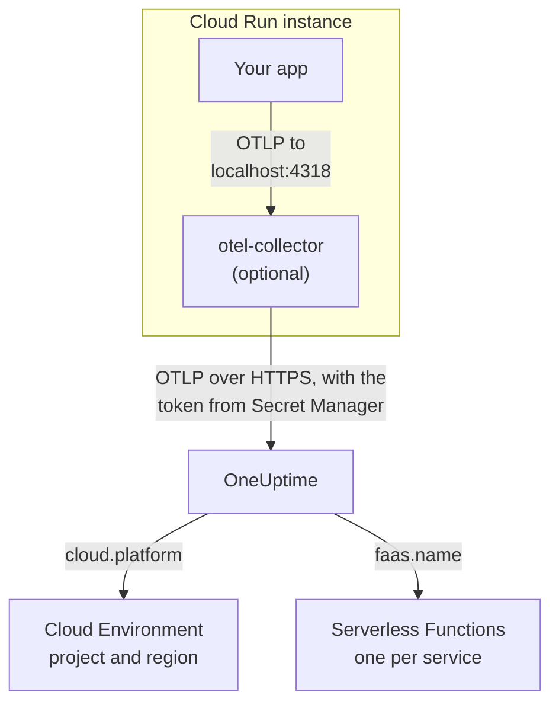

# Google Cloud Run

Send the traces, logs and metrics of your Cloud Run services and jobs to OneUptime. Everything that reports `cloud.platform=gcp_cloud_run` joins one **Cloud Environment** per Google Cloud project and region, such as _GCP Cloud Run · us-central1 · my-project_, and each service also appears under **Serverless Functions**.

:::cards
- [How it works](#how-it-works): What the GCP detector sets, and why a service appears in two places.
- [Set it up](#set-it-up): Store the token, configure the service, deploy and check.
- [The service YAML with a sidecar](#the-service-yaml-with-a-sidecar): A complete Cloud Run service with a collector.
- [Troubleshooting](#troubleshooting): Secret errors, sidecar ordering and missing environments.
:::

## How it works



The OpenTelemetry GCP resource detector reads the metadata server and the `K_SERVICE` and `K_REVISION` environment variables, and sets:

| Attribute          | Value on Cloud Run             | Used for                                                                                  |
| ------------------ | ------------------------------ | ----------------------------------------------------------------------------------------- |
| `cloud.platform`   | `gcp_cloud_run`                | Files the telemetry under **Cloud Environments**                                          |
| `cloud.account.id` | the project ID                 | Part of the environment key                                                               |
| `cloud.region`     | `us-central1`                  | Part of the environment key                                                               |
| `faas.name`        | the service name (`K_SERVICE`) | Also lists the service under **Serverless Functions**                                     |
| `faas.version`     | the revision (`K_REVISION`)    | Shown on the service's serverless function overview; the environment does not use it      |
| `faas.instance`    | the instance ID                | Names one running instance: one row each under **Instances**                              |

> [!NOTE]
> Cloud Run shows up in two places, on purpose. Because the detector sets `faas.name`, each service is also a **Serverless Function**, with its own invocations, error rate and duration. The **Cloud Environment** is the roll-up of every service in that project and region. Nothing is stored twice: the same telemetry is filed under both.

The environment key is `gcp_cloud_run|my-project|us-central1`.

## Before you begin

- **An ingestion key.** Create a **Server** key under **Project Settings → Telemetry & APM → Ingestion Keys** and copy its token.
- **`gcloud`**, signed in to the project, with the Secret Manager API turned on: `gcloud services enable secretmanager.googleapis.com`.
- **Your application instrumented with an OpenTelemetry SDK** that exports OTLP.

## Choose how telemetry leaves the service

|                 | SDK direct                                           | Sidecar collector                                                      |
| --------------- | ---------------------------------------------------- | ---------------------------------------------------------------------- |
| Extra container | None                                                 | `otel-collector` in the service                                        |
| Best for        | One service, and Cloud Run jobs                      | Several services in one project, or an SDK that cannot run a detector |
| Holds the token | The application                                      | The collector                                                          |
| The secret      | `oneuptime-otlp-headers`, the whole header           | `oneuptime-ingestion-token`, the bare token                            |

A job runs to completion, so there is nothing to keep a sidecar alive for: use SDK direct. Each step below has a tab for both; pick one and every step follows it.

## Set it up

:::steps
### Store the token in Secret Manager

> [!IMPORTANT]
> The token is a secret. Put it in Secret Manager and reference it from the service as a secret-backed environment variable. A plain environment variable is visible to every project viewer, in the console and in `gcloud run services describe`.

:::tabs
@tab SDK direct
```bash
printf '%s' "x-oneuptime-token=YOUR_TELEMETRY_INGESTION_TOKEN" | gcloud secrets create oneuptime-otlp-headers \
  --data-file=- \
  --replication-policy=automatic

gcloud secrets add-iam-policy-binding oneuptime-otlp-headers \
  --member="serviceAccount:checkout-api@my-project.iam.gserviceaccount.com" \
  --role="roles/secretmanager.secretAccessor"
```

Cloud Run puts a secret's value into the variable as it is, and `OTEL_EXPORTER_OTLP_HEADERS` needs the whole `name=value` pair, so this secret holds the complete header.
@tab Sidecar collector
```bash
printf '%s' "YOUR_TELEMETRY_INGESTION_TOKEN" | gcloud secrets create oneuptime-ingestion-token \
  --data-file=- \
  --replication-policy=automatic

gcloud secrets add-iam-policy-binding oneuptime-ingestion-token \
  --member="serviceAccount:checkout-api@my-project.iam.gserviceaccount.com" \
  --role="roles/secretmanager.secretAccessor"
```

The collector's configuration adds the header name, so this secret holds just the token.
:::

Put the service's runtime service account in `--member`, not your own user. Without `roles/secretmanager.secretAccessor`, the revision fails to deploy with `Permission denied on secret`. If the service still runs as the default compute service account, grant the role to that account, and consider giving the service an account of its own: the default one is shared by everything in the project.

### Configure the service

:::tabs
@tab SDK direct
1. **Google Cloud console → Cloud Run → click the service → Edit & deploy new revision**.
2. On the **Containers** tab, open your container and go to **Variables & Secrets**. Add the variables below.
3. Click **Reference a secret**, choose `oneuptime-otlp-headers`, version `latest`, and expose it as the environment variable `OTEL_EXPORTER_OTLP_HEADERS`.
4. On the **Security** tab, check that the **Service account** is the one you granted `roles/secretmanager.secretAccessor`.

```bash
OTEL_SERVICE_NAME=checkout-api
OTEL_EXPORTER_OTLP_ENDPOINT=https://oneuptime.com/otlp
OTEL_EXPORTER_OTLP_PROTOCOL=http/protobuf
# Secret-backed (Variables & Secrets → Reference a secret), not typed here.
OTEL_EXPORTER_OTLP_HEADERS=x-oneuptime-token=YOUR_TELEMETRY_INGESTION_TOKEN
```

Then turn on your language's GCP resource detector:

| Language | Turn on the GCP detector                                                                                            |
| -------- | ------------------------------------------------------------------------------------------------------------------- |
| Node.js  | `OTEL_NODE_RESOURCE_DETECTORS=env,host,os,gcp` (auto-instrumentations-node)                                         |
| Python   | `pip install opentelemetry-resourcedetector-gcp`, then `OTEL_EXPERIMENTAL_RESOURCE_DETECTORS=gcp_resource_detector` |
| Java     | `-Dotel.resource.providers.gcp.enabled=true`                                                                        |
| Go       | `import "go.opentelemetry.io/contrib/detectors/gcp"` and pass `gcp.NewDetector()` to `resource.New`                 |
| .NET     | The `OpenTelemetry.Resources.Gcp` package: `.ConfigureResource(r => r.AddGcpDetector())`                            |

Or set it all from the CLI:

```bash
gcloud run services update checkout-api --region us-central1 \
  --set-env-vars "^@^OTEL_SERVICE_NAME=checkout-api@OTEL_EXPORTER_OTLP_ENDPOINT=https://oneuptime.com/otlp@OTEL_EXPORTER_OTLP_PROTOCOL=http/protobuf@OTEL_NODE_RESOURCE_DETECTORS=env,host,os,gcp" \
  --set-secrets "OTEL_EXPORTER_OTLP_HEADERS=oneuptime-otlp-headers:latest"
```

The `^@^` prefix makes `gcloud` split that flag's list on `@` instead of `,`. Without it, `gcloud` splits `OTEL_NODE_RESOURCE_DETECTORS=env,host,os,gcp` at every comma and fails with `Bad syntax for dict arg [host]`.
@tab Sidecar collector
1. **Google Cloud console → Cloud Run → click the service → Edit & deploy new revision**.
2. On the **Containers** tab, open your container and go to **Variables & Secrets**. Add the application variables below.
3. Click **+ Add container**. Set the container image URL to `otel/opentelemetry-collector-contrib:latest`, and under **Container command and arguments** add the argument `--config=env:OTEL_COLLECTOR_CONFIG`.
4. On the new container's **Variables & Secrets** tab, **Reference a secret**: `oneuptime-ingestion-token`, as the environment variable `ONEUPTIME_TOKEN`. Add the variable `OTEL_COLLECTOR_CONFIG` with the collector configuration from [The service YAML with a sidecar](#the-service-yaml-with-a-sidecar).
5. On the collector's **Settings** tab, add a **Startup probe** (HTTP, path `/`, port `13133`), and under **Container start-up order** make your container depend on `otel-collector`.
6. On the **Security** tab, check that the **Service account** is the one you granted `roles/secretmanager.secretAccessor`.

Containers in one Cloud Run instance share `localhost`, so the application exports to the sidecar there:

```bash
OTEL_SERVICE_NAME=checkout-api
OTEL_EXPORTER_OTLP_ENDPOINT=http://localhost:4318
OTEL_EXPORTER_OTLP_PROTOCOL=http/protobuf
```

From the CLI, the sidecar is the service YAML below, deployed with `gcloud run services replace service.yaml --region us-central1`.
:::

If you host OneUptime yourself, use `https://YOUR-ONEUPTIME-HOST/otlp` as the endpoint.

### Deploy the new revision

In the console, click **Deploy**. Cloud Run starts a new revision with the settings and sends traffic to it once it is ready. The `gcloud` commands deploy a new revision on their own.

### Check the connection

```bash
curl -i https://oneuptime.com/otlp/v1/validate \
  -H "x-oneuptime-token: YOUR_TELEMETRY_INGESTION_TOKEN"
```

`200` with `"valid": true` means the token is accepted. `401` means it is unknown, revoked, disabled or expired. Then send one request to the service, and read the collector's logs in Cloud Logging (filter on the `otel-collector` container) for `401`, `connection refused` or `context deadline exceeded`. Within a minute, the environment appears under **Cloud → All Environments** as _GCP Cloud Run · us-central1 · my-project_, and the service under **Serverless Functions**.
:::

## The service YAML with a sidecar

The collector reads its whole configuration from `OTEL_COLLECTOR_CONFIG` (`--config=env:OTEL_COLLECTOR_CONFIG`), and the token from the secret through `${env:ONEUPTIME_TOKEN}`. The `run.googleapis.com/container-dependencies` annotation makes Cloud Run start the collector first, and wait for its startup probe before it starts the application:

```yaml title="service.yaml"
apiVersion: serving.knative.dev/v1
kind: Service
metadata:
  name: checkout-api
spec:
  template:
    metadata:
      annotations:
        # "app" depends on "otel-collector": the collector starts first and
        # must pass its startup probe before the app container is started.
        run.googleapis.com/container-dependencies: '{"app":["otel-collector"]}'
    spec:
      serviceAccountName: checkout-api@my-project.iam.gserviceaccount.com
      containers:
        - name: app
          image: us-central1-docker.pkg.dev/my-project/apps/checkout-api:1.4.2
          ports:
            - containerPort: 8080
          env:
            - name: OTEL_SERVICE_NAME
              value: checkout-api
            - name: OTEL_EXPORTER_OTLP_ENDPOINT
              value: http://localhost:4318
            - name: OTEL_EXPORTER_OTLP_PROTOCOL
              value: http/protobuf
        - name: otel-collector
          image: otel/opentelemetry-collector-contrib:latest
          args:
            - --config=env:OTEL_COLLECTOR_CONFIG
          env:
            - name: ONEUPTIME_TOKEN
              valueFrom:
                secretKeyRef:
                  name: oneuptime-ingestion-token
                  key: latest
            - name: OTEL_COLLECTOR_CONFIG
              value: |
                receivers:
                  otlp:
                    protocols:
                      http:
                        endpoint: 0.0.0.0:4318
                      grpc:
                        endpoint: 0.0.0.0:4317
                processors:
                  # Stamps cloud.provider, cloud.platform=gcp_cloud_run,
                  # cloud.account.id, cloud.region and faas.* on everything.
                  resourcedetection:
                    detectors: [env, gcp]
                    timeout: 5s
                  batch: {}
                exporters:
                  otlphttp/oneuptime:
                    endpoint: https://oneuptime.com/otlp
                    headers:
                      x-oneuptime-token: ${env:ONEUPTIME_TOKEN}
                extensions:
                  health_check:
                    endpoint: 0.0.0.0:13133
                service:
                  extensions: [health_check]
                  pipelines:
                    traces:
                      receivers: [otlp]
                      processors: [resourcedetection, batch]
                      exporters: [otlphttp/oneuptime]
                    metrics:
                      receivers: [otlp]
                      processors: [resourcedetection, batch]
                      exporters: [otlphttp/oneuptime]
                    logs:
                      receivers: [otlp]
                      processors: [resourcedetection, batch]
                      exporters: [otlphttp/oneuptime]
          startupProbe:
            httpGet:
              path: /
              port: 13133
            periodSeconds: 2
            failureThreshold: 15
          resources:
            limits:
              cpu: 500m
              memory: 256Mi
```

Deploy it:

```bash
gcloud run services replace service.yaml --region us-central1
```

Only the container that receives requests (`app`) declares `ports`; a sidecar must not.

## Networking

- **By default**, a Cloud Run service reaches the internet directly, and exporting to `oneuptime.com` needs nothing more.
- **With VPC egress: All traffic** (`--vpc-egress all-traffic`, through Direct VPC egress or a Serverless VPC Access connector), outbound traffic leaves through your VPC, which then needs Cloud NAT (or a route to a proxy) to reach the OneUptime host. With the default `private-ranges-only`, only private addresses use the VPC and OneUptime is reached directly.
- **Firewall egress rules** in the VPC must allow TCP 443 to the OneUptime host.
- **A self-hosted OneUptime inside the VPC** is the reverse case: route traffic through the VPC (`private-ranges-only` or `all-traffic`), so `https://YOUR-ONEUPTIME-HOST/otlp` resolves there.

## What you get

- **Overview**: requests, error rate and p95 latency from your traces.
- **Instances**: one row per Cloud Run instance, named by `faas.instance`. Cloud Run does not show a container's resource usage to a sidecar, so the **CPU** and **Memory** tiles stay empty unless you send `container.cpu.utilization` and `container.memory.usage` metrics with the same `faas.instance` yourself. Read the requests tiles here, and leave instance CPU and memory to Cloud Monitoring.
- **Logs**, **Traces** and **Metrics**, filtered to the environment.
- The same service under **Serverless Functions** (by `faas.name`) and under **Services** (by `service.name`).

## Troubleshooting

:::details The revision fails with "Permission denied on secret"
The runtime service account lacks `roles/secretmanager.secretAccessor` on the secret, or the binding is on a different secret from the one the service references. Run the `gcloud secrets add-iam-policy-binding` command again with the runtime service account as `--member`.
:::

:::details Cloud Run rejects container-dependencies
The annotation names a container that does not exist, or the collector has no startup probe, so Cloud Run cannot tell when it is ready.
:::

:::details The service is under Serverless Functions, but no environment exists
The telemetry has no `cloud.platform`: the GCP detector is not turned on in the SDK, or `gcp` is missing from the collector's `detectors` list.
:::

:::details The environment is there, but Instances is empty
The telemetry has neither `faas.instance` nor `service.instance.id`. The cause is the same: the detector does not run.
:::

An environment that never appears, shows **Disconnected** or splits in two is covered on [Cloud Troubleshooting](/docs/telemetry/cloud-troubleshooting).

## Next steps

:::cards
- [Cloud Environments](/docs/telemetry/cloud-environments): How environments and instances are identified.
- [Serverless Functions](/docs/telemetry/serverless-functions): The per-service view of each Cloud Run service.
- [Cloud Troubleshooting](/docs/telemetry/cloud-troubleshooting): The failures every platform shares.
- [Cloud Resources (IaaS & PaaS)](/docs/telemetry/cloud-resources): Your Cloud SQL, load balancers and buckets, from Cloud Monitoring.
:::
