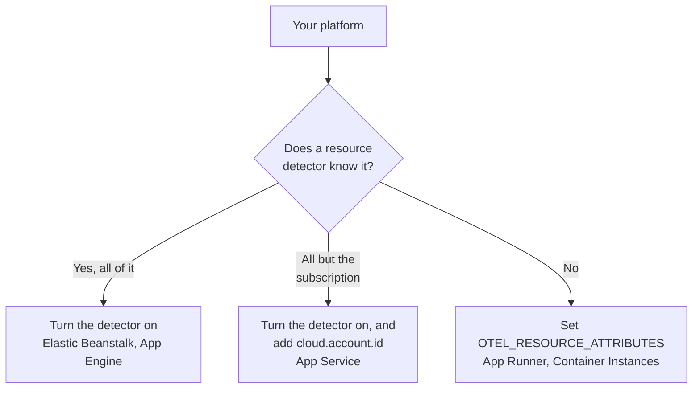

# Other Cloud Platforms

Set up the managed platforms that have no page of their own: AWS Elastic Beanstalk, AWS App Runner, Google App Engine, Azure App Service and Azure Container Instances. The rule is the one on every platform: telemetry that carries a managed `cloud.platform`, with `cloud.account.id` and `cloud.region`, joins one **Cloud Environment** per platform, account and region, and an instance identity gives each running instance a row under **Instances**.

:::cards
- [AWS Elastic Beanstalk](#aws-elastic-beanstalk): A collector on each instance, with the Beanstalk and EC2 detectors.
- [AWS App Runner](#aws-app-runner): The attributes set by hand, the token from Secrets Manager.
- [Google App Engine](#google-app-engine): The GCP detector, with the settings in `app.yaml`.
- [Azure App Service](#azure-app-service): The Azure detectors, a Key Vault reference and the subscription by hand.
- [Azure Container Instances](#azure-container-instances): The attributes set by hand, the token as a secure variable.
:::

## What each platform needs

What differs between these platforms is who sets the `cloud.*` attributes, and where the settings go in the cloud's console:



| Platform                  | `cloud.platform`            | `cloud.*` filled in by                                                                     | Instance identity                                           |
| ------------------------- | --------------------------- | ------------------------------------------------------------------------------------------ | ----------------------------------------------------------- |
| AWS Elastic Beanstalk     | `aws_elastic_beanstalk`     | The Collector's `elastic_beanstalk` and `ec2` detectors; Node.js `aws`                     | `host.id` (drop the deployment's `service.instance.id`)     |
| AWS App Runner            | `aws_app_runner`            | You (no detector)                                                                          | `host.name`                                                 |
| Google App Engine         | `gcp_app_engine`            | The `gcp` detector (the Collector's and every SDK's)                                       | `faas.instance`                                             |
| Azure App Service         | `azure_app_service`         | The Collector's `azureappservice`, the Node.js and .NET `azure` detectors; `cloud.account.id` by you | `service.instance.id`, then `host.id`                       |
| Azure Container Instances | `azure_container_instances` | You (no detector)                                                                          | `host.name`                                                 |

Every section below needs a **Server** ingestion key from **Project Settings → Telemetry & APM → Ingestion Keys**, and an application instrumented with an OpenTelemetry SDK. If you host OneUptime yourself, replace `https://oneuptime.com/otlp` with `https://YOUR-ONEUPTIME-HOST/otlp`.

> [!IMPORTANT]
> The token is a secret on every one of these platforms. Each section names the platform's secret store. A token typed into a plain environment variable can be read by everyone who can read the app's configuration.

## AWS Elastic Beanstalk

`cloud.platform`: `aws_elastic_beanstalk`. The Beanstalk detector reads `/var/elasticbeanstalk/xray/environment.conf` on the instance and sets `cloud.platform`, `service.instance.id`, `service.version` and the environment name. It does **not** know the account or the region, so pair it with the EC2 detector, which does, and which also sets `host.id`.

Run an OpenTelemetry Collector on each instance, with this configuration:

```yaml title="config.yaml"
receivers:
  otlp:
    protocols:
      http:
        endpoint: 0.0.0.0:4318
      grpc:
        endpoint: 0.0.0.0:4317
processors:
  # elastic_beanstalk sets cloud.platform and service.instance.id; ec2 adds
  # cloud.account.id, cloud.region and host.id. The first detector to set an
  # attribute wins, so elastic_beanstalk comes first.
  resourcedetection:
    detectors: [env, elastic_beanstalk, ec2]
    timeout: 5s
  # The Beanstalk detector's service.instance.id is the deployment ID, shared
  # by every instance of a deployment: drop it, so that ec2's host.id names
  # each instance.
  resource:
    attributes:
      - key: service.instance.id
        action: delete
  batch: {}
exporters:
  otlphttp/oneuptime:
    endpoint: https://oneuptime.com/otlp
    headers:
      x-oneuptime-token: ${env:ONEUPTIME_TOKEN}
service:
  pipelines:
    traces:
      receivers: [otlp]
      processors: [resourcedetection, resource, batch]
      exporters: [otlphttp/oneuptime]
    metrics:
      receivers: [otlp]
      processors: [resourcedetection, resource, batch]
      exporters: [otlphttp/oneuptime]
    logs:
      receivers: [otlp]
      processors: [resourcedetection, resource, batch]
      exporters: [otlphttp/oneuptime]
```

:::steps
1. Store the token in Secrets Manager: `aws secretsmanager create-secret --name oneuptime/ingestion-token --secret-string "YOUR_TELEMETRY_INGESTION_TOKEN"`. Beanstalk's environment properties are kept in the environment's configuration, not in a secret store, so read the secret from a platform hook instead, with the instance profile. The instance profile needs `secretsmanager:GetSecretValue` on it.
2. Install the collector from a `.platform/hooks/postdeploy/` script (or `.ebextensions`): the `otelcol-contrib` package, with the configuration above and the secret in its environment as `ONEUPTIME_TOKEN`.
3. **AWS Console → Elastic Beanstalk → Environments → your environment → Configuration**.
4. In the **Updates, monitoring, and logging** category, click **Edit** and scroll to **Environment properties**. Add `OTEL_SERVICE_NAME`, `OTEL_EXPORTER_OTLP_ENDPOINT` set to `http://localhost:4318`, and `OTEL_EXPORTER_OTLP_PROTOCOL` set to `http/protobuf`.
5. Click **Apply**. Beanstalk restarts the application with the new properties.
:::

Node.js applications can skip the collector: the SDK's detectors include Beanstalk and EC2. Set `OTEL_EXPORTER_OTLP_ENDPOINT` to `https://oneuptime.com/otlp`, `OTEL_EXPORTER_OTLP_HEADERS` to `x-oneuptime-token=YOUR_TELEMETRY_INGESTION_TOKEN` and `OTEL_NODE_RESOURCE_DETECTORS=env,host,os,aws`. The token then sits in an environment property. Check the resource attributes of a trace afterwards: if `cloud.platform` reads `aws_ec2`, your SDK version let the EC2 detector win, and the collector is the reliable path.

**Networking:** instances in a private subnet need a NAT gateway, and the instance security group must allow egress on TCP 443 to the OneUptime host.

## AWS App Runner

`cloud.platform`: `aws_app_runner`. No detector exists, so you set the attributes yourself. App Runner can put a Secrets Manager (or SSM Parameter Store) secret into an environment variable.

```bash
OTEL_SERVICE_NAME=checkout-api
OTEL_EXPORTER_OTLP_ENDPOINT=https://oneuptime.com/otlp
OTEL_EXPORTER_OTLP_PROTOCOL=http/protobuf
# From Secrets Manager: the secret holds the whole header.
OTEL_EXPORTER_OTLP_HEADERS=x-oneuptime-token=YOUR_TELEMETRY_INGESTION_TOKEN
OTEL_RESOURCE_ATTRIBUTES=cloud.provider=aws,cloud.platform=aws_app_runner,cloud.region=us-east-1,cloud.account.id=123456789012
OTEL_NODE_RESOURCE_DETECTORS=env,host,os
```

Replace the region and the account ID with your own. The `host` detector supplies `host.name`, the container's hostname, which is different for each App Runner instance, and OneUptime names the instance by it.

:::steps
1. Store the whole header in Secrets Manager: `aws secretsmanager create-secret --name oneuptime/otlp-headers --secret-string "x-oneuptime-token=YOUR_TELEMETRY_INGESTION_TOKEN"`. App Runner puts the secret's value into the variable as it is.
2. **AWS Console → App Runner → Services → your service → Configuration → Configure service** (in the **Configuration** tab, click **Edit**).
3. Under **Environment variables**, click **Add environment variable** for each plain value above.
4. Add `OTEL_EXPORTER_OTLP_HEADERS` with **Source: Secrets Manager** and the secret's ARN. Under **Security → Instance role**, pick a role with `secretsmanager:GetSecretValue` on the secret: the instance role, not the access role that pulls the image.
5. Click **Save changes**. App Runner deploys a new version.
:::

**Networking:** a service without a VPC connector reaches the internet directly. With **Outgoing network traffic: Custom VPC**, egress goes through your VPC, which needs a NAT gateway and a security group egress rule on TCP 443 to the OneUptime host.

## Google App Engine

`cloud.platform`: `gcp_app_engine`. The GCP detector recognizes App Engine standard and flexible from `GAE_SERVICE`, `GAE_VERSION` and `GAE_INSTANCE` and the metadata server. It sets `cloud.account.id` (the project), `cloud.region`, `faas.name`, `faas.version` and `faas.instance`. As on Cloud Run, `faas.name` makes each App Engine service appear under **Serverless Functions** as well, while the environment groups the project and region.

| Language | Turn on the GCP detector                                                                                            |
| -------- | ------------------------------------------------------------------------------------------------------------------- |
| Node.js  | `OTEL_NODE_RESOURCE_DETECTORS=env,host,os,gcp`                                                                      |
| Python   | `pip install opentelemetry-resourcedetector-gcp`, then `OTEL_EXPERIMENTAL_RESOURCE_DETECTORS=gcp_resource_detector` |
| Java     | `-Dotel.resource.providers.gcp.enabled=true`                                                                        |
| Go       | `go.opentelemetry.io/contrib/detectors/gcp` → `gcp.NewDetector()`                                                   |
| .NET     | `OpenTelemetry.Resources.Gcp` → `.AddGcpDetector()`                                                                 |

App Engine has no console editor for environment variables: they live in `app.yaml`.

```yaml title="app.yaml"
runtime: nodejs22
env_variables:
  OTEL_SERVICE_NAME: checkout-api
  OTEL_EXPORTER_OTLP_ENDPOINT: https://oneuptime.com/otlp
  OTEL_EXPORTER_OTLP_PROTOCOL: http/protobuf
  OTEL_NODE_RESOURCE_DETECTORS: env,host,os,gcp
  # Do not commit the real value. Template it in CI, or read the secret at
  # start-up with the Secret Manager client instead.
  OTEL_EXPORTER_OTLP_HEADERS: x-oneuptime-token=YOUR_TELEMETRY_INGESTION_TOKEN
```

:::steps
1. Store the whole header in **Secret Manager**: `printf '%s' "x-oneuptime-token=YOUR_TELEMETRY_INGESTION_TOKEN" | gcloud secrets create oneuptime-otlp-headers --data-file=-`. Grant the App Engine service account (`my-project@appspot.gserviceaccount.com`) `roles/secretmanager.secretAccessor` on it.
2. Put the secret into `app.yaml` in your deploy pipeline, keeping a placeholder in the committed file. Or read `projects/PROJECT_ID/secrets/oneuptime-otlp-headers/versions/latest` at start-up and pass it to the exporter's `headers` option in code.
3. Deploy with `gcloud app deploy`. In the console, **App Engine → Versions** shows the new version, and **App Engine → Services** shows the service that appears under **Serverless Functions**.
:::

**Networking:** App Engine standard reaches the internet directly. Flexible environment instances live in a VPC: if the subnet has no external IPs, they need Cloud NAT, and a firewall egress rule on TCP 443 to the OneUptime host.

## Azure App Service

`cloud.platform`: `azure_app_service`. The Node.js and .NET Azure detectors, and the Collector's `azureappservice` detector, read the `WEBSITE_*` variables App Service sets. They fill in `cloud.platform`, `cloud.region`, `service.instance.id` (from `WEBSITE_INSTANCE_ID`), `deployment.environment` (the slot) and `host.id`. None of them sets `cloud.account.id`: add the subscription ID yourself, or the environment key gets an empty account segment.

```bash
OTEL_SERVICE_NAME=checkout-api
OTEL_EXPORTER_OTLP_ENDPOINT=https://oneuptime.com/otlp
OTEL_EXPORTER_OTLP_PROTOCOL=http/protobuf
# The Key Vault reference, which resolves to the whole header.
OTEL_EXPORTER_OTLP_HEADERS=@Microsoft.KeyVault(SecretUri=https://my-vault.vault.azure.net/secrets/oneuptime-otlp-headers/)
OTEL_RESOURCE_ATTRIBUTES=cloud.account.id=00000000-0000-0000-0000-000000000000
# Node.js:
OTEL_NODE_RESOURCE_DETECTORS=env,host,os,azure
```

The SDK detectors spell the platform `azure.app_service`, with a dot; OneUptime rewrites it to `azure_app_service` when it receives it. In .NET, add `OpenTelemetry.Resources.Azure` and call `.ConfigureResource(r => r.AddAzureAppServiceDetector())`. Other languages add `cloud.provider=azure,cloud.platform=azure_app_service,cloud.region=<region>` to `OTEL_RESOURCE_ATTRIBUTES`, and take `service.instance.id` from `WEBSITE_INSTANCE_ID` in code.

:::steps
1. Turn on the app's **system-assigned managed identity** (**Settings → Identity**), and grant it **Key Vault Secrets User** on the vault. Store the whole header, `x-oneuptime-token=YOUR_TELEMETRY_INGESTION_TOKEN`, as the secret `oneuptime-otlp-headers`.
2. **Azure portal → App Services → your app → Settings → Environment variables** (**Configuration → Application settings** on older portals).
3. **+ Add** each variable above. The value of `OTEL_EXPORTER_OTLP_HEADERS` is the Key Vault reference.
4. Click **Apply**, then **Confirm**: the app restarts with the new settings. Deployment slots have their own settings: mark the token as a **deployment slot setting** if only one slot should send telemetry.
:::

**Networking:** App Service reaches the internet directly unless **VNet integration** with **Route All** is on. Then the VNet needs a NAT gateway, or a route to a firewall that allows TCP 443 to the OneUptime host.

## Azure Container Instances

`cloud.platform`: `azure_container_instances`. No detector exists, so you set the attributes yourself. A container group's environment variables are fixed at creation: changing one means creating the group again. Pass the token with `--secure-environment-variables`, so `az container show` does not return it:

```bash
az container create \
  --resource-group my-rg \
  --name checkout-api \
  --image myregistry.azurecr.io/checkout-api:1.4.2 \
  --location eastus \
  --environment-variables \
    OTEL_SERVICE_NAME=checkout-api \
    OTEL_EXPORTER_OTLP_ENDPOINT=https://oneuptime.com/otlp \
    OTEL_EXPORTER_OTLP_PROTOCOL=http/protobuf \
    "OTEL_RESOURCE_ATTRIBUTES=cloud.provider=azure,cloud.platform=azure_container_instances,cloud.region=eastus,cloud.account.id=00000000-0000-0000-0000-000000000000" \
    OTEL_NODE_RESOURCE_DETECTORS=env,host,os \
  --secure-environment-variables \
    "OTEL_EXPORTER_OTLP_HEADERS=x-oneuptime-token=YOUR_TELEMETRY_INGESTION_TOKEN"
```

The `host` detector's `host.name`, the container group's hostname, names the instance. A sidecar collector works here too, since a container group runs several containers like an ECS task: use the `detectors: [env]` plus `OTEL_RESOURCE_ATTRIBUTES` pattern from [Azure Container Apps](/docs/telemetry/cloud-azure-container-apps). It is also what fills the **CPU** and **Memory** tiles, if it sends `container.cpu.utilization` and `container.memory.usage` with the group's identity.

:::steps
1. **Azure portal → Container Instances → + Create**. Fill in the **Basics** tab: resource group, name, region and image.
2. On the **Advanced** tab, under **Environment variables**, add each variable. For `OTEL_EXPORTER_OTLP_HEADERS`, set **Mark as secure** to **Yes**, so the portal and the API do not show its value.
3. Click **Review + create**, then **Create**. To change a variable later, delete the group and create it again.
:::

**Networking:** a container group with a public IP reaches the internet directly. One in a VNet subnet goes out only through the VNet's route: add a NAT gateway, or allow TCP 443 to the OneUptime host on the firewall or NSG.

## Check the connection

Whichever platform you set up, check the token first, then look for the environment:

```bash
curl -i https://oneuptime.com/otlp/v1/validate \
  -H "x-oneuptime-token: YOUR_TELEMETRY_INGESTION_TOKEN"
```

`200` with `"valid": true` means the token is accepted. `401` means it is unknown, revoked, disabled or expired. Within a minute of the first span, log or metric, the environment appears under **Cloud → All Environments**, named after the platform, region and account.

## Troubleshooting

:::details Beanstalk instances show up under Hosts
The EC2 detector's `cloud.platform=aws_ec2` won. The first detector to set an attribute wins, so keep `elastic_beanstalk` ahead of `ec2` in `detectors`. Without a collector, the Node.js SDK can favor the EC2 detector too: run the collector.
:::

:::details Every Beanstalk instance shares one row under Instances
The Beanstalk detector's `service.instance.id` is the deployment ID, shared by every instance of a deployment, and it is read before `host.id`. Keep the `resource` processor that deletes it in every pipeline.
:::

:::details An App Service app gets 401
The Key Vault reference did not resolve, so App Service passed the literal `@Microsoft.KeyVault(...)` text through as the header. Give the app's managed identity **Key Vault Secrets User** on the vault, and check that the secret holds the whole header `x-oneuptime-token=...`.
:::

:::details An App Service environment has an empty account segment
None of the App Service detectors sets `cloud.account.id`. Add the subscription ID to `OTEL_RESOURCE_ATTRIBUTES` on every app: telemetry with and without it lands in two environments.
:::

:::details A changed Container Instances variable has no effect
A container group's environment variables are fixed at creation. Delete the group and create it again with the new values.
:::

See [Cloud Troubleshooting](/docs/telemetry/cloud-troubleshooting) for the rest, in particular an environment that appears under **Hosts**, only under **Serverless Functions** (App Engine without the GCP detector), or twice (`cloud.account.id` set on some deployments and not others).

## Next steps

:::cards
- [Cloud Environments](/docs/telemetry/cloud-environments): How environments and instances are identified.
- [Cloud Troubleshooting](/docs/telemetry/cloud-troubleshooting): The failures every platform shares.
- [Serverless Functions](/docs/telemetry/serverless-functions): Lambda, Cloud Functions and Azure Functions.
- [Cloud Resources (IaaS & PaaS)](/docs/telemetry/cloud-resources): The resources around your apps, from your cloud's own monitoring.
:::
