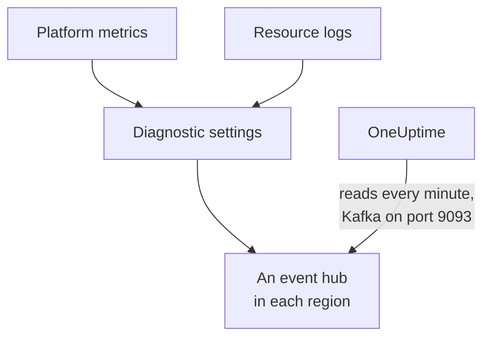

# Stream Azure Monitor Metrics and Logs

A connected Azure subscription can stream its Azure Monitor metrics and resource logs to OneUptime. Diagnostic settings send them to event hubs in your subscription, and OneUptime reads the event hubs every minute: most key metrics arrive within minutes of Azure Monitor having them, instead of at the connection's next read, and resource logs arrive as OneUptime logs, each filed under the resource it is about. One command in Azure Cloud Shell sets it up, and there is nothing to run.

:::cards
- [How it works](#how-it-works): Diagnostic settings send to an event hub in each region, and OneUptime reads them.
- [Set up streaming](#set-up-streaming): Choose what to stream, turn reading on and run one command.
- [What arrives](#what-arrives): Metrics on the resources they measure, and logs on the resources they come from.
- [What the command creates](#what-the-command-creates): Every resource and permission the command makes in your subscription.
- [Stop streaming](#stop-streaming): Stop reading, then delete what the command made.
:::

## How it works



- **An event hub in each region.** A diagnostic setting sends only to an event hub in its resource's own region, so the command makes an Event Hubs namespace in each region your resources are in, all in one resource group, and points each resource's diagnostic setting at its region's.
- **OneUptime reads them.** Azure Monitor sends only to an event hub, a storage account or a Log Analytics workspace, never to an address of yours: an event hub that OneUptime reads is the way that needs nothing of yours to run. OneUptime signs in as the connection's own app, which may read those event hubs and nothing else.
- **The reads leave streamed metrics to the stream.** While the stream delivers a resource type's key metrics in a region, the connection's reads stop writing the ones it carries, so no data point is counted twice, and keep writing [the ones it cannot carry](#what-arrives). The reads go on finding resources, their health and their changes, and take the metrics back after 15 minutes without an event.
- **Nothing is lost while OneUptime cannot read.** Events wait in the event hubs until OneUptime reads them, for as long as the event hubs keep them, and OneUptime keeps where it read each partition to, so it picks up where it stopped.

## Before you begin

- **A connected Azure subscription.** Connect it under **Cloud → Connect** first: see [Connect a Cloud Account](/docs/telemetry/cloud-accounts).
- **A project owner or admin.** Only they can turn reading on and stop streaming.
- **Azure Cloud Shell**, signed in as an **Owner** of the subscriptions, or a **Contributor** who is also a **User Access Administrator**: the command makes a resource group and a role assignment, and changes diagnostic settings.
- **A way out to Azure, on a self-hosted OneUptime.** OneUptime reads each namespace at `<namespace>.servicebus.windows.net` on port 9093, and the namespaces take connections from the internet.

## Set up streaming

:::steps
### Open the streaming dialog

Go to **Cloud → Connect**, and on the Azure subscription's row choose **Stream metrics and logs**.

### Choose what to stream

**Metrics** streams each resource's key metrics a minute at a time, the metrics OneUptime charts and judges each resource by, except [those a diagnostic setting cannot send](#what-arrives), which the connection keeps reading. **Metrics and logs** adds each resource's own logs, every category Azure keeps for it, and **Logs** streams resource logs alone.

### Turn on reading

Choose **Turn on reading**. OneUptime looks for the event hubs every minute, and waits for them until the command has made them.

### Run the command in Azure Cloud Shell

Copy the command, run it in Azure Cloud Shell and wait for it to finish. It says each region it made an event hub in, how many resources send to them, and which resources it left out, with Azure's reason.

### Wait for the first events

The dialog asks every few seconds what arrived. Azure starts sending within a few minutes of the command finishing; the dialog then says what came from where, and the connection's row says **Streaming**.
:::

**More fields** holds the rest:

| Field | What it does |
| --- | --- |
| **Subscriptions** | The subscriptions to stream from: at first, the ones the connection reads. The first holds the event hubs, and OneUptime reads them there. At most 50 |
| **Set it up another way** | The names the command uses, to set it up with Terraform or the portal |

When the connection has read no subscription yet, or more than 50, the dialog asks for **Subscriptions** before its steps instead.

When the first subscription is not the one OneUptime reads the event hubs in, the dialog says so: choose **Read them there** before you run the command.

## What arrives

| What | Where it lands |
| --- | --- |
| Key metrics | On the cloud resources they measure, in the same series the connection's reads write |
| Resource logs | In the Logs explorer, under the connection's telemetry service, with the subscription, region and category as attributes |
| Logs of a resource OneUptime knows | On that resource too: its page in Cloud gains a **Logs** tab |

The stream carries the key metrics the connection reads a minute at a time. The reads keep writing the rest on their schedule: a metric they read at a coarser grain, such as a container registry's storage used, and every key metric a diagnostic setting cannot send, which Azure Monitor's list of supported metrics marks No under DS Export:

- Virtual machines and scale sets: `Network In Total`, `Network Out Total`.
- Disks: `Composite Disk Read Bytes/sec`, `Composite Disk Write Bytes/sec`, `Composite Disk Read Operations/sec`, `Composite Disk Write Operations/sec`.
- Azure Cosmos DB accounts: `TotalRequests`, `TotalRequestUnits`, `NormalizedRUConsumption`, `ServerSideLatency`.
- Storage accounts: `UsedCapacity`.
- AKS clusters: `kube_pod_status_ready`.
- Application gateways: `ApplicationGatewayTotalTime`, `Throughput`.
- Firewalls: `Throughput`.
- NAT gateways: `ByteCount`, `SNATConnectionCount`, `DatapathAvailability`.

A Service Bus or Event Hubs namespace streams no metrics. The reads read its key metrics for each queue, topic and event hub, and the namespace's own totals add those up, while a diagnostic setting sends only the namespace's totals, and not 4 of a Service Bus namespace's 6 key metrics, or 2 of an Event Hubs namespace's 4. So the reads write all of them, streaming or not, and no message is counted twice.

A log is filed under its resource by the resource's ARM ID, carried as `cloud.resource_id`, and keeps its category, operation, result and properties as attributes, such as `azure.category`.

Virtual machines, scale sets, disks, network interfaces, virtual networks, private endpoints, NAT gateways, DNS zones and App Service plans send no resource logs of their own, so their pages have no **Logs** tab. A storage account's logs are its services', and a container app's are its environment's.

## What the command creates

The resource group is named `oneuptime-stream-` and the first 8 characters of the connection's ID. It gives OneUptime no access to your resources: the connection's app may read the event hubs, and nothing more.

| Resource | What it may do |
| --- | --- |
| A resource group, `oneuptime-stream-<suffix>`, in the first subscription | Holds the event hubs, tagged with the connection's ID as `oneuptime-connection` |
| An Event Hubs namespace in each region, `oneuptime-<suffix>-<region>`, on the Standard tier with 1 throughput unit | Takes what the diagnostic settings of its region send |
| An event hub in each, `oneuptime`, with 2 partitions | Keeps the events until OneUptime reads them |
| The **Azure Event Hubs Data Receiver** role for the connection's app, on the resource group alone | Lets the app read the event hubs, and nothing else |
| A diagnostic setting on each resource, `OneUptime-<suffix>` | Sends the resource's metrics, logs or both to its region's event hub |

A resource of a global region, such as Front Door, sends to the first region's event hub. A resource Azure keeps only metrics or only logs of is set up with what it has, and one that already has 5 diagnostic settings, the most Azure allows, is left out. Azure bills each namespace's throughput unit by the hour, and the events the diagnostic settings send.

## Stop streaming

:::steps
### Stop reading

On the subscription's row in **Cloud → Connect**, choose **Stop streaming**. OneUptime stops reading the event hubs at once, and the connection reads all its metrics on its schedule again. What was read stays.

### Delete what the command made

The event hubs and the diagnostic settings stay in Azure, and Azure bills them, until they are deleted. The dialog shows the command: it deletes each resource's diagnostic setting, then the resource group, in whichever subscription holds it.

```bash
oneuptime_stream_stop() {
  local SUB ID N=0
  for SUB in '11111111-aaaa-4aaa-8aaa-111111111111' '22222222-bbbb-4bbb-8bbb-222222222222'; do
    while IFS= read -r ID; do
      if [ -z "$ID" ]; then continue; fi
      az monitor diagnostic-settings delete --name OneUptime-6f1c3a2e --resource "$ID" --output none 2> /dev/null &
      N=$((N + 1))
      if [ $((N % 4)) -eq 0 ]; then wait; fi
    done < <(az resource list --subscription "$SUB" --query "[].id" --output tsv)
  done
  wait
  for SUB in '11111111-aaaa-4aaa-8aaa-111111111111' '22222222-bbbb-4bbb-8bbb-222222222222'; do
    if [ "$(az group exists --subscription "$SUB" --name oneuptime-stream-6f1c3a2e 2> /dev/null)" = true ]; then
      az group delete --subscription "$SUB" --name oneuptime-stream-6f1c3a2e --yes --no-wait && echo "Deleting oneuptime-stream-6f1c3a2e in $SUB."
    fi
  done
}
oneuptime_stream_stop
```
:::

To change what streams, open **Stream metrics and logs** again, choose what to stream and run the new command: it updates what the first run made, and makes nothing twice.

## Set it up another way

With Terraform or the portal, make what the command makes, with these names:

| Setting | Value |
| --- | --- |
| Resource group | `oneuptime-stream-<suffix>`, in the subscription OneUptime reads the event hubs in |
| Event Hubs namespace | `oneuptime-<suffix>-<region>`, one in each region of a resource to stream |
| Event hub | `oneuptime`, in each namespace |
| Diagnostic setting | `OneUptime-<suffix>` on each resource, to its region's event hub, with the namespace's `RootManageSharedAccessKey` rule |
| Role | **Azure Event Hubs Data Receiver** for the connection's app, on the resource group |

Then turn reading on, with that subscription first under **Subscriptions**.

## Troubleshooting

:::details The dialog keeps waiting for the first events
Check that the command finished, and that it said a region's event hub is ready: `az eventhubs namespace list --resource-group oneuptime-stream-6f1c3a2e` lists the namespaces. A diagnostic setting sends only what Azure Monitor has, so a resource that does nothing sends little. A new role can take a few minutes to be in force: until it is, the reads cannot see the events.
:::

:::details The connection says Stream failing
The dialog and the row's tooltip say why. When the app may not read the event hubs, run the command again: it gives the app its role again. When OneUptime could not reach them, check that the namespaces take connections from the internet, and that a self-hosted OneUptime may reach port 9093.
:::

:::details The command left resources out
It lists them, each with Azure's reason. A resource of a type that has no diagnostic settings sends nothing, and one that already has 5 diagnostic settings needs one of them deleted first. Then run the command again.
:::

## Next steps

:::cards
- [Connect a Cloud Account](/docs/telemetry/cloud-accounts): What a connection reads, and how often.
- [Stream Google Cloud Logs](/docs/telemetry/cloud-streaming-google-cloud): A Google Cloud project's logs, pushed through Pub/Sub.
- [Stream CloudWatch Metrics and Logs](/docs/telemetry/cloud-streaming): An AWS account's, delivered by Amazon Data Firehose.
- [Logs Explorer](/docs/telemetry/logs-explorer): Search and filter what the streams delivered.
:::
