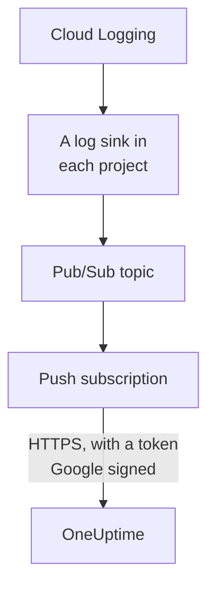

# Stream Google Cloud Logs

A connected Google Cloud project can stream its logs to OneUptime as they are written. Cloud Logging routes them through a log sink into a Pub/Sub topic, and the topic's push subscription delivers each entry to OneUptime within a minute, as a OneUptime log filed under the resource it is about. One command in Google Cloud Shell sets it up, and there is nothing to run. Cloud Monitoring has no export that pushes metrics, so the connection keeps reading metrics on its schedule.

:::cards
- [How it works](#how-it-works): A log sink in each project, a topic and its push subscription.
- [Set up streaming](#set-up-streaming): Choose which logs, make a stream key and run one command.
- [What arrives](#what-arrives): Logs on the resources they come from.
- [What the command creates](#what-the-command-creates): Every resource and permission the command makes in your projects.
- [Stop streaming](#stop-streaming): Turn the keys off, then delete what the command made.
:::

## How it works



- **A log sink in each project.** Each project's sink routes the entries its filter matches into one Pub/Sub topic, in the project of the connection's own service account.
- **Two checks on every push.** Pub/Sub signs an OpenID Connect token for a service account made for the pushes alone, and the token's audience is the connection's stream key. OneUptime takes a push only when Google signed its token for that service account and the key is one of the connection's. The key names the connection, and so the project: nothing in a push decides where it is written. OneUptime keeps only the key's SHA-256.
- **Nothing is lost while OneUptime cannot take it.** Pub/Sub pushes a refused entry again, waiting from 10 seconds up to 10 minutes between tries, and keeps it for a day.

## Before you begin

- **A connected Google Cloud project.** Connect it under **Cloud → Connect** first: see [Connect a Cloud Account](/docs/telemetry/cloud-accounts).
- **A project owner or admin.** Only they can make a stream key and stop streaming.
- **Google Cloud Shell**, signed in as an **Owner** of the projects, or someone who may make service accounts, Pub/Sub topics and log sinks in them.
- **An HTTPS address, on a self-hosted OneUptime.** Pub/Sub pushes only to `https://` addresses, with a certificate Google trusts, and the address must be reachable from Google Cloud.

## Set up streaming

:::steps
### Open the streaming dialog

Go to **Cloud → Connect**, and on the Google Cloud project's row choose **Stream logs**.

### Choose which logs

**Warnings and errors** streams every entry of severity `WARNING` or above: what went wrong, not every request. **Every log** streams every entry but the Data Access audit logs, which record every read and can outweigh everything else a project writes. **A filter of your own** streams the entries a Cloud Logging query matches, written in the **Filter** field.

### Make a stream key

Choose **Make a stream key**. The key is shown this once, in the command: OneUptime keeps only its SHA-256.

### Run the command in Google Cloud Shell

Copy the command, run it in Google Cloud Shell and wait for it to finish. It says each project it set a sink up in, and stops at the first step Google refuses, with Google's reason.

### Wait for the first push

The dialog asks every few seconds what arrived. Pub/Sub pushes an entry within a minute of a project writing one the filter takes; the dialog then says what came from where, and the connection's row says **Streaming**.
:::

**More fields** holds the rest:

| Field | What it does |
| --- | --- |
| **Projects** | The projects to stream logs from: at first, the ones the connection reads. The topic is made in the project of the connection's service account. At most 100 |
| **Set it up another way** | The push endpoint, the push service account and the key, to set it up with Terraform or the console |

## What arrives

| What | Where it lands |
| --- | --- |
| Logs | In the Logs explorer, under the connection's telemetry service, with the project, region and log name as attributes |
| Logs of a resource OneUptime knows | On that resource too: its page in Cloud gains a **Logs** tab |

Each log keeps its entry's time to the nanosecond, its severity, its trace and span, and its HTTP request in the OpenTelemetry semantic conventions' names. It is filed under a resource when its monitored resource is a kind whose metrics OneUptime reads, such as a VM (`gce_instance`), a Cloud Run service (`cloud_run_revision`) or a Cloud SQL instance (`cloudsql_database`), and carries the resource's ID as `cloud.resource_id`. An external load balancer's request logs, written under `http_load_balancer`, are filed under its URL map, the `https_lb_rule` its metrics land on.

An instance group's logs are its VMs', so its page has no **Logs** tab. An entry of another kind streams all the same, under its project.

## What the command creates

Its resources are named after the first 8 characters of the connection's ID. It gives OneUptime no access to your projects: entries only flow out.

| Resource | What it may do |
| --- | --- |
| A service account, `oneuptime-push-<suffix>`, in the project of the connection's service account | Holds no role: Pub/Sub signs its pushes' tokens for it |
| The **Service Account OpenID Connect Identity Token Creator** role for the Pub/Sub service agent, on that service account alone | Lets Pub/Sub make those tokens, and nothing else |
| A Pub/Sub topic, `oneuptime-stream-<suffix>` | Holds the entries the sinks route |
| Its push subscription, `oneuptime-stream-<suffix>-push` | Pushes each entry to OneUptime, with a 60 second acknowledgement deadline, and keeps what it could not push for a day |
| A log sink in each project, `oneuptime-stream-<suffix>` | Routes the entries its filter matches into the topic |
| The **Pub/Sub Publisher** role for each sink's writer, on the topic alone | Lets the sink publish to the topic, and nothing else |

The command turns the Pub/Sub and Cloud Logging APIs on in the topic's project if they are off. Google bills Pub/Sub for the logs it delivers: stream only the logs you need.

## Stop streaming

:::steps
### Turn the keys off

On the project's row in **Cloud → Connect**, choose **Stop streaming**. Every stream key of the connection stops working at once, and OneUptime refuses what Pub/Sub pushes. What was delivered stays.

### Delete what the command made

The sinks, the topic and its push subscription stay in Google Cloud, and Pub/Sub keeps pushing, until they are deleted. The dialog shows the command, for the projects the connection reads:

```bash
for SOURCE in 'acme-prod' 'acme-data'; do
  gcloud logging sinks delete oneuptime-stream-6f1c3a2e --project "$SOURCE" --quiet
done
gcloud pubsub subscriptions delete oneuptime-stream-6f1c3a2e-push --project 'acme-prod' --quiet
gcloud pubsub topics delete oneuptime-stream-6f1c3a2e --project 'acme-prod' --quiet
gcloud iam service-accounts delete 'oneuptime-push-6f1c3a2e@acme-prod.iam.gserviceaccount.com' --project 'acme-prod' --quiet
```
:::

To change which logs stream, open **Stream logs** again, choose **Make a new key** and run the new command. The key it replaces keeps working for 24 hours, so no push is refused while the subscription updates. At most 3 replaced keys work at once.

## Set it up another way

Give a Pub/Sub topic a push subscription with these values, and let the Pub/Sub service agent make tokens for the push service account:

| Setting | Value |
| --- | --- |
| Push endpoint | `https://oneuptime.com/telemetry/gcp-pubsub/v1/logs` |
| Authentication | An OpenID Connect token for `oneuptime-push-<suffix>@<project>.iam.gserviceaccount.com` |
| Audience | The stream key |
| Payload | Wrapped, as Pub/Sub sends it unless told otherwise |
| Acknowledgement deadline | 60 seconds |
| Message retention | 1 day |

Then route each project's logs into the topic with a log sink, and give each sink's writer **Pub/Sub Publisher** on the topic. On a self-hosted OneUptime, replace `https://oneuptime.com` with your OneUptime's HTTPS address.

OneUptime answers every push the way Pub/Sub expects:

| Answer | When | What Pub/Sub does |
| --- | --- | --- |
| `204` | The entry was taken, or it was taken before, or the message is no log entry | Moves on |
| `400` | It is not a Pub/Sub push OneUptime can read | Pushes it again, waiting longer each time, for a day |
| `401` | The token is not one Google signed for the push service account, or its audience is not a key of the connection | Pushes it again, waiting longer each time, for a day |
| `402` | The project cannot be billed for telemetry | Pushes it again, waiting longer each time, for a day |
| `403` | The connection is turned off, or the project cannot take telemetry | Pushes it again, waiting longer each time, for a day |
| `413` | The request is larger than 1 MiB, or its entry larger than 512 KiB | Pushes it again, waiting longer each time, for a day |
| `429` | The connection's subscription pushed more than 12,000 entries in a minute | Pushes it again, waiting longer each time, for a day |
| `503` | OneUptime could not check the token or queue the entry just then | Pushes it again, waiting longer each time, for a day |

## Troubleshooting

:::details The dialog keeps waiting for the first push
Check that the command finished without stopping, and that a project wrote an entry the filter takes: with **Warnings and errors**, a quiet project sends nothing. `gcloud pubsub subscriptions describe oneuptime-stream-6f1c3a2e-push --project acme-prod` shows the subscription's endpoint. On a self-hosted OneUptime, check that Google Cloud reaches its address over HTTPS.
:::

:::details The connection says Stream refused
The dialog and the row's tooltip say why. A wrong key means the subscription pushes with a key that no longer works: make a new key and run the command again. A push not signed for the push service account means the subscription signs as another one, or Pub/Sub may not sign for it: run the command again.
:::

:::details A resource's logs do not show on its page
The page shows the logs Cloud Logging files under the resource's monitored resource, with the labels its metrics have. Logs a workload writes under another resource, such as a container's, stream under their project only.
:::

## Next steps

:::cards
- [Connect a Cloud Account](/docs/telemetry/cloud-accounts): What a connection reads, and how often.
- [Stream Azure Monitor Metrics and Logs](/docs/telemetry/cloud-streaming-azure): An Azure subscription's, read from event hubs.
- [Stream CloudWatch Metrics and Logs](/docs/telemetry/cloud-streaming): An AWS account's, delivered by Amazon Data Firehose.
- [Logs Explorer](/docs/telemetry/logs-explorer): Search and filter what the streams delivered.
:::
