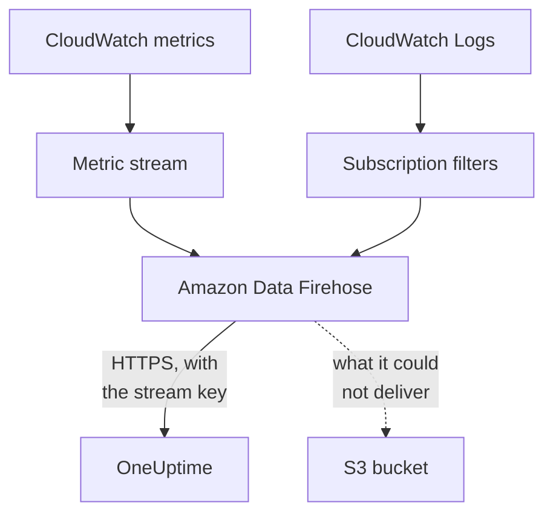

# Stream CloudWatch Metrics and Logs

A connected AWS account can stream its CloudWatch metrics and logs to OneUptime through Amazon Data Firehose. Metrics then arrive a few minutes after CloudWatch has them, instead of at the connection's next read, and CloudWatch Logs arrive as OneUptime logs, each filed under the resource it is about. One command in AWS CloudShell sets it up, and there is nothing to run.

:::cards
- [How it works](#how-it-works): A metric stream and log subscriptions in each Region, delivered by Firehose.
- [Set up streaming](#set-up-streaming): Choose what to stream, make a stream key and run one command.
- [What arrives](#what-arrives): Metrics on the resources they measure, and logs on the resources they come from.
- [What the stack creates](#what-the-stack-creates): Every resource and permission the command makes in your account.
- [Stop streaming](#stop-streaming): Turn the keys off, then delete the stacks.
:::

## How it works



- **One stack in each Region.** The command deploys a CloudFormation stack in each Region you stream from. Its metric stream and log subscription filters hand everything to two Firehose streams, and Firehose delivers it to OneUptime over HTTPS.
- **The stream key says whose it is.** Firehose sends the connection's stream key with every delivery. The key names the connection, and so the project: nothing in a delivery decides where it is written. OneUptime keeps only the key's SHA-256.
- **The reads leave streamed metrics to the stream.** While a stream delivers a namespace of a Region, the connection's reads stop writing that namespace's metrics, so no data point is counted twice. The reads go on finding resources, their health and their changes, and take a namespace back after 15 minutes without a delivery.
- **Nothing is lost while OneUptime cannot take it.** Firehose sends a refused batch again for up to an hour, then keeps it in the stack's S3 bucket for 30 days.

## Before you begin

- **A connected AWS account.** Connect it under **Cloud → Connect** first: see [Connect a Cloud Account](/docs/telemetry/cloud-accounts).
- **A project owner or admin.** Only they can make a stream key and stop streaming.
- **AWS CloudShell in that account**, signed in as someone who may create CloudFormation stacks and IAM roles.
- **An HTTPS address, on a self-hosted OneUptime.** Firehose delivers only to `https://` addresses on port 443, with a certificate AWS trusts, and the address must be reachable from AWS.

## Set up streaming

:::steps
### Open the streaming dialog

Go to **Cloud → Connect**, and on the AWS account's row choose **Stream metrics and logs**.

### Choose what to stream

**Metrics** streams every key metric of every resource, once a minute: the metrics OneUptime charts and judges each resource by. **Metrics and logs** adds CloudWatch Logs, and **Logs** streams CloudWatch Logs alone.

For logs, list the **Log groups** one a line, by name in the **Region** beside them or by ARN in their own Region, or choose **Every log group of the account, new ones too**. One command subscribes at most 50 log groups by name, in at most 10 Regions.

### Make a stream key

Choose **Make a stream key**. The key is shown this once, in the command: OneUptime keeps only its SHA-256.

### Run the command in AWS CloudShell

Copy the command, run it in AWS CloudShell and wait for it to finish. It writes the template to `oneuptime-stream.json` and deploys it in each Region, with the key as a parameter that is never shown again.

### Wait for the first delivery

The dialog asks every few seconds what arrived. Firehose delivers within a few minutes of the command finishing; the dialog then says what came from where, and the connection's row says **Streaming**.
:::

**More fields** holds the rest:

| Field | What it does |
| --- | --- |
| **Every metric, not only the key ones** | Streams every metric CloudWatch has for the account, your own included. AWS bills each metric update a stream sends, so it can cost many times more |
| **Regions** | Where to stream from: at first, the Regions the connection found resources in. Left empty, the command streams from AWS CloudShell's own Region. At most 30 |
| **Set it up another way** | The metrics and logs endpoints and the key, to set the streams up with Terraform or the console |

**Download the template** saves the template the command deploys, to deploy it your own way.

## What arrives

| What | Where it lands |
| --- | --- |
| Metrics | On the cloud resources they measure, with the names and attributes the connection's reads give them |
| Logs | In the Logs explorer, under the connection's telemetry service, with the account, Region and log group as attributes |
| Logs of a log group AWS names after a resource | On that resource too: its page in Cloud gains a **Logs** tab |

A log group is filed under a resource when AWS named it after one:

| Log group | Resource type |
| --- | --- |
| `/aws/lambda/<function>` | `AWS::Lambda::Function` |
| `/aws/rds/instance/<instance>/<log>` | `AWS::RDS::DBInstance` |
| `/aws/rds/cluster/<cluster>/<log>` | `AWS::RDS::DBCluster` |
| `/aws/docdb/<cluster>/<log>` | `AWS::DocDB::DBCluster` |
| `/aws/neptune/<cluster>/<log>` | `AWS::Neptune::DBCluster` |
| `/aws/redshift/cluster/<cluster>/<log>` | `AWS::Redshift::Cluster` |
| `/aws/OpenSearchService/domains/<domain>/<log>` | `AWS::OpenSearchService::Domain` |
| `/aws/aes/domains/<domain>/<log>` | `AWS::OpenSearchService::Domain` |
| `/aws/apprunner/<service>/<service-id>/<log>` | `AWS::AppRunner::Service` |
| `/aws/elasticbeanstalk/<environment>/<log>` | `AWS::ElasticBeanstalk::Environment` |
| `/aws/ecs/containerinsights/<cluster>/performance` | `AWS::ECS::Cluster` |

Each log carries the resource's ID as `cloud.resource_id`, and a Lambda function's logs carry `faas.name` too, so they also appear on the function in Serverless. A log group of any other name streams all the same, under its account and Region. A log's severity is the one its message states, the way Lambda writes it.

## What the stack creates

The stack is named `OneUptimeStream-` and the first 8 characters of the connection's ID. It gives OneUptime no access to your account: data only flows out.

| Resource | What it may do |
| --- | --- |
| A CloudWatch metric stream, in the OpenTelemetry 1.0 format | Put records into the metrics Firehose stream only |
| Log subscription filters, or one account-wide subscription policy for every log group | Put records into the logs Firehose stream only |
| Two Firehose streams, `OneUptime-<suffix>-metrics` and `OneUptime-<suffix>-logs` | Deliver to OneUptime with GZIP, a 1 MiB or 60 second buffer and an hour of retries, and write what they could not deliver to the bucket |
| An S3 bucket for what could not be delivered | Public access blocked, encrypted, emptied after 30 days, and kept when the stack is deleted |
| A log group, `/aws/kinesisfirehose/OneUptime-<suffix>` | Holds Firehose's own delivery errors, and is never streamed |
| Three IAM roles | Each trusts one AWS service of this account and allows only what the rows above say |

AWS bills the metric stream for each metric update it sends, and Firehose for what it delivers. Stream only the metrics and log groups you need.

## Stop streaming

:::steps
### Turn the keys off

On the account's row in **Cloud → Connect**, choose **Stop streaming**. Every stream key of the connection stops working at once, OneUptime refuses what the streams deliver, and the connection reads all its metrics on its schedule again. What the streams delivered stays.

### Delete the stacks

The streams stay in AWS, and AWS bills them, until their stacks are deleted. The dialog shows the command, for the Regions the streams delivered from and those the connection found resources in:

```bash
for REGION in us-east-1 eu-west-1; do
  aws cloudformation delete-stack --region "$REGION" --stack-name OneUptimeStream-6f1c3a2e
done
```
:::

To change what a stack streams, open **Stream metrics and logs** again, choose **Make a new key** and run the new command. The key it replaces keeps working for 24 hours, so no delivery is refused while the stacks update. At most 3 replaced keys work at once.

## Set it up another way

Give each Firehose stream an HTTP endpoint destination with these values, and the metric stream the OpenTelemetry 1.0 output format:

| Setting | Value |
| --- | --- |
| Metrics endpoint | `https://oneuptime.com/telemetry/aws-firehose/v1/metrics` |
| Logs endpoint | `https://oneuptime.com/telemetry/aws-firehose/v1/logs` |
| Access key | The stream key, sent as `X-Amz-Firehose-Access-Key` |
| Content encoding | `GZIP` |
| Buffer | 1 MiB or 60 seconds |
| Retry duration | 3600 seconds, with an S3 bucket for what could not be delivered |

On a self-hosted OneUptime, replace `https://oneuptime.com` with your OneUptime's HTTPS address. The metrics endpoint also takes a metric stream in the JSON format.

OneUptime answers every delivery the way Firehose expects:

| Answer | When | What Firehose does |
| --- | --- | --- |
| `200` | The delivery was taken, or it was taken before | Moves on |
| `400` | It is not a Firehose delivery OneUptime can read, such as one of more than 10,000 records | Sends it again for up to an hour |
| `401` | The key is not one of the connection's | Sends it again for up to an hour |
| `402` | The project cannot be billed for telemetry | Sends it again for up to an hour |
| `403` | The connection is turned off, or the project cannot take telemetry | Sends it again for up to an hour |
| `413` | The request is larger than 4 MiB, or decompresses to more than 32 MiB | Keeps it in the bucket |
| `429` | The connection's streams sent more than 600 deliveries in a minute | Sends it again later |

## Troubleshooting

:::details The dialog keeps waiting for the first delivery
Check that the command finished in every Region, without an error: `aws cloudformation describe-stacks --stack-name OneUptimeStream-6f1c3a2e` says the stack's status. A metric stream delivers only metrics CloudWatch has, so a Region with no resources sends nothing. On a self-hosted OneUptime, check that AWS reaches its address over HTTPS on port 443.
:::

:::details The connection says Stream refused
The dialog and the row's tooltip say why. A wrong key means the stacks run with a key that no longer works: make a new key and run the command again. Firehose keeps sending what it holds, and it is taken once the key is right.
:::

:::details A Lambda function's logs do not show on its page
The page shows the logs of the log group named after the function, `/aws/lambda/<function>`. A function that writes to a log group of another name streams its logs under its account and Region only.
:::

## Next steps

:::cards
- [Connect a Cloud Account](/docs/telemetry/cloud-accounts): What a connection reads, and how often.
- [Cloud Resources (IaaS & PaaS)](/docs/telemetry/cloud-resources): Every resource type OneUptime recognizes.
- [Logs Explorer](/docs/telemetry/logs-explorer): Search and filter what the streams delivered.
:::
