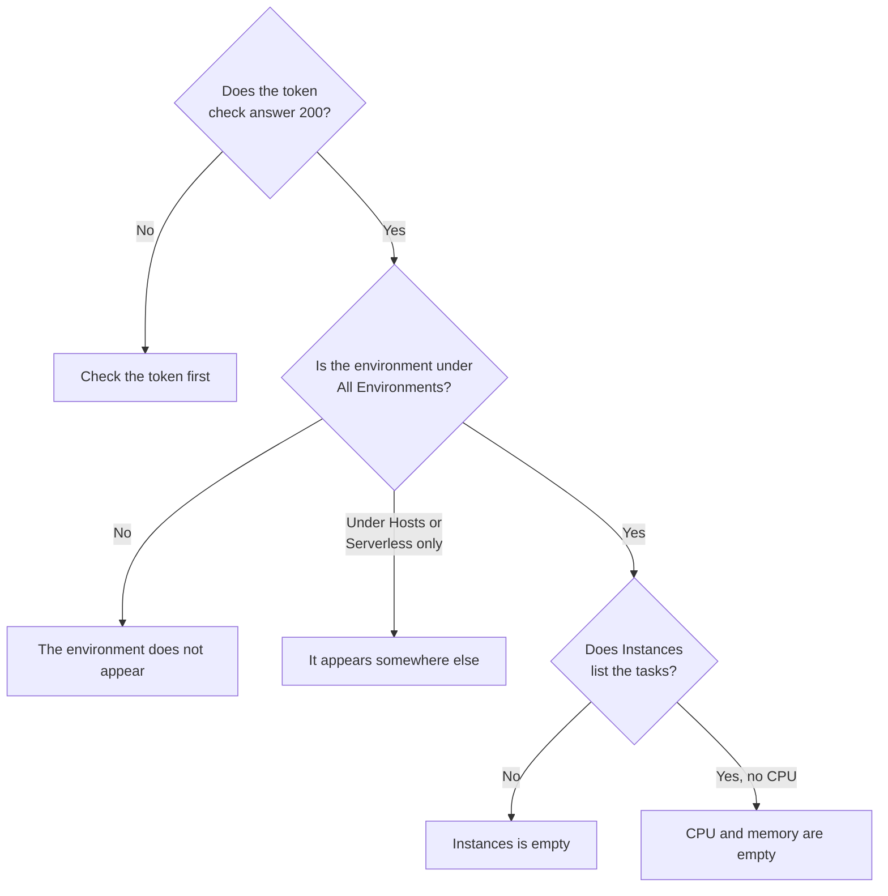

# Cloud Troubleshooting

Find why a cloud environment is missing, filed in the wrong place, empty or duplicated. The sections are in the order these things fail, and each one rules out one layer, so work down from the top. The failures that belong to one platform are at the end of its page: [AWS ECS / Fargate](/docs/telemetry/cloud-aws-ecs), [Google Cloud Run](/docs/telemetry/cloud-gcp-cloud-run), [Azure Container Apps](/docs/telemetry/cloud-azure-container-apps) and [Other Cloud Platforms](/docs/telemetry/cloud-other-platforms).



## Check the token first

It is the cheapest check, and nothing below works without it:

```bash
curl -i https://oneuptime.com/otlp/v1/validate \
  -H "x-oneuptime-token: YOUR_TELEMETRY_INGESTION_TOKEN"
```

| Answer                    | What it means                                                                                                              |
| ------------------------- | -------------------------------------------------------------------------------------------------------------------------- |
| `200`, `"valid": true`    | The token is accepted. Its `keyType` should be `Server`: a `Browser` key is refused from a collector or a backend service. |
| `401`, `"valid": false`   | The token is missing, unknown, revoked, disabled or expired, and the answer's `message` says which. Create a new key under **Project Settings → Telemetry & APM → Ingestion Keys** and deploy it again. |

If you host OneUptime yourself, use `https://YOUR-ONEUPTIME-HOST/otlp/v1/validate`. Run the check from inside the task, instance or replica when you can (ECS Exec, `az containerapp exec`): it proves the workload itself can reach OneUptime, not just your laptop.

## The environment does not appear

Nothing under **Cloud → All Environments** a minute after the first request. Check these three, in this order.

**`cloud.platform` is missing, or is not a managed value.** OneUptime files telemetry under Cloud Environments only when the resource carries one of these values: `aws_ecs`, `aws_elastic_beanstalk`, `aws_app_runner`, `gcp_cloud_run`, `gcp_app_engine`, `azure_container_apps`, `azure_container_instances` or `azure_app_service`. The usual causes:

- The resource detector is off in the SDK (`OTEL_NODE_RESOURCE_DETECTORS`, `OTEL_EXPERIMENTAL_RESOURCE_DETECTORS`, `-Dotel.resource.providers.<cloud>.enabled=true`).
- The collector's pipeline skips the `resourcedetection` processor.
- On a platform with no detector, `OTEL_RESOURCE_ATTRIBUTES` has a typo.

The Node.js and .NET Azure detectors write `azure.container_apps`, `azure.app_service` and `azure.functions`; OneUptime rewrites them to the underscore values, so they count. To see what your telemetry carries, open the service under **Services**, open one of its traces from the **Traces** tab, and read the resource attributes. If `cloud.platform` is not there, that is the whole problem.

**The token is wrong.** The token check answered `401`. The collector logs it as `Permanent error: ... 401`. An SDK logs it once and stops retrying, which is correct OTLP behavior and easy to miss.

**Egress is blocked.** The collector logs `connection refused`, `context deadline exceeded`, `i/o timeout` or a DNS failure:

- **ECS and Fargate:** a private subnet needs a NAT gateway or `assignPublicIp=ENABLED`, and the security group must allow egress on TCP 443.
- **Cloud Run:** **VPC egress: All traffic** needs Cloud NAT.
- **Container Apps:** a user-defined route to a firewall must allow the OneUptime host.
- **Everywhere:** a self-hosted OneUptime behind a private DNS name must resolve from the workload's network.

## It appears under Hosts instead

The resource carries a virtual machine's platform (`aws_ec2`, `gcp_compute_engine` or `azure_vm`), so OneUptime files it under **Hosts**: right for a virtual machine, wrong for managed compute. A virtual machine's detector won over the managed one: `detectors: [ec2, elastic_beanstalk]` in a collector, where the first detector to set `cloud.platform` wins, or an SDK whose order favors the EC2 detector. Put `elastic_beanstalk` first, or set `cloud.platform` yourself in `OTEL_RESOURCE_ATTRIBUTES` and keep only the `env` detector.

## It appears only under Serverless Functions

The resource carries `faas.name` but no managed `cloud.platform`. Cloud Run and App Engine set both when the GCP detector runs. If you set `faas.name` by hand, or a collector drops the resource attributes the SDK's detector set, only the serverless side is satisfied. Turn on the detector, or set `cloud.platform=gcp_cloud_run` (or `gcp_app_engine`), `cloud.account.id` and `cloud.region` yourself.

> [!NOTE]
> On Cloud Run and App Engine a service is meant to appear in both places: the environment groups the project and region, and **Serverless Functions** shows the single service.

## Instances is empty

The environment is there, but its **Instances** tab lists nothing: the telemetry carries no instance identity. OneUptime names an instance from the first of these resource attributes it finds:

1. `aws.ecs.task.id`
2. `aws.ecs.task.arn` (shortened to the task ID)
3. `faas.instance`
4. `azure.container_app.instance.id`
5. `service.instance.id`
6. `container.id`
7. `host.id`
8. `host.name`

The platform's own identity comes before `service.instance.id`, so an ID the SDK makes up for each process (the Node.js SDK does by default) cannot split a task from its sidecar's CPU and memory. What sets the identity on each platform:

| Platform                                  | What sets the identity                                                                                                                           |
| ----------------------------------------- | ------------------------------------------------------------------------------------------------------------------------------------------------ |
| ECS                                       | The `ecs` detector sets the task ARN                                                                                                             |
| Cloud Run, App Engine                     | The `gcp` detector sets `faas.instance`                                                                                                          |
| Container Apps                            | The Collector's `azurecontainerapps` detector sets the replica ID; or set `service.instance.id` from `CONTAINER_APP_REPLICA_NAME`, or run the host detector |
| App Runner, Container Instances           | The host detector's `host.name`                                                                                                                  |
| App Service, Elastic Beanstalk            | The platform's detector sets `service.instance.id`; on Beanstalk, delete it so `host.id` names each instance                                    |

An instance appears within a minute of the first signal that carries the attribute.

## CPU and memory are empty

The instances are listed, but the overview's **CPU** and **Memory** tiles, and the CPU and memory columns of **Instances**, are empty. These come from metrics, not traces: `container.cpu.utilization` and `container.memory.usage` (or `container.memory.usage.total`) data points whose resource carries the **same instance identity** as the traces, and `cloud.platform`.

- **On ECS,** the `awsecscontainermetrics` receiver in a sidecar collector supplies them as `ecs.task.cpu.utilized` and `ecs.task.memory.utilized`. Keep it in the `metrics` pipeline, and keep `resourcedetection` in that pipeline too, or the metrics arrive without `cloud.platform` and are filed elsewhere.
- **On Cloud Run, Container Apps and the other platforms,** the platform does not show container usage to a sidecar. The tiles stay empty unless you send those metrics yourself: read the requests tiles instead.
- **With SDK direct,** nothing sends container metrics, so empty tiles are expected.

## The environment shows Disconnected

An environment shows **Disconnected** when no telemetry has arrived for it in **15 minutes**, and the next span, log or metric brings it back. Time when OneUptime itself was down or catching up does not count. While telemetry flows, the last-seen time can lag by up to five minutes, which is why the threshold is 15.

- **A busy environment shows Disconnected:** the exporter stopped. Check the collector's logs for the `401` and egress errors above.
- **A staging environment that scales to zero overnight** shows Disconnected until the first request in the morning, which is accurate.

Instances follow two clocks:

- **Stale:** the **Instances** tab marks a task, instance or replica **Stale** when it has not reported in the last 15 minutes, and the overview counts only the others as live.
- **Deleted:** a sweep deletes instance rows not seen for `CLOUD_INSTANCE_STALE_MINUTES` (default 15, at least 10), measured from the environment's own last telemetry, so a collector outage freezes that clock instead of wiping the last known task list. Serverless functions use `SERVERLESS_INSTANCE_STALE_MINUTES`. Raising the threshold keeps rows longer; it does not change when they turn **Stale**.

## Two environments where there should be one

The environment key is `cloud.platform|cloud.account.id|cloud.region`, matched character for character. If some workloads set `cloud.account.id` and others do not, one writes `eastus` and another `East US`, or one collector runs the `ecs` detector and another does not, you get `aws_ecs|123456789012|us-east-1` and `aws_ecs||us-east-1` side by side.

Open each environment's **Overview**: its **Environment Key** shows which part differs. Fix the workload that is missing the value. The environment with the empty part stops receiving telemetry, and you can archive it.

## A hand-made environment never matches

Ingest matches an environment on its key alone, and the key must be exactly `platform|account|region`, such as `aws_ecs|123456789012|us-east-1`: the same platform value, account ID and region as the telemetry carries. The create form (**Create Cloud Resource** under **Cloud → All Environments**) builds the key from its **Cloud Platform**, **Cloud Account ID** and **Cloud Region** fields, so those three must match the telemetry character for character. If they do not, ingest creates a second environment with the key it worked out, and yours stays empty. Archive the hand-made environment and let ingest create the right one, or create it again with the corrected values.

## Still stuck

Collect these before you ask for help:

- The resource attributes of one real span or log record from the workload. The collector's `debug` exporter prints them, or open a trace of the service under **Services**.
- The answer to the `/otlp/v1/validate` check, run from inside the workload.
- The last 50 lines of the collector's log, or the SDK's diagnostic log with `OTEL_LOG_LEVEL=debug`.
- The **Environment Key** of any environment that did appear.

Then contact support@oneuptime.com, or open an issue on [GitHub](https://github.com/OneUptime/oneuptime).

## Next steps

:::cards
- [Cloud Environments](/docs/telemetry/cloud-environments): How environments and instances are identified.
- [AWS ECS / Fargate](/docs/telemetry/cloud-aws-ecs): The ECS setup, with a complete task definition.
- [OpenTelemetry](/docs/telemetry/open-telemetry): Endpoints, limits and what each response means.
:::
