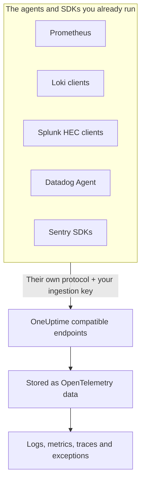

# Prometheus, Loki, Splunk, Datadog & Sentry

Already running Prometheus, a Loki client, a Splunk forwarder, the Datadog Agent or a Sentry SDK? Keep it. OneUptime accepts what each of these tools sends, at the paths the tool already uses, and stores it as OpenTelemetry data. Trying OneUptime is a change of URL and key, not a re-instrumentation, and your drop filters, scrub rules, log pipelines, retention and ingestion budgets apply to this data as to any other.

:::cards
- [Prometheus remote write](#prometheus-remote-write): Metrics from Prometheus, Grafana Alloy or any remote write sender.
- [Loki](#loki): Logs from Promtail, Grafana Alloy, Fluent Bit or Vector.
- [Splunk HTTP Event Collector](#splunk-http-event-collector): Logs and metric events from any HEC client.
- [Datadog Agent](#datadog-agent): Metrics and logs from the Datadog Agent.
- [Sentry SDKs](#sentry-sdks): Errors, transactions and logs from any Sentry SDK.
:::

## How it works



Each endpoint answers in its tool's own terms — a `204` for Prometheus and Loki, HEC's `{"text": "Success", "code": 0}`, Datadog's `202`, Sentry's event ID — so the tool reports success and failure the way it always has. The data is then processed exactly like data from an OpenTelemetry SDK.

## Before you begin

- **A OneUptime project** – on OneUptime Cloud, telemetry is billed per GB ingested, and a project on the Free plan needs a payment method before it can send telemetry.
- **Telemetry ingestion key** – create a **Server** key under **Products → Project Settings → Telemetry & APM → Ingestion Keys**, and copy its **Secret Key**. Each tool sends it where it sends its own credential. A browser app's Sentry DSN takes a **Browser** key instead, with your site's origins on it.
- **Your host** – the examples use `oneuptime.com`. If you self-host OneUptime, use your own host.

> [!TIP]
> The Setup Guide tab on Logs, Metrics, Traces and Exceptions has these tools under its own ways to send, with your host and a key you pick already filled in.

## Endpoints

| Tool | Point it at | Where the key goes |
| --- | --- | --- |
| Prometheus remote write | `https://oneuptime.com/telemetry/prometheus/api/v1/write` | A bearer token, or basic auth with the key as the password. |
| Loki | `https://oneuptime.com/telemetry/loki/api/v1/push` | Basic auth with the key as the password, or a bearer token. |
| Splunk HTTP Event Collector | `https://oneuptime.com/telemetry/services/collector` | The HEC token: `Authorization: Splunk <key>`. |
| Datadog Agent | `https://oneuptime.com/telemetry/datadog` | The API key: `DD-API-KEY`. |
| Sentry SDKs | The DSN `https://<key>@oneuptime.com/telemetry/sentry/1` | The DSN's public key. |

Every endpoint also takes the key in an `x-oneuptime-token` header, and an `x-oneuptime-service-name` header names the service everything it sends belongs to. A key can be written as its 32 hex digits without hyphens; the Sentry DSN and the Datadog API key must be written that way.

## Prometheus remote write

Add OneUptime as a remote write target. Prometheus keeps scraping as it does now and sends a copy of every sample:

```yaml title="prometheus.yml"
remote_write:
  - url: https://oneuptime.com/telemetry/prometheus/api/v1/write
    authorization:
      credentials: YOUR_TELEMETRY_KEY
```

With Grafana Alloy, add a `prometheus.remote_write` component and forward your scrapes to it:

```text title="config.alloy"
prometheus.remote_write "oneuptime" {
  endpoint {
    url          = "https://oneuptime.com/telemetry/prometheus/api/v1/write"
    bearer_token = "YOUR_TELEMETRY_KEY"
  }
}
```

Remote write 1.0 and 2.0 are both accepted, snappy-compressed as every sender sends them.

### What a series becomes

- **Its name and labels stay.** `http_requests_total{job="checkout", code="500"}` is the metric `http_requests_total` with the attributes `job` and `code`, so a query moved from Grafana finds it.
- **The job is the service.** Each `job` becomes a service, and each `instance` its service instance, as OpenTelemetry's Prometheus rules map them.
- **Types are kept.** Counters, and a histogram's buckets and counts, are cumulative sums, so their rates chart correctly. A type comes from the metadata the sender includes; without it, a `_total` name is a counter and a `_bucket` with an `le` label a histogram bucket.
- **Native histograms** become exponential histograms, and native histograms with custom buckets become histograms.
- **Not kept:** staleness markers and other NaN or infinite samples, the `_created` series of counters, and exemplars.

## Loki

OneUptime takes Loki's push API at Loki's own path, in JSON or as the snappy-compressed protobuf Promtail and Grafana Alloy send. Add it as a client:

```yaml title="promtail.yaml"
clients:
  - url: https://oneuptime.com/telemetry/loki/api/v1/push
    bearer_token: YOUR_TELEMETRY_KEY
```

Fluent Bit's `loki` output takes the host and the path apart:

```text title="fluent-bit.conf"
[OUTPUT]
    Name         loki
    Match        *
    Host         oneuptime.com
    Port         443
    Tls          On
    Uri          /telemetry/loki/api/v1/push
    Http_User    oneuptime
    Http_Passwd  YOUR_TELEMETRY_KEY
    Labels       job=fluent-bit
```

### What a stream becomes

- **Every entry is a log**, with its own timestamp to the nanosecond and its line as the body.
- **Labels and structured metadata are attributes**, under the names they have in Loki.
- **The service** comes from the first of `service_name`, `service`, `app`, `application`, `name`, `app_kubernetes_io_name`, `container`, `container_name`, `component`, `workload` and `job` a stream has, as Loki finds it. A `host` or `hostname` label names the host.
- **The level** comes from a `level`, `detected_level` or `severity` label or metadata, or else from a logfmt `level=` or a JSON line's `level` field.
- **Trace context:** a `trace_id` and `span_id` in the structured metadata link the log to its trace.

## Splunk HTTP Event Collector

Use OneUptime as the HTTP Event Collector, with your ingestion key as the HEC token. Splunk's Docker logging driver adds the path itself, so it takes just the host:

```bash
docker run \
  --log-driver=splunk \
  --log-opt splunk-url=https://oneuptime.com \
  --log-opt splunk-token=YOUR_TELEMETRY_KEY \
  --log-opt splunk-format=json \
  your-image
```

Any other HEC client posts to `/services/collector/event` or `/services/collector/raw`. To send one event:

```bash
curl https://oneuptime.com/telemetry/services/collector/event \
  -H "Authorization: Splunk YOUR_TELEMETRY_KEY" \
  -d '{"event": "Payment failed for order 42", "sourcetype": "app", "fields": {"service": "checkout"}}'
```

A `200` with `{"text": "Success", "code": 0}` means the event was accepted. The endpoint answers with HEC's own codes too — `No data` (5), `Invalid data format` (6) with the number of the event that was not valid, and `Event field is required` (12) — and answers `GET /services/collector/health` without a token.

### What an event becomes

- **A log**, with its `time` as its timestamp. A string event is the body; an object event's `message`, `msg`, `log`, `line` or `text` is the body, and its other fields are attributes.
- **Its metadata stays:** `host` is the host, and `source`, `sourcetype` and `index` are kept as `com.splunk.source`, `com.splunk.sourcetype` and `com.splunk.index`. The query string's `host`, `source`, `sourcetype` and `index` fill in what an event leaves out.
- **Its fields are attributes.** A `service.name` field names the service, and so does a log's `service` field.
- **Metric events** (`"event": "metric"`, with `metric_name` and `_value`, or `metric_name:<name>` fields) are stored as metrics, never as logs.
- **Not offered:** indexer acknowledgement. A client that asks for it gets no `ackId`.

## Datadog Agent

Point the Agent's metrics and logs at OneUptime, with your ingestion key as its API key:

```yaml title="datadog.yaml"
api_key: YOUR_TELEMETRY_KEY_WITHOUT_HYPHENS
dd_url: https://oneuptime.com/telemetry/datadog
logs_enabled: true
logs_config:
  use_http: true
  logs_dd_url: oneuptime.com:443
apm_config:
  enabled: false
process_config:
  process_collection:
    enabled: false
```

The Agent adds its own paths to `dd_url`, and sends logs to `/api/v2/logs` on the host and port `logs_dd_url` names. OneUptime answers those paths at the root only for a request that carries a `DD-API-KEY` header. Restart the Agent after the change; `datadog-agent status` shows its API key as valid when OneUptime accepts it.

### What the Agent's data becomes

- **Metrics** keep their names. Gauges are gauges, counts are sums, and rates are gauges of their per-second value.
- **Distributions** become summaries with their count, sum, minimum and maximum.
- **Service checks** become a metric named after the check, whose value is the check's status: 0 OK, 1 warning, 2 critical, 3 unknown.
- **Logs** keep their message, status, host and service, and the rest of their fields as attributes.
- **Tags are attributes**, and the `service`, `env` and `version` tags name the service, its environment and its version.
- **Not read yet:** APM traces, processes, containers, network data and profiles. Leave them off in `datadog.yaml`, as above.

Datadog's HTTP API clients — a log library posting to `/api/v2/logs`, a script posting series — can send to the same endpoint with the `DD-API-KEY` header.

## Sentry SDKs

Replace the DSN where you set up Sentry. The rest of your Sentry code stays as it is:

```javascript
Sentry.init({
  dsn: "https://YOUR_TELEMETRY_KEY_WITHOUT_HYPHENS@oneuptime.com/telemetry/sentry/1",
  release: "checkout@1.4.2",
  environment: "production",
});
```

```python
sentry_sdk.init(
    dsn="https://YOUR_TELEMETRY_KEY_WITHOUT_HYPHENS@oneuptime.com/telemetry/sentry/1",
    release="checkout@1.4.2",
    environment="production",
)
```

The `1` at the end of the DSN is required by Sentry's SDKs and not read. A browser app's DSN is public, so use a **Browser** ingestion key there, with your site's origins on it.

### What an envelope becomes

- **Errors** appear in Exceptions, with their stack traces and the exceptions that caused them, grouped as any other exception. Each is a span on its trace, under the span that was active.
- **Transactions** and their spans appear in Traces.
- **Sentry logs** and messages captured with `capture_message` appear in Logs.
- **The service** is a `service` tag, or else the release's name before the `@`: `checkout@1.4.2` is `checkout`. The release is the service version, and the environment is kept.
- **Not kept:** sessions, replays, attachments, profiles and check-ins. The SDK still sends them; OneUptime accepts and drops them.

## Limits and ingestion budgets

- **Request size** – OneUptime's ingress accepts requests of up to 4 MB under `/telemetry`, and each body may decompress to at most 64 MB.
- **Ingestion budgets** – Prometheus remote write and Loki are checked against the metrics or logs budget before their body is read, and are refused with `403` when it is used up. A HEC batch, a Datadog payload or a Sentry envelope can carry several signals, so each signal is counted against its own budget as it is stored, and dropped when that budget is used up.

## Troubleshooting

### Every request is refused with 401

The key did not arrive where the endpoint looks for it, or it is not a key of this project. Check the tool's credential setting against the [Endpoints](#endpoints) table, and that the key is not turned off or expired.

### A Sentry SDK says the DSN is invalid

Sentry's SDKs refuse a DSN whose key has hyphens. Write the key as its 32 hex digits, without the hyphens.

### Datadog metrics arrive, but logs do not

Check that `logs_config.use_http` is `true` and that `logs_config.logs_dd_url` is a host and port, not a URL. The Agent sends logs over TCP when `use_http` is not set.

### Prometheus reports 415

The sender asked for a remote write protocol OneUptime does not read. Send remote write 1.0 or 2.0.
