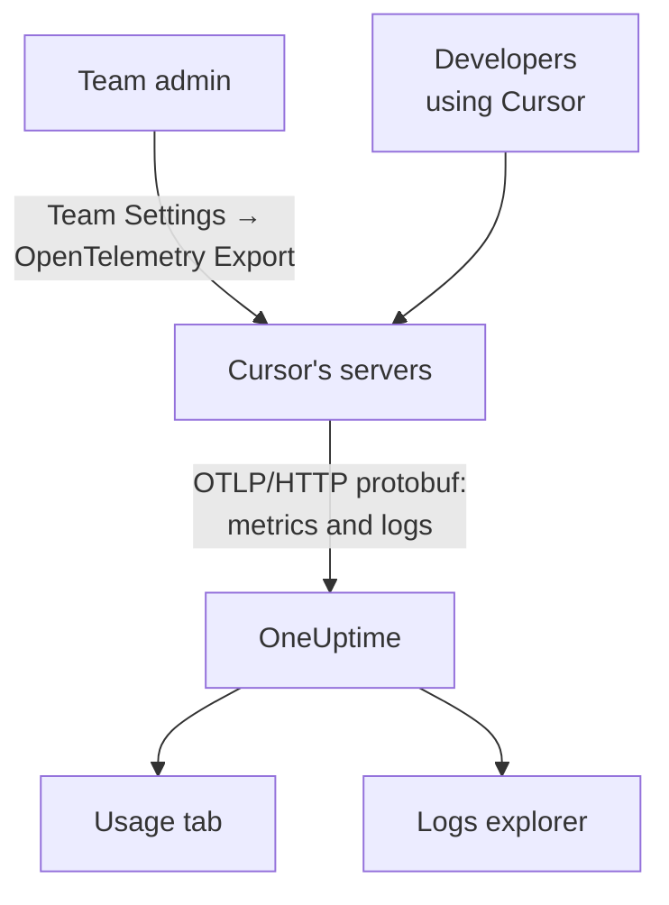

# Cursor

Cursor exports its team's telemetry from Cursor's own servers. A team admin adds OneUptime as the destination once, in Cursor's dashboard, and the whole team's tokens, estimated cost and tool calls arrive: nothing to install or set on developer machines.

:::cards
- [Set it up](#set-it-up): Create a key in OneUptime and a destination in Cursor.
- [What you get](#what-you-get-and-what-you-dont): Metrics and logs; no traces.
- [Who spent what](#employee-attribution): People arrive as Cursor user ids.
- [Troubleshooting](#troubleshooting): What to check when nothing arrives.
:::

## How it works



## Before you begin

- **Cursor's Enterprise plan.** The OpenTelemetry Export screen is not on other plans.
- **An endpoint Cursor can reach from the internet.** Cursor connects to you, from a fixed set of addresses. OneUptime Cloud needs nothing more; a self-hosted OneUptime behind a firewall must allow the egress addresses that Cursor lists on its [OpenTelemetry Export](https://cursor.com/docs/enterprise/opentelemetry-export) page.

## Set it up

:::steps
### Create an ingestion key

In OneUptime, open **Project Settings → Telemetry & APM → Ingestion Keys**, click **Create Ingestion Key** and copy the key. Your OTLP base URL is `https://oneuptime.com/otlp`, or `https://YOUR-ONEUPTIME-HOST/otlp` if you host OneUptime yourself.

### Create the destination in Cursor

In Cursor's web dashboard, as a team admin, open **Team Settings → OpenTelemetry Export** and create a destination:

| Field | Value |
| --- | --- |
| Endpoint (base URL) | `https://oneuptime.com/otlp` |
| Header name | `x-oneuptime-token` |
| Header value | `YOUR_INGESTION_TOKEN` |

Enter the base URL without `/v1`: Cursor adds `/v1/metrics` and `/v1/logs` itself, and `https://oneuptime.com/otlp/v1` would send to `/otlp/v1/v1/metrics`, where nothing arrives.

### Test and enable

Click **Test connection** to check the URL and the header, then **Enable**. Export starts within about a minute; later edits to the header take about 30 seconds.

### Check that data arrives

Use Cursor for a minute or two, then open **Logs** in OneUptime and filter on the service name `cursor`: `cursor.api.request` records with token counts mean the key and the URL are right.
:::

Cursor speaks OTLP over HTTP with binary protobuf only (no gRPC, no JSON), which OneUptime accepts as it is. It stores the header encrypted, and sends to one destination per team: to send to OneUptime and somewhere else, put a collector in front.

## What you get, and what you don't

| Signal | From Cursor |
| --- | --- |
| Metrics: tokens, estimated cost, tool calls | Yes, as deltas |
| Log events: requests, errors, corrections, skills, hooks, plugins, cloud agents | Yes |
| Prompt and answer text | Only if you turn on the `conversation_content` family |
| Traces | No |
| Anything from before you enabled the destination | No |

So in OneUptime, Cursor shows on the **Usage** tab of **Products → AI / LLM**, from `cursor.token.usage` and `cursor.cost.usage`, but never in **Calls** or **Conversations**, which are built from traces. The per-request detail is the `cursor.api.request` event in the **Logs** explorer.

### Families

Each signal, and each family of telemetry, has its own switch in Cursor's settings:

| Family | Covers |
| --- | --- |
| `model_usage` | `cursor.token.usage`, `cursor.cost.usage`, and the `cursor.api.request`, `cursor.api.error` and `cursor.api.correction` events |
| `tool_calls` | `cursor.tool.calls` |
| `skills_hooks_plugins` | Skill, hook and plugin events |
| `cloud_agents` | `cursor.cloud_agent.*` events |
| `grok_bot_agent_actions` | `cursor.grok_bot.*` events; needs Action Recording |
| `conversation_content` | Message text and MCP tool input and output; off by default |

Every family but `conversation_content` starts on. Families Cursor adds later start on too, unless you turn off `auto_enable_new_families`.

## Metrics and events

All three metrics are delta sums:

| Metric | Unit | Attributes |
| --- | --- | --- |
| `cursor.token.usage` | `{token}` | `cursor.token.type`: `input`, `output`, `cache_read`, `cache_creation`; `cursor.model.name`; `cursor.api.status`: `success`, `errored`, `aborted`; `cursor.api.billable` |
| `cursor.cost.usage` | `USD` | `cursor.model.name` |
| `cursor.tool.calls` | `{call}` | `cursor.tool.kind`: `builtin`, `mcp`; `cursor.tool.name`; `cursor.tool.status`: `success`, `failure`, `aborted`; `cursor.mcp.server.name` |

The data points carry no conversation or request id, so per-session cost is not in the metrics. `cursor.model.name` is the model asked for, with routed choices collapsed: a model breakdown has a row named `Auto` that cannot be split into the models Cursor routed it to.

The log event you will use most is `cursor.api.request`: one per request, with its input, output and cache token counts, the model and whether it was billed. `cursor.api.error` records a failed request (without the error message), and `cursor.api.correction` arrives later to say a request was not billed after all. Cursor's [wire reference](https://cursor.com/docs/enterprise/opentelemetry-export/wire) lists every event and attribute.

Every record carries these resource attributes:

| Attribute | What it is |
| --- | --- |
| `service.name` | Always `cursor`: filter the **Logs** and **Metrics** explorers on it |
| `cursor.team.id` | Your team, an integer; always present |
| `cursor.user.id` | The person, a team-scoped integer; optional |
| `cursor.surface` | Where the activity came from, such as `desktop`, `cli`, `cloud_agent` or `bugbot` |
| `cursor.entrypoint` | How it started, such as `desktop`, `cli`, `web`, `api` or `github_pr` |

## Employee attribution

**Cursor names a person by `cursor.user.id`, an integer only Cursor can turn into a name, and often leaves it out for cloud agents.** OneUptime reads it as the employee, and `cursor.team.id` as the team, so the **Usage** tab ranks people and teams with no setup, but people show as integers.

- Both arrive as resource attributes (`resource.cursor.user.id`, `resource.cursor.team.id`), which OneUptime reads.
- Cursor can also send `cursor.user.email`, but OneUptime does not read it yet, so the employee email column stays empty for Cursor.
- `gen_ai.user`, `llm.user` and LiteLLM's end-user ids are never read as the employee: they name your customers, not your staff. See [Employee and team attribution](/docs/telemetry/ai-coding-assistants#employee-and-team-attribution).

### Where Cursor shows up in the Usage tab

Cursor sends metrics and no GenAI spans, and the metrics only fill in for spans: **if the same project receives GenAI spans with cost, Cursor's spend does not show.** Send Cursor to a project of its own. See [Spans come first, metrics fill in](/docs/telemetry/ai-llm-observability#spans-come-first-metrics-fill-in).

| Breakdown | For Cursor |
| --- | --- |
| **Employee** | Yes, by `cursor.user.id` |
| **Team** | Yes, by `cursor.team.id` |
| **Model** | Yes, by `cursor.model.name` |
| **Provider** | No: Cursor never says which provider served a call |
| **Application / Service** | No: Cursor's metrics belong to no OneUptime service |

A Cursor row carries cost only: its calls and token cells show `—`, because `cursor.cost.usage` has no per-call detail. `cursor.token.usage` still feeds the token totals above the table (its `input` and `output` types; cache tokens are left out), and you can chart it on a dashboard by `cursor.token.type`.

:::details Turning a Cursor user id into a person
Names and billed amounts are in Cursor's Admin API, which OneUptime does not call: run it yourself if you need it. It is Enterprise-only, at `https://api.cursor.com`, and takes an admin API key as the user name with an empty password:

```bash
curl -u YOUR_API_KEY: https://api.cursor.com/teams/members
```

`GET /teams/members` lists each member's email and name. `POST /teams/filtered-usage-events` returns billed usage per event; add up its `chargedCents` for spend. Its `conversationId` matches `cursor.conversation.id` on Cursor's log events, which joins a person and a billed amount to a session you already see, when both sides carry it. Cursor does not document that the integer `cursor.user.id` and the Admin API's user ids are the same, so check that against your own team before you bill anyone by it.
:::

## How Cursor delivers

These change what you see in charts, so know them before you report a gap:

- **Metrics are sent at most once.** A failed export is not retried, so a brief gap after a failure is expected: don't page on gaps in Cursor's metrics.
- **Logs are sent at least once**, deduplicated on `cursor.event.id`, and retried automatically for about 7 days.
- **There is no ordering.** A `cursor.api.correction` arrives after the request it corrects: order by the record's timestamp, never by arrival.
- **Nothing is backfilled.** Nothing from before you enabled the destination arrives, and a destination left broken loses what Cursor could not send.
- **Disabling or deleting a destination drops data in flight.** To change the ingestion key, edit the destination's header instead of deleting and re-creating it.

## Cost is an estimate, not an invoice

Cursor documents `cursor.cost.usage` as a best-effort estimate. It does not separate included usage from usage billed on demand; with your own model keys, it reflects only Cursor's token rate, not your provider's bill; and a later `cursor.api.correction` can take back usage it already counted. Read it as a trend. For a figure that matches the invoice, add up `chargedCents` from Cursor's Admin API.

## Troubleshooting

:::details Nothing arrives
Run **Test connection** again in Cursor. Check that the base URL does not end in `/v1`, that the header name is `x-oneuptime-token` and its value the key exactly, and that the `model_usage` family is on. Export starts about a minute after you enable the destination.
:::

:::details Nothing arrives at a self-hosted OneUptime
Cursor connects from its own servers: your OTLP endpoint must be reachable from the internet, under a public DNS name, and allow Cursor's egress addresses through your firewall.
:::

:::details Logs arrive, but the Usage tab shows no Cursor spend
The project also receives GenAI spans with cost, so the Cursor metrics are not read. Send Cursor to a project of its own, with its own ingestion key.
:::

:::details People show as numbers
That is `cursor.user.id`: the only person id OneUptime reads from Cursor today. Map it to names with Cursor's Admin API.
:::

## Next steps

:::cards
- [AI Coding Assistants](/docs/telemetry/ai-coding-assistants): How spend is attributed across every coding assistant.
- [AI Gateways](/docs/telemetry/ai-gateways): Full traces and prompts for the model calls your own apps make.
- [Metrics Monitor](/docs/monitor/metrics-monitor): Alert on `cursor.cost.usage`, `cursor.token.usage` or `cursor.tool.calls`.
:::
