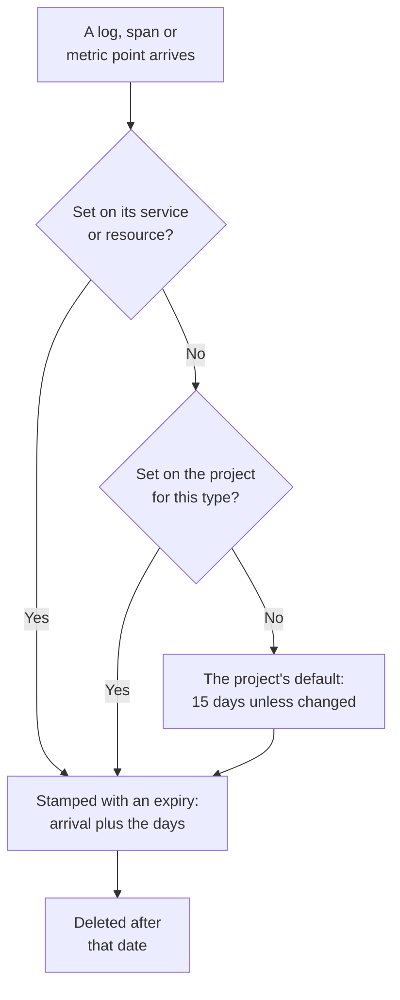

# Data Retention

OneUptime keeps your logs, traces, metrics and profiles for a number of days, then deletes them: 15 days unless you change it. This page shows how that number is worked out, how to change it for the whole project, and how to keep some telemetry longer or shorter than the rest.

:::cards
- [How long telemetry is kept](#how-long-telemetry-is-kept): The order OneUptime reads the settings in.
- [Change the project's retention](#change-the-projects-retention): One number for all your telemetry.
- [Keep some telemetry longer or shorter](#keep-some-telemetry-longer-or-shorter): By type, severity, status or service.
- [What retention costs](#what-retention-costs): Billing on OneUptime Cloud, disk when you self-host.
:::

## How long telemetry is kept

Each log, span, metric point and profile sample gets its retention as it arrives. OneUptime works out how many days to keep it, stamps the date it expires, and deletes it after that date. The most specific setting wins:

In full, OneUptime reads these settings in this order, and the first one set decides:

| Order | Setting | Where it is set |
| --- | --- | --- |
| 1 | Days for one log severity or span status, for one service or resource | **Retention by Telemetry Type**, on its **Settings** page |
| 2 | Days for one type of telemetry, for one service or resource | The same card |
| 3 | Days for everything from one service or resource | **Telemetry Data Retention**, on the same page |
| 4 | Days for one log severity or span status, for the project | **Retention by Telemetry Type**, on **Data Retention** |
| 5 | Days for one type of telemetry, for the project | The same card |
| 6 | Days for everything else | **Default Retention (Days)**, on **Data Retention** |

- **Settings 1 to 5 are retention overrides.** They are part of the [Enterprise Edition](/docs/self-hosted/enterprise), and of the Scale plan on OneUptime Cloud. Without them, every record is kept for the project's default.
- **A change applies to new telemetry.** A record keeps the date it was stamped with: a shorter retention does not delete it sooner, and a longer one does not keep it longer. New records follow a change within about five minutes.
- **Exceptions follow what they were found in.** An exception is kept as long as the span or log it came from. Session replays have a retention of their own: see [Other data with its own retention](#other-data-with-its-own-retention).

## Before you begin

- **A role that changes the project.** Project Owner or Project Admin change the project's retention. A service's or resource's retention takes the role that changes its other settings.
- **For overrides, the Enterprise Edition or the Scale plan.** A self-hosted installation needs an Enterprise license, and a OneUptime Cloud project the Scale plan or above. The project's default retention is in every edition and plan.

## Change the project's retention

:::steps
### Open Data Retention

Go to **Project Settings → Telemetry & APM → Data Retention**. **Telemetry & APM** starts collapsed in the side menu: click it to open it. The **Telemetry Data Retention** card shows the **Default Retention (Days)**.

### Set the number of days

Click **Edit Retention Settings**, enter the number of days, at least 1, and click **Save Changes**.
:::

The new number applies to every record that arrives from then on and has no override of its own.

## Keep some telemetry longer or shorter

Overrides keep what you need longer and the rest shorter: error logs for a quarter, say, and debug logs for a few days.

### For the whole project

Under the default, the **Retention by Telemetry Type** card sets days for each type of telemetry. Click **Edit Overrides**, fill in the fields you need, and leave the rest blank:

| Type | Fields |
| --- | --- |
| Logs | **Logs default (days)**, and one field for each log severity |
| Traces | **Traces default (days)**, and one field for each span status: Error, Ok and Unset |
| Metrics | **Metrics default (days)** |
| Profiles | **Profiles default (days)** |

A field left blank falls back to the next setting in the order above, so a severity without days of its own keeps its logs for the logs default.

### For one service or resource

Open the service's or resource's **Settings** page. Its **Telemetry Data Retention** card holds **Retain Telemetry Data For (Days)**, one number for everything it sends, and its **Retention by Telemetry Type** card has the same fields as the project's. Leave a field blank to use the project's settings.

Services, hosts, Kubernetes clusters, Docker and Podman hosts, Docker Swarm, Proxmox and Ceph clusters, storage arrays, vCenters, databases, serverless functions, cloud resources, RUM applications and IoT fleets all have these cards. See the [Service Catalog](/docs/telemetry/services#change-a-service) for a service's **Settings** page.

### When the plan or license no longer includes overrides

- **On a self-hosted installation**, overrides stop applying once the Enterprise trial or grace period ends without a license. New telemetry is kept for the project's default, the cards become read-only, and nothing you set is deleted: activate a license and they apply again. See [Enterprise Edition](/docs/self-hosted/enterprise#when-a-license-expires-or-is-missing).
- **On OneUptime Cloud**, an override that a trial left set keeps applying below the Scale plan. Its page shows it under the upgrade card, with a **Remove Override** button that works on every plan. Setting an override again needs the Scale plan.

## Other data with its own retention

| Data | Kept for | Where to change it |
| --- | --- | --- |
| Session replays | 7 days unless changed | The RUM application's replay policy: see [Managing Applications](/docs/rum/applications#session-replay-retention). |
| Monitor logs, one row per check | 1 day unless changed | On a self-hosted installation, **Monitor Log Retention (Days)** in the Admin Dashboard |
| Monitor metrics, and the metrics SLOs record | 30 days unless changed | On a self-hosted installation, **Monitor Metric Retention (Days)** in the Admin Dashboard |

## What retention costs

- **On OneUptime Cloud**, telemetry is billed per GB ingested, and the per-GB price includes 15 days of retention. Longer retention costs proportionally more: 30 days costs twice as much per GB as 15. Shorter retention costs proportionally less, but retention under 7 days is billed as 7 days. **Project Settings → Billing and Invoices → Usage History** shows, day by day, how much each service sent and how long it is kept.
- **When you self-host**, telemetry lives in ClickHouse, and retention multiplies its disk. See [Sizing](/docs/installation/sizing#retention-and-how-it-affects-storage).

Telemetry you do not need costs nothing if it is never stored: [Drop Filters & Scrub Rules](/docs/telemetry/drop-filters-and-scrub-rules) drop it as it arrives.

## Troubleshooting

:::details I lowered the retention, but old data is still there
A record keeps the expiry date it was stamped with when it arrived. Records stored before the change are deleted on their own dates, and only new records follow the new retention.
:::

:::details The override cards show an upgrade prompt
Retention overrides need the Enterprise Edition on a self-hosted installation, and the Scale plan on OneUptime Cloud. Until then, everything is kept for the project's default.
:::

:::details Disk space comes back a day after data expires
Expired records stop showing in searches, charts and lists as soon as they expire. On disk, logs and metrics are deleted at the first midnight after that, so their space comes back up to a day later.
:::

## Next steps

:::cards
- [Ingestion Keys](/docs/telemetry/ingestion-keys): Send telemetry into your project.
- [Drop Filters & Scrub Rules](/docs/telemetry/drop-filters-and-scrub-rules): Keep only the telemetry you need.
- [Service Catalog](/docs/telemetry/services): Set a service's own retention.
- [Enterprise Edition](/docs/self-hosted/enterprise): What retention overrides come with.
:::
