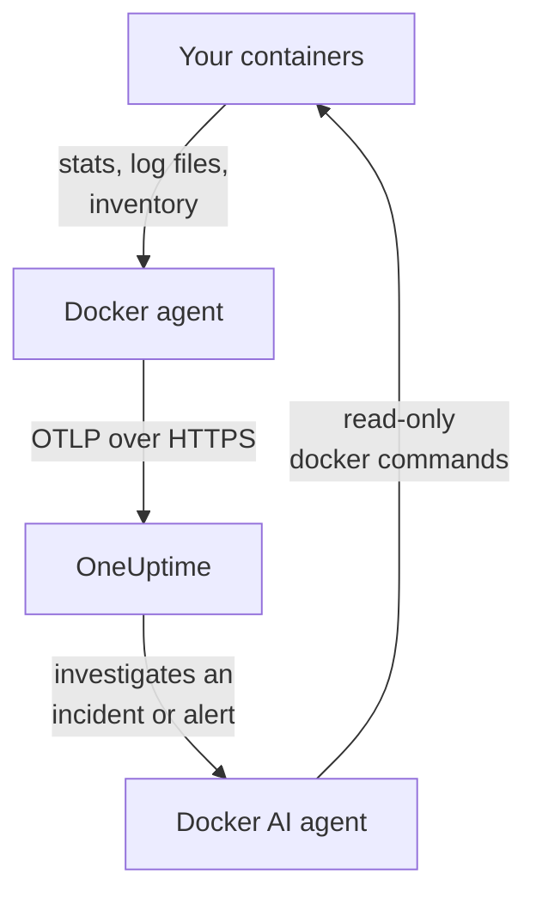

# Docker Agent

The OneUptime Docker agent is one container you run on a Docker host. It reads the stats and log files of every container on the host and sends them to OneUptime, where the host appears with its containers, metrics and logs. A second container, the Docker AI agent, lets OneUptime AI investigate the host. [Docker monitors](/docs/monitor/docker-monitor) alert on what the agent sends.

:::cards
- [Install the agent](#install-the-agent): Two containers, with `docker run` or Docker Compose.
- [What the agent collects](#what-the-agent-collects): Metrics, logs and an inventory of every container.
- [Container logs need json-file](#container-logs-need-the-json-file-log-driver): Check and switch a container's log driver.
- [Troubleshooting](#troubleshooting): Restart loops, missing metrics, missing logs.
:::

## How it works

The agent is an OpenTelemetry Collector with OneUptime's configuration built in. Through the Docker socket it reads each container's stats every 30 seconds and lists every container, image, network and volume every 5 minutes. It tails the containers' log files and sends everything to your OneUptime URL over OTLP, with the ingestion key you give it.



The host registers itself with its first data, under the name you give it in `DOCKER_HOST_NAME`. The AI agent is optional: leave it out and the collector works the same.

## Before you begin

- Docker Engine 20.10 or later, and root access on the host: the agent reads `/var/run/docker.sock`.
- Docker Compose v2 (the `docker compose` command), if you install with Docker Compose.
- An ingestion key. Create one under **Project Settings → Telemetry & APM → Ingestion Keys** and copy its value.
- Outbound HTTPS from the host to your OneUptime URL.
- For container logs, containers that use Docker's `json-file` log driver, which is Docker's default. See [Container logs need the json-file log driver](#container-logs-need-the-json-file-log-driver).

## Install the agent

:::steps
### Start the agent

Replace `YOUR_ONEUPTIME_URL` with your OneUptime URL, `YOUR_TELEMETRY_INGESTION_TOKEN` with the ingestion key, and `my-docker-host` with a name for this host, such as `prod-docker-01`. The name is how the host appears in OneUptime, so keep it stable: a new name registers a new host.

:::tabs
@tab Docker CLI
```bash
docker run -d \
  --name oneuptime-docker-agent \
  --user 0:0 \
  --restart unless-stopped \
  -v /var/run/docker.sock:/var/run/docker.sock:ro \
  -v /var/lib/docker/containers:/var/lib/docker/containers:ro \
  -e ONEUPTIME_URL="YOUR_ONEUPTIME_URL" \
  -e ONEUPTIME_SERVICE_TOKEN="YOUR_TELEMETRY_INGESTION_TOKEN" \
  -e DOCKER_HOST_NAME="my-docker-host" \
  oneuptime/docker-agent:release
```

Then start the [AI agent](#ai-agent) beside it, with the same values. **AI investigations are on by default**: while OneUptime AI investigates an incident or alert on this host, it runs read-only `docker` commands through the AI agent, and it changes nothing unless you allow fixes. To install without AI investigations, skip this command.

```bash
docker run -d \
  --name oneuptime-docker-ai-agent \
  --user 0:0 \
  --restart unless-stopped \
  --read-only --tmpfs /tmp \
  -v /var/run/docker.sock:/var/run/docker.sock:ro \
  -e ONEUPTIME_URL="YOUR_ONEUPTIME_URL" \
  -e ONEUPTIME_SERVICE_TOKEN="YOUR_TELEMETRY_INGESTION_TOKEN" \
  -e ONEUPTIME_AI_AGENT_RESOURCE_TYPE=docker \
  -e DOCKER_HOST_NAME="my-docker-host" \
  oneuptime/resource-ai-agent:release
```
@tab Docker Compose
Save this as `docker-compose.yml` in a folder on the host. The second service is the [AI agent](#ai-agent): leave it out to run the collector without AI investigations.

```yaml title="docker-compose.yml"
services:
  oneuptime-docker-agent:
    image: oneuptime/docker-agent:release
    container_name: oneuptime-docker-agent
    user: "0:0"
    restart: unless-stopped
    volumes:
      - /var/run/docker.sock:/var/run/docker.sock:ro
      - /var/lib/docker/containers:/var/lib/docker/containers:ro
    environment:
      - ONEUPTIME_URL=YOUR_ONEUPTIME_URL
      - ONEUPTIME_SERVICE_TOKEN=YOUR_TELEMETRY_INGESTION_TOKEN
      - DOCKER_HOST_NAME=my-docker-host
    logging:
      driver: json-file
      options:
        max-size: "10m"
        max-file: "3"
  oneuptime-docker-ai-agent:
    image: oneuptime/resource-ai-agent:release
    container_name: oneuptime-docker-ai-agent
    user: "0:0"
    restart: unless-stopped
    read_only: true
    tmpfs:
      - /tmp
    volumes:
      - /var/run/docker.sock:/var/run/docker.sock:ro
    environment:
      - ONEUPTIME_URL=YOUR_ONEUPTIME_URL
      - ONEUPTIME_SERVICE_TOKEN=YOUR_TELEMETRY_INGESTION_TOKEN
      - ONEUPTIME_AI_AGENT_RESOURCE_TYPE=docker
      - DOCKER_HOST_NAME=my-docker-host
```

Start it in that folder:

```bash
docker compose up -d
```
:::

### Check the agent is running

```bash
docker ps --filter name=oneuptime-docker-agent
docker logs -f oneuptime-docker-agent
```

The logs should show this line once the collector has started:

```text
Everything is ready. Begin running and processing data.
```

### Find the host in OneUptime

Open **Products → Infrastructure → Docker → All Hosts**. The host appears under its `DOCKER_HOST_NAME` within a minute or so, with its containers, metrics and logs. The AI agent shows as connected on the host's **AI agent** page, and at the bottom of its **Overview**.
:::

## Environment variables

| Variable | Required | Description |
| --- | --- | --- |
| `ONEUPTIME_URL` | Yes | Your OneUptime URL, such as `https://oneuptime.com` or your self-hosted instance. Use `http://` and its port if the instance is HTTP-only. |
| `ONEUPTIME_SERVICE_TOKEN` | Yes | The ingestion key from **Project Settings → Telemetry & APM → Ingestion Keys**. |
| `DOCKER_HOST_NAME` | No | The host's name in OneUptime. Defaults to `docker-host`, so give every host its own. |
| `DOCKER_API_VERSION` | No | The Docker Engine API version the agent speaks. Defaults to `1.44`. Lower it on an older daemon, or set it to an empty value to negotiate it with the daemon (see [Troubleshooting](#troubleshooting)). |

To change a value, remove the agent and run its command again (Docker CLI), or edit `docker-compose.yml` and run `docker compose up -d` (Docker Compose).

## What the agent collects

| Data | What it is |
| --- | --- |
| Container metrics | CPU (usage, percentage, throttling), memory (usage, limit, percentage), network and block I/O, uptime, restarts and process count, per container, every 30 seconds. |
| Container logs | The stdout and stderr of every container, from its `json-file` log file. |
| Inventory | Every container in every state, and every image, network and volume, every 5 minutes. |

Each container's metrics and logs are filed under a service named after the container. Each log line gets a severity from the level it names, such as `[ERROR]`, `level=warn` or `{"level":"info"}`; a line that names none takes its stream's: stderr is `ERROR`, stdout is `INFO`. Lines that start with whitespace or a closing bracket join the line before, so a stack trace arrives as one record. The agent's own logs are left out.

[Docker Monitor](/docs/monitor/docker-monitor#collected-metrics) lists every metric and what it means.

## Container logs need the json-file log driver

The agent tails `/var/lib/docker/containers/*/*-json.log`, the files Docker's `json-file` log driver writes. A container that uses another driver leaves no file to read: `local` writes binary files, and `journald`, `syslog`, `fluentd` and `gelf` send the logs elsewhere. Its metrics still arrive; its logs do not.

Check a container's log driver, and the daemon's default:

```bash
docker inspect <container> --format '{{.HostConfig.LogConfig.Type}}'
docker info --format '{{.LoggingDriver}}'
```

Switch a Compose service to `json-file`, with rotation:

```yaml
services:
  my-app:
    image: my-app:latest
    logging:
      driver: "json-file"
      options:
        max-size: "100m"
        max-file: "5"
```

Or make it the default for every container created afterwards, in `/etc/docker/daemon.json`:

```json title="/etc/docker/daemon.json"
{
  "log-driver": "json-file",
  "log-opts": {
    "max-size": "100m",
    "max-file": "5"
  }
}
```

Then restart Docker and recreate the containers. A container keeps the log driver it was created with, so restarting it is not enough.

## Upgrading the agent

When the agent is older than your OneUptime, a warning sign appears beside **Agent Version** on the host's **Overview**. Select it to see these commands.

:::tabs
@tab Docker CLI
```bash
docker pull oneuptime/docker-agent:release
docker pull oneuptime/resource-ai-agent:release
docker rm -f oneuptime-docker-agent oneuptime-docker-ai-agent
```

Then run both `docker run` commands from [Start the agent](#start-the-agent) again.
@tab Docker Compose
```bash
docker compose pull
docker compose up -d
```
:::

The `release` tag always points at the newest release. To pin a version, use `oneuptime/docker-agent:<version>`, such as `oneuptime/docker-agent:10.0.31`. The same image is on the GitHub Container Registry as `ghcr.io/oneuptime/docker-agent:release`.

## Uninstalling the agent

:::tabs
@tab Docker CLI
```bash
docker rm -f oneuptime-docker-agent
docker rm -f oneuptime-docker-ai-agent
```
@tab Docker Compose
```bash
docker compose down
```
:::

The host stays in OneUptime with the data it sent. Delete it from the host's **Settings** if you no longer need it.

## AI agent

The commands and the Compose file above, the Docker agent's `install.sh` and the `docker-compose.yml` in its [DockerAgent directory](https://github.com/OneUptime/oneuptime/tree/master/agents/DockerAgent) all run the **Docker AI agent**: a second container, `oneuptime-docker-ai-agent` (image `oneuptime/resource-ai-agent:release`), that runs the read-only `docker` commands OneUptime AI asks for while it investigates an incident or alert on this host — `docker ps -a`, `docker logs --tail 200 web`, `docker container inspect web`, `docker stats --no-stream` — and, only if you allow it, applies fixes such as restarting a named container. It reads the same `ONEUPTIME_URL`, `ONEUPTIME_SERVICE_TOKEN` and `DOCKER_HOST_NAME` as the collector, so it serves exactly this host, and it shows up on the host's **AI agent** page in OneUptime.

- **AI investigations are on by default.** Once the agent connects, OneUptime AI investigates incidents and alerts on this host with it, and the host's **Overview** shows the agent's status. To stop, set `ONEUPTIME_AI_INVESTIGATION=false` where the agent runs (**Change** under **What AI may do** on the AI agent page shows how), or leave the agent out.
- It is read-only unless you start it with `ONEUPTIME_AI_ALLOW_WRITES=true`; `ONEUPTIME_AI_WRITE_TARGETS` (for example `web-*,api-*`) limits which containers a fix may touch. Start it with `ONEUPTIME_AI_FIXES` too, to say how fixes run — `ask-for-approval` (a person approves each one), `automatic` or `bypass-approval` — and the AI agent page shows it read-only ([What AI may do, set by the agent](/docs/ai/infrastructure-ai-agents#what-ai-may-do-set-by-the-agent)).
- It runs as root with the Docker socket mounted, because the socket is root-owned — and whoever can use the socket is root on this host, `:ro` or not. The agent's command policy is the limit: it never runs `exec`, `run`, `rm` or `prune`, and it never changes itself, the collector or anything in `ONEUPTIME_AI_PROTECTED_TARGETS` (container name globs). Environment values in `docker inspect` output are masked before anything leaves the host.
- `install.sh --no-ai-agent` leaves it out; `docker rm -f oneuptime-docker-ai-agent` removes it. Upgrade it like the collector: `docker pull oneuptime/resource-ai-agent:release`, remove it, and start it again.

What it may run, how fixes work and how to troubleshoot it: [Infrastructure AI Agents](/docs/ai/infrastructure-ai-agents#docker-and-podman-hosts).

## Troubleshooting

:::details The agent restarts with "client version is too new"
The agent's logs show:

```text
Error: cannot start pipelines: failed to start "docker_stats" receiver:
Error response from daemon: client version 1.44 is too new.
Maximum supported API version is 1.41
```

A daemon refuses a client newer than its own maximum, so the receiver never starts and the collector exits with it. Find the daemon's maximum:

```bash
docker version --format '{{ .Server.APIVersion }}'
```

Then add `-e DOCKER_API_VERSION=1.41` (or the value you got) to `docker run`, or set `DOCKER_API_VERSION` in Compose. Newer daemons still serve older API versions, so the setting stays valid after an upgrade.

Rather not look the number up? Set `DOCKER_API_VERSION` to the empty string. The agent then negotiates the version with the daemon (one `HEAD /_ping`, then the daemon's own maximum), which works against both old and new daemons:

```bash
docker run -d ... -e DOCKER_API_VERSION= ...
```
:::

:::details Docker socket permission denied
The agent must run as root to read `/var/run/docker.sock`. Check that `--user 0:0` is in your `docker run` command, or `user: "0:0"` in Compose.
:::

:::details The host shows as Disconnected
1. Check that the agent is running: `docker ps --filter name=oneuptime-docker-agent`
2. Look for errors in its logs: `docker logs oneuptime-docker-agent 2>&1 | grep -i error`
3. Check `ONEUPTIME_URL` and `ONEUPTIME_SERVICE_TOKEN`: the key must be a valid ingestion key that has not been disabled.
4. Check that the host can reach your OneUptime URL over the network.
:::

:::details No metrics appear
1. Check that the Docker socket is mounted into the agent. Its image has no shell, so look from a throwaway container that shares its mounts: `docker run --rm --volumes-from oneuptime-docker-agent alpine:3.19 ls -la /var/run/docker.sock`
2. Look for export errors in its logs: `docker logs oneuptime-docker-agent 2>&1 | tail -100`
3. Check that the ingestion key is valid and has not expired.
:::

:::details Metrics arrive but no container logs
Your containers most likely use another log driver than `json-file`. Check which files the agent watches, and which driver a container uses:

```bash
docker logs oneuptime-docker-agent 2>&1 | grep -E "Started watching file|no files match"
docker inspect <container> --format '{{.HostConfig.LogConfig.Type}}'
```

If the agent reports `no files match the configured criteria`, switch the containers to `json-file` and recreate them, as [Container logs need the json-file log driver](#container-logs-need-the-json-file-log-driver) shows.
:::

:::details The logs are on another host, or the host is named docker-host
The host's name comes from `DOCKER_HOST_NAME`. An agent started without it reports `docker-host`, so every host set up that way looks like the same one; change the name later and OneUptime registers a second host, which then holds the new data. Set `DOCKER_HOST_NAME` to a name of its own on each host, and recreate the agent. To check the name the agent reports:

```bash
docker inspect oneuptime-docker-agent --format '{{range .Config.Env}}{{println .}}{{end}}' | grep DOCKER_HOST_NAME
```
:::

## Next steps

:::cards
- [Docker Monitor](/docs/monitor/docker-monitor): Alert on container CPU, memory and restarts.
- [Databases](/docs/telemetry/databases): Database containers on the host are found and get pages of their own.
- [Kubernetes Agent](/docs/telemetry/kubernetes-agent): Monitor a Kubernetes cluster instead.
- [Host OpenTelemetry Collector](/docs/telemetry/host-otel-collector): Monitor the machine itself: CPU, disks, processes and logs.
:::
