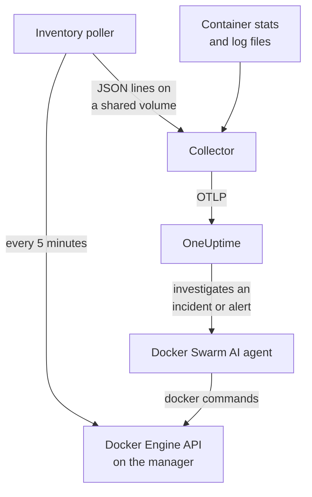

# Docker Swarm Agent

The OneUptime Docker Swarm agent monitors a Docker Swarm cluster: its nodes, services, tasks, stacks, overlay networks, secrets, configs and volumes, plus each container's metrics and logs. You run it with Docker Compose on a swarm manager node, and the cluster appears in OneUptime with all of them. [Docker Swarm monitors](/docs/monitor/docker-swarm-monitor) alert on what arrives.

:::cards
- [Install the agent](#install-the-agent): The install script or Docker Compose, on a manager node.
- [What the agent collects](#what-the-agent-collects): The inventory, the cluster counts, and container metrics and logs.
- [AI agent](#ai-agent): Let OneUptime AI read the swarm while it investigates.
- [Troubleshooting](#troubleshooting): A diagnostic script, and the usual problems.
:::

## How it works

The agent is three containers, all defined in one `docker-compose.yml`:

1. **Collector**: an OpenTelemetry Collector that reads `docker_stats` for each container's metrics, tails the containers' log files, and tails the inventory snapshot file. It stamps everything with your cluster's name (`docker.swarm.cluster.name`) and sends it to OneUptime over OTLP.
2. **Inventory poller**: a small `curl` and `jq` sidecar that every 5 minutes walks the swarm manager's API (`/nodes`, `/services`, `/tasks`, `/networks`, `/secrets`, `/configs`, `/volumes`) and works out the stacks from the `com.docker.stack.namespace` service label. It writes one JSON line per object for the collector to forward.
3. **AI agent**: `oneuptime-docker-swarm-ai-agent`, which runs the `docker` commands OneUptime AI asks for while it investigates an incident or alert on this cluster. It is read-only unless you allow fixes (see [AI agent](#ai-agent)).



The cluster registers itself with its first data, under the cluster name you configure.

## Before you begin

- A swarm **manager** node to run the agent on: the inventory poller and the AI agent call API endpoints only managers answer.
- Docker Engine 20.10 or later with the Docker Compose v2 plugin.
- An ingestion key. Create one under **Project Settings → Telemetry & APM → Ingestion Keys** and copy its value.
- Outbound HTTPS from the node to your OneUptime URL.

### Where to run the agent

Run it on a manager node. The collector reports the containers of the node it runs on, so for every node's container metrics, run the collector on every node, all with the same `DOCKER_SWARM_CLUSTER_NAME`; the inventory poller and the AI agent need to run on one manager only. `install.sh` leaves the AI agent out on a node that is not a manager (and removes one it installed there before). An AI agent started on a worker anyway never registers for the cluster: it waits until its node is a manager, so it cannot keep the manager's AI agent out. Deploying the agent as a swarm stack instead of with Compose? Keep the inventory poller and the AI agent on managers with the constraint `node.role == manager`.

## Install the agent

:::steps
### Install and start the agent

:::tabs
@tab install.sh
Download the install script and run it on a manager node:

```bash
curl -sSL https://raw.githubusercontent.com/OneUptime/oneuptime/master/agents/DockerSwarmAgent/install.sh -o install.sh
sh install.sh
```

The script asks for your OneUptime URL, the ingestion key and a name for the cluster. It installs to `/opt/oneuptime-docker-swarm-agent`, writes a `.env` file only its owner can read, and starts all three containers. Add `--no-ai-agent` to leave the AI agent out.
@tab Docker Compose
Download `docker-compose.yml`, `otel-collector-config.yaml` and `inventory-snapshot.sh` from the [DockerSwarmAgent directory](https://github.com/OneUptime/oneuptime/tree/master/agents/DockerSwarmAgent) into a new folder on a manager node:

```bash
curl -fsSL https://raw.githubusercontent.com/OneUptime/oneuptime/master/agents/DockerSwarmAgent/docker-compose.yml -o docker-compose.yml
curl -fsSL https://raw.githubusercontent.com/OneUptime/oneuptime/master/agents/DockerSwarmAgent/otel-collector-config.yaml -o otel-collector-config.yaml
curl -fsSL https://raw.githubusercontent.com/OneUptime/oneuptime/master/agents/DockerSwarmAgent/inventory-snapshot.sh -o inventory-snapshot.sh
chmod +x inventory-snapshot.sh
```

Create a `.env` file next to them. It holds the ingestion key, so keep it private with `chmod 600 .env`:

```bash title=".env"
ONEUPTIME_URL=https://oneuptime.com
ONEUPTIME_SERVICE_TOKEN=your-telemetry-ingestion-key
DOCKER_SWARM_CLUSTER_NAME=my-swarm
```

Start the agent:

```bash
docker compose up -d
```
:::

### Check the agent is running

```bash
docker compose ps
docker compose logs --tail 50 oneuptime-docker-swarm-agent oneuptime-docker-swarm-inventory
```

`docker compose ps` lists three containers: the collector (`oneuptime-docker-swarm-agent`), the inventory poller (`oneuptime-docker-swarm-inventory`) and the AI agent (`oneuptime-docker-swarm-ai-agent`).

### Find the cluster in OneUptime

Open **Products → Infrastructure → Docker Swarm → All Clusters**. The cluster appears within a few minutes, and its **Nodes**, **Services**, **Tasks**, **Stacks**, **Networks**, **Secrets**, **Configs** and **Volumes** pages fill in after the first inventory snapshot, within 5 minutes.
:::

## Environment variables

The install script writes the first three to `/opt/oneuptime-docker-swarm-agent/.env`; a Docker Compose install reads them from the `.env` next to `docker-compose.yml`. Add or change any of them there, then run `docker compose up -d` in that folder.

| Variable | Required | Description |
| --- | --- | --- |
| `ONEUPTIME_URL` | Yes | Your OneUptime URL, such as `https://oneuptime.com` or your self-hosted instance. Use `http://` and its port if the instance is HTTP-only. |
| `ONEUPTIME_SERVICE_TOKEN` | Yes | The ingestion key from **Project Settings → Telemetry & APM → Ingestion Keys**. |
| `DOCKER_SWARM_CLUSTER_NAME` | Yes | The cluster's name in OneUptime, and the key every node's data joins by: stamped on everything as the `docker.swarm.cluster.name` resource attribute. Keep it stable: changing it later registers a second cluster. Defaults to `docker-swarm`. |
| `DOCKER_INVENTORY_INTERVAL_SECONDS` | No | How often the inventory poller takes a snapshot, in seconds. Defaults to `300`. |
| `DOCKER_API_VERSION` | No | The Docker Engine API version the collector and the inventory poller speak. Defaults to `1.44`; empty negotiates it with the daemon (see [Troubleshooting](#troubleshooting)). The AI agent negotiates it unless you set one. |

The AI agent's own settings are under [AI agent](#ai-agent).

## What the agent collects

| Signal | Source | Where it shows |
| --- | --- | --- |
| The nodes, services, tasks, stacks, networks, secrets, configs and volumes | The inventory poller, from the swarm manager's API | The cluster's lists and detail pages |
| Cluster counts (nodes ready, tasks running, services, stacks, …) | The same snapshot | The Overview's cards and the side menu's badges |
| Container CPU, memory, process count and uptime | The `docker_stats` receiver | The **Metrics** page |
| Container stdout and stderr logs | The `filelog` receiver | The **Logs** page |

### How it differs from the Docker agent

The [Docker agent](/docs/telemetry/docker-host) models one host, and stamps `host.name` and `container.runtime=docker`. The Docker Swarm agent stamps only `docker.swarm.cluster.name`, on purpose: OneUptime then files the data under the swarm cluster, instead of registering each node as a host of its own.

## Tag the cluster with project labels

A resource attribute that starts with `oneuptime.label.` becomes a project label on the cluster: `oneuptime.label.<dimension>=<value>` is the label `<dimension>:<value>`. Add the attributes to the `resource` processor in `otel-collector-config.yaml`, next to `docker.swarm.cluster.name`:

```yaml
processors:
  resource:
    attributes:
      # ...existing attributes...
      - key: oneuptime.label.team
        value: platform
        action: upsert
      - key: oneuptime.label.env
        value: production
        action: upsert
```

The collector reads its config only when it starts: run `docker compose restart oneuptime-docker-swarm-agent`. The cluster then shows the labels `team:platform` and `env:production`. Labels are matched without regard to case, so an existing `Production` label is reused rather than duplicated, and the agent never removes a label someone added in OneUptime.

## Run as a systemd service

To start the agent with the node and restart it when it fails, install its systemd unit. It assumes the agent lives in `/opt/oneuptime-docker-swarm-agent`, where the install script puts it:

```bash
sudo curl -fsSL https://raw.githubusercontent.com/OneUptime/oneuptime/master/agents/DockerSwarmAgent/systemd/oneuptime-docker-swarm-agent.service -o /etc/systemd/system/oneuptime-docker-swarm-agent.service
sudo systemctl daemon-reload
sudo systemctl enable --now oneuptime-docker-swarm-agent
```

## Upgrading the agent

The agent reports the collector version it runs. When that is older than the version this OneUptime release pins, a warning sign appears beside the agent's version on the cluster's **Overview**. Select it to see these commands.

Run the install script again on the manager node, and answer its questions with the same URL, key and cluster name. It downloads the latest files, pulls the images and restarts the agent:

```bash
curl -sSL https://raw.githubusercontent.com/OneUptime/oneuptime/master/agents/DockerSwarmAgent/install.sh -o install.sh
sh install.sh
```

The script writes `.env` again from your answers. It keeps only the AI agent's target lists and what AI may do (`ONEUPTIME_AI_INVESTIGATION`, `ONEUPTIME_AI_FIXES`): add back any variable you set yourself, such as `DOCKER_API_VERSION`. Turned AI fixes on? Run it as `ONEUPTIME_AI_ALLOW_WRITES=true sh install.sh` to keep them on. Left the AI agent out? Pass `--no-ai-agent` again.

With Docker Compose, download the three files again in the agent's folder (then make again any change you made to `docker-compose.yml`), and pull and restart:

```bash
docker compose pull
docker compose up -d
```

The collector version is pinned in the files, so pulling alone does not move the agent forward.

## Uninstalling the agent

```bash
cd /opt/oneuptime-docker-swarm-agent
docker compose down
```

## AI agent

The swarm's `docker-compose.yml` (and `install.sh`) also runs the **Docker Swarm AI agent**: a third container, `oneuptime-docker-swarm-ai-agent` (image `oneuptime/resource-ai-agent:release`), that runs the read-only `docker` commands OneUptime AI asks for while it investigates an incident or alert on this cluster — `docker node ls`, `docker service ps web --no-trunc`, `docker service logs --tail 200 web` — and, only if you allow it, applies fixes such as a rolling restart of a named service. It reads the same `ONEUPTIME_URL`, `ONEUPTIME_SERVICE_TOKEN` and `DOCKER_SWARM_CLUSTER_NAME` as the collector, so it serves exactly this cluster, and it shows up on the cluster's **AI → AI agent** page in OneUptime.

- **AI investigations are on by default.** Once the agent connects, OneUptime AI investigates incidents and alerts on this cluster with it, and the cluster's **Overview** shows the agent's status. To stop, set `ONEUPTIME_AI_INVESTIGATION=false` where the agent runs (**Change** under **What AI may do** on the AI agent page shows how), or leave the agent out.
- Like the inventory poller it **must run on a manager node**: node, service and task commands are manager-only. On a worker it runs nothing and does not register for the cluster until the node is a manager (its `/status` says why). Run one per cluster.
- It is **read-only** unless you set `ONEUPTIME_AI_ALLOW_WRITES=true` in `.env` and run `docker compose up -d` (or run `install.sh` with it; the installer writes `ONEUPTIME_AI_ALLOW_WRITES`, `ONEUPTIME_AI_INVESTIGATION`, `ONEUPTIME_AI_FIXES`, `ONEUPTIME_AI_WRITE_TARGETS` and `ONEUPTIME_AI_PROTECTED_TARGETS` from its environment into `.env`, and a re-run keeps what `.env` already has for the last four unless you pass that variable, even empty); `ONEUPTIME_AI_WRITE_TARGETS` (service and node name globs, for example `web_*,api_*`) limits what a fix may touch. `ONEUPTIME_AI_FIXES` in the same `.env` says how fixes run — `ask-for-approval` (a person approves each one), `automatic` or `bypass-approval` — and the AI agent page shows it read-only ([What AI may do, set by the agent](/docs/ai/infrastructure-ai-agents#what-ai-may-do-set-by-the-agent)). Draining a node always needs a person's approval, whatever the mode.
- It runs as root with the Docker socket mounted, because the socket is root-owned — and on a manager, whoever can use the socket controls the whole swarm, `:ro` or not. The agent's command policy is the limit: it never creates or removes services or stacks, never touches secrets or configs, and never changes itself, the collector, the inventory poller or anything in `ONEUPTIME_AI_PROTECTED_TARGETS` (service and node name globs).
- `install.sh --no-ai-agent` leaves it out, or delete the `oneuptime-docker-swarm-ai-agent` service from `docker-compose.yml`.

What it may run, how fixes work and how to troubleshoot it: [Infrastructure AI Agents](/docs/ai/infrastructure-ai-agents#docker-swarm-clusters).

## Troubleshooting

:::details Run the diagnostic script first
The agent ships with a script, [`troubleshoot.sh`](https://github.com/OneUptime/oneuptime/blob/master/agents/DockerSwarmAgent/troubleshoot.sh), that checks the whole chain: the containers, that the inventory poller is on a manager (`docker node ls`), the snapshot file, the cluster name stamped on everything, the token's shape, the collector's own metrics, and whether OneUptime accepts the ingestion key. That last check matters most. OneUptime refuses a bad key with `401` (`422` for a disabled key or a browser key), and the collector logs it as one `Exporting failed` line per batch, which is easy to miss. The script asks `GET <url>/otlp/v1/validate` for a direct `200` (valid) or `401` (invalid). Run it on the manager node:

```bash
curl -sSL https://raw.githubusercontent.com/OneUptime/oneuptime/master/agents/DockerSwarmAgent/troubleshoot.sh -o troubleshoot.sh
bash troubleshoot.sh    # add -d <dir> if you installed outside /opt/oneuptime-docker-swarm-agent
```
:::

:::details The cluster never appears
Run the diagnostic script first. Otherwise read the collector's logs (`docker compose logs oneuptime-docker-swarm-agent`), check that `ONEUPTIME_SERVICE_TOKEN` and `ONEUPTIME_URL` in `.env` are right, and that the node can reach your OneUptime URL.
:::

:::details No inventory appears
Check that the inventory poller runs on a manager: `docker node ls` must succeed there. Then look for `failed to emit ...` lines in its logs: `docker compose logs oneuptime-docker-swarm-inventory`.
:::

:::details The cluster flips to Disconnected
A cluster turns Disconnected when OneUptime has received nothing from it for 15 minutes; OneUptime checks every 5 minutes, and time it was not receiving data itself does not count. Make sure the collector container stays up: `docker compose ps` shows it.
:::

:::details The collector exits with "client version is too new"
The collector's logs show:

```text
Error: cannot start pipelines: failed to start "docker_stats" receiver:
Error response from daemon: client version 1.44 is too new.
Maximum supported API version is 1.41
```

The daemon's highest API version is below the default `1.44` (Docker Engine 20.10 stops at `1.41`), so the `docker_stats` receiver cannot start and the container restarts in a loop. Find the daemon's highest version:

```bash
docker version --format '{{ .Server.APIVersion }}'
```

Set `DOCKER_API_VERSION` to that value in `.env`, and run `docker compose up -d` on every node the agent runs on. Newer daemons still serve older API versions, so the setting keeps working after you upgrade Docker. Or set `DOCKER_API_VERSION=` (empty) to have the collector negotiate the version with the daemon instead of pinning one.
:::

:::details The cluster appears under the wrong name
The cluster's name comes from `DOCKER_SWARM_CLUSTER_NAME`. Change it in `.env` and run `docker compose up -d`: a new name registers a new cluster rather than renaming the old one.
:::

## Next steps

:::cards
- [Docker Swarm Monitor](/docs/monitor/docker-swarm-monitor): Alert on nodes, services, tasks and containers.
- [Infrastructure AI Agents](/docs/ai/infrastructure-ai-agents): What the Docker Swarm AI agent may run, and how fixes work.
- [Docker Agent](/docs/telemetry/docker-host): Monitor a single Docker host instead.
:::
