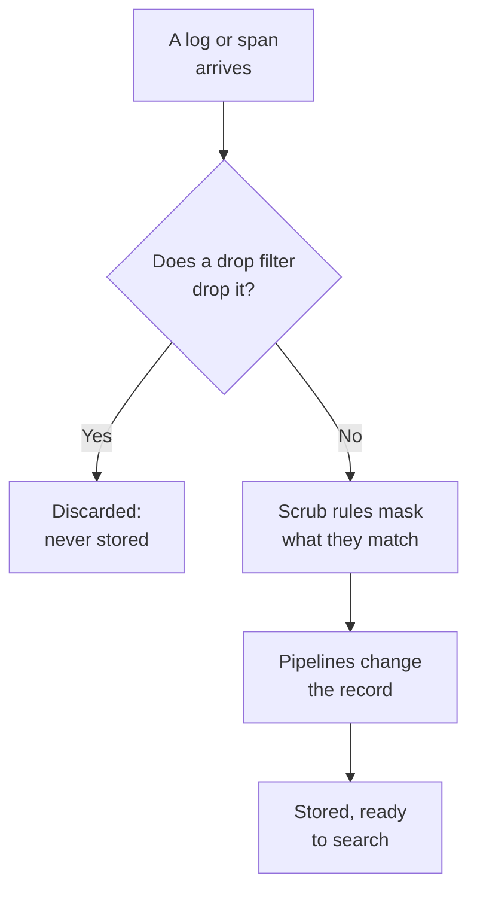

# Drop Filters & Scrub Rules

Drop filters and scrub rules act on your logs and spans as they arrive, before anything is stored. A drop filter throws away the records you never need, or keeps only a sample of them. A scrub rule masks personal data and secrets, such as email addresses, card numbers and passwords, so they never reach your storage.

:::cards
- [Where they run](#where-they-run): Before pipelines, before storage.
- [Drop or sample records](#drop-or-sample-records): Match records, then drop them or keep a share.
- [Scrub sensitive data](#scrub-sensitive-data): Redact, mask or hash what a pattern finds.
- [Check what a filter dropped](#check-what-a-filter-dropped): Counts on every filter.
:::

## Where they run

Logs have theirs under **Logs → Settings**, and spans under **Traces → Settings**. As a record arrives, OneUptime runs them in this order:



- **They act on new records only.** A rule you create or change applies to records that arrive about a minute later. Records already stored are not changed.
- **A dropped record is gone.** No search, chart, monitor or recording rule ever sees it, and no exception is made from it. On OneUptime Cloud, it is not billed either.
- **Each list runs in order.** Drag the rows of a list to change the order. Only enabled filters and rules run.

Log drop filters and scrub rules apply to logs from OpenTelemetry, syslog, Fluent Bit and Fluentd alike. [Log Pipelines](/docs/telemetry/log-pipelines) explains the step after them.

## Before you begin

- **Logs or spans arriving.** See [OpenTelemetry](/docs/telemetry/open-telemetry).
- **A role that changes telemetry settings.** Project Owner or Project Admin, or a custom role with the permission for what you change, such as Create Log Drop Filter or Create Trace Scrub Rule. The Telemetry roles can see filters and rules, but not change them.

## Drop or sample records

:::steps
### Open Drop Filters

Go to **Logs → Settings → Drop Filters**, or **Traces → Settings → Drop Filters** for spans.

### Match the records

Click **Create Log Drop Filter**, or **Create Trace Drop Filter** for spans. On **Match**, give the filter a **Name**, then build its **Filter Query**: a field, an operator and a value for each condition, and whether **All conditions** or **Any condition** must match. Click **Next**.

### Choose the action

On **Action**, keep **Drop** to discard every matching record, or pick **Sample** and enter the **Sample Percentage** to keep, from 1 to 99. Then create the filter.
:::

The filter starts dropping within a minute. To save it without dropping anything yet, turn **Enabled** off under **Advanced** before you create it.

> [!WARNING]
> A dropped record cannot be brought back. Keep a filter's query narrow, and watch its **Dropped** count after you create it.

A filter can test these fields, and any attribute with **Custom Attribute...**:

| Records | Fields |
| --- | --- |
| Logs | **Severity**, **Log Body**, **Service ID** |
| Spans | **Span Name**, **Span Kind**, **Status**, **Status Message**, **Service ID**, **Has Exception**, **Is Root Span** |

| Operator | Matches |
| --- | --- |
| **equals** | The exact value, with its upper and lower case: `Debug` matches, `DEBUG` does not. |
| **does not equal** | Anything but the exact value. |
| **contains** | The value anywhere in the field, in any case. A `%` in the value is a wildcard. |
| **is one of** | One of a list of exact values, separated by commas. |

**Preview query** shows the query the conditions make. This one drops a health check's debug lines:

```text
severityText = 'Debug' AND body LIKE 'healthcheck'
```

Sampling decides record by record: at a **Sample Percentage** of 10, about one matching record in ten is kept. Filters run in the order of the list, and the first one that drops a record decides; a record a sample keeps goes on to the next filter.

## Scrub sensitive data

:::steps
### Open Scrub Rules

Go to **Logs → Settings → Scrub Rules**, or **Traces → Settings → Scrub Rules** for spans.

### Pick what to find

Click **Create Log Scrub Rule**, or **Create Trace Scrub Rule** for spans, and pick a **Pattern Type**. The rule is named after it, such as **Scrub email addresses**, until you type a name of your own. For **Custom Regex**, also enter the **Custom Regex Pattern**, and for **Named Attributes**, the **Attributes to Hide**, one a line.

### Choose how to scrub it

Under **More fields**, pick the **Scrub Action** and the **Fields to Scrub**, or leave them as they are: a new rule replaces every match with `[REDACTED]`, wherever it is in the record. Then create the rule.
:::

| Pattern Type | What it finds |
| --- | --- |
| **Email Address** | Email addresses, such as `jane@example.com` |
| **Credit Card Number** | Sixteen digits in groups of four, such as `4111 1111 1111 1111` |
| **SSN (Social Security Number)** | US Social Security numbers, such as `123-45-6789` |
| **Phone Number** | North American phone numbers, such as `555-123-4567` |
| **IP Address** | Public IPv4 and IPv6 addresses, such as `203.0.113.7` or `2001:db8::1`, but not private, loopback or link-local ones |
| **Sensitive Attribute Keys** | The whole value of any attribute whose key looks secret, such as `password`, `token`, `api_key`, `authorization` or `cookie` |
| **Named Attributes** | The whole value of the attributes you name, whatever it holds, such as a person's name under `customer_name`. A key names the attributes nested under it too: `user` hides `user.email` |
| **Custom Regex** | Your own regular expression, written without slashes or flags, and matched with its case |

| Scrub Action | What a match becomes |
| --- | --- |
| **Redact** | `[REDACTED]`, the default |
| **Mask** | Mostly hidden: an email keeps its first letter and the end of its domain, a card, phone or Social Security number its last four digits, and a custom match or a secret value its first and last characters. An IP address is hidden completely. |
| **Hash** | A token unique to your project, the same for the same value every time, so repeats can still be counted, but no one can work back to the value |

For example, an **Email Address** rule stores this log body:

```text
Payment failed for jane@example.com
```

as one of these, depending on its **Scrub Action**:

```text
Redact: Payment failed for [REDACTED]
Mask:   Payment failed for j***@***.com
Hash:   Payment failed for [HASHED:5e29db14e508e09a]
```

**Fields to Scrub** is **Both (Body & Attributes)** for a log rule unless you pick **Body Only** or **Attributes Only**, and **All (Name, Attributes & Events)** for a span rule unless you pick **Span Name Only**, **Attributes Only** or **Event Attributes Only**. The attributes of a span's links are scrubbed with the span's own attributes, and **All (Name, Attributes & Events)** also scrubs a span's status message and its events' names. A **Sensitive Attribute Keys** rule reads keys, so it always scrubs the values under them: in attributes, and in a log's JSON body.

- **A rule can be for one service.** Under **More fields**, pick the service in **Only for one service**: the rule scrubs that service's records, and other services' records stay as they are. Left empty, it scrubs every service's records. The list's **Scope** column says which.
- **A rule can name the attributes it reads.** A **Named Attributes** rule hides the attributes it names, and a rule Data Security makes for a finding reads only the attribute the data was found in. The list names them under the rule's **Pattern Type**: the attributes a rule hides whole, or the only ones its pattern reads.
- **The list says what each rule changed.** **Values Changed** counts the values each rule hid in the last 7 days, and **By Service** opens which services and versions they came from. A version that no longer sends what a rule hides changes nothing more, which is how a leak fixed in the code shows here.
- **A rule Data Security proved says so.** A rule made for a finding was run on the records the data was seen in before it was saved, and shows **Proven** while it is still the rule that was proven (see [Sensitive Data in Telemetry](/docs/data-security/telemetry#proven-on-the-records-it-was-seen-in)).
- **The form says what a rule would change for others.** Before you create a rule, and when you turn one on, OneUptime lists what reads the values it would hide: monitors, dashboards, saved views, recording rules and SLOs, each as a link, and what [Security Events](/docs/telemetry/security-events) would lose. A monitor that filters on a hidden value stops matching it. The rule is saved either way.
- **An IP Address rule hides the addresses that are personal data.** Those are public IPv4 and IPv6 addresses, however they are written: shortened, as `2001:db8::1`, in brackets with a port, as `[2001:db8::1]:443`, which keeps its brackets and port, with a zone, as `2001:db8::2%eth0`, which keeps its zone, or an IPv4 address written as IPv6, as `::ffff:203.0.113.7`, hidden whole. It keeps private, loopback and link-local addresses, such as `10.0.0.12`, `127.0.0.1` and `fe80::1`, and the cloud metadata address `169.254.169.254` in a request's URL, where [Security Events](/docs/telemetry/security-events) looks for server-side request forgery. To hide internal addresses too, add a **Custom Regex** rule for them, such as `\b(?:\d{1,3}\.){3}\d{1,3}\b` for every IPv4 address.
- **A Hash token is your project's own.** It is made with a key of your project's, derived from the installation's `ENCRYPTION_SECRET`, so the same value has another token in another project, and nobody who reads a token can work back to the value or hash a guess to compare. An IP address has one token however it is written: `::ffff:203.0.113.7` and `203.0.113.7` share one. Records stored before tokens had a key hold 8-character ones, such as `[HASHED:8c87b489]`, which differ from today's 16-character ones: until those records reach their retention, search for both. Changing `ENCRYPTION_SECRET` changes every token, and on a self-hosted installation the tokens are only as secret as it is.
- **An IP Address rule that redacts or masks says what it costs Security Events.** Where [Security Events](/docs/telemetry/security-events) reads your logs or traces, such a rule says on its row that it also hides addresses from Security Events, so it can't tell you which address to block, with **Hash Instead**, which switches the rule to **Hash**: people see a token instead of the address, and Security Events still sees the address. The rule form says the same under the rule's actions, and **Scrub It** hashes an IP address there from the start.
- **Security Events can still name a hashed IP address.** When [Security Events](/docs/telemetry/security-events) reads your logs or traces, an IP Address rule that hashes also keeps each address it hides beside its token, in a store only Security Events' scans read: no page, search, export, API or AI tool can. So an attack from an address your logs show only as a token still names the address, and its case says which address to block. Each address is kept until 30 days after it was last seen. A rule that redacts or masks keeps nothing, so Security Events then says a scrub rule hid the address, as it does for a token older than 30 days or made before tokens had a key.
- **Lists and nested values are read too.** A rule reads every text inside a list, a list of lists or a key-value list, such as the values of an HTTP header, and keeps the value's shape: numbers and true or false stay as they are. A **Sensitive Attribute Keys** rule also reads the keys inside a value, so the `password` inside a key-value list is hidden too. A log body sent as a map or a list is stored as its JSON text, and a **Sensitive Attribute Keys** rule reads the keys inside it, as it does in a body written as JSON. A pattern rule keeps such a body JSON, and an attribute written as JSON too, such as an AI call's messages: it reads the text as your application wrote it, an escape such as `\n` read as the line break it stands for, and replaces what it finds only inside its texts and numbers.
- **JSON held in a string is read too.** A text that is JSON of its own, such as an attribute `http.request.body` holding `{"password":"hunter2"}`, or a Fluentd record's `log` line inside a log body, is read as JSON, up to 4 levels of JSON one inside another, and deeper as text. A **Sensitive Attribute Keys** rule hides the values under the keys in it that look secret, and nothing else: its numbers, spaces and other texts stay as your application wrote them. A text that only looks like JSON, such as `{token}`, is left as it is.
- **A value too large to read item by item is read as text.** A value nested more than 32 levels deep, or one that would take a record past 10,000 values inside its lists and maps, is read and stored as its JSON text. A pattern rule scrubs what it finds in that text, and a **Sensitive Attribute Keys** rule hides the whole value when a word such as `password` or `token` appears in it. In a log body, and in JSON held in a string, only the part past these bounds is read as text: the rest is still read key by key.
- **Exceptions come from the scrubbed record.** An exception found in a log is made after scrubbing, and the rules that scrub span events also scrub the exceptions recorded on them. Each exception is still grouped by what it said before scrubbing, so adding a rule never turns an exception you already have into a new one, or sets off **New Exception** for it again. When a rule hides part of what a new exception is grouped by, its fingerprint is keyed to your project, as a Hash token is, so no one can work it back to what was hidden.
- **A syslog line's raw copies hide what the rules hid in its parts.** Syslog keeps an RFC 5424 line's structured data as it arrived in `syslog.structured.raw`, and syslog sent over HTTP keeps the whole line in `syslog.raw`. Each copy is put together again from what the rules left of the header's fields, each structured-data parameter and the message, and the rules then read it as they read any attribute. So a password a **Sensitive Attribute Keys** rule hides in `syslog.structured.auth_1.password`, or an address a **Body Only** rule hides in the message, is hidden in the copies too, written as RFC 5424 writes a value: `password="[REDACTED\]"`. A line the rules change nothing in keeps its copies as it arrived.
- **A record's session id is kept.** A **Sensitive Attribute Keys** rule hides a login session, such as a `session_id`, a `sessionid` or a cookie, but keeps `session.id` when it holds the session the log or span belongs to: the random id [Session Replay](/docs/telemetry/session-replay) files the record under, which the record keeps as its session either way. An AI call's conversation id is kept the same way. Don't send a login session's secret as `session.id`.
- **Session replays are scrubbed too.** Log scrub rules for every service also run over session replay recordings, behind the masking the recorder does in the browser.
- **Rules run in the order of the list.** Each rule sees what the rules before it left.
- **A custom pattern takes time in line with the record.** It keeps JavaScript's syntax and answers, look-aheads and look-behinds included, however it is written. A back-reference, such as `\1`, cannot run that way: a rule with one is refused when you save it, as is a pattern too large to run. If finding every match would read a long value over and over, the rule scrubs the whole value. A project's drop filters, scrub rules and pipelines also share an allowance of work for each batch it sends, in line with the batch's size and enough for dozens of custom patterns to read every value. When their patterns need more, a custom scrub rule scrubs the whole value, and a filter that cannot be answered does not apply to the record.

## Check what a filter dropped

The **Drop Filters** list shows each filter's **Dropped** count and when it **Last Dropped**. **Nothing dropped yet** means it has never matched. A filter's own page has the same under **Activity**, updated within a minute of a drop. Its **Filter Conditions** card shows what it matches, and you can change them there.

## Troubleshooting

:::details A drop filter drops nothing
**equals**, **does not equal** and **is one of** compare exact text, upper and lower case included. Severities are `Information` and `Warning`, not `INFO` or `WARN`. Check that the filter is enabled, and allow a minute after a change.
:::

:::details Logs I expected are missing
Look at the **Dropped** count and **Last Dropped** time of each drop filter. Turn **Enabled** off on the one you suspect, and the next logs arrive again.
:::

:::details A custom scrub rule says Scrubs nothing
Its pattern is empty, is not a valid regular expression, or cannot run, such as one with a back-reference like `\1`, so it scrubs nothing. Edit the rule and give it a pattern that matches at least one character.
:::

:::details Old records still show the data a new rule scrubs
Scrub rules act as records arrive. Records stored before the rule keep what they had until their retention ends. See [Data Retention](/docs/telemetry/data-retention).
:::

## Next steps

:::cards
- [Log Pipelines](/docs/telemetry/log-pipelines): Parse and enrich the logs you keep.
- [Logs Explorer](/docs/telemetry/logs-explorer): Search what was stored.
- [Traces Explorer](/docs/telemetry/traces-explorer): Follow the spans you keep.
- [Data Retention](/docs/telemetry/data-retention): Decide how long they are kept.
:::
